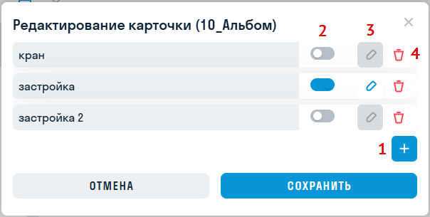
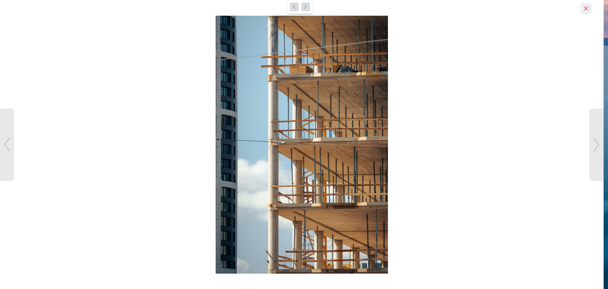
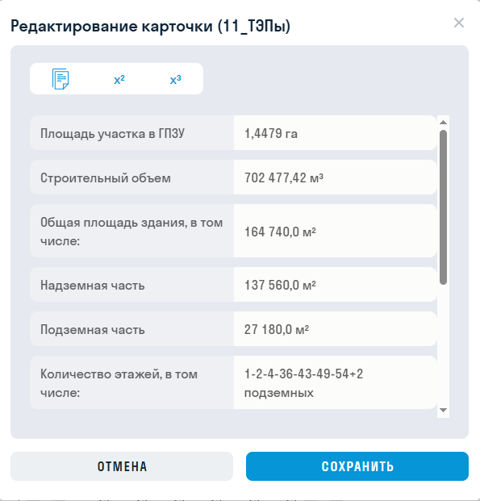
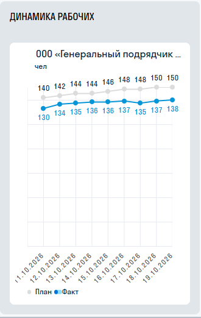
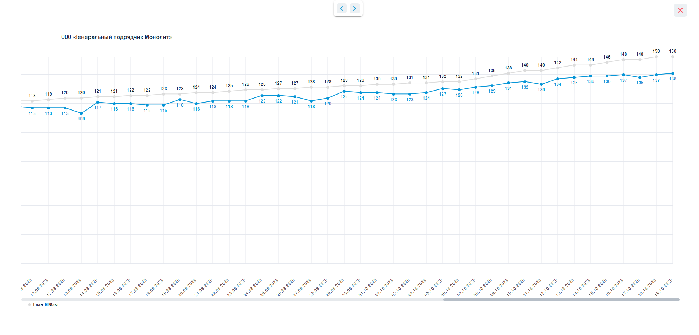
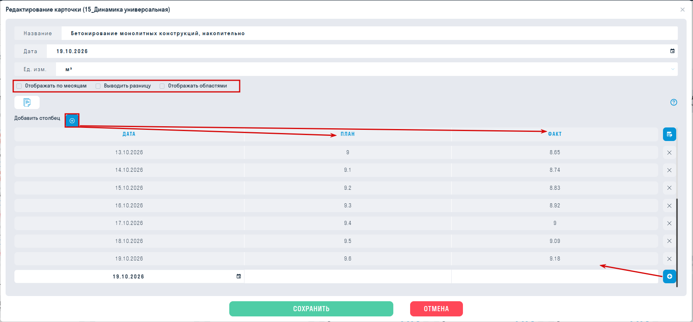

<sub>**[<   DASHBOARD. Все карточки](/ru/dash/cards)     **|**     [DASHBOARD. Карточки 20. Деньги    >](/ru/dash/cards-20)**</sub>
 
<summary style="font-size: 16px; color: #0D47A1; background: #E3F2FD; border-radius: 7px; border: 1px solid #64B5F6; display: flex; gap: 10px; padding: 5px 16px; display: block; margin-top: 10px;">
<span style="flex-grow: 1;"> <a href="/dash/cards-10/updates" onclick="event.stopPropagation();" style="color: inherit; text-decoration: none;">🔄 Что нового (история изменений этого функционала)</a></span>
</summary>

---

Карточки этой группы помогают представить общую информацию о проекте: фотографии, характеристики, риски, видеотрансляции и динамику показателей. Выберите карточку по тому, что нужно показать читателю.

| Если нужно | Подходящие карточки |
|---|---|
| Показать фотографии или материал с пояснениями | [10 — альбом](#card-10) для фотографий; [17 — отчёт](#card-17) для сочетания текста и изображений |
| Представить характеристики или готовую таблицу | [11 — ТЭПы](#card-11) для списка характеристик; [18 — таблица из DOCS](#card-18) для данных листа XLSX |
| Сравнить значения по датам | [14 — динамика рабочих](#card-14) для плана и факта численности; [15 — универсальная динамика](#card-15) для нескольких показателей |
| Сообщить о рисках, открыть камеру или показать готовность | [12 — риски](#card-12), [13 — видеотрансляция](#card-13), [16 — процент готовности](#card-16) |

Добавление карточек и [права на заполнение и редактирование](/dash/settings#card-access) описаны в настройках проекта. Ниже приведены особенности заполнения и просмотра каждой карточки.

# Вкладки{.tabset}

## 10_Альбом

### Фотографии проекта {#card-10}

Карточка объединяет фотографии в альбом — например, для фотоотчёта со строительной площадки. На превью показывается выбранная обложка, при открытии можно просмотреть все фотографии.


### Добавление фотографий и выбор обложки

1. Откройте заполнение карточки и нажмите «+», чтобы загрузить изображения.
2. Расположите фотографии в нужном порядке перетаскиванием строк списка.
3. Включите переключатель у фотографии, которую хотите показать на превью. Обложкой может быть одно изображение.
4. При необходимости обрежьте выбранную обложку кнопкой редактирования.
5. Сохраните карточку.



| Действие | Результат |
|---|---|
| Выбрать другую обложку | Меняется изображение превью и фотография, с которой начинается просмотр |
| Обрезать обложку | Меняется кадр на превью; внутри альбома остаётся исходная фотография |
| Удалить фотографию | Она исключается из альбома после сохранения изменений |

Если фотографии загружены, но превью пустое, проверьте выбор обложки: загрузка сама по себе её не назначает.

### Просмотр альбома

Нажмите на карточку, чтобы открыть альбом. Перелистывайте фотографии стрелками; на клавиатуре можно использовать ← и →.



## 11_ТЭПы

### Технико-экономические показатели {#card-11}

Карточка показывает основные характеристики проекта: площадь участка, строительный объём, этажность и другие показатели. Для каждой строки задаются название и значение вместе с единицей измерения.


### Заполнение показателей

Для заполнения требуется [право «Заполнение»](/dash/settings#card-access).

1. Откройте форму заполнения карточки.
2. В левом поле строки укажите название показателя, в правом — его значение: например, «Общая площадь» и «164 740 м²».
3. При необходимости используйте кнопки ² и ³: символ добавляется в поле, в котором находится курсор.
4. Сохраните карточку.



Доступно **11 строк**. Строка, у которой не заполнены ни название, ни значение, не показывается. Значения могут содержать текст и единицы измерения; итоги и суммы задайте самостоятельно.

### Вставка значений из Excel

Подготовьте два столбца: название и значение. Пример:

| Название показателя | Значение |
|---|---|
| Площадь участка | 1,4479 га |
| Строительный объём | 702 477,42 м³ |

Скопируйте только строки с показателями, без заголовков таблицы. В форме карточки нажмите кнопку вставки данных и вставьте скопированные ячейки.

> Вставка заменяет текущие показатели. Если скопировано больше 11 строк, используются первые 11.
{.is-warning}

### Заполнение из привязанной таблицы

Для [привязки Google Таблицы или XLSX](/dash/settings#planned-data) используется полный блок карточки со служебными строками. Он отличается от двух столбцов для вставки в форму.

<details>
<summary>Формат диапазона для привязки таблицы</summary>

|        |                              |                               |
|-----------------|------------------------------------|-------------------------------|
| Заголовок       | ТЭПЫ                               |                               |  
| Статус          |                TRUE                |                               |
| Url изображения |                                    |                               |
| Тип             | teps                               |                               |
|                 |                                    |                               |
|               0 | Площадь участка в ГПЗУ             | 1,4479 га                     |
|               1 | Строительный объем                 | 702 477,42 м³                 |
|               2 | Общая площадь здания, в том числе: | 164 740,0 м²                  |
|               3 | Надземная часть                    | 137 560,0 м²                  |
|               4 | Подземная часть                    | 27 180,0 м²                   |
|               5 | Количество этажей, в том числе:    | 1-2-4-36-43-49-54+2 подземных |
|               6 | Корпус - "Башня А"                 | 54 (h-190,00м)                |
|               7 | Корпус - "Башня В"                 | 49 (h-173,75м)                |
|               8 | Корпус - "Башня С"                 | 43 (h-151,55м)                |
|               9 | Корпус - "Башня D"                 | 36 (h-126,50м)                |
|              10 | Вместимость подземной автостоянки  | 662 м/м                       |
{.dense}

</details>

## 12_Риски

### Риски проекта и их важность {#card-12}

Карточка показывает внесённый пользователем список рисков с заголовками, описаниями и уровнем важности. Например, можно сообщить о задержке поставки или недостатке рабочих.


### Добавление и изменение рисков

1. В поле «Название» укажите общий заголовок карточки.
2. Нажмите «+», чтобы добавить риск.
3. Выберите важность: низкая, средняя или высокая.
4. Заполните заголовок риска и его описание.
5. Добавьте остальные риски и сохраните карточку.


| Поле | Что указать |
|---|---|
| Название карточки | Общую тему списка, например «Риски текущей недели» |
| Заголовок риска | Краткое описание ситуации, до 125 символов |
| Описание риска | Подробности и необходимые действия, до 1000 символов |

Чтобы изменить риск, откройте заполнение карточки и исправьте запись. Для удаления используйте кнопку удаления у нужного риска, затем сохраните изменения.

### Порядок отображения рисков

Сначала показываются риски высокой важности, затем средней и низкой. При одинаковой важности новые записи расположены раньше старых.

На превью отображаются первые четыре риска. Нажмите на карточку, чтобы прочитать весь список и полные описания.


## 13_Видеотрансляция

### Наблюдение за строительной площадкой {#card-13}

Карточка открывает видеотрансляцию с камеры. Выберите способ подключения по источнику ссылки:

| Источник | Что подготовить |
|---|---|
| RTSP | Адрес потока камеры, начинающийся с `rtsp://`; для переключения качества — отдельные адреса HD и SD |
| RTSP.ME | Ссылку на трансляцию сервиса RTSP.ME и изображение для превью |


> Для подключения RTSP используется видеокодек H.264. Если камера работает через внешний веб-плеер, возможность его встраивания рассмотрите в описании [карточки 90 «Интеграция»](/dash/cards-90).
{.is-warning}

Вкладка RTSP доступна, если этот способ подключения включён в вашей системе. Если вкладки нет, уточните её доступность у администратора.

### Подключение и просмотр {.tabset}

#### Подключение RTSP

1. Откройте вкладку RTSP в форме заполнения карточки.
2. В поле «Название» укажите название камеры или зоны наблюдения.
3. Заполните «HD стрим» и/или «SD стрим» адресами потоков камеры. Для работы достаточно одной ссылки.
4. Включите «Отображать трансляцию» на этой вкладке и сохраните карточку.


Открытие вкладки в форме не выбирает источник для просмотра. Карточка использует тот источник, у которого включено «Отображать трансляцию».

#### Подключение RTSP.ME

1. Откройте вкладку RTSP.ME в форме заполнения карточки.
2. Укажите название и ссылку на трансляцию RTSP.ME в поле трансляции.
3. В поле «Превью» выберите изображение для карточки.
4. Включите «Отображать трансляцию» на этой вкладке и сохраните карточку.


Если сервис предлагает отдельную ссылку для встраивания, используйте её. Возможность просмотра зависит от доступности трансляции и разрешения сервиса показывать её во встроенном плеере.

#### Просмотр и проверка трансляции

Нажмите на карточку, чтобы открыть трансляцию. В RTSP-просмотре флажок **HD** переключает высокое и низкое качество. Переключение доступно, когда заполнены обе ссылки — HD и SD.


Изображение на превью сохраняется отдельно от видеопотока. В RTSP-просмотре при наличии кнопки с камерой можно сохранить текущий кадр для превью; для RTSP.ME изображение задаётся в форме заполнения.

| Что происходит | Что проверить |
|---|---|
| Карточка не сохраняется | Выбран ли активный источник через «Отображать трансляцию», заполнена ли ссылка нужного типа |
| HD не переключается | Указаны ли оба адреса — HD и SD |
| RTSP не загружается | Адрес потока, H.264 и доступность камеры для сервиса трансляции; при необходимости привлеките администратора камеры |
| RTSP.ME показывает пустое окно или ошибку | Открывается ли ссылка отдельно, разрешён ли просмотр и встраивание этой трансляции |
| Видео изменилось, а превью осталось прежним | Сохранён ли новый кадр или загружено ли новое изображение превью |

## 14_Динамика рабочих

### Плановая и фактическая численность рабочих {#card-14}

Карточка сравнивает плановое и фактическое количество рабочих по датам. План и факт можно заполнить вручную; фактическую численность также можно получить из JSON-файла СКУД — системы контроля и управления доступом.



### Заполнение и просмотр графика {.tabset}

#### Ручной ввод и вставка из Excel

<span id="nastroyka"></span>

1. Откройте форму заполнения. Укажите компанию и дату карточки.
2. Добавьте строки с датой, плановым и фактическим числом работников.
3. Для изменения или удаления существующей строки используйте её кнопки редактирования или удаления.
4. Сохраните карточку.


Для вставки из Excel подготовьте три столбца в таком порядке:

| Дата | План | Факт |
|---|---|---|
| 10.11.2026 | 120 | 114 |
| 11.11.2026 | 125 | 118 |

Скопируйте строки данных без заголовков и служебных строк. Нажмите кнопку вставки таблицы в форме карточки и вставьте данные. Используйте даты вида `10.11.2026`.

Вставка **добавляет строки** к существующим. Повторная вставка тех же дат создаёт дубли: перед сохранением проверьте, что каждой дате соответствует одна строка.

При подключённом файле СКУД вставка из буфера недоступна. План можно изменить в строках таблицы; дата и факт импортированных строк задаются источником.

**Для привязки таблицы** используйте полный блок карточки со служебными строками — это другой формат. Порядок подключения описан в [настройках проекта](/dash/settings#planned-data).

<details>
<summary>Формат диапазона для привязки таблицы</summary>

|        |                              |                               | |
|-----------------|------------------------------------|-------------------------------|-|
| Заголовок       |         14 |     |     |
| Статус          |    TRUE    |     |     |
| Url изображения |            |     |     |
| Тип             | dynamics2  |     |     |
|                 |            |     |     |
| Компания        |            |     |     |
| Дата            | 12.12.2025 |     |     |
| По месяцам      |    FALSE   |     |     |
| Данные          |            |     |     |
|                 | 02.11.2025 | 126 | 114 |
|                 | 26.10.2025 | 134 | 148 |
|                 | 19.10.2025 | 150 | 120 |
|                 | 12.10.2025 | 100 | 150 |

</details>

#### Импорт СКУД из DOCS

<span id="import_dannyh_skud_iz_docs"></span>

Загрузите JSON-файл в DOCS проекта. Минимальный пример содержимого:

```json
[
  { "contractor": "Подрядчик А", "employeeCount": 80, "date": "10.11.2026" },
  { "contractor": "Подрядчик Б", "employeeCount": 34, "date": "10.11.2026" }
]
```

| Поле | Что передать |
|---|---|
| `contractor` | Название подрядчика |
| `employeeCount` | Численность работников, неотрицательное число |
| `date` | Дату в формате **ДД.ММ.ГГГГ** |

1. В форме заполнения нажмите кнопку импорта из DOCS и выберите JSON-файл.
2. Выберите подрядчиков. Пустой выбор означает всех подрядчиков из файла.
3. Подтвердите импорт и сохраните карточку.


В примере факт за 10.11.2026 составит **114 человек**, если выбраны оба подрядчика, и **80 человек**, если выбран только подрядчик А.

##### Обновление и смена файла СКУД

После загрузки новой версии файла нажмите «Обновить данные» в форме заполнения карточки и сохраните результат.

| При обновлении | Что произойдёт |
|---|---|
| Для даты есть данные выбранных подрядчиков | Факт будет получен из СКУД; ранее введённый план этой даты сохранится |
| Добавлена новая дата | Появится строка с фактом; план новой даты можно заполнить вручную |
| Вручную добавлена дата, которой нет в импортированной выборке | Ручная строка сохранится |
| Прежняя импортированная дата отсутствует в новой выборке | Прежняя импортированная строка не сохраняется отдельно от выборки |
| Выбран другой файл | Подрядчиков потребуется выбрать заново |

Импорт учитывает версии выбранного файла DOCS. Если один подрядчик и одна дата встречаются в нескольких версиях, используется запись из более новой версии. Поэтому строка, удалённая только из последней версии JSON, может остаться в данных из предыдущих версий. Для исправления численности проверьте записи нужного подрядчика и даты в источнике.

У импортированной строки дата и факт недоступны для ручного изменения; план редактируется. Некорректные записи пропускаются с предупреждением — проверьте обязательные поля, дату и численность.

#### Настройка и чтение графика

<span id="otobrazhenie_kartochki_v_rezhime_polzovatelya"></span>

| Настройка | Как влияет на график |
|---|---|
| «Компания» | Подпись графика |
| «Дата» и «Учитывать дату карточки» | При включённом флажке факт показывается до даты карточки включительно; более поздние строки остаются в таблице |
| «Отображать по месяцам» | Меняет подписи дат на месяцы; значения не суммируются за месяц |

На обычном превью показаны последние девять дат. Нажмите на карточку, чтобы открыть весь график; длинный ряд можно прокручивать по горизонтали.



| Что происходит | Что проверить |
|---|---|
| Нет факта после определённой даты | Дату карточки и флажок «Учитывать дату карточки» |
| Карточка не сохраняется после вставки | Корректность дат и отсутствие двух строк на одну дату |
| Численность СКУД отличается от ожидаемой | Подрядчиков, формат JSON и версии подключённого файла |
| Факт или дата строки не редактируются | Получена ли строка импортом СКУД; такие значения исправляются в источнике |

## 15_Динамика универсальная

### Изменение показателей по датам {#card-15}

Карточка сравнивает несколько показателей на одном графике — например, количество техники разных видов или число актов в работе и на подписи. Для каждой даты задаются значения показателей с общей единицей измерения.


### Таблица и график {.tabset}

#### Заполнение таблицы

<span id="nastroyka_2"></span>

1. Укажите название, дату карточки и единицу измерения.
2. Кнопкой «Добавить столбец» создайте показатели и задайте им разные названия.
3. В нижней строке таблицы выберите дату и заполните значения показателей, затем нажмите «+» справа.
4. Добавьте остальные даты и сохраните карточку.



Чтобы переименовать или удалить показатель, нажмите на заголовок его столбца. Удаление столбца убирает значения этого показателя для всех дат. Для изменения или удаления отдельной строки используйте кнопки этой строки.

##### Вставка данных из Excel

Сначала создайте столбцы показателей в карточке. Подготовьте данные в том же порядке: **дата → первый показатель → второй показатель → …**.

| Дата | Экскаваторы | Краны |
|---|---|---|
| 10.11.2026 | 6 | 14 |
| 17.11.2026 | 8 | 12 |

Скопируйте строки данных без заголовков. Нажмите кнопку вставки данных в форме и вставьте скопированные ячейки.


Вставка добавляет строки к уже заполненным. Названия столбцов из Excel не создают показатели автоматически: значения распределяются по порядку столбцов карточки.

| Пустая ячейка | Как обрабатывается |
|---|---|
| При ручном заполнении | Значение остаётся незаполненным и в таблице обозначается «−» |
| При вставке из Excel | Подставляется 0 |

Если важно сохранить отсутствие значения, проверьте такие ячейки после вставки и очистите их вручную.

**Для привязки таблицы** нужен полный блок карточки со служебными строками. Порядок подключения описан в [настройках проекта](/dash/settings#planned-data).

<details>
<summary>Формат диапазона для привязки таблицы</summary>

|        |                              |                               |    |
|-----------------|------------------------------------|-------------------------------|----|
| Заголовок       |         15 |           |        |
| Статус          |    TRUE    |           |        |
| Url изображения |            |           |        |
| Тип             | dynamics3  |           |        |
|                 |            |           |        |
| Название        |            |           |        |
| Дата            | 12.12.2025 |           |        |
| По месяцам      |    FALSE   |           |        |
| Разница         |    FALSE   |           |        |
| Ед. изм.        | шт         |           |        |
| Данные          |            |           |        |
|                 |            | Машинисты | Маляры |
|                 | 05.12.2025 |         6 |     14 |
|                 | 12.12.2025 |         8 |     12 |
|                 |            |           |        |

</details>

#### Настройка и чтение графика

<span id="otobrazhenie_kartochki_v_rezhime_polzovatelya_2"></span>
<span id="ispolzovanie"></span>

| Настройка | Результат |
|---|---|
| «Отображать по месяцам» | На линейном графике вместо полных дат показываются месяцы; значения не суммируются за месяц |
| «Выводить разницу» | Справа от линейного графика выводится изменение между последней и предыдущей датами для первых трёх показателей |
| «Отображать областями» | Показатели отображаются цветными областями друг над другом; общая высота соответствует их сумме на дату |

Настройки месяцев и разницы применяются к линейному графику. При отображении областями они не влияют на график.

##### Как считается разница

**Разница = значение на последнюю дату − значение на предыдущую дату.**

В примере выше для экскаваторов получится **8 − 6 = +2**, для кранов — **12 − 14 = −2**. Это изменение между двумя последними датами таблицы, а не обязательно за неделю или месяц.

При вычислении разницы незаполненное значение считается нулём. Если одна из двух ячеек пуста, проверьте, соответствует ли показанная разница смыслу ваших данных.

##### Просмотр значений

На обычном превью показаны последние девять дат. Откройте карточку, чтобы увидеть весь ряд; для длинного графика используйте горизонтальную прокрутку.


В режиме областей наведите указатель на график, чтобы увидеть значение показателя на выбранную дату. Если в таблице несколько строк на одну дату, значения этой даты в областях суммируются. Для однозначного сравнения удобнее заполнять одну строку на дату.

| Что происходит | Что проверить |
|---|---|
| Значения оказались под другим показателем | Порядок столбцов перед вставкой |
| На графике появился ноль вместо отсутствующего значения | Не была ли пустая ячейка вставлена из Excel |
| Разница неожиданно большая | Значения на двух последних датах, включая пустые ячейки |
| Переключатели месяцев и разницы не меняют вид | Не включено ли «Отображать областями» |

## 16_Процент готовности объекта

### Плановая и фактическая готовность {#card-16}

Карточка показывает готовность объекта или отдельного вида работ в процентах: план, факт и оставшуюся часть. Плановую и фактическую готовность задаёт пользователь.


### Заполнение процентов {#nastroyka_3}

1. Укажите название объекта или вида работ.
2. Введите плановый и фактический проценты готовности — от 0 до 100.
3. Включите «Показывать дробные значения», если нужна точность до двух знаков после запятой. Без флажка проценты отображаются округлёнными до целого.
4. Сохраните карточку.


### Как читать результат {#otobrazhenie_kartochki_v_rezhime_polzovatelya_3}

| Элемент | Что означает |
|---|---|
| Куб целиком | Полный объём работ — 100% |
| Синий цвет | Фактическую готовность в пределах плана |
| Серый цвет | Плановый уровень готовности |
| Голубой цвет | Часть фактической готовности сверх плана |
| «Осталось» | 100% минус фактическая готовность |

Например, при плане **60%** и факте **45%** осталось выполнить **55%**, а отставание от плана составляет **15 процентных пунктов**. Значение «Осталось» не равно разнице между планом и фактом.

Если факт выше плана, превышение выделяется голубым:


## 17_Отчет

### Текст и изображения в одной карточке {#card-17}

Карточка позволяет собрать пояснительную записку, отчёт о ходе работ или другой материал из текстовых блоков и изображений. Это содержимое одной карточки внутри отчёта DASHBOARD.


### Создание текста и изображений {#nastroyka_4}

1. Откройте форму заполнения карточки.
2. Кнопкой добавления текста создайте блок и введите текст.
3. Кнопкой добавления изображения загрузите иллюстрацию. Формат SVG не поддерживается.
4. Добавьте остальные блоки и расположите их в нужном порядке перетаскиванием.
5. Сохраните карточку.


### Изменение блоков

| Действие | Как выполнить |
|---|---|
| Изменить текст | Нажмите кнопку редактирования текстового блока, исправьте содержимое и завершите ввод |
| Заменить изображение | Используйте кнопку выбора другого изображения у нужного блока |
| Обрезать изображение | Откройте обрезку кнопкой редактирования изображения и сохраните кадр |
| Изменить порядок | Перетащите блок на новое место |
| Удалить блок | Нажмите кнопку удаления и подтвердите действие |

После изменений сохраните карточку. Обрезка заменяет изображение самого блока: новый кадр будет виден и на превью, и в раскрытой карточке.

### Просмотр материала {#otobrazhenie_kartochki_v_rezhime_polzovatelya_4}

<span id="ispolzovanie_2"></span>

На превью текст может быть сокращён. Нажмите на карточку, чтобы прочитать материал целиком и увидеть изображения в порядке, заданном при заполнении.


## 18_Таблица из DOCS

### Просмотр листа XLSX {#card-18}

Карточка показывает данные выбранного листа XLSX-файла из DOCS. На превью помещаются первые четыре столбца и часть строк; при раскрытии можно просмотреть всю таблицу, начиная с указанной ячейки.


### Выбор файла и начала таблицы {#nastroyka_5}

1. Загрузите XLSX-файл в DOCS проекта. У пользователя, который подключает и открывает источник, должен быть доступ к файлу — см. [права доступа](/dash/settings#card-access).
2. В форме заполнения карточки выберите «Файл» и нужный лист книги.
3. В полях «С какого столбца» и «С какой строки» укажите начало таблицы. Нумерация начинается с 1: столбец **2** и строка **3** соответствуют ячейке **B3**.
4. Убедитесь, что выбранная начальная строка содержит заголовки всех нужных столбцов.
5. Сохраните карточку.

Первая строка выбранной области используется как заголовки, следующие — как данные. Если начать с обычной строки данных, её значения станут названиями столбцов.

Карточка отображает данные листа в собственной таблице; оформление Excel не переносится как готовое изображение.

### Ширина столбцов и перенос текста

| Настройка | Как используется |
|---|---|
| Ширина первых четырёх столбцов, % | Задаёт их ширину на превью; сумма не должна превышать 100% |
| Ширина столбца 0% | Скрывает этот столбец на превью |
| Перенос текста | Позволяет показывать длинные значения в несколько строк |

Эти настройки помогают разместить данные на превью. Откройте карточку, чтобы увидеть остальные строки и столбцы.

### Изменение файла и проверка данных

При открытии карточка загружает текущую версию выбранного файла из DOCS. Данные превью сохраняются отдельно, поэтому после изменения файла они могут отличаться от раскрытой таблицы.

Чтобы обновить превью планового отчёта, заново откройте форму заполнения карточки, дождитесь загрузки книги, проверьте выбранный лист и сохраните карточку. Для вкладки «Онлайн» используйте [общие правила обновления превью](/dash/settings#online-refresh).

Если изменилось имя листа или вместо новой версии создан другой файл, откройте форму заполнения, заново выберите источник и лист, проверьте начальную ячейку и сохраните карточку.

| Что происходит | Что проверить |
|---|---|
| Список листов пуст | Доступен ли выбранный XLSX-файл для загрузки |
| Таблица пустая | Есть ли выбранный лист, верны ли начальная строка и столбец, есть ли данные ниже заголовков |
| Не видны все столбцы | Содержит ли начальная строка заголовки всех нужных столбцов; на превью также проверьте ширины и ограничение четырьмя столбцами |
| При раскрытии появляется ошибка | Существует ли файл, доступна ли его текущая версия этому пользователю |
| Превью и раскрытая таблица различаются | Когда обновлялось превью и какая версия XLSX загружена в DOCS |

#
<sub>**[<   DASHBOARD. Все карточки](/ru/dash/cards)     **|**     [DASHBOARD. Карточки 20. Деньги    >](/ru/dash/cards-20)**</sub>


