<sub>**[<   DASHBOARD. Карточки 10. Общие](/ru/dash/cards-10)     **|**     [DASHBOARD. Карточки 30. Сроки    >](/ru/dash/cards-30)**</sub>

<summary style="font-size: 16px; color: #0D47A1; background: #E3F2FD; border-radius: 7px; border: 1px solid #64B5F6; display: flex; gap: 10px; padding: 5px 16px; display: block; margin-top: 10px;">
<span style="flex-grow: 1;"> <a href="/dash/cards-20/updates" onclick="event.stopPropagation();" style="color: inherit; text-decoration: none;">🔄 Что нового (история изменений этого функционала)</a></span>
</summary>

---

Денежные карточки показывают освоение бюджета, расчёты по работам и движение денег по месяцам. Они используются в плановом отчёте проекта.

| Что нужно показать | Карточка |
|---|---|
| Долю бюджета по плану и факту на дату отчёта | [20 — Процент освоения денег](#card-20) |
| Стоимость работ, закрытие по КС-2, аванс и удержания на одной диаграмме | [21 — Общая накопительная по деньгам](#card-21) |
| Остатки по работам и авансу, сумму к оплате и оплату за период | [21_2 — Общая накопительная по деньгам 2](#card-21-2) |
| План и факт по месяцам, в том числе факт из выгрузок 1С | [22 — Освоение денег по месяцам](#card-22) |
| План и факт по месяцам с отдельной линией прогноза | [23 — Освоение денег по месяцам с прогнозом](#card-23) |
| План финансирования, реальные поступления, затраты и их разницу | [24 — План-факт финансирования](#card-24) |

Для ручного ввода и вставки из Excel требуется право «Заполнение». Если карточке уже назначен диапазон, меняйте значения в источнике и синхронизируйте их. См. [права на заполнение](/dash/settings#card-access) и [способы подключения таблиц](/dash/settings#planned-data).

# Вкладки{.tabset}

## 20_Процент освоения денег
<span id="card-20"></span>

Карточка показывает, какую долю общей суммы планировали освоить и сколько освоили по факту. Её можно использовать для всего объекта, отдельного подрядчика или вида работ.


### Какие суммы указать

1. В поле **«Название»** укажите объект, подрядчика или вид работ.
2. Введите плановую и фактическую суммы в поля **«План»** и **«Факт»**.
3. В поле **«Всего»** укажите общую сумму, соответствующую 100%. Используйте одну валюту и размерность для всех трёх сумм, затем выберите **«Ед. изм.»**.
4. При необходимости включите **«Показывать дробные значения»** для процентов с точностью до двух знаков. Сохраните карточку.


### Как считаются проценты

Серое кольцо показывает **План ÷ Всего × 100%**, синее — **Факт ÷ Всего × 100%**. Рядом указаны сами суммы. Если проценты выглядят неверно, проверьте, что «Всего» больше нуля, а план и факт введены как денежные суммы.

> При общей сумме 100 000 000 ₽, плане 40 000 000 ₽ и факте 30 000 000 ₽ серое кольцо покажет 40%, синее — 30%.
{.is-info}

### Вставка из Excel

Нажмите **«Вставить данные из таблицы»** и вставьте одну строку из пяти ячеек в порядке **Название → План → Факт → Всего → Ед. изм.**. Копируйте только значения. После вставки проверьте поля и флажок дробных процентов, затем сохраните карточку.

```text
Монолит	40000000	30000000	100000000	₽
```

## 21_Общая накопительная по деньгам
<span id="card-21"></span>

Карточка показывает накопительные расчёты по договору и данные к оплате за выбранный период. Цветные полосы помогают различить аванс, закрытие работ, удержания и остаток работ. Для сводки с отдельными строками «Незакрытый аванс» и «Остаток к оплате» используйте [карточку 21_2](#card-21-2).


### Накопительные суммы и отчётный период

Укажите название, дату и единицу измерения. В верхнем блоке формы введите суммы по договору на эту дату.

| Поле | Что указать |
|---|---|
| Всего | Общую стоимость работ |
| Аванс | Общую сумму выданного аванса |
| Всего закрыто по КС-2 | Стоимость работ, закрытых по КС-2 на указанную дату |
| Закрыто в счет аванса | Часть аванса, зачтённую в счёт выполненных работ |
| Гарантийное удержание | Сумму гарантийного удержания на дату |
| Удержано по Предписаниям | Сумму удержаний по предписаниям на дату |

В блоке отчётного периода заполните **«К оплате за»**, например «Ноябрь 2026», **«Предъявлено к закрытию»** и **«Рекомендовано к удержанию»**. «К оплате за» — текст в заголовке блока. Суммы за этот период указываются отдельно.


> Переключатель скрытия строки «Удержано по Предписаниям» обнуляет сумму в форме. Если строку нужно вернуть, введите сумму заново.
{.is-warning}

### Как читать сводку

Строка **«Остаток работ»** показывает разницу между общей стоимостью и суммой закрытия по КС-2. Например, при стоимости 100 млн ₽ и закрытии на 60 млн ₽ остаток работ составит 40 млн ₽. Отдельные полосы выделяют части общей диаграммы, относящиеся к соответствующему показателю.

### Вставка из Excel

1. Откройте пример заполнения в форме карточки и при необходимости скачайте его кнопкой **«Экспорт»**.

   

2. Заполните столбец **«Значение»** в порядке из примера. Копируйте 13 ячеек без заголовка и столбца с названиями полей.

   | Порядок | Значение |
   |---|---|
   | 1–4 | Дата в формате ДД.ММ.ГГГГ, название, общая стоимость, аванс |
   | 5–8 | Закрыто по КС-2, закрыто в счёт аванса, гарантийное удержание, удержано по предписаниям |
   | 9–13 | Подпись периода, предъявлено к закрытию, рекомендовано к удержанию, единица измерения, скрытие удержания (`true` или `false`) |

3. Нажмите **«Вставить данные из таблицы»**. Вставка заменяет значения в форме. Проверьте их перед сохранением.

   

   

### Привязка к таблице

Для именованного диапазона используйте полный блок, полученный через «Привязку». В нём есть служебные строки, а поля идут в другом порядке, чем в столбце для вставки. См. [настройку привязки](/dash/settings#planned-data).

<details>
<summary>Формат диапазона для привязки таблицы</summary>


|        |                              |
|-----------------------------------|------------|
| Заголовок                         |         21 |
| Статус                            |    TRUE    |
| Url изображения                   |            |
| Тип                               | money      |
|                                   |            |
| Название                          | Монолит    |
| Дата                              | 12.12.2025 |
| Ед. изм.                          | ₽          |
| Закрыто в счет аванса             |      90000 |
| К оплате за                       | Январь     |
| Гарантийное удержание             |      10000 |
| KS-2                              |      80000 |
| Удержано по Предписаниям          |      15000 |
| Предъявлено к закрытию            |      70000 |
| Рекомендовано к удержанию         |      24000 |
| Общая стоимость                   |     150000 |
| Аванс всего                       |     150000 |
| Скрыть "Удержано по предписаниям" |    FALSE   |
{.dense}

</details>

## 21_2_Общая накопительная по деньгам 2
<span id="card-21-2"></span>

Карточка показывает накопительные суммы по договору и отдельную сводку за отчётный период. По сравнению с [карточкой 21](#card-21) здесь есть незакрытый аванс, остаток к оплате, отдельные поля суммы к оплате и фактической оплаты за период.

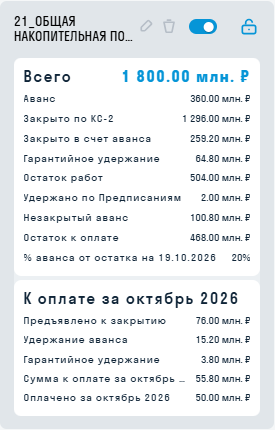

### Какие значения заполнить

| Блок | Что указать |
|---|---|
| Название и дата | Объект или договор и дату, на которую собраны накопительные данные |
| «Всего» | Общую стоимость, аванс, сумму закрытия по КС-2, закрытие в счёт аванса и удержания по состоянию на дату |
| «Отчётный период» | Подпись в поле «К оплате за», предъявленную сумму, удержание аванса и гарантийное удержание за этот период |
| «Сумма к оплате за…» и «Оплачено за…» | Сумму к оплате и фактическую оплату за период. Введите оба значения отдельно |
| «% аванса от остатка» | Дополнение к подписи, например «на конец ноября», и готовый процент от 0 до 100 |

Одинаково названные поля **«Гарантийное удержание»** относятся к разным данным. В блоке «Всего» укажите накопленную сумму, в блоке периода — удержание за указанный период. Если скрыть строку «Удержано по Предписаниям», её сумма обнулится.

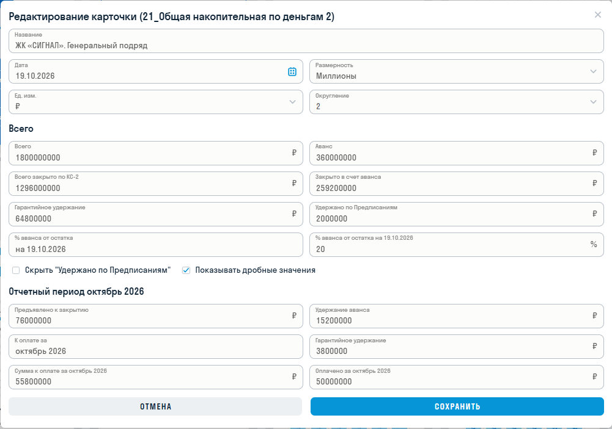

### Как считаются остатки

| Показатель | Расчёт |
|---|---|
| Остаток работ | Всего − закрыто по КС-2 |
| Незакрытый аванс | Аванс − закрыто в счёт аванса |
| Остаток к оплате | Всего − аванс − (закрыто по КС-2 − накопительное гарантийное удержание − закрыто в счёт аванса) |

> Если общая стоимость 150 млн ₽, аванс 30 млн ₽, закрыто по КС-2 80 млн ₽, закрыто в счёт аванса 18 млн ₽, а гарантийное удержание 4 млн ₽, карточка покажет 70 млн ₽ остатка работ, 12 млн ₽ незакрытого аванса и 62 млн ₽ остатка к оплате.
{.is-info}

### Размерность и округление

Введите суммы в полных единицах выбранной валюты. **«Размерность»** задаёт, как показать суммы — в единицах, тысячах, миллионах или миллиардах. **«Округление»** задаёт от 0 до 3 знаков после запятой для отображаемых сумм. Например, 5 250 000 ₽ при размерности «Миллионы» и округлении до двух знаков отобразится как 5,25 млн ₽.

### Заполнение из привязанной таблицы

1. Во вкладке «Привязка» скопируйте полный блок карточки.

   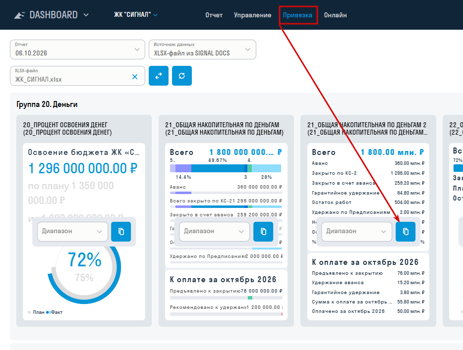

2. Вставьте блок в XLSX или Google Таблицу. Заполните значения, сохранив порядок строк. Для размерности в таблице используются значения `units`, `thousands`, `millions` и `billions`.

   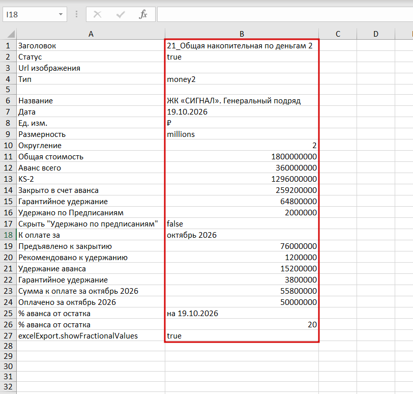

3. Создайте именованный диапазон на весь блок и синхронизируйте карточку. Порядок подключения источника приведён в [настройках проекта](/dash/settings#planned-data).

   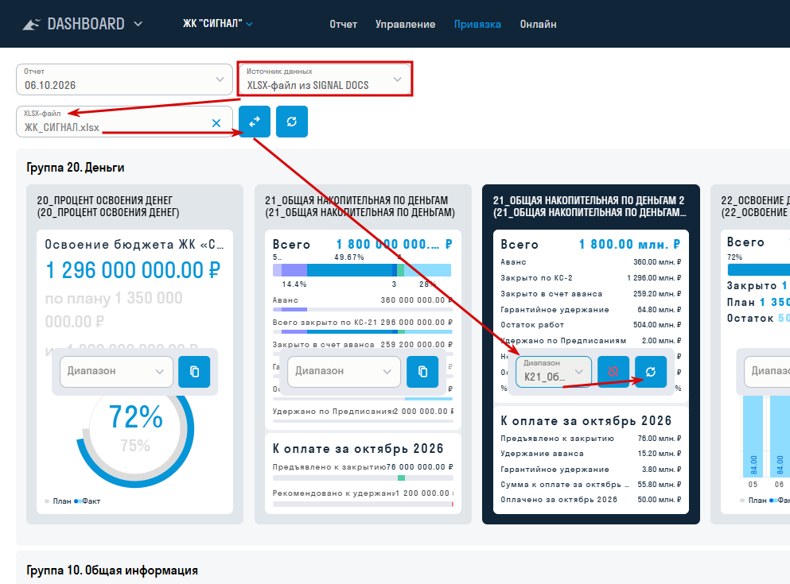

<details>
<summary>Формат диапазона для привязки таблицы</summary>


| Параметр | Значение |
|---|---|
| Заголовок | 21_2 |
| Статус | true |
| Url изображения | |
| Тип | money2 |
| | |
| Название | Монолит |
| Дата | 12.12.2025 |
| Ед. изм. | ₽ |
| Размерность | millions |
| Округление | 2 |
| Общая стоимость | 150000000 |
| Аванс всего | 30000000 |
| KS-2 | 80000000 |
| Закрыто в счет аванса | 18000000 |
| Гарантийное удержание | 4000000 |
| Удержано по Предписаниям | 1500000 |
| Скрыть "Удержано по предписаниям" | false |
| К оплате за | Ноябрь 2025 |
| Предъявлено к закрытию | 7000000 |
| Рекомендовано к удержанию | 0 |
| Удержание аванса | 1400000 |
| Гарантийное удержание | 350000 |
| Сумма к оплате за Ноябрь 2025 | 5250000 |
| Оплачено за Ноябрь 2025 | 4000000 |
| % аванса от остатка | на конец периода |
| % аванса от остатка | 20 |
| Показывать дробные значения | false |
{.dense}

</details>

## 22_Освоение денег по месяцам
<span id="card-22"></span>

Карточка сравнивает план и факт освоения денег по месяцам. План можно заполнить вручную, а факт — ввести в таблицу или собрать из выгрузок 1С в DOCS.

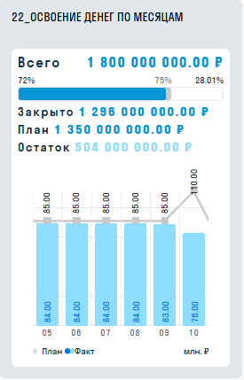

### Работа с карточкой{.tabset}

#### Ручное заполнение и Excel

1. Укажите **«Всего»** и **«Ед. изм.»**. Вводите «Всего», план и факт в полных единицах одной валюты.
2. В поле **«Текущая дата»** выберите отчётный месяц для итогов. Если заполняете таблицу вставкой, также задайте **«Дата начала»** и **«Дата окончания»**.
3. Добавьте по одной строке на месяц. Укажите суммы за каждый месяц и сохраните карточку.

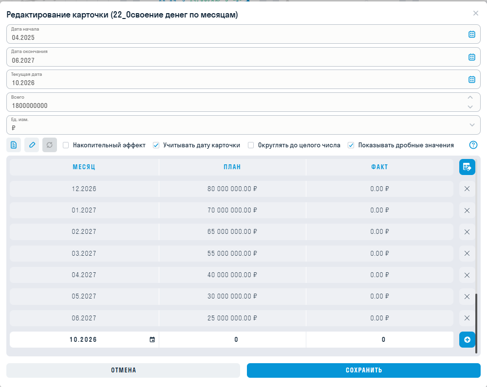

**Вставка из Excel**

1. Задайте начальный и конечный месяцы. Для одного месяца добавьте строку вручную.
2. Скопируйте два столбца **«План» → «Факт»** без заголовков и столбца дат. Начните с первого месяца выбранного периода.
3. Нажмите **«Вставить данные из таблицы»**. DASH заменит строки в форме и назначит месяцы начиная с даты начала. Если строк меньше, чем месяцев, оставшиеся месяцы заполнятся нулями. Проверьте таблицу и сохраните.

[Шаблон «Деньги по месяцам»](https://docs.sgnl.pro/s/f/4d8f615a-27fd-4b1a-a631-c7529eb99f03)

Если дата начала — октябрь 2026, первая строка ниже попадёт в октябрь, вторая — в ноябрь.

```text
10000000	8000000
12000000	9000000
```

#### Импорт из 1С

1. Загрузите выгрузку в папку проекта в DOCS. Вам потребуется доступ к папке и файлам.
2. В форме заполнения откройте **«Импорт из 1С»** и выберите папку. После загрузки можно выбрать **«Тип документа»** и **«Компания»**. Списки формируются из выгрузки. Пустой фильтр включает все значения по этому полю.
3. Подтвердите импорт. Проверьте месяцы и суммы факта, внесите план и сохраните карточку.

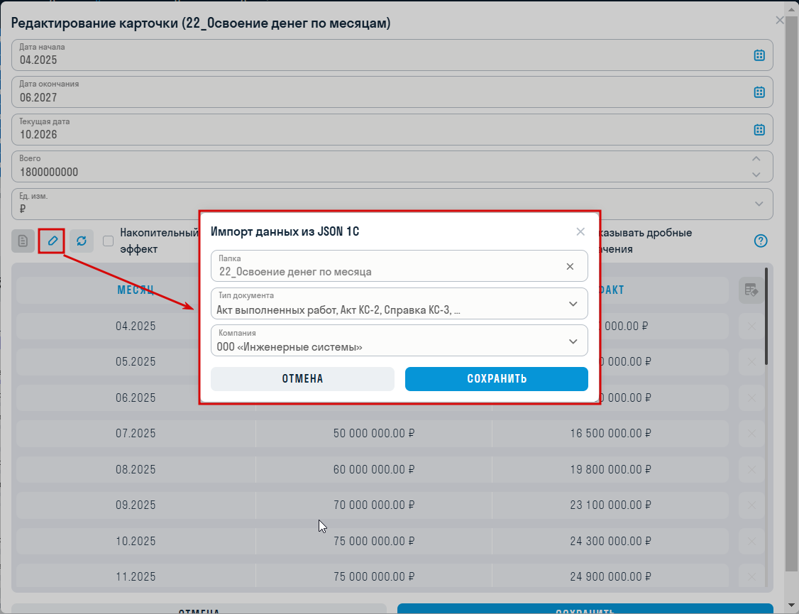

##### Формат выгрузки

Подходят файлы `.json` и `.txt` с JSON-массивом. На каждую запись укажите дату документа `docDate`, контрагента `partnerName`, сумму числом `docSum` и тип документа `docType`. Для даты используйте формат `ГГГГ-ММ-ДД`.

```json
[
  {"docDate": "2026-11-02", "partnerName": "Подрядчик А", "docSum": 100000, "docType": "Оплата"},
  {"docDate": "2026-11-12", "partnerName": "Подрядчик Б", "docSum": 50000, "docType": "Оплата"}
]
```

DASH читает последние версии подходящих файлов из выбранной папки и её доступных подпапок. После отбора по фильтрам он складывает суммы документов за каждый месяц. В примере при выборе обеих компаний факт за ноябрь составит 150 000.

> Если одни и те же документы есть в нескольких файлах, их суммы будут учтены повторно. При исправлении выгрузки загружайте новую версию исходного файла. Для нескольких файлов проверьте, что документы в них не повторяются.
{.is-warning}

##### Как обновить факт и сохранить план

Загрузите данные в DOCS и нажмите кнопку обновления рядом с импортом 1С. Проверьте результат и сохраните карточку. Для изменения состава данных откройте «Импорт из 1С» и измените папку или фильтры.

| Что изменилось | Что будет со строкой месяца |
|---|---|
| Месяц снова есть в выгрузке после фильтрации | Факт заменится новым итогом, прежний план за этот месяц сохранится |
| Ранее импортированный месяц исчез из выгрузки или исключён фильтром | Строка удалится вместе с её планом |
| Ручной месяц отсутствует в импорте | Ручная строка сохранится |
| Ручной месяц появился в импорте | План сохранится, факт будет взят из 1С, строка станет импортированной |

В импортированной строке можно менять план. Месяц и факт обновляются из файлов. Пока выбрана папка 1С, вставка из буфера и очистка всей таблицы недоступны.

Если не появились типы документов или компании, проверьте доступ к файлам и поля `docType` и `partnerName`. Если сумма меньше ожидаемой, проверьте фильтры и предупреждения об ошибках в записях. При завышенной сумме проверьте повторы документов в отдельных файлах.

#### Чтение графика и итогов

**«Текущая дата»** определяет, по какой месяц включительно суммируются план и факт. Строка **«Закрыто»** показывает накопленный факт по этот месяц, а **«Осталось»** — разницу между «Всего» и этим фактом. Если факт превысил общую сумму, остаток показан как ноль.

На превью видно до шести последних строк за текущий и предыдущие месяцы. Откройте карточку, чтобы увидеть полный график. Подписи на графике показывают суммы в миллионах выбранной валюты.

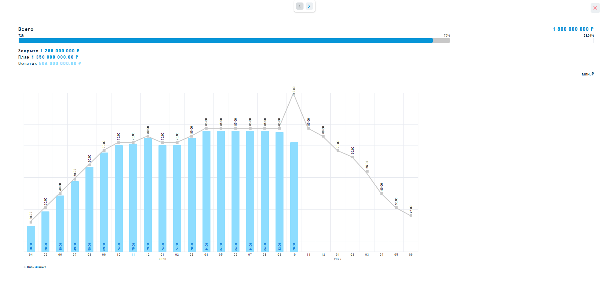

| Настройка | Что изменится |
|---|---|
| Накопительный эффект | Каждая точка графика покажет сумму с начала ряда. При факте 8 млн ₽ за октябрь и 9 млн ₽ за ноябрь значения графика составят 8 и 17 млн ₽ |
| Учитывать дату карточки | В раскрытом графике факт после текущего месяца скрывается. План остаётся видимым |
| Округлять до целого числа | Подписи сумм на графике показываются без десятичных знаков |
| Показывать дробные значения | В процентных показателях отображается до двух знаков после запятой |

При накопительном эффекте вводите в таблицу суммы **за отдельный месяц**. DASH сам сложит их на графике.

## 23_Освоение денег по месяцам с прогнозом
<span id="card-23"></span>

Карточка сравнивает план и факт освоения денег с прогнозом по месяцам. Прогноз — отдельный ряд, который вы заполняете по уточнённому бюджету или ожидаемому графику платежей.


### Заполнение прогноза, плана и факта

Укажите **«Всего»** и валюту. В **«Текущей дате»** выберите месяц, по который нужно подвести итоги. На каждый месяц добавьте строку с суммами в полных единицах выбранной валюты.

| Поле | Что указать |
|---|---|
| Прогноз | Ожидаемую сумму за месяц по уточнённой оценке |
| План | Плановую сумму за месяц |
| Факт | Фактическую сумму за месяц |

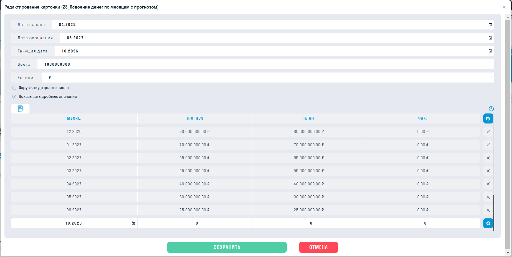

Для вставки задайте **«Дата начала»** и **«Дата окончания»**. Скопируйте три столбца **Прогноз → План → Факт** без дат и заголовков, затем нажмите **«Вставить данные из таблицы»**. Вставка заменит таблицу в форме. Первая строка получит начальный месяц, следующие — месяцы по порядку до даты окончания. Проверьте строки перед сохранением.

```text
11000000	10000000	8000000
13000000	12000000	9000000
```

### Чтение графика и остатка

Серая линия показывает план, синяя — прогноз, столбцы — факт. График подписан в миллионах. На превью видно до шести последних строк за текущий и предыдущие месяцы. Для просмотра остальных месяцев откройте карточку.


Итоги плана и факта включают строки за месяц из поля «Текущая дата» и за предыдущие месяцы. Остаток рассчитывается как **«Всего» минус накопленный факт**. Если факт превысил общую сумму, карточка показывает ноль. При общей сумме 50 млн ₽, факте октября 8 млн ₽ и ноября 9 млн ₽ остаток на конец ноября составит 33 млн ₽.

Флажок **«Округлять до целого числа»** меняет точность подписей на графике. **«Показывать дробные значения»** добавляет десятичные знаки в процентных показателях.

## 24_План-факт финансирования
<span id="card-24"></span>

Карточка помогает сравнить график финансирования с реальными поступлениями и затратами. По выбранный месяц включительно она показывает, сколько денег получено, сколько затрачено и какая между ними разница.

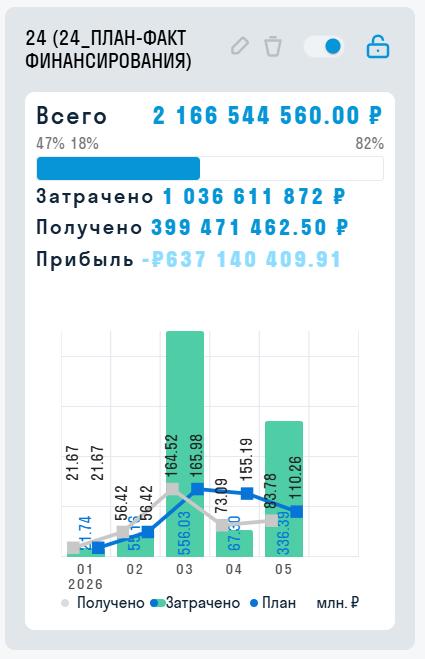

### Заполнение финансирования по месяцам

Укажите **«Всего»** как общую сумму финансирования для процентного индикатора, выберите валюту и задайте **«Текущую дату»** для подведения итогов. Заполняйте месячные значения в полных единицах этой валюты.

| Поле | Что указать |
|---|---|
| План | Сумму финансирования, которую планировали получить за месяц |
| Получено | Сколько денег фактически поступило за месяц |
| Затрачено | Сколько денег фактически потрачено за месяц |

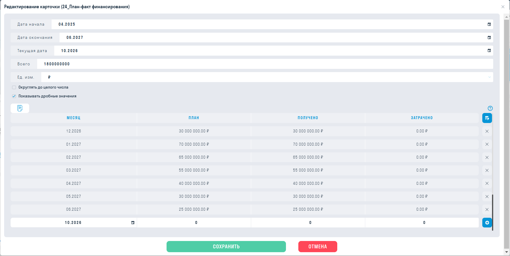

Для вставки задайте **«Дата начала»** и **«Дата окончания»**. Скопируйте три столбца **План → Получено → Затрачено** без дат и заголовков. Нажмите **«Вставить данные из таблицы»**. Вставка заменит таблицу в форме, а месяцы назначатся по порядку от начального до конечного. Проверьте строки перед сохранением.

```text
12000000	10000000	8000000
15000000	15000000	12000000
```

### Чтение графика и прибыли

Синяя линия показывает план финансирования, серая — поступления, зелёные столбцы — затраты. Подписи на графике указаны в миллионах. На превью видно до шести последних строк за текущий и предыдущие месяцы. Раскрытый график показывает и остальные строки таблицы.

**«Прибыль»** — сумма поступлений минус сумма затрат. В расчёт входят строки за месяц из поля «Текущая дата» и за предыдущие месяцы. Если затраты больше поступлений, значение будет отрицательным. Верхний индикатор показывает доли от суммы «Всего» и помогает оценить, сколько финансирования ещё предстоит получить.

> В первом месяце поступило 10 млн ₽, потрачено 8 млн ₽. Во втором поступило 15 млн ₽, потрачено 12 млн ₽. Если текущим выбран второй месяц, карточка покажет получено 25 млн ₽, затрачено 20 млн ₽, прибыль 5 млн ₽.
{.is-info}

#
<sub>**[<   DASHBOARD. Карточки 10. Общие](/ru/dash/cards-10)     **|**     [DASHBOARD. Карточки 30. Сроки    >](/ru/dash/cards-30)**</sub>
