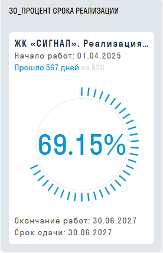
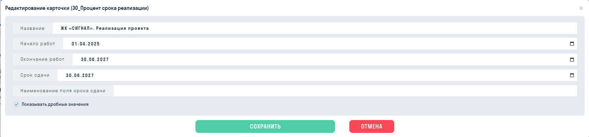
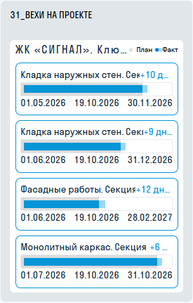
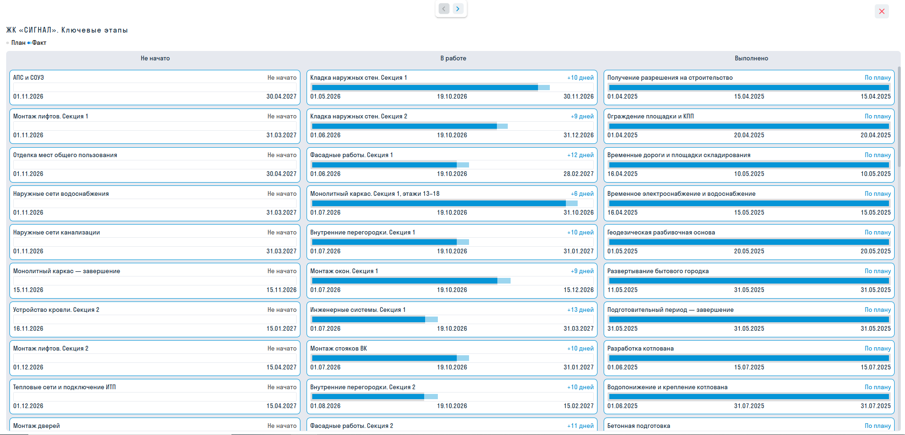
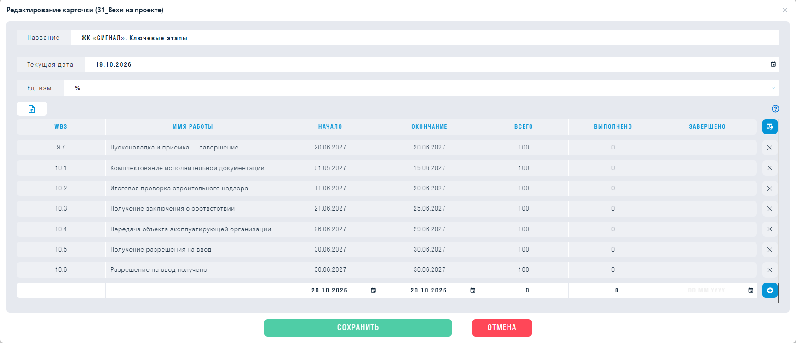
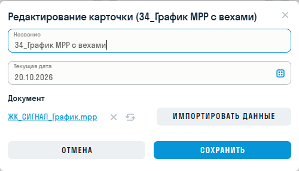

**[<   DASHBOARD. Карточки 20. Деньги](/ru/dash/cards-20)     **|**     [DASHBOARD. Карточки 40. Объёмы    >](/ru/dash/cards-40)**
  

 <a href="/dash/cards-30/updates" onclick="event.stopPropagation();" style="color: inherit; text-decoration: none;">🔄 Что нового (история изменений этого функционала)</a>

---

  

    <h4 class="toc-card-title"><a href="#card-30">Карточки_30. Сроки</a></h4>
    <ul class="toc-list">
      <li><a href="#cards-30-settings">Настройки карточек 30-х</a></li>
      <li><a href="#card-30">1.1 30_Процент срока реализации</a></li>
      <li><a href="#card-31">1.2 31_Вехи на проекте</a></li>
      <li><a href="#card-32">1.3 32_График Excel</a></li>
      <li><a href="#card-33">1.4 33_График MPP</a></li>
      <li><a href="#card-34">1.5 34_График MPP с вехами</a></li>
    </ul>
  

# Вкладки{.tabset}
## Настройки карточек 30-х
###### Настройки карточек 30-х {#cards-30-settings}

> Карточки сроков показывают прошедшую часть срока проекта, выполнение вех и графики работ. Источник и состав данных зависят от типа карточки.
{.is-info}

**Какую карточку выбрать**

| Карточка | Для чего подходит | Какие данные нужны |
|---|---|---|
| [30_Процент срока реализации](#card-30) | Показать, какая часть календарного срока прошла к сегодняшнему дню | Даты начала и окончания; срок сдачи для отдельной подписи |
| [31_Вехи на проекте](#card-31) | Оценить выполнение работ и отклонение от равномерного плана на выбранную дату | WBS, названия, даты начала и окончания, общий и выполненный объёмы; ручной ввод или XML |
| [32_График Excel](#card-32) | Показать выбранные вехи и подробный график | Таблица вручную, XLSX или XML; даты и процент выполнения работ |
| [33_График MPP](#card-33) | Показать выбранные работы из графика DOCS | MPP-файл текущего проекта и выбор работ после импорта |
| [34_График MPP с вехами](#card-34) | Показать вехи с переходом к графику | MPP-файл текущего проекта, выбранные работы и отмеченные вехи |

Порядок настройки приведён на вкладке каждой карточки.

## 30_Процент срока реализации
###### 30_Процент срока реализации {#card-30}

Карточка показывает даты начала и окончания работ, срок сдачи объекта, общую продолжительность проекта в календарных днях и число прошедших дней.

**Настройка карточки**

1. В поле «Название» введите заголовок карточки.
2. Укажите даты в полях «Начало работ», «Окончание работ» и «Срок сдачи». Окончание должно быть позже начала, чтобы продолжительность была больше нуля.
3. При необходимости заполните «Наименование поля срока сдачи», например «Срок сдачи квартир по ДДУ». Если оставить поле пустым, на карточке появится подпись «Срок сдачи». Это поле отображается отдельно и не участвует в расчёте процента.
4. Если нужно показывать проценты с дробной частью, включите «Показывать дробные значения».
5. Нажмите «Сохранить».

**Расчёт процента срока**

| Показатель | Как считается |
|---|---|
| Продолжительность | Окончание − начало, в календарных днях |
| Прошло дней | Сегодня − начало; сегодняшний день используется и в историческом отчёте |
| Процент срока | Прошло дней / продолжительность × 100%; до начала — 0%, после окончания — не больше 100% |

Например, начало — 1 ноября, окончание — 11 ноября. Продолжительность составляет 10 дней. На 6 ноября прошло 5 дней, поэтому карточка показывает **50%**.

## 31_Вехи на проекте
###### 31_Вехи на проекте {#card-31}

Карточка показывает выполнение работ по вехам на выбранную дату. Данные можно внести вручную или импортировать из XML-файла MS Project.

Рядом с отклонением по срокам отображается **«Выполнено / Всего»** — выполненный и общий объём по работе. Например, `40/100` означает, что выполнено 40 из 100 выбранных единиц измерения. Это позволяет оценить объём вместе с опережением или отставанием по срокам.
  
**Отображение карточки в режиме пользователя**

В режиме просмотра отчёта:

  
При открытии карточки:
  

  

**Настройка карточки**
  
  
  
1. Укажите название, текущую дату и единицу измерения.
2. Для каждой работы заполните WBS, название, даты начала и окончания, общий и выполненный объёмы.
3. Если выполненный объём равен общему, можно указать дату фактического завершения.

Выполненный объём не должен превышать общий, окончание не должно быть раньше начала. Общий и выполненный объёмы указывайте в одной выбранной единице; проценты источника нельзя сопоставлять с физическим объёмом без пересчёта.

Для импорта нажмите кнопку загрузки XML-файла. Импортированные строки появятся в таблице карточки; проверьте их перед сохранением. Если данных нет, карточка показывает сообщение «Нет данных».

**Порядок столбцов при обмене с Excel или Google Таблицами**

WBS → Название → Начало → Окончание → Всего → Выполнено → Дата завершения.

Сохраняйте порядок полей при подготовке диапазона. Общая привязка описана в [настройках DASHBOARD](/dash/settings#updating).

**Расчёт опережения и отставания**

Для работы в процессе выполнения карточка принимает равномерное распределение объёма между началом и окончанием работ. Продолжительность и прошедшие дни считаются в календарных днях, включая день начала и день окончания.

**Отклонение в днях = выполненный объём / общий объём × продолжительность − прошедшие дни.** Положительное значение означает опережение, отрицательное — отставание. Дробное опережение округляется вверх, отставание — вниз до целого дня.

Например, работа запланирована с 1 по 10 ноября, общий объём — 100 м³. На текущую дату карточки 5 ноября выполнено 40 м³. Продолжительность — 10 дней, прошло 5 дней: **40 / 100 × 10 − 5 = −1 день**.

<strong>Как считаются остальные состояния работ</strong>

| Состояние | Отклонение |
|---|---|
| Завершена, заполнена фактическая дата | Плановое окончание − фактическое завершение |
| Нет выполнения | Отображается «Не начато» |
| Выполняется досрочно, текущая дата раньше начала | Доля выполненного объёма × дни от текущей даты до планового окончания |

**Если строки не сохраняются**

| Что видно | Что проверить |
|---|---|
| Сообщение о незаполненном поле | WBS и название в указанной строке |
| Ошибка объёмов | Выполненный объём не превышает общий; для расчёта общий объём больше нуля |
| Ошибка дат | Окончание не раньше начала; даты распознаны корректно |

## 32_График Excel
###### 32_График Excel {#card-32}

Карточка показывает вехи и позволяет открыть график работ по нажатию на веху. Данные можно ввести в таблицу вручную, импортировать из XML-файла MS Project или файла XLSX.

Для просмотра подробного графика нажмите на веху.

В настройках заполните «Название» и «Текущая дата». Для ручного ввода укажите для каждой строки WBS, название работы, даты начала и окончания, процент выполнения от 0 до 100.

**Импорт XML или XLSX**

1. Нажмите кнопку «.xml» или «.xlsx» и выберите файл с компьютера. Для XLSX первая строка таблицы служит заголовком; далее по порядку должны идти WBS, название, начало, окончание и процент выполнения.
2. В открывшемся списке выберите работы для отображения и отметьте нужные вехи.
3. Сохраните выбор, проверьте таблицу и нажмите «Сохранить» в настройках карточки.

**Требования к таблице**

Из XLSX читается первый лист, первая строка пропускается как заголовок. В следующих строках должны идти: **WBS → Название → Начало → Окончание → Процент выполнения**. Процент указывайте числом от 0 до 100, например `40` для 40%.

WBS определяет иерархию: например, `1`, `1.1`, `1.2`. Не оставляйте код пустым: строки без WBS не попадают в импортированный график. В XML используются данные задач MS Project, включая WBS, название, начало, окончание и процент выполнения.

**Если данные не отображаются**

| Что видно | Что проверить |
|---|---|
| Нет работ после импорта | Первый лист XLSX, порядок столбцов и заполнение WBS |
| В таблице работы есть, на карточке нет | Выбор работ и сохранение окна импорта, затем сохранение карточки |
| Нет вех, но есть подробный график | Отмечены ли нужные работы как вехи |

## 33_График MPP
###### 33_График MPP {#card-33}

Карточка показывает график работ из файла MPP, загруженного в SIGNAL DOCS.

**Настройка карточки**

1. Укажите «Название» и выберите файл `.mpp` в DOCS.
2. Нажмите «Импортировать данные».
3. В открывшемся окне выберите работы для отображения и сохраните выбор.
4. Нажмите «Сохранить» в настройках карточки.

**Подготовка источника**

| Что подготовить | Требование |
|---|---|
| Файл | `.mpp`, загруженный в DOCS того же проекта; у пользователя есть доступ к нему |
| Задачи | Названия и идентификаторы задач MS Project. Задачи без названия или идентификатора в график не попадают |
| Структура | Коды WBS и структура суммарных и дочерних задач; например, `1`, `1.1`, `1.2` |
| Сроки | Обычные даты начала и окончания задач MS Project — «Начало» и «Окончание» |
| Выполнение | Процент выполнения задач: 0–100. Фактические даты начала и окончания используются, если заполнены |
| Базовый план | Для основного графика не обязателен: его даты передаются дополнительно, если заполнены |

> Для 33 не нужны параметр отбора и числовой параметр объёма из карточки 41 MPP. Она показывает график задач, а не распределяет физические объёмы по базовому плану.
{.is-info}

**Если данные не отображаются**

| Что видно | Что проверить |
|---|---|
| Файл не удаётся выбрать | Проект, расширение `.mpp`, наличие файла и доступ к нему в DOCS |
| Выбран файл, но график пустой | Выполнен ли импорт и выбран ли хотя бы один элемент графика |
| Выбранные работы не появились | Сохранён ли выбор в окне импорта, затем сама карточка |
| Появилась ошибка импорта | Открывается ли файл в MS Project; повторяется ли ошибка для этого же файла. Сохраните текст ошибки для обращения в поддержку |

## 34_График MPP с вехами
###### 34_График MPP с вехами {#card-34}

Карточка показывает вехи из файла MPP и позволяет открыть график работ по нажатию на веху. Файл должен быть загружен в SIGNAL DOCS.

Для просмотра графика нажмите на веху.

**Настройка карточки**
  

  
1. Укажите название и текущую дату.
2. Выберите файл `.mpp` в DOCS и нажмите «Импортировать данные».
3. Выберите работы и отметьте вехи.
4. Сохраните выбор, затем карточку.

Изменения файла DOCS можно импортировать повторно через настройки карточки.

**Требования к источнику**

Используются те же данные MPP, что в [карточке 33](#card-33): задачи, WBS, даты и процент выполнения. Дополнительно в окне импорта выбираются вехи для показа на карточке.

**Если данные не отображаются**

| Что видно | Что проверить |
|---|---|
| Нет графика | Выбор файла, успешность импорта, выбор работ и сохранение карточки |
| График есть, вех нет | Отмечены ли нужные работы как вехи в окне импорта |

#
**[<   DASHBOARD. Карточки 20. Деньги](/ru/dash/cards-20)     **|**     [DASHBOARD. Карточки 40. Объёмы    >](/ru/dash/cards-40)**
