**[<   DASHBOARD. Карточки 30. Сроки](/ru/dash/cards-30)     **|**     [DASHBOARD. Карточки 50. 3D карточки    >](/ru/dash/cards-50)**

 <a href="/dash/cards-40/updates" onclick="event.stopPropagation();" style="color: inherit; text-decoration: none;">🔄 Что нового (история изменений этого функционала)</a>

---

  

    <h4 class="toc-card-title"><a href="#card-40">Карточки_40. Объемы</a></h4>
    <ul class="toc-list">
      <li><a href="#cards-40-settings">Настройки карточек 40-х</a></li>
      <li><a href="#card-40">1.1 40_Процент освоения объемов</a></li>
      <li><a href="#card-41">1.2 41_План-факт по объемам</a></li>
      <li><a href="#card-41-mpp">1.3 41_План-факт по объёмам MPP</a></li>
      <li><a href="#card-42">1.4 42_План-Факт-Замечания</a></li>
      <li><a href="#card-43">1.5 43_Темпы выполнения по объемам</a></li>
      <li><a href="#card-44">1.6 44_Прогноз выполнения</a></li>
      <li><a href="#card-46">1.7 46_План факт по объёмам с прогнозом</a></li>
      <li><a href="#card-49">1.8 49_DOCS</a></li>
    </ul>
  

# Вкладки{.tabset}
## Настройки карточек 40-х
###### Настройки карточек 40-х {#cards-40-settings}

> Карточки объёмов сравнивают план и факт, помогают оценить темп и прогноз завершения. Источники и правила заполнения приведены на вкладках карточек.
{.is-info}

**Какую карточку выбрать**

| Карточка | Для чего подходит | Какие данные нужны |
|---|---|---|
| [40_Процент освоения объемов](#card-40) | Сравнить план и факт с общим объёмом в процентах | Общий, плановый и фактический объёмы |
| [41_План-факт по объемам](#card-41) | Сравнить объёмы по датам, за периоды или с накоплением | Общий объём и таблица «Дата / План / Факт» |
| [41_План-факт по объёмам MPP](#card-41-mpp) | Получить план из графика и сопоставить его с введённым фактом | MPP в DOCS, параметры отбора, базовый план и параметр объёма; факт в карточке |
| [42_План-Факт-Замечания](#card-42) | Сравнить объёмы по участкам или видам работ | План, факт и объём работ с замечаниями, введённые пользователем |
| [43_Темпы выполнения по объемам](#card-43) | Рассчитать требуемое число работников или выработку для завершения в срок | Объёмы, даты, выработка и численность работников |
| [44_Прогноз выполнения](#card-44) | Рассчитать прогнозную дату по фактическому темпу | Полный план и факт за периоды на разных датах |
| [46_План факт по объёмам с прогнозом](#card-46) | Показать план, факт и прогноз пользователя | Общий объём и таблица «Дата / План / Факт / Прогноз» |
| [49_DOCS](#card-49) | Показать документы проекта с переходом в DOCS | Выбранная папка DOCS текущего проекта |

**На что обратить внимание**

- **Единицы.** В одной карточке используйте сопоставимые объёмы в одинаковых единицах. Для расчёта процентов общий объём должен быть больше нуля.
- **Периоды.** В 41, 44 и 46 вводите объёмы без накопления: карточка суммирует их сама. Общий план карточки 44 — сумма столбца «План».
- **Вставка из Excel.** В 41, 44 и 46 она заменяет таблицу, в 42 — добавляет строки. Порядок столбцов приведён на соответствующей вкладке.
- **Прогноз.** В 44 он рассчитывается по темпу, в 46 вводится пользователем.

> Карточки объёмов не извлекают объёмы из BIM автоматически. Работа с моделью описана в [карточках 50-х](/dash/cards-50). Карточка 49 показывает документы и не рассчитывает объёмы.
{.is-info}

## 40_Процент освоения объемов
###### 40_Процент освоения объемов {#card-40}

> Карточка показывает степень освоения объема работ объекта в процентном соотношении: план/факт/осталось. Например, можно визуализировать общий процент освоения объема работ по всему объекту или процент освоения по отдельному виду работы.
{.is-info}

**Настройка карточки**
При настройке укажите название карточки, плановый и фактический объём, общий объём работ и единицу измерения.

  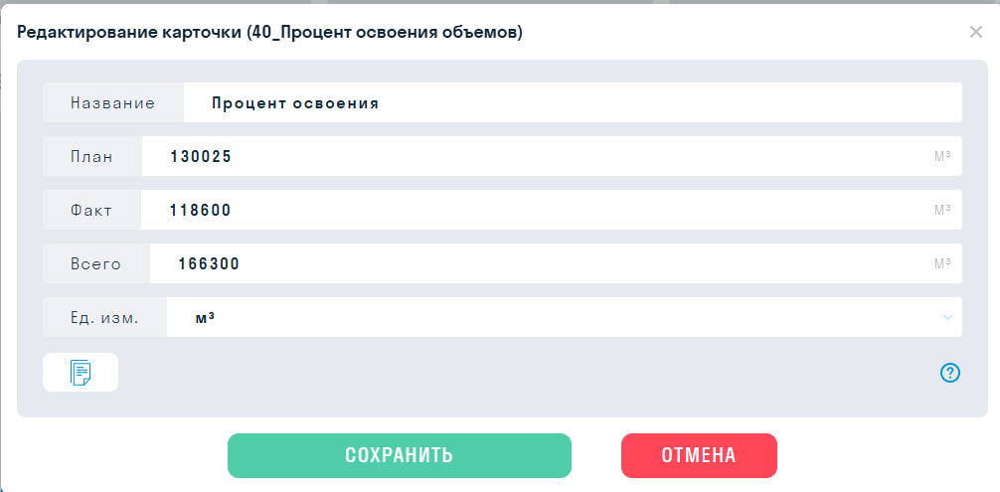

**Расчёт показателей**

В поля плана и факта вводите объёмы в выбранной единице измерения, а не готовые проценты:

- план, % = плановый объём / общий объём × 100%;
- факт, % = фактический объём / общий объём × 100%;
- осталось, % = 100% − факт, %.

Например, всего — 1000 м³, план — 600 м³, факт — 450 м³. Карточка покажет **план 60%, факт 45%, осталось 55%**. Если проценты выглядят неверно, проверьте общий объём больше нуля и одинаковые единицы всех трёх значений.

## 41_План-факт по объемам
###### 41_План-факт по объемам {#card-41}

> Карточка для отображения планового и фактического объема выполненных работ.
{.is-info}

**Настройка карточки**

| Поле или переключатель | Что означает |
|---|---|
| Вид работ | Название показателя на карточке, например «Бетонирование»; не отбирает данные автоматически |
| Дата | Отчётная дата карточки. Ограничивает итоговые объёмы только при включённом «Учитывать дату карточки» |
| Единицы | Общая единица для общего объёма, плана и факта, например м³ |
| Общий объём | Полный объём выбранного вида работ; используется как 100% при расчёте процентов и для остатка |
| Отображать по месяцам | Показывать названия месяцев вместо полных дат. Строки одного месяца не объединяются |
| Отображать в виде накопительного объёма | Включить линейный график с суммированием объёмов. Если выключено — столбцы |
| Учитывать дату карточки | Считать итоговые план и факт только по строкам до даты карточки включительно. Если выключено — по всей таблице |
| Показывать дробные значения | Показывать проценты с двумя знаками после запятой вместо целых |

**Пример ограничения по дате:** в таблице факт 100 м³ на 1 ноября и 150 м³ на 8 ноября. При дате карточки 5 ноября итог будет **100 м³** с включённым «Учитывать дату карточки» и **250 м³** с выключенным.

Данные о плановом и фактическом объеме на определенную дату можно добавить вручную либо с помощью таблиц Excel.

**Заполнение карточки вручную**

Заполните поля «Дата», «План», «Факт» и нажмите «+», чтобы добавить строку. Чтобы изменить её, нажмите на строку.

**Заполнение карточки с помощью Excel**

1. Подготовьте столбцы **Дата → План → Факт**. Скопируйте строки без заголовков.
2. Нажмите «Вставить данные» и вставьте строки с помощью Ctrl+V.
3. Проверьте таблицу и сохраните карточку.

> Вставка заменяет существующую таблицу. В каждой строке указывайте объём за соответствующий период, без накопления.
{.is-info}

**Использование карточки**

Внутри карточки находится график, отражающий введенную информацию.

**Расчёт и отображение**

План и факт в итогах — суммы соответствующих столбцов. При включённой настройке «Учитывать дату карточки» в итог входят только строки не позднее указанной даты, иначе — вся таблица. Проценты плана и факта рассчитываются относительно поля «Общий объём», остаток — общий объём минус суммарный факт.

«Отображать в виде накопительного объёма» включает линейный график с суммированием значений. При выключенной настройке отображаются столбцы. «Отображать по месяцам» меняет подписи дат на месяцы, но не объединяет строки одного месяца.

Например, при общем объёме 1000 м³ строки с фактом 100 и 150 м³ дадут итог **250 м³, или 25%**. Если вторая строка позже даты карточки и включено «Учитывать дату карточки», итог составит **100 м³, или 10%**.

**На что обратить внимание:** свёрнутая карточка показывает часть дат; подробный график доступен при раскрытии.

<strong>Если данные выглядят неверно</strong>

| Что видно | Что проверить |
|---|---|
| Итог меньше ожидаемого | Включено ли «Учитывать дату карточки» и какие строки попали в расчёт |
| Итог завышен | Не введены ли накопительные объёмы вместо объёмов за периоды |
| Несколько подписей одного месяца | «Отображать по месяцам» меняет подписи, а не объединяет строки |

## 41_План-факт по объёмам MPP
###### 41_План-факт по объёмам MPP {#card-41-mpp}

> В этой карточке даты и плановые объёмы можно получить из файла MPP, загруженного в DOCS. Фактические объёмы заполняйте в таблице карточки. При работе с импортированными данными даты и плановые значения доступны только для чтения.
{.is-info}

**Что означают параметры MPP**

Общие поля вида работ, даты, единиц и объёма описаны в [карточке 41](#card-41). Дополнительно выберите файл MPP из DOCS и откройте «Настройка заполнения данных».

| Поле | Что выбрать | Пример |
|---|---|---|
| Параметр | Поле задачи MPP, по которому нужно отобрать работы. Это может быть стандартное или пользовательское поле; пользовательские поля могут отображаться под заданными в файле названиями | «Вид работ», сохранённый в поле «Текст1» |
| Значения | Одно или несколько значений выбранного параметра. В отбор проходят задачи с любым из отмеченных значений | «Бетонирование» |
| Дата - отчетный день | День недели, на который формируются отчётные строки плана; это не дата самой карточки | Пятница |
| Даты для расчета | Сохранённый базовый план MPP, из которого брать начало и окончание выбранных работ. Обычные поля «Начало» и «Окончание» не заменяют даты выбранного базового плана | «Базовый план» или «Базовый план 1» |
| План - параметр объема | Числовое поле задачи MPP с полным плановым объёмом работы. Его единица должна соответствовать единице карточки | «Число1»: 1000 м³ |

**Пример:** выберите параметр «Вид работ», значение «Бетонирование», отчётный день «Пятница», нужный базовый план и числовое поле объёма. Карточка отберёт соответствующие работы, распределит плановый объём по календарным дням базового плана и сформирует строки по пятницам. Факт заполняется в карточке отдельно.

<strong>Откуда берётся выпадающий список параметров</strong>

Список строится автоматически после чтения выбранного MPP-файла. В него входят поля задач из файла и пользовательские поля задач. Обычные поля могут отображаться техническими английскими именами, пользовательские — под названиями, заданными в MPP. Поэтому набор пунктов зависит от файла.

| Пример пункта | Что означает |
|---|---|
| `name` | Название задачи |
| `wbs` | Код задачи в иерархии работ, например `1.2.3` |
| `start`, `finish` | Начало и окончание задачи |
| `actual_start`, `actual_finish` | Фактическое начало и окончание |
| `baseline_start`, `baseline_finish` | Даты сохранённого базового плана |
| `percent_complete` | Процент выполнения |
| Пользовательское числовое поле, например «Число1» | Может хранить физический объём, если так подготовлен файл |

**Один список используется в двух разных целях:**

- В поле **«Параметр»** задаётся признак отбора. Например, `name` позволяет выбрать задачи по названиям в поле «Значения».
- В поле **«План - параметр объема»** задаётся источник числа для планового объёма. Здесь нужно выбрать поле, в котором действительно записаны объёмы работ.

> Список параметра объёма не ограничен числовыми полями. Наличие пункта в списке не означает, что он подходит для расчёта. `wbs` — код, поэтому для физического объёма он не подходит; выбор текстового поля может дать нулевой план. Число должно храниться числом, а не строкой вида «100 м³».
{.is-info}

Чтобы найти нужное поле, откройте исходный файл в MS Project и проверьте столбец с плановыми объёмами и его пользовательское название. Поле не создаёт и не определяет объём автоматически. Если объёмы не заполнены, сначала подготовьте их в исходном MPP.

**Подключение источника**

1. Выберите файл MPP из DOCS в настройках карточки.
2. Откройте настройки данных рядом с полем файла. Укажите параметр и значения работ, отчётный день, базовый план для дат и параметр объёма.
3. Нажмите «Обновить данные», чтобы заполнить таблицу датами и планом из MPP. Вносите фактические объёмы в столбец «Факт».

Если файл MPP не подключён, таблицу можно заполнить вручную или вставить данные из Excel. Кнопка обновления карточек в отчёте также обновляет данные 41_mpp из подключённого файла.

**Требования к MPP и расчёт плана**

| Данные MPP | Что проверить |
|---|---|
| Отбор работ | Задан параметр и хотя бы одно его значение; нужные работы им соответствуют |
| Даты | В работах заполнены начало и окончание именно выбранного базового плана |
| Объём | Выбран числовой параметр, соответствующий единице измерения карточки |

Работы без дат выбранного базового плана не участвуют в построении таблицы.

Объём работы распределяется равномерно по календарным дням от начала до окончания базового плана включительно. Затем объёмы сводятся к выбранному отчётному дню недели. В таблицу записываются объёмы за периоды, округлённые до двух знаков, а не накопительный итог.

Например, объём 100 м³ на 10 календарных дней даёт плановый темп **10 м³ в день**. Объём на отчётную дату зависит от того, сколько дней работы вошло в период.

**Повторный импорт источника**

| Изменение даты строки | Что произойдёт с фактом |
|---|---|
| Дата осталась в новом списке | Факт сохраняется |
| Дата появилась впервые | Факт 0 |
| Дата исчезла из нового списка | Строка не остаётся в таблице |

> Перед сменой работ, базового плана или отчётного дня сохраните факт отдельно. После импорта проверьте соответствие дат и значений.
{.is-info}

<strong>Если данные не отображаются</strong>

| Что видно | Что проверить |
|---|---|
| Таблица пустая | Доступность файла, параметр отбора и выбранные значения |
| Нужная работа не попала в таблицу | Совпадение её значения с отбором; даты начала и окончания выбранного базового плана |
| Даты появились, план нулевой | Числовой параметр объёма и заполнение его значений в MPP |

**На что обратить внимание:** при смене отчётного дня или работ проверьте фактические значения на новых датах. Наличие задач в файле не означает, что они прошли отбор.

## 42_План-Факт-Замечания
###### 42_План-Факт-Замечания {#card-42}

> Карточка показывает плановый и фактический объёмы работ, а также объём работ с замечаниями к качеству выполнения.
{.is-info}

Отображение карточки в режиме пользователя:

  
Отображение карточки при раскрытии:
  
  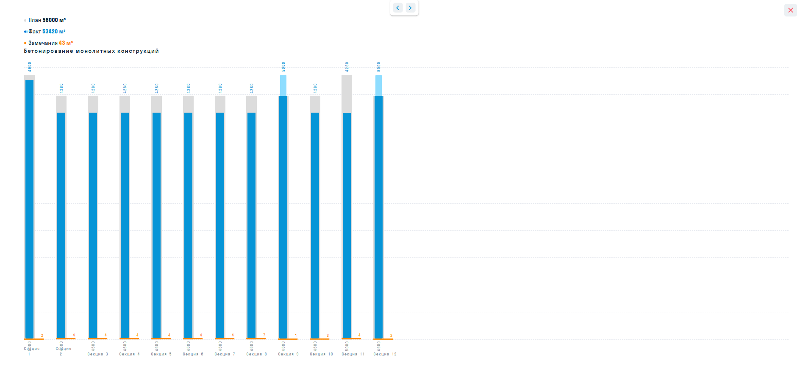
  
**Настройка карточки**

- В поле «Вид работ» укажите вид работ, в поле «Дата» — дату отчёта.
- Выберите единицу измерения.
  
  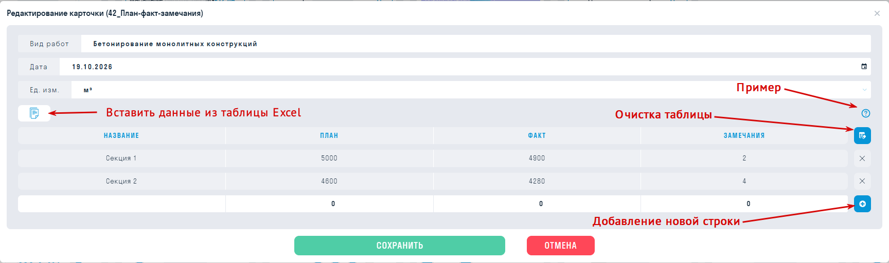

Данные по отдельным участкам, этажам или видам работ можно добавить вручную либо с помощью таблиц Excel. Дата отчёта и единица измерения задаются для всей карточки.

**Заполнение карточки вручную**

Заполните поля «Название», «План», «Факт», «Замечания» и нажмите «+», чтобы добавить новую строку. Для изменения значений нажмите на строку.
  
  

В поле «Замечания» укажите объём работ с замечаниями в выбранной единице измерения. Значение вводится вручную и не рассчитывается по замечаниям DOCS.

**Заполнение карточки с помощью Excel**

- Подготовьте столбцы в порядке: «Наименование», «План», «Факт», «Замечания» (пример можно взять из окна редактирования карточки - иконка с знаком вопроса).
- Скопируйте строки без заголовков.
- Нажмите «Вставить данные из таблицы» и вставьте скопированные из Excel строки с помощью Ctrl+V.
  
  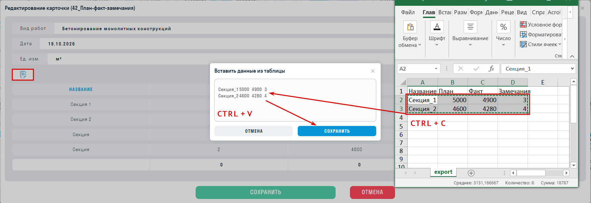

>Наименования для вставки указывайте без пробелов, например `Этаж_1`. Вставленные строки добавляются к существующим.{.is-info}

**Как читать показатели**

План, факт и замечания показываются в одной выбранной единице измерения. Например, для строки «Этаж_1» можно задать план 100 м³, факт 80 м³ и замечания 10 м³: последнее значение означает объём работ с замечаниями, а не десять замечаний DOCS.

<strong>Если после вставки появились ошибки</strong>

| Что видно | Что проверить |
|---|---|
| Повторяющиеся строки | Не вставлены ли они повторно: вставка добавляет данные к существующим |
| Название разделилось на поля | Нет ли пробелов в наименовании; замените их подчёркиваниями |

**На что обратить внимание:** «Замечания» — физический объём в единице карточки, а не число замечаний DOCS.

## 43_Темпы выполнения по объемам
###### 43_Темпы выполнения по объемам {#card-43}

> Карточка показывает плановую и фактическую выработку по виду работ. В блоке «Для выполнения в срок» она рассчитывает, сколько работников потребуется при плановой выработке и какой должна быть выработка при текущем количестве работников. [Шаблон в Excel](https://docs.sgnl.pro/s/f/4d8f615a-27fd-4b1a-a631-c7529eb99f03).
{.is-info}

**Настройка карточки**

| Блок | Что заполнить |
|---|---|
| Общие данные | Вид работ, единица измерения и дата отчёта |
| Объёмы | Общий, плановый и выполненный объёмы |
| Сроки | Плановые и фактические даты начала и окончания |
| Ресурсы | Плановая и фактическая выработка одного работника в день; плановая и фактическая численность |

Эти исходные показатели вводятся пользователем.

**Расчёт «Для выполнения в срок»**

1. Остаток объёма = общий объём − выполненный объём.
2. Оставшиеся дни = плановое окончание − дата карточки, в календарных днях, без добавления одного дня.
3. Требуемый темп бригады = остаток объёма / оставшиеся дни.
4. Требуемое число работников = требуемый темп бригады / **плановая выработка одного работника в день**.
5. Требуемая выработка одного работника = требуемый темп бригады / фактическое число работников.

Например, из 1000 м³ выполнено 400 м³, до планового окончания осталось 10 дней. Для завершения нужно 60 м³ в день: при плановой выработке 5 м³ на человека потребуется **12 работников**; при фактической численности 10 человек требуется выработка **6 м³ на человека в день**.

**На что обратить внимание**

- Число работников округляется до ближайшего целого, требуемая выработка — до двух знаков.
- Для расчёта должны оставаться дни до планового окончания; плановая выработка и фактическая численность — больше нуля.
- Нулевые значения при невыполнении этих условий не означают, что ресурсы не нужны.

Отклонение срока в карточке — разница между введёнными плановой и фактической датами окончания: положительное значение означает опережение, отрицательное — отставание. Дата окончания в этой карточке не прогнозируется по темпу; для такого расчёта используйте [карточку 44](#card-44).

## 44_Прогноз выполнения
###### 44_Прогноз выполнения {#card-44}

> Карточка предназначена для прогнозирования объемов выполнения и даты завершения работ на основе месячного темпа выполнения работ, а также вычисляет количество дней опережения/отставания.
{.is-info}
  
  Отображение карточки в режиме пользователя:

  
  Отображение карточки при раскрытии:
  
  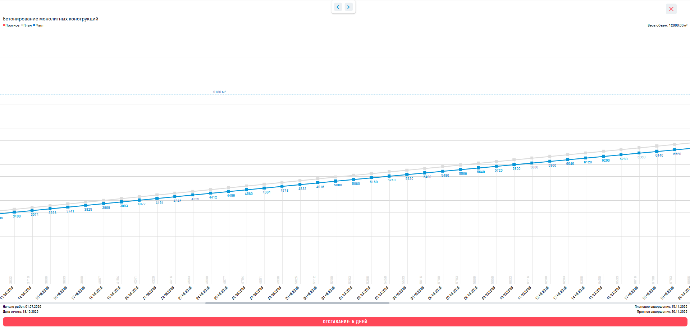

**Настройка карточки**

- В поле «Вид работ» укажите вид работ.
- Выберите единицу измерения.
- После заполнения таблицы выберите отчётную дату из списка дат добавленных строк.

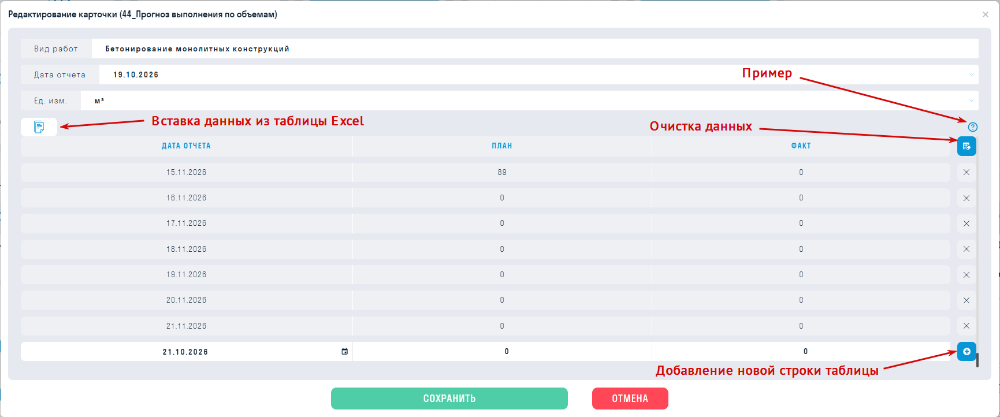

Данные можно добавить вручную либо с помощью таблиц Excel. Для расчёта прогноза заполните план до предполагаемого завершения работ и факт по отчётную дату включительно.

**Заполнение карточки вручную**

  
Заполните поля «Дата отчета», «План», «Факт» и нажмите «+», чтобы добавить новую строку. Для изменения значений нажмите на строку.

В каждой строке указывайте плановый и фактический объёмы за соответствующий период.

> Вводите объёмы за отдельные периоды без накопления. Карточка самостоятельно суммирует значения и строит накопительный график.
{.is-info}

**Заполнение карточки с помощью Excel**

- Подготовьте столбцы в порядке: «Отчётная дата», «План», «Факт». Пример можно открыть в окне редактирования карточки — иконка со знаком вопроса.
- Скопируйте строки без заголовков.
- Нажмите «Вставить данные из таблицы» и вставьте скопированные из Excel строки с помощью Ctrl+V.
- Проверьте значения и выберите отчётную дату.
  
  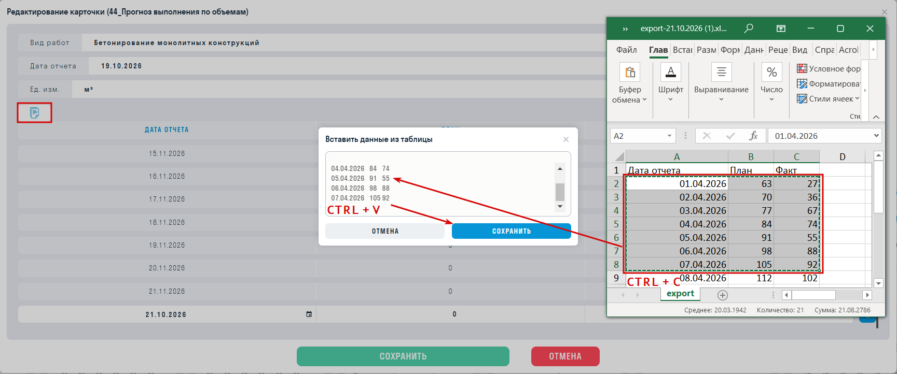

> Вставленные из Excel строки заменяют существующие данные таблицы.
{.is-info}

**Расчёт прогнозной даты**

Карточка сравнивает накопленный факт на отчётную дату с накопленным фактом на опорную дату примерно месяцем ранее:

1. От отчётной даты отнимается один календарный месяц. Опорной становится последняя дата таблицы не позднее этой границы. Если таких строк нет, используется первая дата после границы; она должна отличаться от отчётной.
2. Среднесуточный темп = прирост фактического объёма между опорной и отчётной датами / календарные дни между этими датами.
3. Остаток = сумма всего плана в таблице − факт по отчётную дату включительно.
4. Дни до завершения = остаток / среднесуточный темп, с округлением вверх до целого дня. Это число прибавляется к отчётной дате.
5. Опережение или отставание — разница между последней датой с ненулевым планом и прогнозной датой. Отрицательное значение означает отставание.

Например, общий план — 900 м³. На 2 октября накоплено 300 м³ факта, на 1 ноября — 600 м³. Темп за 30 дней составляет **10 м³ в день**. Остаток 300 м³ потребует ещё 30 дней: прогноз — **1 декабря**. Если последнее плановое выполнение назначено на 25 ноября, отставание составит **6 дней**.

Календарь рабочих дней проекта в этом расчёте не применяется: используются календарные дни. Переключателя дробных значений для прогнозной даты нет; остаток времени округляется вверх.

<strong>Если прогноз не отображается</strong>

| Что видно | Что проверить |
|---|---|
| Нет прогнозной даты | Есть ли фактические данные на разных датах и положительный прирост между ними |
| Прогноз сильно отличается от ожидаемого | Отчётную дату, полноту плана и отсутствие накопительных значений в строках |
| Получена некорректная дата | Различаются ли опорная и отчётная даты; положителен ли темп; не превышает ли факт общий план |

**На что обратить внимание:** при нулевом темпе или некорректном плане расчёт не даёт содержательного прогноза. Исходные строки должны содержать объёмы за периоды.

## 46_План факт по объёмам с прогнозом
###### 46_План факт по объёмам с прогнозом {#card-46}

> Карточка показывает плановые и фактические объёмы по датам и дополнительный прогноз.
{.is-info}
  
  Отображение карточки в режиме пользователя:
  
  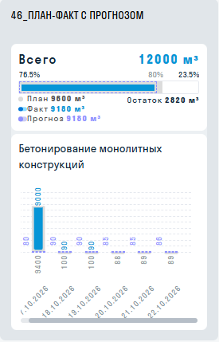
  
  Отображение карточки при раскрытии:
  
  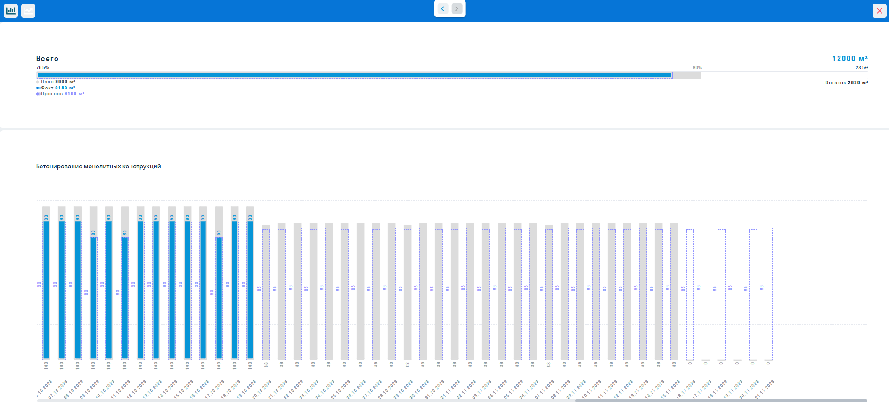
  
  **Настройка карточки**

- В поле «Вид работ» укажите вид работ, в поле «Дата» — дату отчёта.
- Выберите единицу измерения и укажите общий объём работ.
- При необходимости включите дополнительные настройки отображения (отображение по месяцам, отображение в виде накопительного объема).
  
  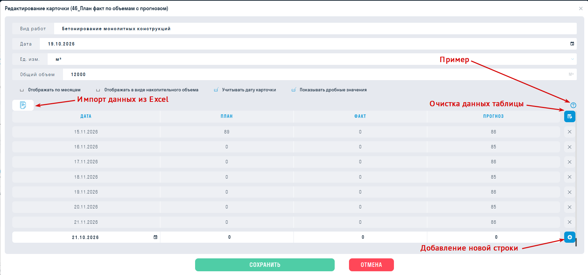
  

Доступные настройки:

- «Отображать по месяцам» — заменяет полные даты на подписи месяцев. Значения строк при этом не объединяются по месяцам.
- «Отображать в виде накопительного объема» — включает линейный график с накоплением значений. Если настройка выключена, данные отображаются в виде столбцов.
- «Учитывать дату карточки» — ограничивает расчёт итоговых значений плана, факта и прогноза датой отчёта включительно.
- «Показывать дробные значения» — включает отображение процентов с дробной частью.

Данные о плановом, фактическом и прогнозном объёмах можно добавить вручную либо с помощью таблиц Excel.

**Заполнение карточки вручную**

Заполните поля «Дата», «План», «Факт», «Прогноз» и нажмите «+», чтобы добавить новую строку. Для изменения значений нажмите на строку.

В каждой строке укажите объёмы за соответствующий период.

> Вводите значения без накопления. При включении накопительного отображения карточка самостоятельно суммирует объёмы.
{.is-info}

**Заполнение карточки с помощью Excel**

- Подготовьте столбцы в порядке: «Дата», «План», «Факт», «Прогноз». Пример можно открыть в окне редактирования карточки — иконка со знаком вопроса.
- Скопируйте строки без заголовков.
- Нажмите «Вставить данные из таблицы» и вставьте скопированные из Excel строки с помощью Ctrl+V.
- Проверьте значения и сохраните карточку.
  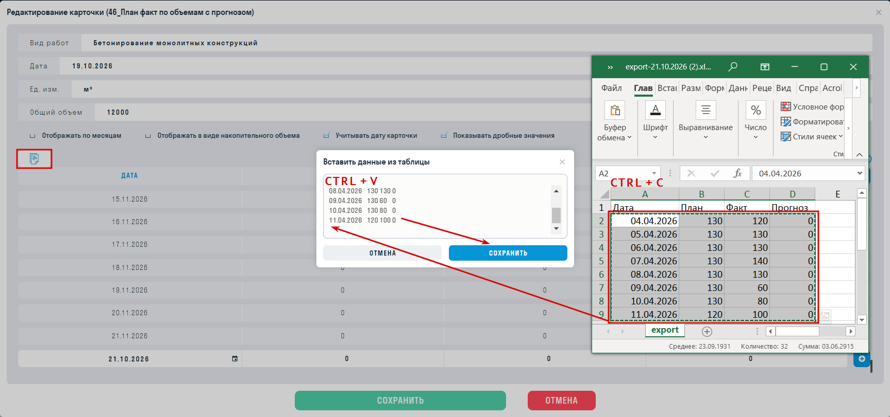

> Вставленные из Excel строки заменяют существующие данные таблицы.
{.is-info}

**Использование карточки**

Внутри карточки находится график, отражающий введенную информацию.
  
  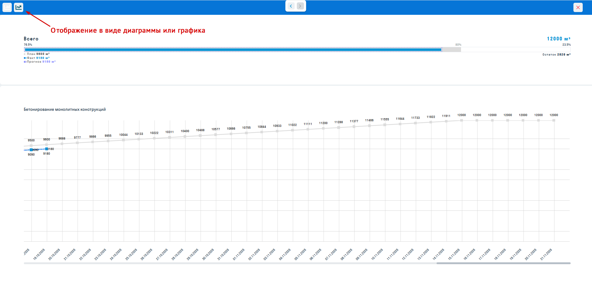

**Откуда берётся прогноз**

Столбец «Прогноз» заполняет пользователь. Карточка суммирует введённые объёмы и показывает их на графике; она не вычисляет прогноз по фактическому темпу, как [карточка 44](#card-44).

**Пример:** прогноз 100 и 150 м³ в двух строках даст накопленный прогноз **250 м³**.

<strong>Если прогноз не отображается</strong>

| Что видно | Что проверить |
|---|---|
| Нет значений прогноза | Заполнен ли столбец «Прогноз» |
| Итог не включает часть строк | Включено ли «Учитывать дату карточки»; не позже ли строки указанной даты |
| Вид графика отличается от ожидаемого | Режим накопительного отображения |

**На что обратить внимание:** прогноз не появляется автоматически после ввода факта.

## 49_DOCS
###### 49_DOCS {#card-49}

> Карточка выводит прямо в отчёте содержимое выбранной папки DOCS: вложенные папки и файлы. Удобна, чтобы держать на дашборде нужные документы проекта (например, папку с актуальной рабочей документацией или с исполнительной документацией) и открывать их без поиска по дереву DOCS.
{.is-info}

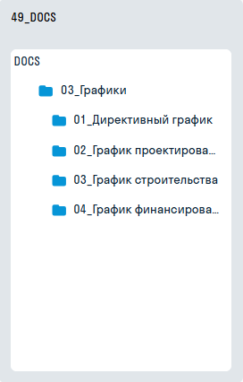

**Настройка карточки**

1. Добавьте карточку «49_DOCS» в отчёт и откройте её настройки.
2. Нажмите на поле «Папка». Откроется окно выбора, в котором показана структура DOCS текущего проекта.
3. Выберите папку и подтвердите выбор. Название папки появится в поле «Папка».
4. Нажмите «Сохранить».

- Выбрать можно только папку. Выбрать отдельный файл нельзя.
- Папка выбирается из проекта, к которому относится отчёт.
- Чтобы убрать папку, очистите поле «Папка» и сохраните карточку. Карточка станет пустой.
- Чтобы заменить папку, снова нажмите на поле «Папка», выберите другую и сохраните.

**Использование карточки**

- Внутри карточки под заголовком «DOCS» показано содержимое выбранной папки; сама папка при этом раскрыта.
- Нажатие на карточку открывает эту же папку в DOCS в новой вкладке. Нажатие на отдельный файл или вложенную папку внутри карточки в отчёте тоже ведёт в DOCS.
- Если открыть DOCS не удалось, появится сообщение об ошибке открытия папки. Повторите попытку позже или откройте папку в DOCS вручную.

> Карточка 49_DOCS работает только как превью: в отчёте она не открывается в увеличенном (раскрытом) виде. Для работы с файлами используйте переход в DOCS.
{.is-info}

<strong>Если данные не отображаются</strong>

| Что видно | Что проверить |
|---|---|
| Карточка пустая | Выбрана ли папка и сохранены ли настройки; есть ли в ней файлы |
| Папка или файл не открывается | Наличие папки в DOCS и доступ пользователя к её содержимому |

**На что обратить внимание:** доступ к отчёту не даёт прав на документы в DOCS.

#
**[<   DASHBOARD. Карточки 30. Сроки](/ru/dash/cards-30)     **|**     [DASHBOARD. Карточки 50. 3D карточки    >](/ru/dash/cards-50)**
