**[<   DASHBOARD. Карточки 40. Объёмы](/ru/dash/cards-40)     **|**     [DASHBOARD. Карточки 60. DOCS    >](/ru/dash/cards-60)**

 <a href="/dash/cards-50/updates" onclick="event.stopPropagation();" style="color: inherit; text-decoration: none;">🔄 Что нового (история изменений этого функционала)</a>

---

# Вкладки{.tabset}
## 50_3D объёмы в BIM по датам
###### 50_3D объёмы в BIM по датам {#card-50}

> Карточка показывает 3D-модель и сравнивает плановый и фактический объёмы работ на выбранные даты. Объёмы накапливаются: значение на дату включает все более ранние даты. По графику и раскраске модели можно проследить выполнение работ и опережение или отставание от плана.
{.is-info}

Отображение карточки в режиме пользователя: снимок модели, плановый и фактический объёмы и отклонение между ними.

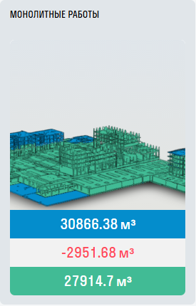

Отображение карточки при раскрытии:

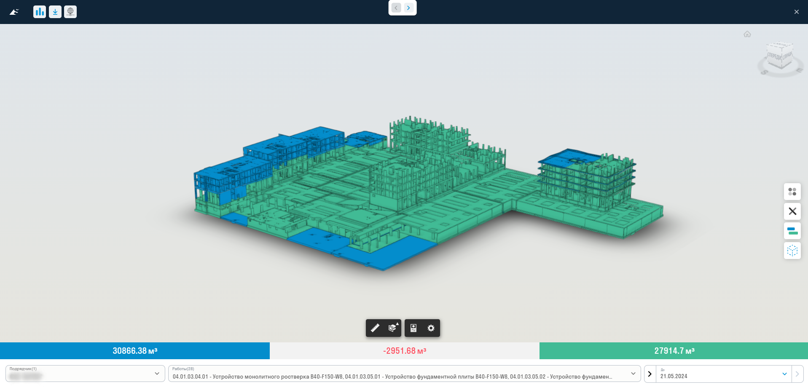

**Настройка карточки**

1. На вкладке «Основные» выберите модель из DOCS. При необходимости добавьте модель подложки. Укажите плановый и фактический объёмы, единицу измерения и включите отображение списка видов работ «Завершить 1, 2, 3», если он нужен в карточке. Если объёмы берутся из модели, поля ручного ввода недоступны.
2. На вкладке «Условные обозначения» включите показ легенды на превью и внутри карточки, подпишите системные цвета (красный, жёлтый, зелёный). Кнопкой «+» можно добавить цвета, заданные в TOOLS, и подписать их.
3. На вкладках «Объем», «Площадь» и «Длина» проверьте свойства модели (категория и свойство), по которым рассчитываются показатели. Строки можно добавлять и удалять.
4. На вкладке «Тип» включите переключателями типы элементов, которые нужно показывать («План ГРП», «План», «Факт», «Принято», «Закрыто»), при необходимости измените свойство модели и цвет типа.
5. На вкладке «Цвета» выберите цветовую схему плана и факта из двух вариантов.
6. Сохраните карточку.

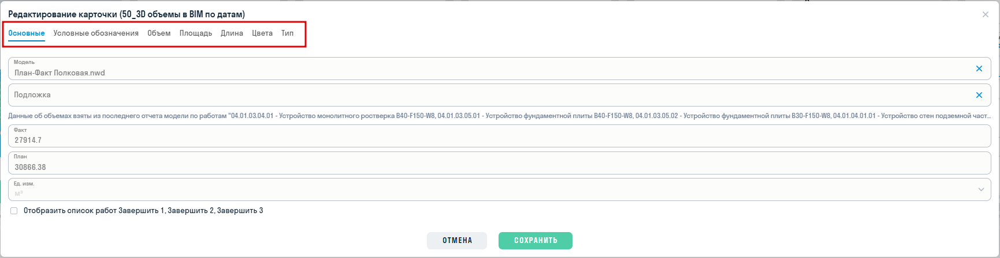

**Просмотр карточки**

Нажмите на карточку, чтобы открыть модель. Внизу показаны значения «План» и «Факт» за выбранные даты. Между ними отображается отклонение: факт минус план, зелёным с «+», если факт не меньше плана, и красным, если меньше. Нажатие на значение включает или отключает его раскраску в модели.

Доступны фильтры:

- **«Подрядчик»** (элементы без подрядчика собраны в пункте «Без подрядчика»);
- **«Работы»**;
- **«Завершено»** — если в настройках включён список работ «Завершить 1, 2, 3»;
- **«До»** — выбор дат.

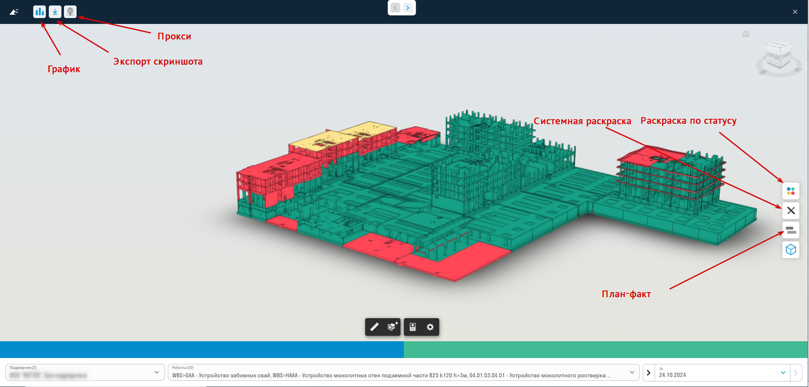

Кнопки в просмотре:

- **График** — переключает просмотр между моделью и графиком «План-факт».
- **Раскраска модели** (справа от модели): «Раскраска по статусу» — цвета из свойств модели (недоступна, если таких цветов нет), «Системная раскраска» — исходные цвета модели, «План-факт» — раскраска по типам. Рядом кнопка скрытия остальных элементов модели.
- **Легенда** (если включена в настройках) — нажатие на цвет оставляет в модели элементы этого цвета, повторное нажатие отменяет выбор.
- **Снимок экрана** — сохраняет изображение рабочей области.

Если плановый объём заполнен вручную в настройках, карточка использует его. Если поле пустое, объём рассчитывается по модели.

> Если у выбранных работ разные единицы измерения, значения плана, факта и отклонения не отображаются. Выберите работы с одной единицей измерения и проверьте свойства единиц в модели. Если данных по выбранным работам нет, появится сообщение «Нет данных для отображения».
{.is-warning}

**При редактировании отчёта**

У пользователя, который редактирует отчёт, в заголовке просмотра появляются дополнительные кнопки:

- **Снимок для превью** — сохраняет текущий вид модели как изображение превью карточки. Этот снимок используется и при экспорте отчёта в PPTX.
- **Настройки** (только в разделе «Управление») — флажок «Использовать текущие данные для превью» и кнопка «Обновить». Если флажок включён, значения «План», «Факт» и единицы измерения для превью берутся из выбранных в просмотре работ.

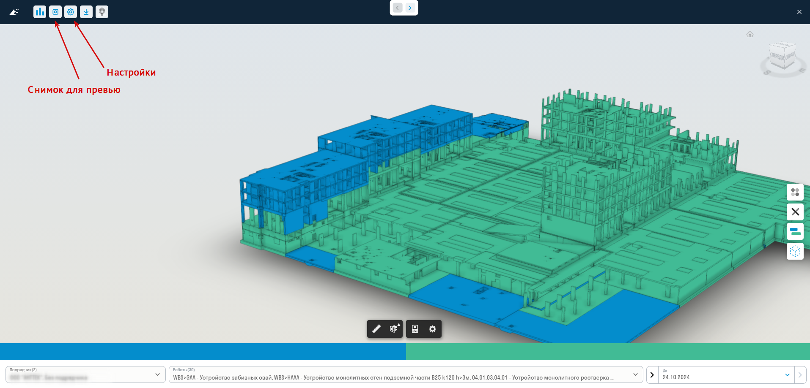

## 51_3D объём в BIM за период
###### 51_3D объём в BIM за период {#card-51}

> Карточка показывает 3D-модель и сравнивает плановый и фактический объёмы работ за выбранный период. В отличие от [карточки 50](#card-50), значения не накапливаются: учитываются только даты внутри периода, включая его начальную и конечную даты.
{.is-info}

Карточку можно добавить в отчёт раздела «Управление».

Отображение карточки в режиме пользователя: снимок модели, плановый и фактический объёмы.

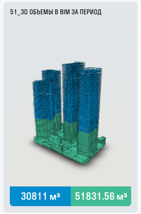

**Настройка карточки**

1. Заполните вкладки «Основные», «Условные обозначения», «Объем», «Площадь», «Длина», «Тип» и «Цвета» так же, как в [карточке 50](#card-50): окно настройки у карточек общее.
2. Плановый и фактический объёмы на вкладке «Основные» выводятся на превью карточки. Если плановый объём больше нуля, он используется и в просмотре вместо значения из модели.
3. Сохраните карточку.
  
  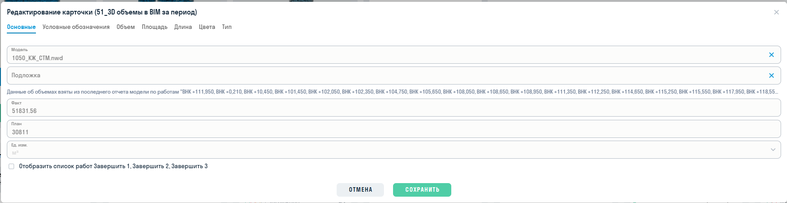

**Просмотр карточки**

Нажмите на карточку, чтобы открыть модель. Внизу показаны значения за выбранный период по типам, включённым ранее в настройках на вкладке «Тип». Каждый элемент модели учитывается в значении один раз, даже если в период попадает несколько его дат. Нажатие на значение включает или отключает его раскраску в модели — при раскраске «План-факт».

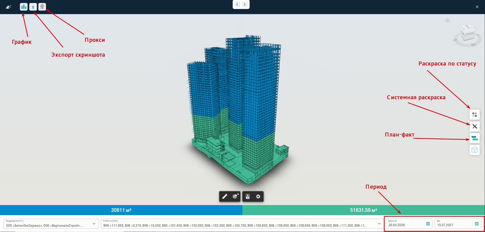

Доступны фильтры:

- **«Завершено»** — если в настройках включён список работ «Завершить 1, 2, 3»;
- **«Подрядчик»** (элементы без подрядчика собраны в пункте «Без подрядчика»). При смене подрядчика выбор работ и период сбрасываются на все доступные;
- **«Работы»**;
- **«Дата от»** и **«До»** — начало и конец периода. При открытии период охватывает все даты, которые есть в модели по выбранным подрядчикам. «Дата от» нельзя выбрать позже «До», обе даты ограничены датами модели. Значения рассчитываются, когда заполнены обе даты.

Кнопки в просмотре — как в [карточке 50](#card-50): **График** (план-факт по датам выбранного периода), **Раскраска модели** и скрытие остальных элементов, **Легенда** (если включена «Отображать легенду внутри карточки») и **Снимок экрана**.

> Если у выбранных работ разные единицы измерения, значения не отображаются. Выберите работы с одной единицей измерения и проверьте свойства единиц в модели. Если данных по выбранным работам нет, появится сообщение «Нет данных для отображения».
{.is-warning}

**При редактировании отчёта**

У пользователя, который редактирует отчёт, в заголовке просмотра появляются дополнительные кнопки:

- **Снимок для превью** — сохраняет текущий вид модели как изображение превью карточки. Этот снимок используется и при экспорте отчёта в PPTX.
- **Настройки** — флажок «Использовать текущие данные для превью» и кнопка «Обновить». Если флажок включён, значения «План», «Факт» и единица измерения для превью берутся из текущего просмотра за выбранный период. Если флажок выключен, «Обновить» очищает значения «План» и «Факт» превью.
  
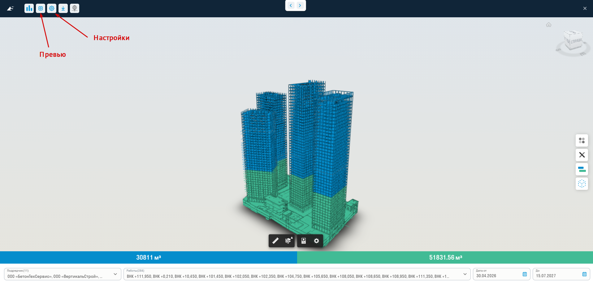

## 52_3D Цвета
###### 52_3D Цвета {#card-52}

> Карточка показывает модель с раскраской элементов. Цвета можно передать из Navisworks с помощью [«Раскраски» TOOLS](/tools/navis/coloring). В отличие от карточек 50 и 51, здесь не рассчитываются плановый и фактический объёмы.
{.is-info}

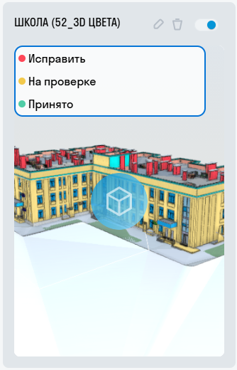

**Настройка карточки**

1. На вкладке «Основные» выберите модель из DOCS и при необходимости модель подложки.
2. На вкладке «Цвета» включите «Отображать легенду на превью» (если она нужна на превью), задайте подписи для системных цветов: красного, жёлтого и зелёного. При необходимости добавьте цвета TOOLS и подпишите их.
3. Сохраните карточку.

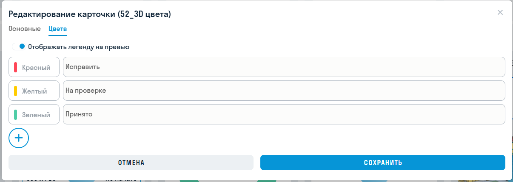

При просмотре карточка показывает модель и легенду. Нажмите на цвет легенды, чтобы оставить в модели элементы этого цвета. Повторное нажатие отменяет выбор.

При редактировании отчёта в просмотре появляется кнопка «Снимок для превью»: она сохраняет текущий вид модели как изображение превью. В опубликованном отчёте и по публичной ссылке кнопки нет.

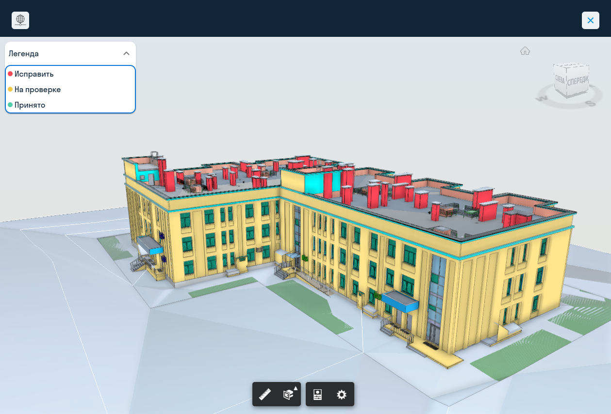

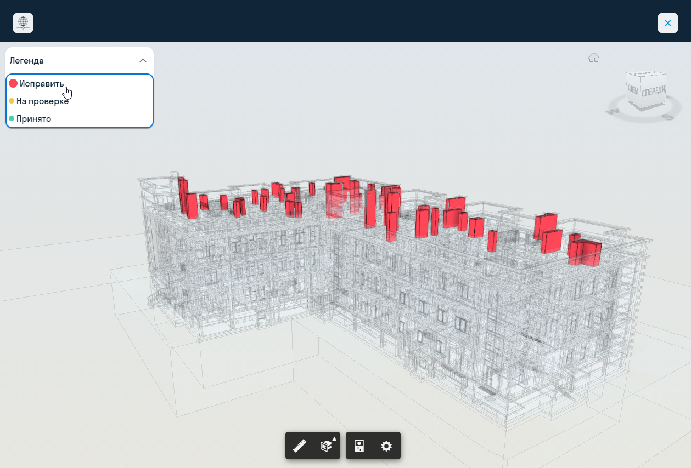

## 52_2_3D Цвета 2
###### 52_2_3D Цвета 2 {#card-52-2}

> Карточка позволяет одновременно показать проектную и строительную модели, а также модель подложки. Для проектной и строительной моделей можно отдельно настроить прозрачность.
{.is-info}

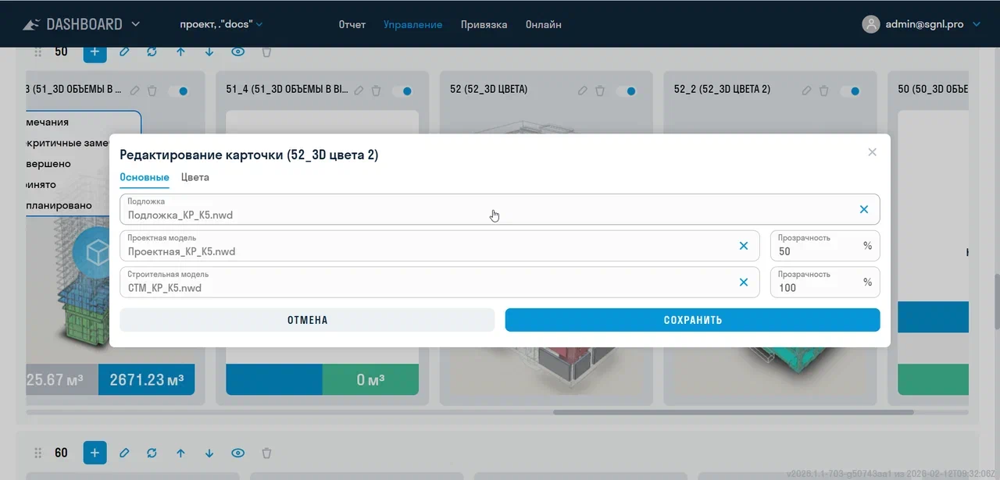

**Настройка карточки**

1. На вкладке «Основные» выберите «Подложку» (необязательно), «Проектную модель» и «Строительную модель». Для проектной и строительной моделей укажите «Прозрачность» в процентах (по умолчанию 100).
2. На вкладке «Цвета» включите легенду на превью (при необходимости), подпишите системные цвета и добавьте цвета TOOLS.
3. Сохраните карточку.

В просмотре нажмите на цвет легенды для выделения соответствующих элементов; повторное нажатие снимает выбор. Кнопка «Снимок для превью» при редактировании отчёта работает так же, как в карточке 52.

#
**[<   DASHBOARD. Карточки 40. Объёмы](/ru/dash/cards-40)     **|**     [DASHBOARD. Карточки 60. DOCS    >](/ru/dash/cards-60)**
