**[<   DASHBOARD. Карточки 40. Объёмы](/ru/dash/cards-40)     **|**     [DASHBOARD. Карточки 60. DOCS    >](/ru/dash/cards-60)**

 <a href="/dash/cards-50/updates" onclick="event.stopPropagation();" style="color: inherit; text-decoration: none;">🔄 Что нового (история изменений этого функционала)</a>

---

# Вкладки{.tabset}

## Подготовка 3D-моделей

### С чего начать {#3d-preparation}

Карточки 50-х используют модели из DOCS. До настройки карточки подготовьте свойства элементов и обработайте нужную версию файла в Autodesk.

### Разделы {.tabset}

#### Выбор карточки и подключение модели

**Выберите карточку под задачу**

- [50_3D объёмы в BIM по датам *Посмотреть план и факт с накоплением до даты или по выбранным датам*](#card-50)
- [51_3D объём в BIM за период *Посчитать объёмы за период с начальной и конечной датами*](#card-51)
- [52_3D Цвета *Посмотреть одну модель с раскраской по свойствам элементов*](#card-52)
- [52_2_3D Цвета 2 *Совместно посмотреть проектную и строительную модели с отдельной прозрачностью*](#card-52-2)
{.links-list}

**Доступность карточек:** 50 — плановый отчёт и «Онлайн»; 51, 52 и 52_2 — плановый отчёт.

##### Подготовка источника в DOCS {#model-preparation}

1. Подготовьте модель с нужными свойствами. Для 50 и 51 требуются работы, даты и количественные показатели; для 52 и 52_2 — цветовые свойства.
2. Сохраните файл с этими свойствами и загрузите его в DOCS нужного проекта.
3. Выполните обработку нужной версии в Autodesk и дождитесь её завершения. Форматы файлов и порядок обработки описаны в [инструкции DOCS](/docs/viewers#bim).
4. Откройте обработанную модель в DOCS и проверьте свойства одного элемента: категорию, название параметра и его значение.
5. Выберите файл в настройках карточки. Если используется подложка или вторая модель, подготовьте и обработайте каждый из этих файлов.
6. Проверьте результат на небольшой выборке: для 50/51 выберите одну работу и дату, для 52/52_2 — один цвет легенды.

Просмотр файла в SIGNAL Viewer или Tangl не заменяет его обработку в Autodesk для 3D-карточек DASH.

Для моделей из Revit перенос S-параметров в категорию `SIGNAL` описан в [TOOLS: «Копировать из R»](/tools/navis/properties).

Для обычного просмотра карточки пользователю нужен доступ к источнику в DOCS. Права DASH и DOCS проверяются отдельно. Общие права описаны в [настройках проекта](/dash/settings#card-access), а внешний просмотр — в [публичных ссылках](/dash/settings#public-links).

#### Свойства модели для расчёта объёмов

Карточки 50 и 51 рассчитывают объёмы по свойствам элементов модели: виду работ, единице измерения и датам выполнения. В таблице приведены свойства по умолчанию для моделей SIGNAL. Проверяйте их в обработанной модели DOCS. Свойство с похожим названием в другой категории может не использоваться в расчёте.

| Что определяет | Категория → свойство | Пример значения |
|---|---|---|
| Вид работ | `SIGNAL → Work` | `Бетонирование` |
| Единица измерения работ | `SIGNAL → Unit` | `м3` |
| Подрядчик | `SIGNAL → Contractor` | `Подрядчик А` |
| Дата для «План ГРП» | `SIGNAL → Baseline` | `2026.11.09` |
| Дата для «План» | `SIGNAL → Planned` | `2026.11.10` |
| Дата для «Факт» | `SIGNAL → Completed` | `2026.11.12` |
| Дата для «Принято» | `SIGNAL → Accepted` | `2026.11.13` |
| Дата для «Закрыто» | `SIGNAL → Closed` | `2026.11.14` |

**Для сравнения плана и факта заполните:** работу, единицу и даты `Planned` / `Completed`.

- Формат даты — **год.месяц.день**, например `2026.11.12`.
- Без работы или нужной даты элемент не входит в соответствующий расчёт.
- Если подрядчик не указан, элемент попадёт в «Без подрядчика».
{.grid-list}

Справочник свойств объёма, площади, длины и единиц работ

**Откуда берутся объём, площадь и длина**

На одноимённых вкладках настройки карточки перечислены пары «Категория / Свойство». По умолчанию используются следующие варианты:

| Показатель | Свойства категории «Объект» | Свойства категории `Element` |
|---|---|---|
| Объём | `Объем`, `S Объем`, `S Volume` | `S Volume`, `Volume` |
| Площадь | `Площадь`, `S Площадь`, `S Area` | `S Area`, `Area` |
| Длина | `Длина`, `S Длина`, `S Length` | `S Length`, `Length` |
{.dense}

Если в модели другое свойство, укажите его категорию и название в настройках карточки. Числовые значения должны соответствовать единицам и масштабу модели. Список служит для поиска показателя: значения всех перечисленных свойств одного элемента не складываются. Используется первое найденное положительное значение.

**Единицы работ**

| Значения свойства `Unit` | Показатель в карточке |
|---|---|
| `м3`, `m3` | Объём, м³ |
| `м2`, `m2` | Площадь, м² |
| `м`, `m` | Длина, м |
| `шт`, `pcs` | Количество элементов, шт. |
| `компл`, `set` | Количество элементов, компл. |
{.dense}

Если единица в модели отсутствует или не распознана, используется единица из настройки карточки на вкладке «Основные». Проверьте её явно.

Единица выбирает используемый показатель. Замена её названия не исправляет неверные исходные значения или масштаб модели.

Если на одном элементе несколько работ или слоёв

**Несколько работ на одном элементе**

Если включён флажок «Отобразить список работ Завершить 1, Завершить 2, Завершить 3», в просмотре появляется дополнительный список «Завершено». Он позволяет выбрать основной набор свойств или отдельные слои работ:

| Пункт списка | Работа | Единица | Плановая дата | Фактическая дата |
|---|---|---|---|---|
| Завершено | `Work` | `Unit` | `Planned` | `Completed` |
| Завершено (1-ый слой) | `Work1` | `Unit1` | `Planned1` | `Completed1` |
| Завершено (2-й слой) | `Work2` | `Unit2` | `Planned2` | `Completed2` |
| Завершено (3-й слой) | `Work3` | `Unit3` | `Planned3` | `Completed3` |

Все эти свойства относятся к категории `SIGNAL`. Заполняйте связанные поля одного набора вместе. Затем в фильтре «Работы» выберите нужные названия работ из выбранных наборов.

#### Обновление файла модели

1. Загрузите новую версию того же файла в DOCS и обработайте эту версию в Autodesk.
2. Закройте и снова откройте карточку. При открытии запрашивается текущая версия выбранного файла.
3. Проверьте работы, даты, единицы и цвета: их состав мог измениться вместе с моделью.
4. Если вы сохраняли значения и изображение превью, актуализируйте их отдельно средствами карточки.

Если создан другой файл вместо новой версии прежнего, выберите новый файл в настройках карточки. Для нескольких моделей проверьте каждый источник.

> Дата опубликованного отчёта не закрепляет историческую версию интерактивной модели. Сохранённое изображение превью также не заменяется автоматически после загрузки новой версии файла.
{.is-warning}

#### Проблемы загрузки модели

Если карточка не раскрывается или файл модели не загружается, проверьте источник в DOCS. Эти проверки относятся ко всем 3D-карточкам.

| Что происходит | Что проверить |
|---|---|
| Карточка 50 или 51 не раскрывается | Выбрана ли основная модель в настройках карточки |
| Появляется сообщение о необработанной модели | Откройте файл в DOCS и проверьте обработку текущей версии в Autodesk; дождитесь завершения и откройте карточку повторно |
| Появляется ошибка доступа или загрузки | Существует ли выбранный файл и доступен ли он этому пользователю в DOCS |
| Не загружается подложка или вторая модель | Версию, обработку и доступ к каждому выбранному файлу |

Если геометрия уже видна, но отсутствуют значения или цвета, используйте проверки в описании [карточки 50](#volume-data-check), [52](#color-data-check) или [52_2](#models-position-check).

## 50_3D объёмы в BIM по датам

### 50_3D объёмы в BIM по датам {#card-50}

> Карточка помогает оценить выполнение работ: сравнить плановый и фактический объёмы на выбранную дату или за диапазон дат, увидеть результат на модели и графике.
{.is-info}

Отображение карточки в режиме пользователя: снимок модели, плановый и фактический объёмы и отклонение между ними.

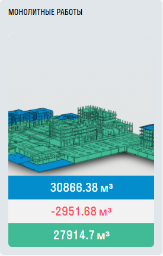

### Разделы {.tabset}

#### Настройка карточки

Перед настройкой выполните [подготовку модели в DOCS](#model-preparation) и проверьте [свойства работ, дат и единиц](#model-properties).

1. На вкладке «Основные» выберите модель из DOCS. При необходимости добавьте модель подложки. Укажите плановый и фактический объёмы, единицу измерения и включите отображение списка видов работ «Завершить 1, 2, 3», если он нужен в карточке. Если объёмы берутся из модели, поля ручного ввода недоступны.
2. На вкладке «Условные обозначения» включите показ легенды на превью и внутри карточки, подпишите системные цвета (красный, жёлтый, зелёный). Кнопкой «+» можно добавить цвета, заданные в TOOLS, и подписать их.
3. На вкладках «Объем», «Площадь» и «Длина» проверьте свойства модели (категория и свойство), по которым рассчитываются показатели. Строки можно добавлять и удалять.
4. На вкладке «Тип» включите переключателями типы элементов, которые нужно показывать («План ГРП», «План», «Факт», «Принято», «Закрыто»), при необходимости измените свойство модели и цвет типа.
5. На вкладке «Цвета» выберите цветовую схему плана и факта из двух вариантов.
6. Сохраните карточку.

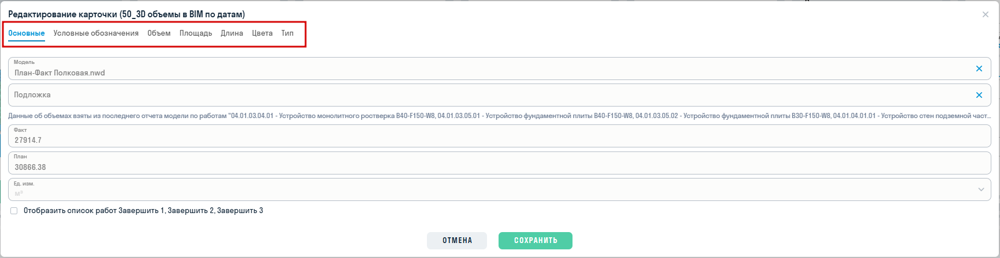

#### Просмотр модели и выбор дат

Нажмите на карточку, чтобы открыть модель. Внизу показаны значения типов, включённых в настройках на вкладке «Тип». Для стандартной пары «План/Факт» между значениями отображается отклонение; [формула и условия показа](#volume-calculation) описаны в разделе «Расчёт объёмов». Нажатие на значение включает или отключает его раскраску в модели — при раскраске «План-факт».

Отображение карточки при раскрытии:

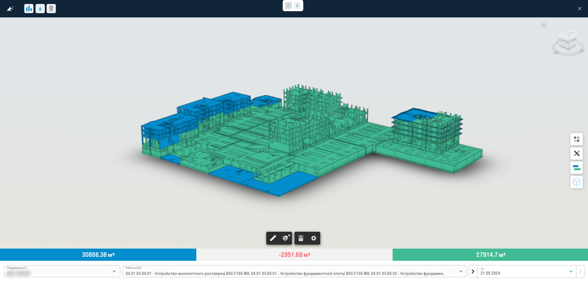

Доступны фильтры:

- **«Подрядчик»** (элементы без подрядчика собраны в пункте «Без подрядчика»);
- **«Работы»**;
- **«Завершено»** — выбор основного набора или слоёв работ, если включён соответствующий список в настройках; [связанные свойства](#model-properties);
- **«До»** — выбор дат.

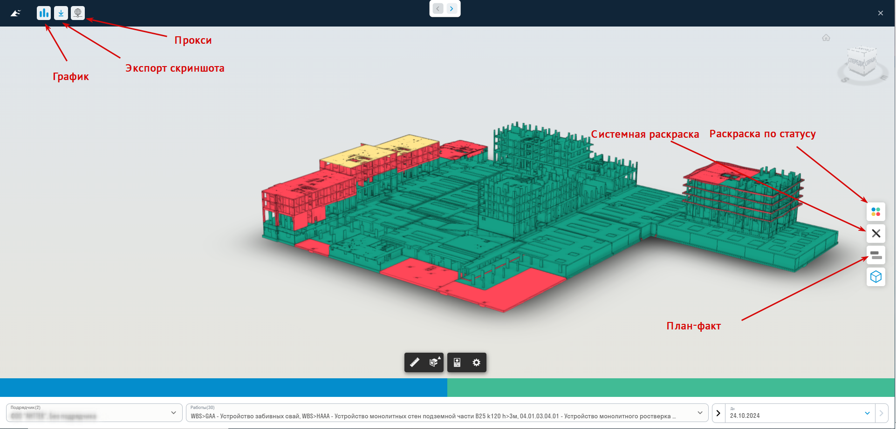

##### Выбор дат в карточке 50 {#dates-50}

| Действие | Какие даты учитываются |
|---|---|
| Обычное нажатие на дату в списке «До» | Все доступные даты с начала списка до выбранной включительно |
| Стрелка рядом со списком | Предыдущая или следующая доступная дата с накоплением от начала списка |
| Включить «Диапазон», затем нажать начальную и конечную даты | Только даты между этими границами включительно |
| Нажатие с удержанием Shift после выбора опорной даты | Диапазон до нажатой даты добавляется к текущей выборке |
| Общий флажок в списке | Выбор всех доступных дат или снятие выбора |

Цветные метки рядом с датой соответствуют типам из настройки «Тип», для которых в модели есть данные на эту дату. Если даты не выбраны, расчётная выборка пуста.

Обычный выбор «До» и режим «Диапазон» дают разные результаты на одной модели — см. [числовой пример](#volume-example).

Кнопки в просмотре:

- **График** — переключает просмотр между моделью и графиком «План-факт».
- **Раскраска модели** (справа от модели): «Раскраска по статусу» — цвета из свойств модели (недоступна, если таких цветов нет), «Системная раскраска» — исходные цвета модели, «План-факт» — раскраска по типам. Рядом кнопка скрытия остальных элементов модели.
- **Легенда** (если включена в настройках) — нажатие на цвет оставляет в модели элементы этого цвета, повторное нажатие отменяет выбор.
- **Снимок экрана** — сохраняет изображение рабочей области.

Положительный ручной план может заменять вычисленный — см. [правила расчёта и использования ручных значений](#volume-calculation).

> Если у выбранных работ разные единицы измерения, значения плана, факта и отклонения не отображаются. Выберите работы с одной единицей измерения и проверьте свойства единиц в модели. Если данных по выбранным работам нет, появится сообщение «Нет данных для отображения».
{.is-warning}

##### Работа с графиком {#volume-chart}

Кнопка «График» переключает модель на график по выбранным работам и датам. На нём показываются типы, включённые в настройках карточки.

- Шаг временной шкалы можно менять: день, неделя, месяц или квартал.
- Линия показывает накопленное значение по отобранным данным. В карточке 51 накопление строится внутри выбранного периода; точка линии не означает объём только за этот день.
- Положительный ручной план может отличаться от линии плана: линия строится по датам и элементам модели.

Сохранение выбранных фильтров, чисел и снимка описано на вкладке [«Фильтры и превью»](#editor-actions).
  
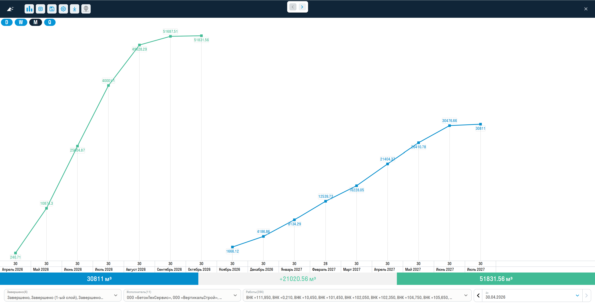

#### Расчёт объёмов

##### Как рассчитываются значения 50 и 51 {#volume-calculation}

Карточка отбирает элементы по подрядчику, работам, типам и датам. Затем для каждого типа отдельно суммирует выбранный показатель: объём, площадь или длину. Для штук и комплектов считается количество элементов.

- Один элемент в итоговом значении типа учитывается один раз, даже если он найден через несколько выбранных работ или дат.
- Для геометрических величин учитывается масштаб модели. Итог округляется до двух знаков после запятой.
- Показатель выбирается по единице работ, а его свойства — на вкладках «Объем», «Площадь» и «Длина». Подробнее — в [подготовке свойств модели](#model-properties).

**Как влияют ручные значения**

Если на вкладке «Основные» поля доступны для ввода и «План» больше нуля, этот план используется и в раскрытой карточке. Он может не меняться при смене дат и работ. Без положительного ручного плана значение рассчитывается по модели.

Ручной «Факт» задаёт значение превью; в раскрытой карточке факт рассчитывается по модели. Если поля на «Основных» заблокированы, см. [как переключить источник значений превью](#preview-values).

Для стандартной пары «План» и «Факт» отклонение равно **факт − план**. Отдельное значение отклонения показывается при двух включённых типах и одинаковых единицах. Если включены дополнительные типы, ориентируйтесь на значения каждого типа.

##### Пример расчёта по датам {#volume-example}

В примере два разных элемента одной работы и одного подрядчика. Объёмы уже приведены к м³. Используются обычные свойства `Work`, `Unit`, `Planned` и `Completed`; положительный ручной план не задан.

**Исходные данные модели**

| Элемент | Работа | Объём | Плановая дата | Фактическая дата |
|---|---|---|---|---|
| А | Бетонирование | 10 м³ | 10.11.2026 | 11.11.2026 |
| Б | Бетонирование | 20 м³ | 12.11.2026 | 14.11.2026 |

**Результат выбора дат**

| Выбор дат | План | Факт |
|---|---|---|
| Карточка 50: обычный выбор «До» 12.11.2026 | 30 м³ — обе плановые даты | 10 м³ — только элемент А |
| Карточка 50: «Диапазон» 12–14.11.2026 | 20 м³ — элемент Б | 20 м³ — элемент Б |
| Карточка 51: период 12–14.11.2026 | 20 м³ — элемент Б | 20 м³ — элемент Б |

В первой строке отклонение для пары «План/Факт» составляет **10 − 30 = −20 м³**. Во второй и третьей строках фактическая дата элемента А не входит в выборку, хотя работы по нему выполнены раньше.

#### Проверка объёмов и фильтров

Проверки для карточек 50 и 51: модель загрузилась, но работы, даты или объёмы отсутствуют либо отличаются от ожидаемых.

| Что происходит | Что проверить |
|---|---|
| Нет нужной работы | Значение `Work` или `Work1/2/3`, категорию свойства, выбранный подрядчик и набор в списке «Завершено» |
| Нет нужной даты | Дату у элементов выбранной работы и типа, её формат и включение типа в настройках |
| Элементы есть, но объём не получается | Числовой показатель, пары «Категория / Свойство» и соответствие единиц в [подготовке модели](#model-properties) |
| План одинаковый при смене дат | Не задан ли положительный ручной план; проверьте [правила расчёта](#volume-calculation) |
| Значения превью отличаются от раскрытой карточки | Ручные поля «Основных», настройку использования данных модели, выбранные работы и даты |
| Часть геометрии исчезла | Выбранный цвет легенды, включённые типы и режим раскраски; отмените отбор по цвету и проверьте фильтры |

Если не загружается сама геометрия, начните с [проверки источника в DOCS](#model-loading). Для карточки 51 дополнительно проверьте обе границы периода.

## 51_3D объём в BIM за период

### 51_3D объём в BIM за период {#card-51}

> Карточка помогает сравнить плановый и фактический объёмы работ за заданный период. Учитываются даты от начала до конца периода включительно. Отличие от выбора дат в [карточке 50](#card-50) показано в [числовом примере](#volume-example).
{.is-info}

Отображение карточки в режиме пользователя: снимок модели, плановый и фактический объёмы.

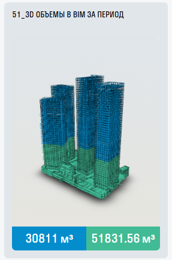

### Настройка карточки

Требования к источнику и связанным свойствам — в [подготовке 3D-моделей](#model-preparation).

1. Заполните вкладки «Основные», «Условные обозначения», «Объем», «Площадь», «Длина», «Тип» и «Цвета» так же, как в [карточке 50](#card-50): окно настройки у карточек общее.
2. Плановый и фактический объёмы на вкладке «Основные» выводятся на превью карточки. Условия использования ручного плана и расчёт по модели описаны в [общих правилах для 50 и 51](#volume-calculation).
3. Сохраните карточку.
  
  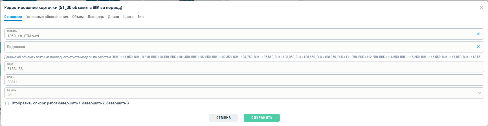

### Просмотр модели за период

Нажмите на карточку, чтобы открыть модель. Внизу показаны значения за выбранный период по типам, включённым ранее в настройках на вкладке «Тип». Каждый элемент модели учитывается в значении один раз, даже если в период попадает несколько его дат. Нажатие на значение включает или отключает его раскраску в модели — при раскраске «План-факт».

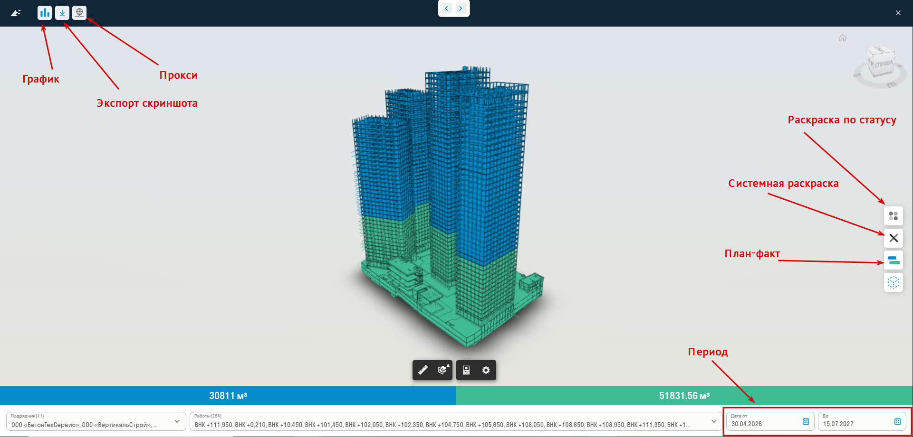

Доступны фильтры:

- **«Завершено»** — выбор основного набора или слоёв работ, если включён соответствующий список в настройках; [связанные свойства](#model-properties);
- **«Подрядчик»** (элементы без подрядчика собраны в пункте «Без подрядчика»). При смене подрядчика выбор работ и период сбрасываются на все доступные;
- **«Работы»**;
- **«Дата от»** и **«До»** — начало и конец периода. При открытии применяются сохранённые фильтры, если они заданы. Без сохранённых фильтров период охватывает все даты, которые есть в модели по выбранным подрядчикам. «Дата от» нельзя выбрать позже «До», обе даты ограничены датами модели. Значения рассчитываются, когда заполнены обе даты.

Для сохранения подрядчиков, работ и дат используйте [«Сохранить фильтры»](#saved-filters).

Кнопки в просмотре — как в [карточке 50](#card-50): **График** (план-факт по датам выбранного периода), **Раскраска модели** и скрытие остальных элементов, **Легенда** (если включена «Отображать легенду внутри карточки») и **Снимок экрана**.

> Если у выбранных работ разные единицы измерения, значения не отображаются. Выберите работы с одной единицей измерения и проверьте свойства единиц в модели. Если данных по выбранным работам нет, появится сообщение «Нет данных для отображения».
{.is-warning}

Правила подсчёта и округления — в [расчётах 50/51](#volume-calculation). График строится с накоплением по данным выбранного периода; подробнее — в [работе с графиком](#volume-chart).

Сохранение выбранных фильтров, чисел и снимка описано на вкладке [«Фильтры и превью»](#editor-actions).

Если модель видна, но значения не совпадают с ожидаемыми, проверьте обе границы периода и используйте [проверки данных 50/51](#volume-data-check). Если не открывается сама модель — [проверьте источник в DOCS](#model-loading).

## 52_3D Цвета

### 52_3D Цвета {#card-52}

> Карточка показывает модель с раскраской элементов по цветам из свойств модели. Цвета можно передать из Navisworks с помощью [«Раскраски» TOOLS](/tools/navis/coloring). В отличие от карточек 50 и 51, плановый и фактический объёмы здесь не рассчитываются.
{.is-info}

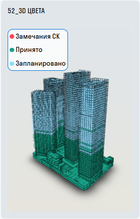

Цвет элемента берётся из свойств «IssueColor», «UserColor» или «Color» категории «SIGNAL» модели.

### Разделы {.tabset}

#### Настройка карточки

До подключения выполните [подготовку источника в DOCS](#model-preparation). Допустимые значения цветовых свойств и отличие цвета от подписи легенды описаны в разделе [«Цвета модели и подписи легенды»](#model-colors).

1. На вкладке «Основные» выберите «Модель» из DOCS и при необходимости «Подложку».
2. На вкладке «Цвета»:
   - включите «Отображать легенду на превью», если легенда нужна на превью карточки;
   - подпишите системные цвета: красный, жёлтый и зелёный;
   - кнопкой «+» добавьте цвета TOOLS, выберите цвет и подпишите его. Лишний цвет можно удалить. Когда добавлены все цвета TOOLS, кнопка «+» недоступна.
3. Сохраните карточку.

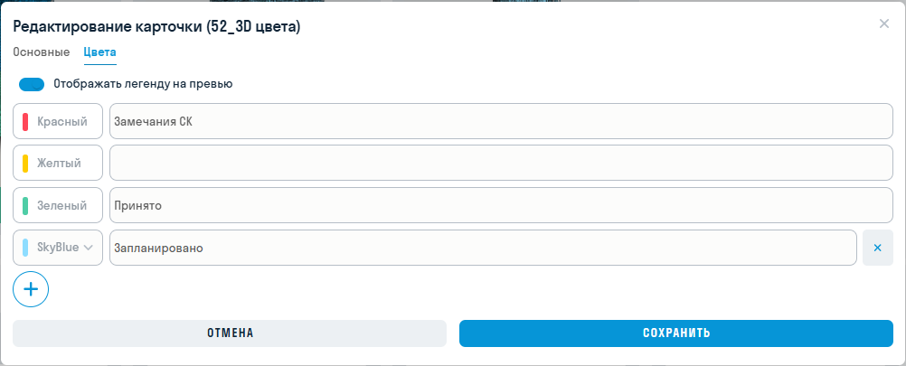

#### Раскраска модели и легенда

Нажмите на карточку, чтобы открыть модель. Элементы окрашены в цвета из свойств модели. Слева вверху находится панель «Легенда» (на телефоне она свёрнута). В легенде показываются только цвета с подписью; если подписей нет, в ней выводится «Нет данных».

Нажмите на цвет в легенде, чтобы оставить в модели только элементы этого цвета. Повторное нажатие возвращает всю модель.

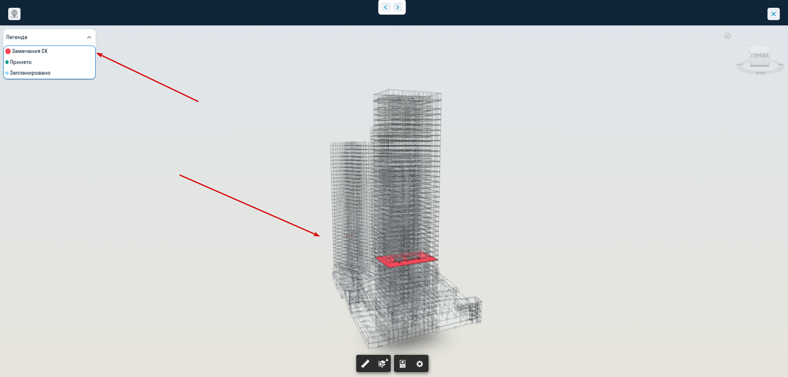

Чтобы сохранить изображение модели, используйте [«Снимок для превью»](#preview-image).

##### Цвета модели и подписи легенды {#model-colors}

Раскраска определяется сохранёнными значениями свойств модели. Простое изменение внешнего вида элемента в Navisworks не всегда меняет эти свойства. Подготовка цвета описана в [инструкции TOOLS](/tools/navis/coloring).

В категории `SIGNAL` используются свойства `IssueColor`, `UserColor` и `Color`. Поддерживаются следующие значения:

| Группа | Значения свойств |
|---|---|
| Системные цвета | `Red`, `Yellow`, `Green` |
| Дополнительные цвета | `Violet`, `Blue`, `DarkBlue`, `SkyBlue`, `Orange`, `DarkOrange`, `SaladGreen`, `Pink`, `Burgundy`, `Gray`, `MediumGray`, `LightGray` |

Передавайте название цвета как значение свойства, например `UserColor = Blue`. Произвольный HEX-код или текст «Синий» не заменяет это значение.

Подпись легенды задаётся в карточке: например, для `Blue` можно написать «Передано подрядчику». Она объясняет цвет читателю, но не присваивает его элементам и не настраивает связь со статусами DOCS.

Если у элемента заполнено несколько цветовых свойств с разными значениями, его итоговый цвет зависит от выбора свойства. Для однозначного результата согласуйте значения цветовых свойств в исходной модели.

#### Проверка раскраски модели

Если модель загрузилась, но цвета или отбор по легенде не соответствуют ожидаемым, проверьте следующее.

| Что происходит | Что проверить |
|---|---|
| Модель открылась, но нужный цвет не появился | Категорию `SIGNAL`, наличие цветового свойства и точное значение из таблицы выше |
| Цвет есть в легенде, но нажатие ничего не показывает | Есть ли элементы с этим значением в модели; подпись легенды не подтверждает наличие таких элементов |
| Цвет элемента отличается от ожидаемого | Нет ли разных цветов в `IssueColor`, `UserColor` и `Color`; какая версия модели открыта |
| После выбора цвета пропали остальные элементы | Это отбор по легенде. Повторно нажмите выбранный цвет для отмены отбора |
| Превью осталось прежним после изменения модели | Подготовлена ли [новая версия файла модели](#model-versions) и создан ли новый снимок для превью |

## 52_2_3D Цвета 2

### 52_2_3D Цвета 2 {#card-52-2}

> Карточка показывает одновременно проектную и строительную модели и модель подложки с раскраской элементов по цветам из свойств моделей. Для проектной и строительной моделей прозрачность настраивается отдельно.
{.is-info}

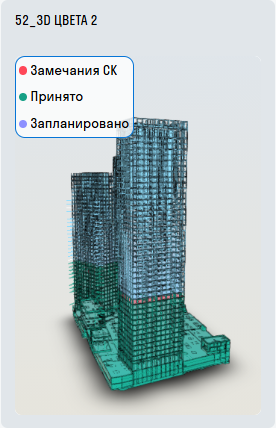

### Настройка моделей и прозрачности

Каждый выбранный файл должен быть [подготовлен в DOCS](#model-preparation). Назначение моделей и проверка их совместного расположения описаны в разделе [«Назначение моделей»](#model-roles).

1. На вкладке «Основные» выберите «Подложку» (необязательно), «Проектную модель» и «Строительную модель».
2. Для проектной и строительной моделей укажите «Прозрачность» в процентах. При значении 100 (по умолчанию) модель непрозрачна; чем меньше значение, тем прозрачнее модель. При значении меньше 100 элементы без цвета показываются серым.
3. На вкладке «Цвета» настройте легенду так же, как в [карточке 52](#card-52).
4. Сохраните карточку.
  
  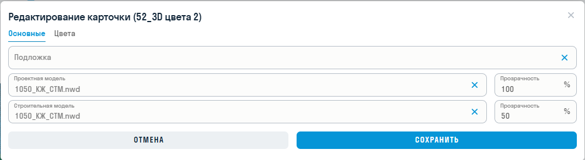

### Совместный просмотр моделей

Цвета из свойств применяются к проектной и строительной моделям с заданной прозрачностью. Нажмите на цвет в легенде, чтобы оставить в обеих моделях только элементы этого цвета; повторное нажатие возвращает модели целиком. Сохранение изображения модели описано в [«Снимке для превью»](#preview-image).
  
  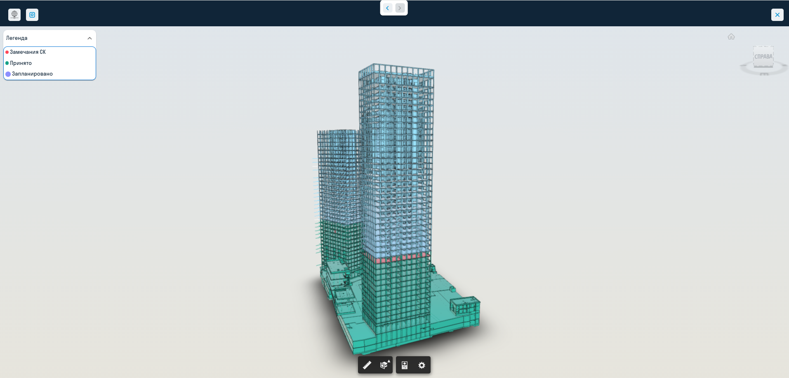

##### Назначение моделей {#model-roles}

| Источник | Для чего используется |
|---|---|
| Проектная модель | Основная модель для просмотра проектных решений и их цветовых свойств |
| Строительная модель | Вторая модель для совместного просмотра; для неё отдельно задаётся прозрачность |
| Подложка | Дополнительное окружение для ориентации, например соседние конструкции; не обязательна |

До подключения проверьте совместное расположение моделей: их координаты и масштаб должны позволять рассматривать один и тот же объект в общей сцене.

Карточка показывает модели вместе, но не сопоставляет элементы и не составляет автоматический отчёт о различиях геометрии. Одинаковый цвет в двух моделях означает одинаковое значение цветового свойства, а не найденную связь между элементами.

Для проектной и строительной моделей используются [те же значения цветовых свойств и правила легенды](#model-colors). В режиме раскраски и при отборе по цвету подложка скрывается, чтобы не перекрывать выбранные элементы.

### Проблемы совместного просмотра {#models-position-check}

Если в карточке 52_2 не видна проектная, строительная модель или подложка либо модели расположены неправильно, проверьте следующее.

| Что происходит | Что проверить |
|---|---|
| Видна только одна модель | Выбраны ли оба файла, доступна ли их обработка в DOCS; затем проверьте прозрачность каждой модели |
| Модели находятся далеко друг от друга | Координаты и масштаб исходных моделей, их совместное расположение до подключения |
| Подложка выбрана, но не показывается | При цветовой раскраске и отборе по легенде подложка скрывается; наличие файла в настройках не означает его видимость в этом режиме |

Если геометрия видна, но цвет отличается от ожидаемого, используйте [проверки раскраски](#color-data-check).

## Фильтры и превью

### Сохранение вида и данных карточки {#editor-actions}

Здесь описаны действия в окне раскрытой 3D-карточки: сохранение фильтров, перенос числовых значений на превью и создание снимка.

### Разделы {.tabset}

#### Кнопки раскрытой карточки

1. Откройте раздел **«Управление»** и выберите отчёт.
2. Нажмите на превью 3D-карточки, чтобы открыть модель.
3. Найдите кнопки в заголовке над моделью. Для карточек 50/51 кнопка с **шестерёнкой** открывает отдельное окно **«Настройки»**.

Окно «Редактирование карточки» с вкладками «Основные», «Условные обозначения», «Объем» и другими используется для выбора источника и настройки карточки. Флажок переноса значений на превью находится в отдельном окне «Настройки» раскрытого просмотра.

Для настройки значений превью используйте «Управление» с доступом администратора. Если шестерёнки нет, проверьте раздел, в котором открыта карточка, и [права пользователя](/dash/settings#card-access). В читательском просмотре отчёта и по публичной ссылке эти действия недоступны.

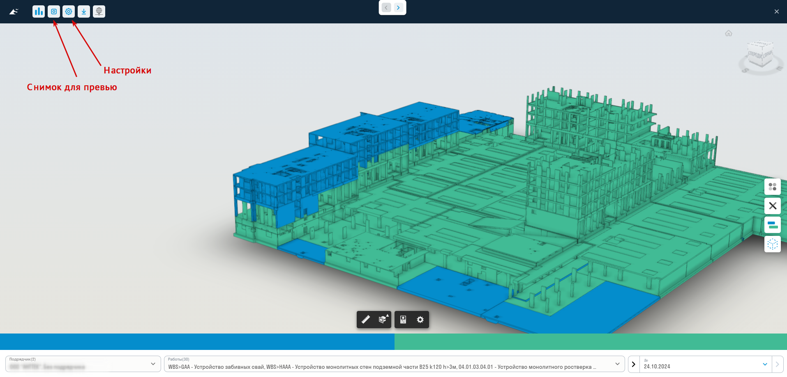

#### План и факт на превью

Для карточек 50 и 51 можно перенести на превью значения из модели или задать их вручную.

##### Взять значения из модели

1. В раскрытой карточке выберите подрядчиков, работы и даты.
2. В её заголовке нажмите **шестерёнку → «Настройки»**.
3. Включите флажок **«Использовать текущие данные для превью»** и нажмите **«Обновить»**.

Выбранные значения «План», «Факт» и единица измерения сохранятся для превью. В окне редактирования на «Основных» эти поля будут заблокированы; над ними появится сообщение **«Данные об объемах взяты из последнего отчета модели по работам…»**.

##### Вернуться к ручному вводу

1. В том же окне **шестерёнка → «Настройки»** выключите флажок и нажмите **«Обновить»**. Значения «План» и «Факт» превью обнулятся.
2. Закройте просмотр модели, откройте редактирование карточки и вкладку **«Основные»**.
3. Заполните доступные поля «План», «Факт» и единицу измерения, затем сохраните карточку.

Влияние ручного плана на раскрытый просмотр описано в [расчётах 50/51](#volume-calculation).

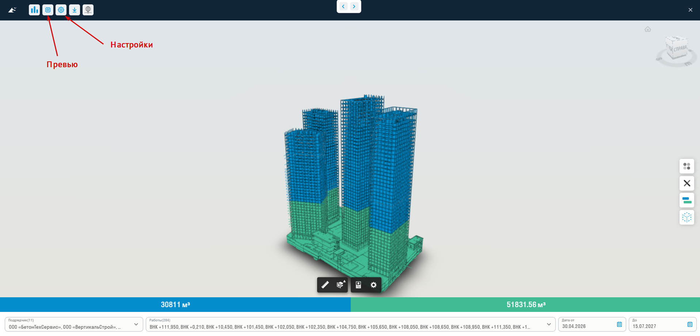

#### Сохранение фильтров

Для карточек 50 и 51 сохраните выбранные подрядчиков, работы и даты, чтобы восстановить их при следующем открытии.

1. Откройте карточку с правом редактирования и выберите подрядчиков, работы и даты.
2. Нажмите кнопку с дискетой **«Сохранить фильтры»** в заголовке просмотра.
3. При следующем открытии карточка восстановит этот набор, в том числе на вкладке **«Отчёт»**.

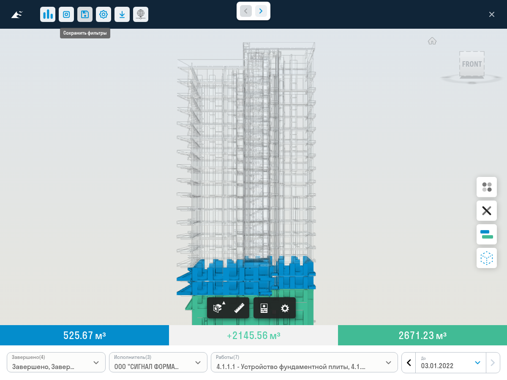

При просмотре можно временно менять фильтры для анализа. Сохранённый набор изменяется только после повторного нажатия **«Сохранить фильтры»**. Кнопка сохранения доступна пользователю с правом редактирования; обычный просмотр не изменяет настройки карточки.

Сохранение фильтров и создание снимка для превью — отдельные действия. Для изображения превью используйте кнопку **«Снимок для превью»**.

#### Изображение превью и PPTX

Снимок сохраняет изображение модели для превью и экспорта в PPTX. Это отдельное действие от сохранения фильтров и числовых значений.

1. Откройте карточку в «Управлении», выберите нужные фильтры и расположите модель.
2. В заголовке просмотра нажмите **«Снимок для превью»**.
3. Проверьте кадр по рамкам **«Презентация»** и **«Предпросмотр»**, затем нажмите **«OK»**.

Кнопка **«Снимок экрана»** в карточках 50/51 сохраняет изображение рабочей области отдельно и не заменяет это действие.

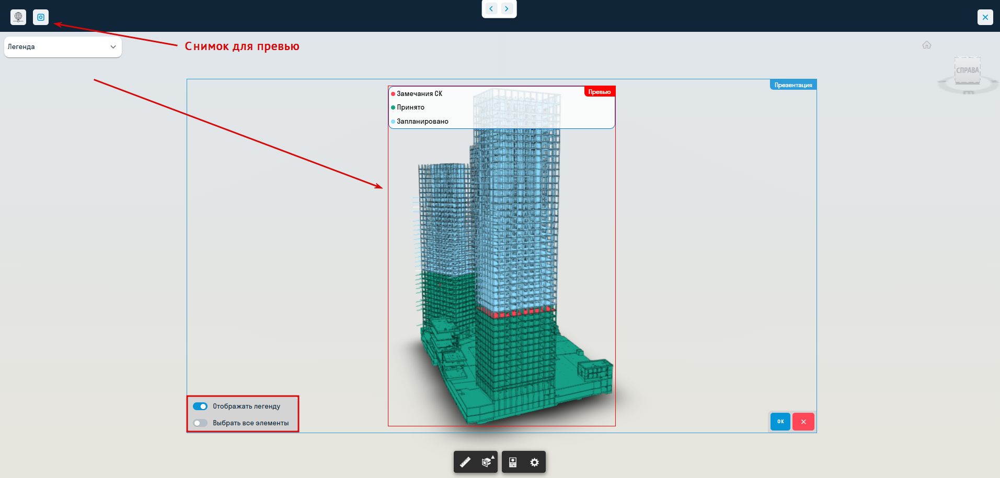

После загрузки новой версии модели проверьте фильтры и сохраните актуальные значения и снимок. Порядок работы с файлом описан в [обновлении модели](#model-versions).

#
**[<   DASHBOARD. Карточки 40. Объёмы](/ru/dash/cards-40)     **|**     [DASHBOARD. Карточки 60. DOCS    >](/ru/dash/cards-60)**
