**[<   DASHBOARD. Карточки 50. 3D карточки](/ru/dash/cards-50)     **|**     [DASHBOARD. Карточки 90. Другие    >](/ru/dash/cards-90)**

 <a href="/dash/cards-60/updates" onclick="event.stopPropagation();" style="color: inherit; text-decoration: none;">🔄 Что нового (история изменений этого функционала)</a>

---

  

    <h4 class="toc-card-title"><a href="#card-61">Карточки_60. DOCS</a></h4>
    <ul class="toc-list">
      <li><a href="#cards-60-settings">Настройки карточек 60-х</a></li>
      <li><a href="#card-61">1.1 61_Динамика замечаний в DOCS</a></li>
      <li><a href="#card-62">1.2 62_Замечания DOCS</a></li>
      <li><a href="#card-63">1.3 63_Общая по согласованиям в DOCS</a></li>
      <li><a href="#card-64">1.4 64_Динамика согласований в DOCS 2</a></li>
      <li><a href="#card-65">1.5 65_Реестр согласований в DOCS</a></li>
      <li><a href="#card-65-2">1.6 65_Согласования DOCS 2</a></li>
      <li><a href="#card-66">1.7 66_SLA по ролям</a></li>
      <li><a href="#card-67">1.8 67_SLA по согласованиям</a></li>
    </ul>
  

# Вкладки{.tabset}
## Настройки карточек 60-х
###### Настройки карточек 60-х {#cards-60-settings}

> Карточки 61–67 получают сведения о замечаниях, согласованиях и проверках из DOCS того проекта, в котором открыт отчёт DASHBOARD. В настройках карточки выбирается, какие данные нужно показать.
{.is-info}

**Назначение карточек**

- [61_Динамика замечаний в DOCS](#card-61) — проследить, как меняется количество замечаний по статусам за недели или месяцы. Данные можно рассматривать за отдельные периоды или накопительным итогом.
- [62_Замечания DOCS](#card-62) — посмотреть статистику замечаний по периодам и перейти к реестру замечаний DOCS за интересующий период.
- [63_Общая по согласованиям в DOCS](#card-63) — увидеть распределение учитываемых согласований по статусам на круговой диаграмме.
- [64_Динамика согласований в DOCS 2](#card-64) — сопоставить накопительный план согласований с их состоянием по неделям.
- [65_Реестр согласований в DOCS](#card-65) — просмотреть список согласований, их статусы, сроки и количество замечаний; открыть нужное согласование в DOCS.
- [65_Согласования DOCS 2](#card-65-2) — найти согласование с помощью поиска и фильтров, просмотреть его этапы и историю версий внутри карточки.
- [66_SLA по ролям](#card-66) — оценить соблюдение сроков завершённых проверок и подписаний выбранными ответственными, сравнить показатели групп и отдельных пользователей.
- [67_SLA по согласованиям](#card-67) — оценить соблюдение договорных сроков завершённых согласований по типам и сценариям.

**Что нужно для получения данных**

1. Проверьте, что в DOCS того же проекта есть замечания или согласования, которые должна учитывать карточка. Типы замечаний и согласований настраиваются в DOCS.
2. В настройках карточки задайте выборку: типы замечаний или согласований, группы ответственных либо сценарии — в зависимости от выбранного типа карточки. Параметры описаны на её вкладке.
3. Сохраните настройки. Для изменения карточки пользователю нужен соответствующий доступ.

Если данных нет, проверьте наличие исходных записей, выбранные параметры и фильтры просмотра. Для карточки 66 нужны завершённые проверки выбранных ответственных. Для перехода к исходному замечанию или согласованию нужен доступ к нему в DOCS.

> Здесь описаны проектные карточки 61–67. Карточка 62 в разделе «Мой отчёт» показывает отдельный реестр замечаний пользователя; её работа описана на вкладке 62.
{.is-info}

## 61_Динамика замечаний в DOCS
###### 61_Динамика замечаний в DOCS {#card-61}

> Карточка показывает на графике, как со временем меняется количество замечаний проекта по статусам: по каждому выбранному статусу строится отдельная линия, а линия «Всего» показывает их сумму.
{.is-info}
  
  **Отображение карточки в режиме пользователя**
  В режиме просмотра отчёта:
  
  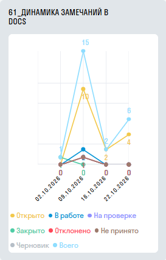

  При открытии карточки:
  
  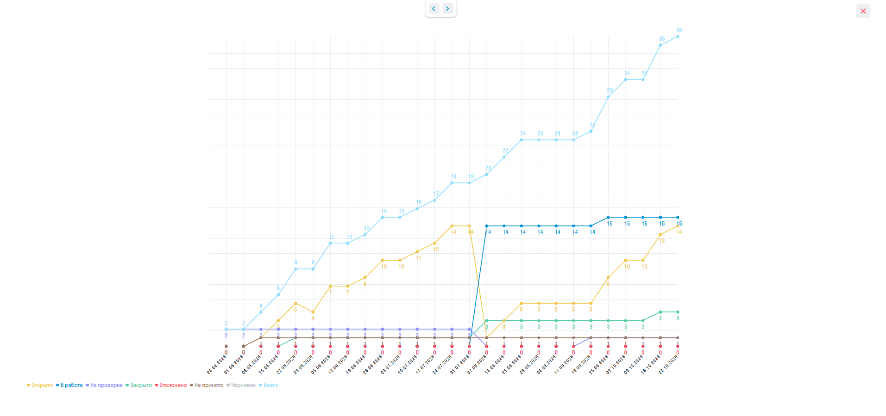
  
  
  
**Настройка карточки**
  
  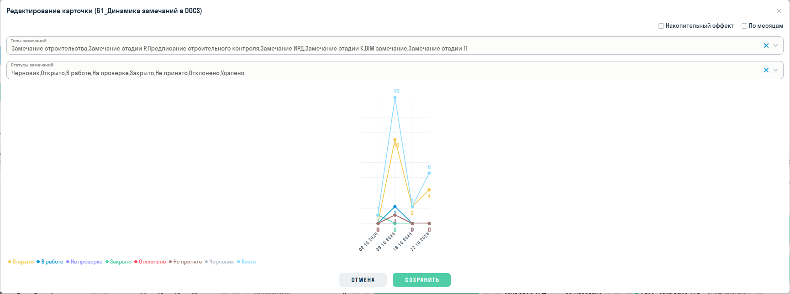

В настройках выберите:

- **Типы замечаний** — учитываются только замечания выбранных типов. Доступны все неудалённые типы проекта и пункт «Выбрать все»;
- **Статусы замечаний** — «Черновик», «Открыто», «В работе», «На проверке», «Закрыто», «Не принято», «Отклонено», «Удалено». Для каждого выбранного статуса (кроме «Удалено») на графике своя линия;
- **Накопительный эффект** — если флажок включён, значение на каждой дате равно числу замечаний с начала проекта по эту дату включительно; если выключен — числу замечаний, появившихся за отдельный период;
- **По месяцам** — если флажок включён, период равен месяцу; если выключен — неделе. По умолчанию включены оба флажка.

Под полями выбора сразу показывается график с текущими настройками. Если не выбрано ни одного типа или ни одного статуса, график остаётся пустым.

## 62_Замечания DOCS
###### 62_Замечания DOCS {#card-62}

> Карточка показывает статистику замечаний DOCS по статусам на графике. При настройке выберите типы замечаний, периодичность и способ подсчёта: накопительный итог или значения за отдельные периоды. При наведении на точку видны подробности, а нажатие на дату открывает реестр замечаний DOCS за этот период.
{.is-info}

**Настройка карточки**

В разделе «Мой отчёт» карточка 62 показывает реестр замечаний пользователя из всех проектов, в которых он состоит. В этом варианте можно фильтровать записи по проекту, типу и статусу замечания.

## 63_Общая по согласованиям в DOCS
###### 63_Общая по согласованиям в DOCS {#card-63}

> Карточка показывает статистику согласований DOCS в виде круговой диаграммы. В настройках выберите типы согласований, которые нужно учитывать.
{.is-info}

## 64_Динамика согласований в DOCS 2
###### 64_Динамика согласований в DOCS 2 {#card-64}

> Карточка показывает на линейном графике, сколько согласований проекта запланировано и в каком статусе они находятся к каждой неделе. Значения нарастающие: на каждую неделю считаются все согласования с начала проекта.
{.is-info}
  
  **Отображение карточки в режиме пользователя**
  В режиме просмотра отчёта:
  
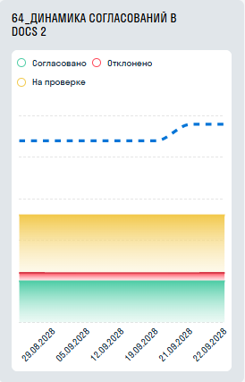
  
  При открытии карточки:
  
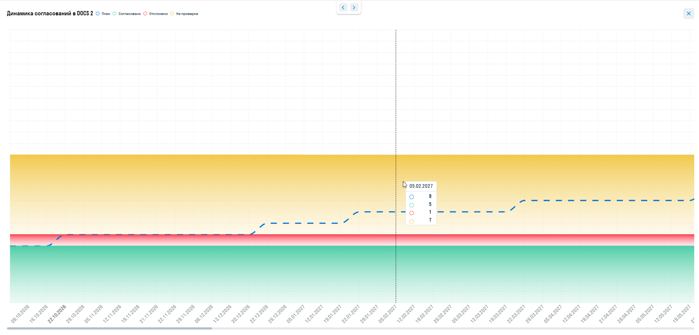
  
  На карточке дашборда показаны последние недели, в полноэкранном просмотре — весь период, график прокручивается по горизонтали и открывается на текущей неделе. При наведении на недельную точку в просмотре отображаются значения по линиям. Над графиком показана легенда с цветами линий «План», «Согласовано», «Отменено» и «На проверке» (только для выбранных статусов).

**Настройка карточки**
  
  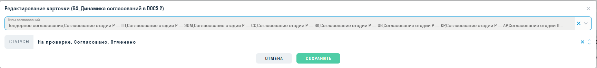

В настройках выберите:

- **Типы согласований** — учитываются согласования только выбранных типов; доступен пункт «Выбрать все»;
- **Статусы** — «Согласовано», «На проверке», «Отменено». Статус «Черновик» в этой карточке недоступен. Для каждого выбранного статуса строится своя линия.

## 65_Реестр согласований в DOCS
###### 65_Реестр согласований в DOCS {#card-65}

> Карточка показывает реестр согласований DOCS. В настройках выберите типы согласований, которые нужно включить в реестр. В строках отображаются статус, сроки и число замечаний в комплекте. Нажмите на строку, чтобы открыть соответствующее согласование в DOCS.
{.is-info}

## 65_Согласования DOCS 2
###### 65_Согласования DOCS 2 {#card-65-2}

> Карточка показывает реестр согласований проекта. От [65_Реестр согласований в DOCS](#card-65) её отличают полноценный просмотр с фильтрами, поиском и постраничным списком, а также возможность открыть этапы и историю версий согласования, не выходя из карточки.
{.is-info}
  
  **Отображение карточки в режиме пользователя**
  В режиме просмотра отчёта:
  
  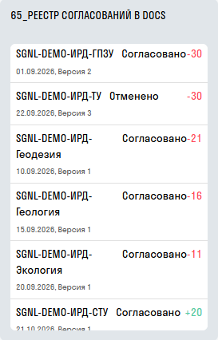

  При открытии карточки:
  
  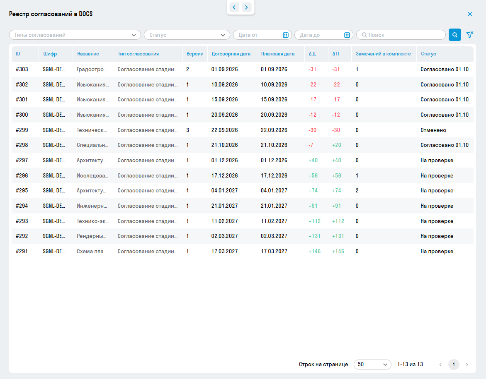
  
  Над таблицей доступны фильтры:

- **Типы согласований** и **Статус** — можно выбрать несколько значений. Если статус не выбран, показываются статусы, заданные в настройках карточки;
- **Дата от** и **Дата до** — диапазон по плановой дате согласования;
- **Поиск** — по тексту записей реестра.

Чтобы применить фильтры, нажмите кнопку поиска; кнопка очистки сбрасывает все фильтры.
  
  **Данные выбранного согласования**

Нажмите на строку реестра: откроется страница согласования внутри карточки. В ней показаны текущая версия и предыдущие версии (если они есть) с таблицей этапов: «Этап», «Ответственный», «ФИО» (кто завершил этап), «Дата начала», «Дата завершения», «План срок» и «Факт срок». Стрелка рядом с названием открывает это согласование в DOCS в новой вкладке, кнопка возврата — к реестру.
  
  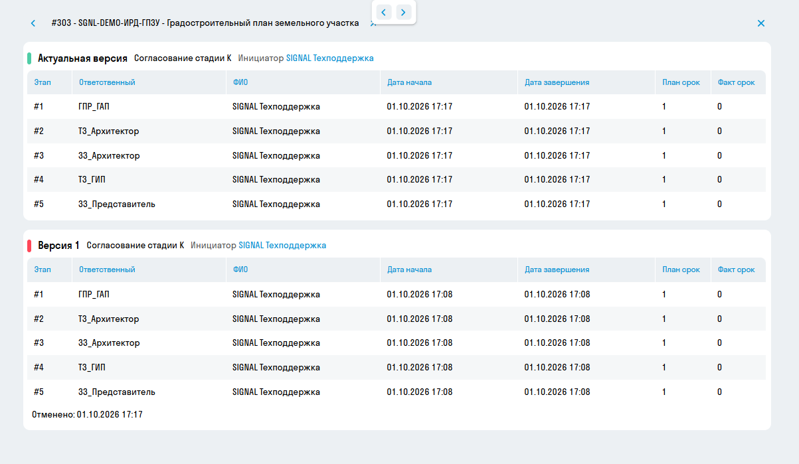

**Настройка карточки**

  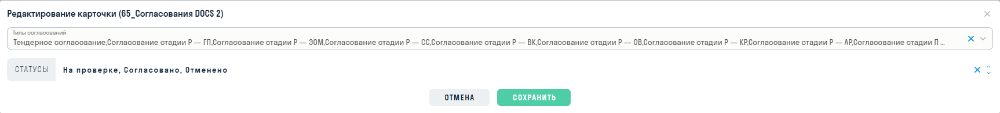
  
В настройках выберите:

- **Типы согласований** — какие типы попадут в реестр; доступен пункт «Выбрать все»;
- **Статусы** — «Согласовано», «На проверке», «Отменено», «Черновик». У новой карточки по умолчанию выбраны все типы и все статусы, кроме «Черновик».

## 66_SLA по ролям
###### 66_SLA по ролям {#card-66}

> Карточка показывает SLA завершённых проверок и подписаний по группам ответственных в проекте. Отдельно отображается количество проверок, завершённых в срок или с просрочкой.
{.is-info}

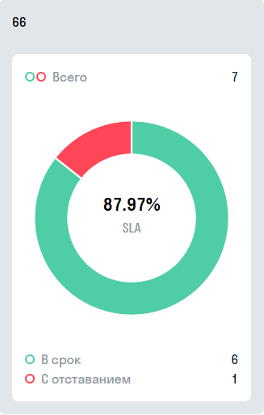

**Настройка карточки**

Назначение карточек и общие условия получения данных описаны на вкладке [«Настройки карточек 60-х»](#cards-60-settings). Для настройки карточки 66:

1. В настройках данных карточки введите название группы, например «Проектировщик».
2. В поле «Ответственный» выберите пользователей проекта или роли, чьи проверки нужно учитывать. В группе должен быть выбран хотя бы один ответственный.
3. Нажмите «+», чтобы добавить группу. При необходимости создайте другие группы ответственных.
4. Сохраните настройки и обновите данные карточки.

Группы объединяют ответственных для отображения статистики. Роль можно выбрать и до появления в проекте её участников, чтобы подготовить карточку для шаблонного проекта. Для получения статистики нужны завершённые проверки выбранных пользователей или участников выбранных ролей.

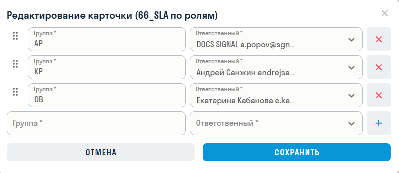

**Просмотр карточки**

В просмотре сначала показаны показатели групп: SLA, количество проверок и число проверок, завершённых в срок или с просрочкой. Откройте группу, чтобы увидеть показатели отдельных ответственных. В верхней части просмотра доступны фильтры. Фильтр периода использует дату завершения проверки.

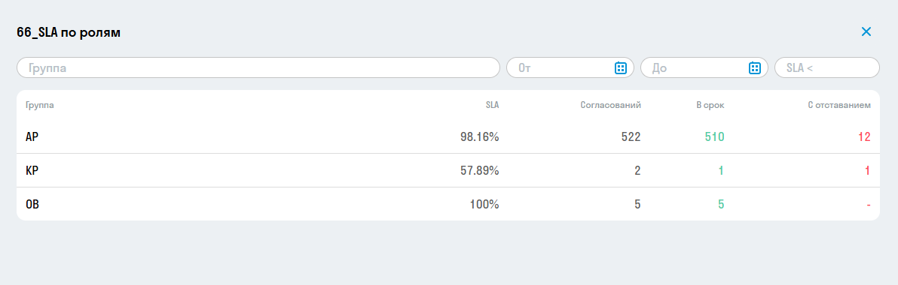

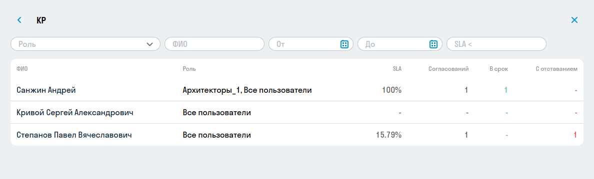

**Расчёт SLA**

Если проверка завершена в пределах плановой длительности, её SLA равен 100%. При превышении срока SLA рассчитывается как отношение плановой длительности к фактической. Длительность учитывает календарь проекта. Итоговый SLA — среднее значений учитываемых проверок.

Например, две проверки с планом по 5 дней завершены за 5 и 10 дней. Их SLA равен 100% и 50%, средний SLA — **75%**. При этом в срок завершена одна из двух проверок, то есть **50%**. Поэтому SLA и доля проверок в срок могут различаться.

В одном согласовании может быть несколько проверок и версий. Поэтому количество проверок в карточке не обязательно равно количеству согласований.

**Если данных нет**

Проверьте, добавлена ли группа, выбраны ли ответственные и сохранены ли настройки. Если выбрана роль, проверьте наличие в ней пользователей проекта. У выбранных ответственных должны быть завершённые проверки в DOCS; незавершённые этапы не дают статистику завершённых проверок. В просмотре проверьте или сбросьте фильтр периода и затем обновите данные.

## 67_SLA по согласованиям
###### 67_SLA по согласованиям {#card-67}

> Карточка показывает соблюдение договорных сроков согласований по типам и сценариям запуска. SLA рассчитывается по завершённым комплектам с указанной договорной датой.
{.is-info}

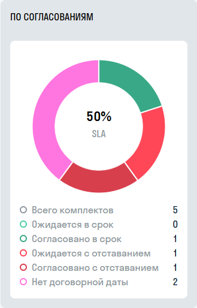

**Настройка карточки**

1. Проверьте наличие согласований нужных типов в DOCS текущего проекта. Для участия в SLA у комплекта должна быть договорная дата и завершена актуальная итерация.
2. Выберите один или несколько сценариев запуска. Пустой список означает все сценарии.
3. Укажите название группы, выберите типы согласований и нажмите «+». Добавьте остальные группы при необходимости.
4. При необходимости включите «Показывать дробные значения» и сохраните карточку.

Название группы служит для объединения типов внутри карточки; новый тип согласования в DOCS при этом не создаётся.

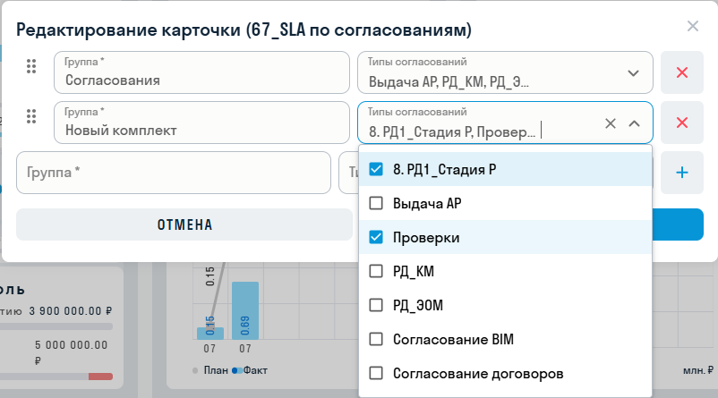

**Что означает «Сценарий запуска»**

Сценарий показывает, каким способом была запущена итерация согласования в DOCS. В DASH это фильтр существующих согласований; он не запускает процесс заново.

| Сценарий | Что произошло в DOCS |
|---|---|
| **Первичный запуск** | Создана первая итерация согласования комплекта |
| **Полный перезапуск** | Запущена новая итерация с аннулированием предыдущей |
| **Запуск изменений** | Запущена новая итерация; в предыдущих итерациях аннулируются позиции файлов, версии которых включены в новую итерацию |
| **Дополнительное согласование** | Запущено дополнительное согласование; ранее согласованные итерация и файлы сохраняют согласование |

Отбор выполняется по сценарию **актуальной итерации**. Например, после полного перезапуска комплект учитывается в этом сценарии, а не в «Первичном запуске».

**Просмотр карточки**

**Карточка → группа → комплект → этапы итераций.** Нажмите на группу, затем на строку комплекта. Ниже приведены колонки каждого уровня.

<strong>1. При открытии карточки — таблица групп</strong>

| Колонка | Что означает |
|---|---|
| Группа | Название, заданное в настройках; нажмите для просмотра комплектов |
| SLA | Доля завершённых в договорный срок среди завершённых комплектов с договорной датой |
| Процент выполнения | `(Принято в срок + Принято с отставанием) / Комплектов × 100%` |
| Комплектов | Число комплектов, отнесённых к группе по актуальному типу согласования |
| Принято в срок | Завершённые комплекты с соблюдённой договорной датой |
| Принято с отставанием | Завершённые комплекты с нарушенной договорной датой |
| Ожидается в срок | Незавершённые комплекты, ожидаемое завершение которых укладывается в договорный срок |
| Ожидается с отставанием | Незавершённые комплекты, ожидаемое завершение которых позже договорного срока |
| Нет договорной даты | Комплекты без договорной даты; в SLA не входят |
| Сред. кол-во проверок | Среднее число итераций типов этой группы на комплект, включая незавершённые и отменённые |
| Сред. кол-во дней на проверку | Для каждого комплекта берётся средняя длительность завершённых и отменённых итераций типов группы; затем эти средние усредняются по комплектам |

Поле «Группа» над таблицей фильтрует список по названию. Средние значения округляются до двух знаков; точность процентов зависит от настройки дробных значений.

> «Процент выполнения» и SLA имеют разные знаменатели. Например, из четырёх комплектов один завершён в срок, один с опозданием, один в работе, один без договорной даты: оба показателя равны 50%, но по разным причинам. Если в работе ещё два комплекта, SLA останется 50%, а процент выполнения станет 33,33% при включённых дробных значениях.
{.is-info}

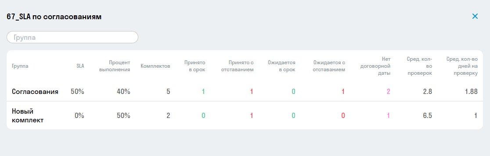

<strong>2. При открытии группы — таблица комплектов</strong>

| Колонка | Что означает |
|---|---|
| # | Номер согласования в DOCS |
| Шифр | Шифр комплекта |
| Название | Название согласования |
| Тип согласования | Тип актуальной итерации |
| SLA | 100% — завершено в договорный срок; 0% — завершено позже; «–» — не завершено или нет договорной даты |
| Проверок | Число итераций этого комплекта с типами, включёнными в группу; это не число этапов и не число проверяющих |
| Замечаний | Число активных замечаний к файлам актуальной итерации |
| Договорная дата | Договорный срок окончания согласования из DOCS |
| Плановая дата | Плановый срок окончания из DOCS; это отдельное поле, которое не заменяет договорную дату в SLA |
| Δ Контракт | Отклонение от договорного срока в днях: для завершённой актуальной итерации — относительно её завершения, иначе — относительно текущей даты |
| Δ П | Аналогичное отклонение от планового срока |
| Сред. кол-во дней на проверку | Средняя длительность завершённых и отменённых итераций этого комплекта с типами группы; «–», если таких итераций нет |
| Статус | Завершение в срок / с отставанием, ожидаемое завершение либо отсутствие договорной даты; для завершённых отображается дата и время |

Положительная дельта означает запас времени или опережение, отрицательная — просрочку, нулевая — отсутствие отклонения в целых днях.

**Фильтры:** шифр, тип, статус и диапазон дат. Поля «От» и «До» ограничивают **плановую дату**, а не дату запуска или завершения. Доступен экспорт данных в Excel.

> Сводка группы относится к актуальному типу согласования. В детализацию могут входить и комплекты, у которых тип группы встречается в истории итераций. Поэтому число строк детализации может отличаться от «Комплектов» в сводке.
{.is-info}

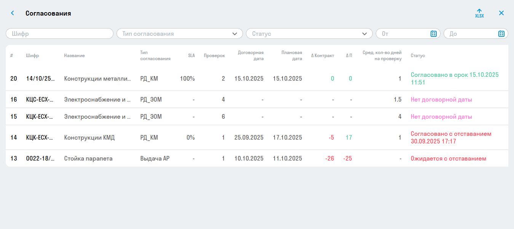

<strong>3. При открытии комплекта — итерации и этапы</strong>

Итерации расположены от новых к старым; показываются итерации типов выбранной группы. В заголовке указаны актуальность или номер версии, тип согласования и инициатор. Цветная отметка обозначает состояние; у отменённой итерации ниже указаны автор и время отмены.

Нажатие на заголовок комплекта со стрелкой открывает согласование в DOCS в новой вкладке. Стрелка возврата возвращает на предыдущий уровень карточки.

| Колонка | Что означает |
|---|---|
| Этап | Порядковый номер этапа в маршруте |
| Ответственный | Назначенная роль; «Назначить в процессе» означает отсутствие заранее заданного ответственного |
| ФИО | Пользователь, завершивший этап; до завершения может стоять «–» |
| Дата начала | Фактические дата и время запуска этапа |
| Дата завершения | Фактические дата и время завершения этапа; «–», пока не завершён |
| План. срок согласования | Длительность этапа в днях, заданная для него или взятая из типа согласования |
| Факт. срок согласования | Рассчитанная длительность этапа с учётом календаря проекта; превышение плана выделяется красным |
| Замечаний | То же число активных замечаний к файлам актуальной итерации, что показано у комплекта; повторяется в каждой строке |

> Значения «Замечаний» по строкам этапов не суммируются. Это не количество замечаний, созданных конкретным проверяющим или на конкретном этапе. В счётчик входят статусы: открыто, в работе, на проверке, отклонено и не принято.
{.is-info}

При расчёте фактической длительности этапа значения меньше одного дня учитываются как один день. Длительности завершённых и отменённых итераций также учитываются минимум как один день. Комплект, завершённый с замечаниями, дополнительно выделяется жёлтым.

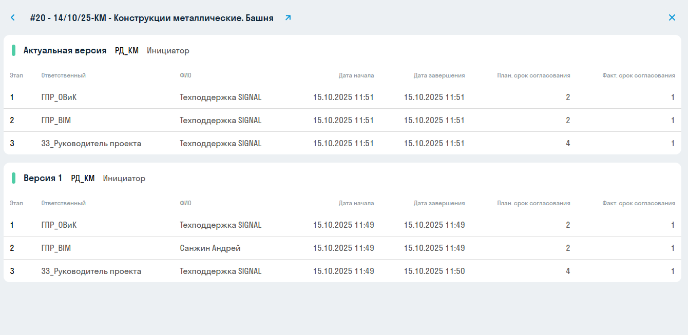

**Расчёт SLA**

| Состояние актуальной итерации | Участие в SLA |
|---|---|
| Завершена не позднее договорной даты | 100% |
| Завершена после договорной даты | 0% |
| Не завершена или договорная дата не указана | Не входит в расчёт процента |

> **SLA = завершённые в договорный срок / завершённые с договорной датой × 100%.** Договорная дата учитывается включительно.
{.is-info}

**Пример:** один комплект завершён в срок, один с опозданием, один в работе, ещё один без договорной даты. SLA = **1 / 2 × 100% = 50%**, всего комплектов — четыре.

**Отличие от карточки 66:** в 66 учитывается отношение плановой длительности проверки к фактической. В 67 любое завершение после договорного срока даёт 0% отдельному комплекту.

**Ожидаемые статусы:** сравнивают ожидаемую дату завершения с договорной. Ожидаемая дата зависит от прохождения этапов и календаря проекта; она не участвует в SLA завершённых комплектов.

<strong>Если данные не отображаются</strong>

| Что видно | Что проверить |
|---|---|
| «Нет данных» на карточке | Есть ли в настройках хотя бы одна группа с названием и типами согласований |
| Нет нужной группы в открытой карточке | Не скрыта ли она фильтром по названию группы |
| Нет нужного комплекта в группе | Тип и сценарий актуальной итерации; шифр, статус, тип и диапазон плановых дат в фильтрах |
| В колонке SLA стоит «–» | Есть ли договорная дата и завершена ли актуальная итерация |
| В раскрытом комплекте нет ожидаемой итерации | Включён ли её тип в выбранную группу |

**На что обратить внимание**

- В свёрнутой карточке при наличии комплектов без рассчитанного SLA может показываться **0%**, а в раскрытой таблице — **«–»**. Для проверки откройте детализацию и договорные даты.
- Ожидаемый статус и дельта показывают разные вещи: статус сравнивает ожидаемое завершение с договорным сроком, дельта незавершённого комплекта — текущую дату с этим сроком.
- Плановый срок не заменяет договорный при расчёте SLA.

#
**[<   DASHBOARD. Карточки 50. 3D карточки](/ru/dash/cards-50)     **|**     [DASHBOARD. Карточки 90. Другие    >](/ru/dash/cards-90)**