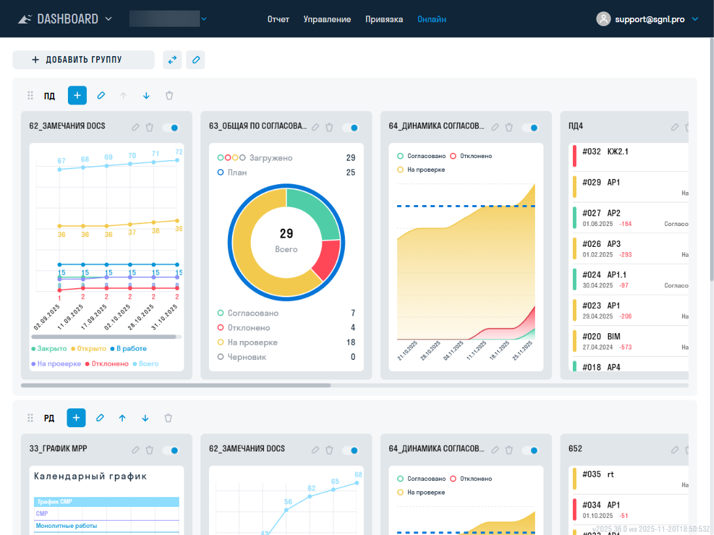
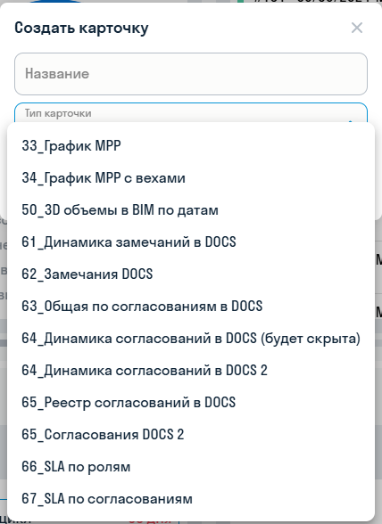
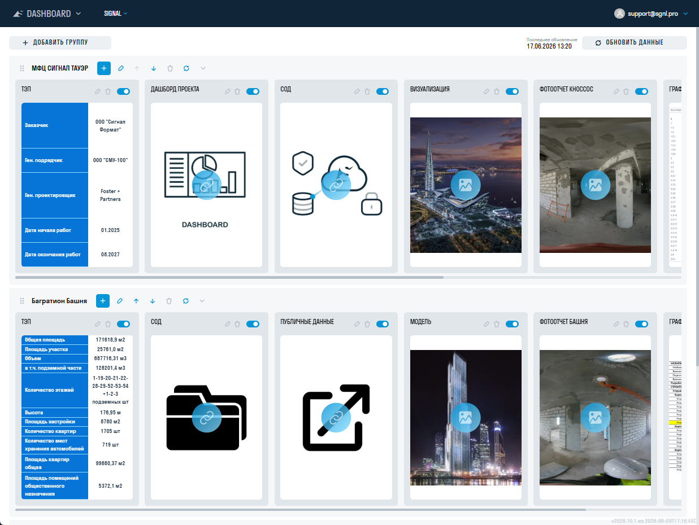
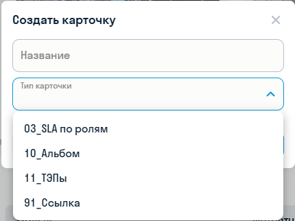

**[<   FORMS. Библиотека форм](/ru/forms/library)     **|**     [DASHBOARD. Настройки    >](/ru/dash/settings)**

---

**[SIGNAL DASHBOARD](https://dash.sgnl.pro/)** помогает отслеживать показатели строительных проектов и готовить отчётность для участников проекта.

Во введении объясняется, из чего состоит отчёт, как связаны разделы DASHBOARD и какой вид отчёта выбрать. Пошаговые действия приведены в [настройках проекта](/dash/settings).

### Из чего состоит отчёт {#dashboard-basics}

- **Карточка** показывает отдельные сведения: например, сроки, объёмы, расходы или состояние согласований DOCS. Доступные типы перечислены в [каталоге](/dash/cards).
- **Группа** объединяет связанные карточки, например по разделу строительства или локации.
- **Отчёт** объединяет группы и карточки в общую картину проекта или нескольких проектов.

### Как связаны разделы проекта {#project-sections}

«Управление», «Привязка» и «Отчёт» используются для подготовки и чтения одного отчёта на выбранную дату. «Онлайн» содержит отдельную сводку для текущей работы с данными DOCS.

Ниже описаны два сценария: подготовка отчётности к выбранной дате и ежедневный контроль работы проекта.

#### Подготовка отчёта на дату

Например, к еженедельному совещанию нужно собрать план и факт объёмов, расходы и сроки, чтобы руководитель проекта или заказчик мог оценить ход работ.

- **Готовит:** ответственный за отчётность — например, специалист ПТО или проектный аналитик.
- **Читает:** руководитель проекта, заказчик или другой участник, которому предоставлен доступ.

Для этой задачи связаны **три раздела одного планового отчёта**:

- **«Управление» — подготовка.** Автор создаёт отчёт на дату, добавляет группы и карточки, заполняет показатели и публикует результат.
- **«Привязка» — заполнение из таблицы, если оно нужно.** Автор связывает карточки этого же отчёта с Google Таблицей или XLSX из DOCS и переносит данные синхронизацией. Если данные вводятся вручную или через собственный источник карточки, этот раздел можно не использовать.
- **«Отчёт» — чтение опубликованного результата.** Читатель открывает подготовленный отчёт, выбирает дату, в том числе историческую, и при необходимости выгружает файл.

**Схема подготовки и публикации отчёта**

> «Управление» → заполнение вручную или через «Привязку» → публикация → «Отчёт».
{.is-info}

Публикация открывает подготовленный отчёт читателям; отдельная копия карточек при этом не создаётся. Синхронизация в «Привязке» заполняет данные, а публикация выполняется в «Управлении».

#### Ежедневная работа во вкладке «Онлайн»

«Онлайн» — рабочая сводка по данным DOCS выбранного проекта. Она помогает находить проблемы в ходе работы: открытые замечания, задержки согласований и нарушения сроков. Для обращения к этой сводке не нужно каждый раз готовить и публиковать новый отчёт на дату.

##### Кому и для чего нужна сводка

- **Координатору согласований** — найти комплекты с отставанием и посмотреть, на каком этапе задержалось согласование.
- **Инженеру проекта** — отобрать открытые замечания и проверить их состояние.
- **Руководителю проекта** — оценить состояние согласований и замечаний, определить, что требует внимания команды.

##### Связь с отчётом на дату

- **Собственные карточки.** Группы, карточки и права «Онлайн» настраиваются отдельно. Публикация планового отчёта не переносит сюда его карточки.
- **Общие источники.** Одни и те же согласования DOCS можно показывать и в «Онлайн» для ежедневной работы, и в плановом отчёте для совещания.
- **Самостоятельные настройки.** У карточек могут различаться фильтры и время обновления. Поэтому совпадение источника само по себе не гарантирует одинаковых значений.

Один участник может совмещать подготовку отчётности и работу с «Онлайн». Конкретные действия определяются [правами](/dash/settings#card-access).

### Какой вид отчёта выбрать {#report-types}

- **Для одного проекта** доступны плановый отчёт по дате и онлайн-отчёт. Выбор зависит от задачи: подготовить отчётность на дату или работать с текущей сводкой DOCS.
- **Для обзора нескольких проектов** используйте «Отчёт компании» или «Мой отчёт». Первый объединяет сведения по проектам компании, второй — сведения пользователя по его проектам.

На вкладках ниже описаны особенности каждого вида отчёта и доступные карточки. Подготовка, доступы и работа с источниками описаны в [настройках проекта](/dash/settings).

# Виды отчётов{.tabset}

## Плановый отчёт по дате
###### Плановый отчёт по дате {#planned-report}

Плановый отчёт — подборка показателей проекта, подготовленная на выбранную дату.

**Особенности**

- Состав групп и карточек выбирает автор под задачу отчётности.
- Данные можно заполнить вручную, получить из привязанной таблицы или из источника конкретной карточки.
- Опубликованные отчёты доступны читателям; можно выбрать дату и посмотреть ранее опубликованный отчёт.

Порядок действий описан в [создании](/dash/settings#creating) и [публикации отчёта](/dash/settings#publication).

**Выбор типа карточки при создании**

## Онлайн-отчёт
###### Онлайн-отчёт {#online-report}

Онлайн-отчёт — отдельный набор карточек с данными DOCS выбранного проекта.

**Примеры данных в карточках**

- [Замечания DOCS](/dash/cards-60#card-61) — количество, статусы и динамика.
- [Согласования DOCS](/dash/cards-60#card-65-2) — реестр, состояние и сроки.
- [SLA](/dash/cards-60#card-66) — показатели соблюдения сроков проверок.

Порядок работы с данными описан в [настройках проекта](/dash/settings#online-refresh).

## Отчёт компании
###### Отчёт компании {#company-report}

Отчёт компании объединяет сведения по её проектам в одном месте. Доступ к просмотру [настраивает администратор](/dash/settings#card-access).

**Доступные карточки**

- «01_Общий SLA по ролям»;
- «03_SLA по ролям»;
- [«10_Альбом»](/dash/cards-10#card-10);
- [«11_ТЭПы»](/dash/cards-10#card-11);
- [«91_Ссылка»](/dash/cards-90#card-91).

## Мой отчёт
###### Мой отчёт {#my-report}

«Мой отчёт» — личная сводка пользователя по его проектам.

**Доступные карточки**

- [«10_Альбом»](/dash/cards-10#card-10);
- [«11_ТЭПы»](/dash/cards-10#card-11);
- [«62_Замечания DOCS»](/dash/cards-60#card-62);
- [«91_Ссылка»](/dash/cards-90#card-91).

Карточки можно объединять в группы.

**Как работает «62_Замечания DOCS»**

- Собирает замечания пользователя из проектов, в которых он состоит.
- Позволяет отбирать их по проекту, типу и статусу.

#
**[<   FORMS. Библиотека форм](/ru/forms/library)     **|**     [DASHBOARD. Настройки    >](/ru/dash/settings)**
