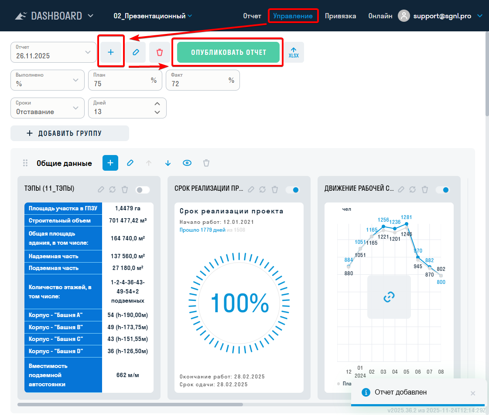
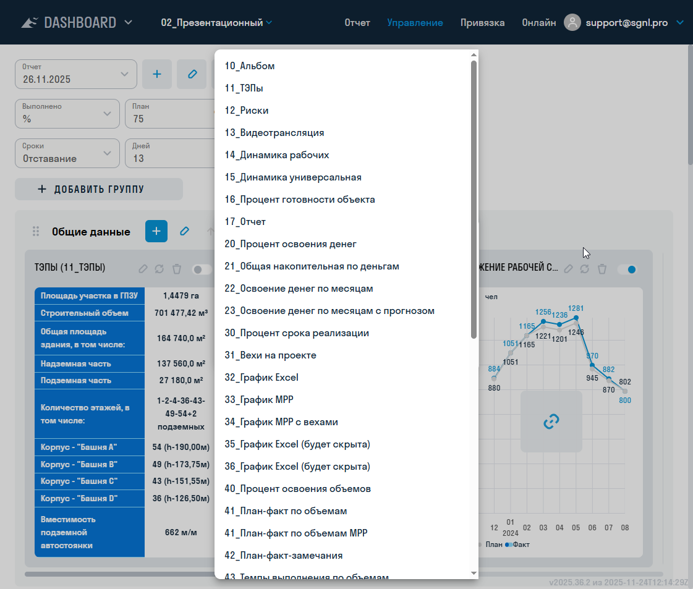
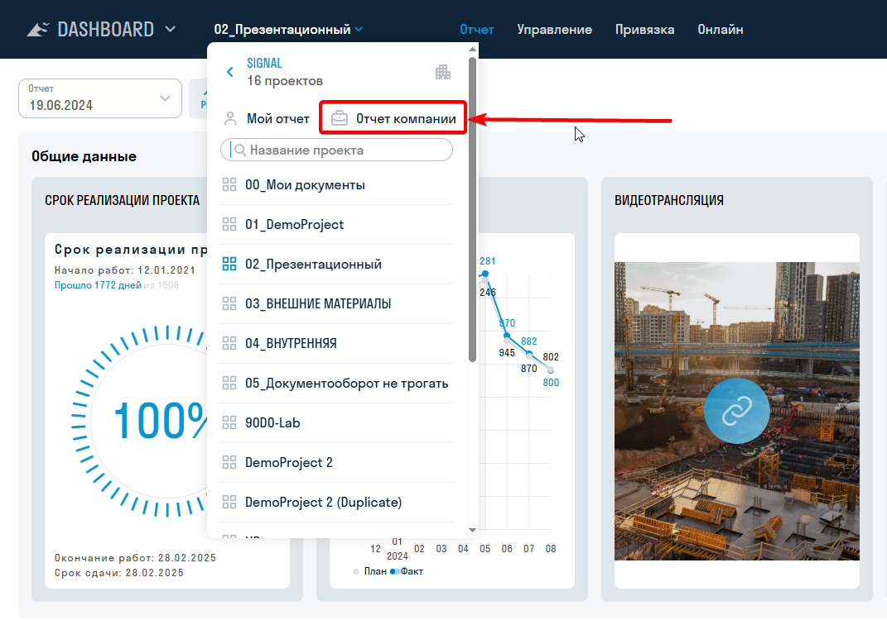
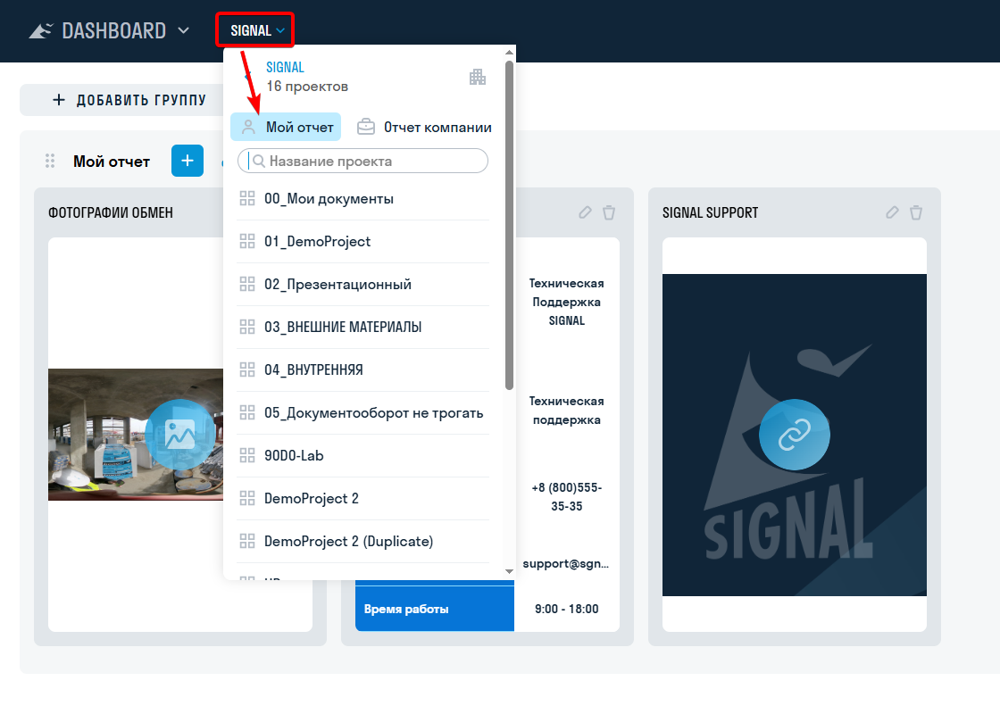
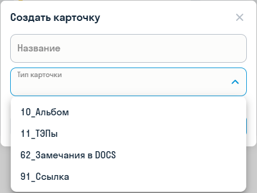

**[<   FORMS. Библиотека форм](/ru/forms/library)     **|**     [DASHBOARD. Настройки    >](/ru/dash/settings)**

---

**[SIGNAL DASHBOARD](https://dash.sgnl.pro/)** помогает контролировать сроки, объёмы, расходы и работу с документами строительных проектов. В модуле можно подготовить отчёт к совещанию или собрать сводку для ежедневной работы.

### Что вы хотите сделать? {#choose-task}

- [Подготовить отчёт к совещанию *Плановый отчёт по дате — показатели одного проекта для руководителя и заказчика*](#planned-report)
- [Контролировать замечания и согласования *Онлайн-отчёт — рабочая сводка DOCS одного проекта*](#online-report)
- [Посмотреть проекты компании *Отчёт компании — общая сводка по нескольким проектам*](#company-report)
- [Собрать свою сводку *Мой отчёт — сведения пользователя по его проектам*](#my-report)
{.links-list}

### Из чего состоит отчёт {#dashboard-basics}

- **Карточка** — отдельные сведения: сроки, объёмы, расходы, замечания или согласования.
- **Группа** — несколько связанных карточек, например по локации или разделу строительства.
- **Отчёт** — группы и карточки, собранные для обзора проекта или нескольких проектов.
{.grid-list}

Типы карточек перечислены в [каталоге](/dash/cards), а порядок настройки — в [настройках проекта](/dash/settings).

### Виды отчётов {#report-types}

Плановый и онлайн-отчёт относятся к одному проекту. «Отчёт компании» и «Мой отчёт» доступны на уровне компании и объединяют сведения по нескольким проектам.

### Виды отчётов {.tabset}

#### Плановый отчёт по дате

- **Для какой задачи:** подготовить показатели проекта на выбранную дату, например к еженедельному совещанию.
- **Кому нужен:** ответственный за отчётность готовит данные; руководитель проекта, заказчик и другие участники с доступом читают результат.
- **Что показывает:** выбранные автором показатели — например, план и факт объёмов, расходы и сроки.

**Особенности**

- Группы и карточки подбирают под задачу отчётности.
- Значения заполняют вручную, из привязанной таблицы или из источника конкретной карточки.
- После публикации отчёт доступен читателям. Можно выбрать дату и открыть ранее опубликованный отчёт.

[Создание отчёта](/dash/settings#creating) · [Публикация](/dash/settings#publication)

Скриншот: выбор типа карточки при создании

#### Онлайн-отчёт

- **Для какой задачи:** ежедневно находить открытые замечания, задержки согласований и нарушения сроков в выбранном проекте.
- **Кому нужен:** координатору согласований, инженеру и руководителю проекта.
- **Что показывает:** данные DOCS проекта в настроенных карточках.

**Примеры карточек**

- [Замечания DOCS](/dash/cards-60#card-61) — количество, статусы и динамика замечаний.
- [Согласования DOCS](/dash/cards-60#card-65-2) — реестр, состояние и сроки согласований.
- [SLA](/dash/cards-60#card-66) — показатели соблюдения сроков проверок.

Для работы со сводкой не нужно каждый раз создавать и публиковать новый отчёт на дату. Группы, карточки и права «Онлайн» настраиваются отдельно от планового отчёта.

[Обновление сводных значений](/dash/settings#online-refresh) · [Права доступа](/dash/settings#card-access)

Дополнительный скриншот онлайн-отчёта

#### Отчёт компании

- **Для какой задачи:** собрать сведения по проектам компании в одном месте.
- **Кому нужен:** руководителю компании и участникам, которым нужен обзор нескольких проектов; доступ к просмотру настраивает администратор.
- **Что показывает:** сводные показатели по проектам компании и другие сведения в выбранных карточках.

**Доступные карточки**

- «01_Общий SLA по ролям»;
- «03_SLA по ролям»;
- [«10_Альбом»](/dash/cards-10#card-10);
- [«11_ТЭПы»](/dash/cards-10#card-11);
- [«91_Ссылка»](/dash/cards-90#card-91).

[Настройка доступа](/dash/settings#card-access) · [Обновление сводных значений](/dash/settings#online-refresh)

Дополнительные скриншоты отчёта компании

#### Мой отчёт

- **Для какой задачи:** собрать личную сводку по проектам, в которых участвует пользователь.
- **Кому нужен:** участнику проекта для работы со своими сведениями.
- **Что показывает:** выбранные пользователем карточки, в том числе его замечания DOCS из разных проектов.

**Доступные карточки**

- [«10_Альбом»](/dash/cards-10#card-10);
- [«11_ТЭПы»](/dash/cards-10#card-11);
- [«62_Замечания DOCS»](/dash/cards-60#card-62);
- [«91_Ссылка»](/dash/cards-90#card-91).

Карточки можно объединять в группы. «62_Замечания DOCS» собирает замечания пользователя из проектов, в которых он состоит; их можно отбирать по проекту, типу и статусу.

[Обновление сводных значений](/dash/settings#online-refresh)

Дополнительный скриншот личного отчёта

### Как связаны разделы проекта {#project-sections}

**Подготовка и чтение одного планового отчёта**

<strong>Управление</strong> Создать и заполнить отчёт

→

<strong>Публикация</strong> Открыть отчёт читателям

→

<strong>Отчёт</strong> Смотреть результат и выбирать дату

**«Привязка» подключается при необходимости:** Google Таблица или XLSX из DOCS → синхронизация → заполнение карточек этого же отчёта. Публикация выполняется в «Управлении»; отдельная копия карточек при этом не создаётся.

**«Онлайн» — отдельная рабочая сводка.** Публикация планового отчёта не переносит в неё карточки. Оба отчёта могут использовать одни и те же источники DOCS, но фильтры и время обновления карточек могут различаться, поэтому значения не обязательно совпадают.

Один участник может и готовить отчётность, и работать с «Онлайн». Доступные действия определяются [правами пользователя](/dash/settings#card-access).

---

**[<   FORMS. Библиотека форм](/ru/forms/library)     **|**     [DASHBOARD. Настройки    >](/ru/dash/settings)**
