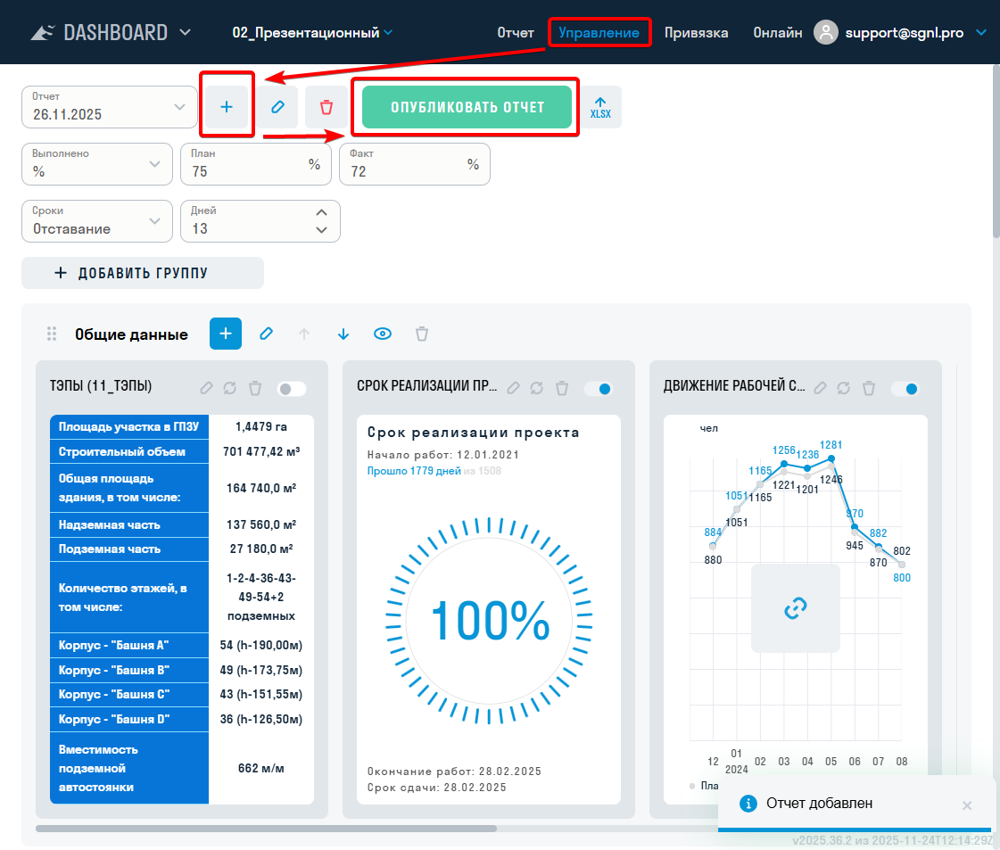
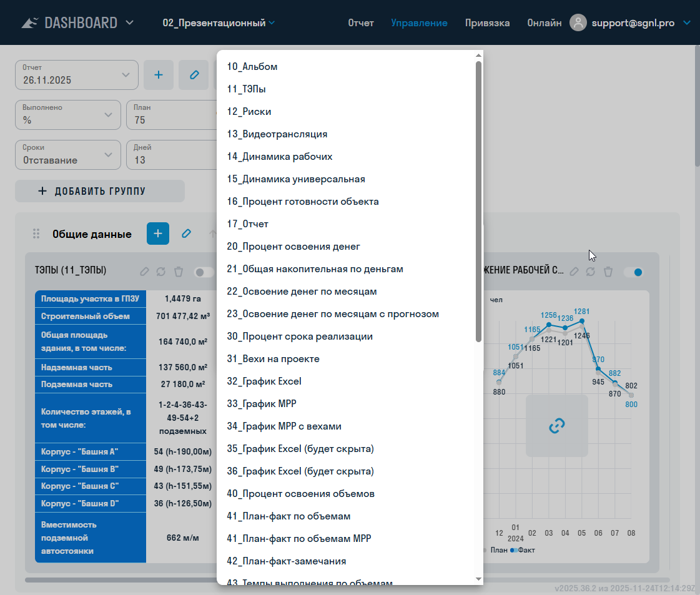
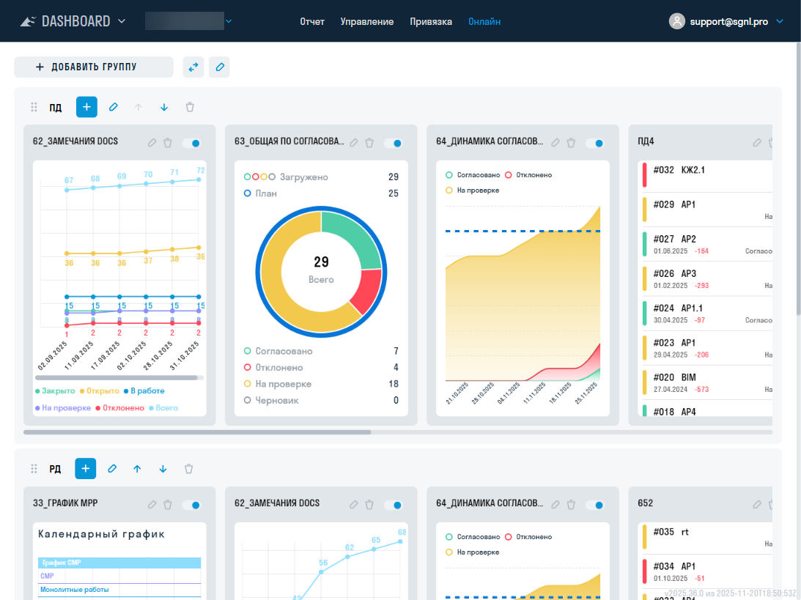
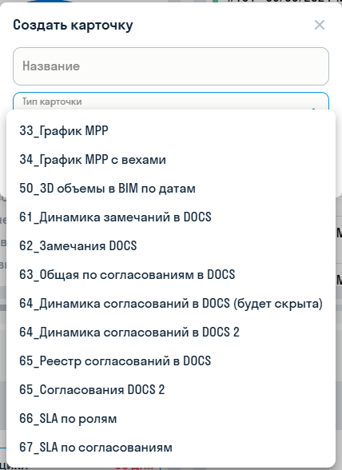
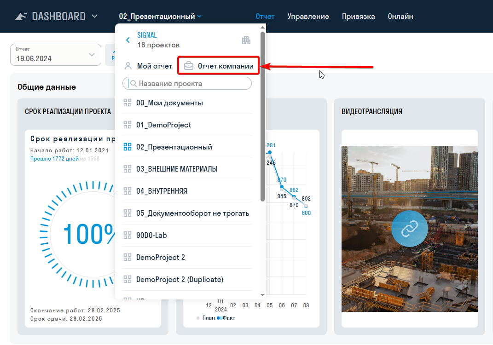
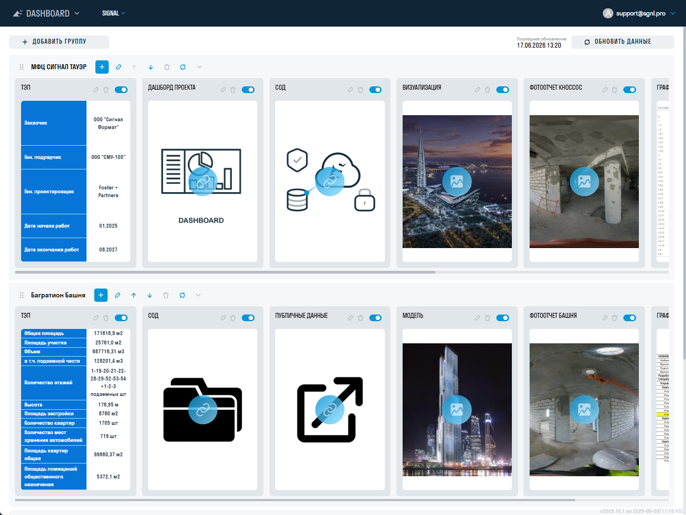
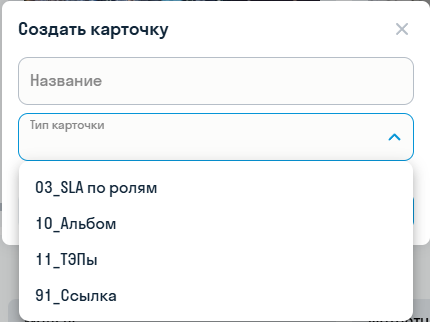
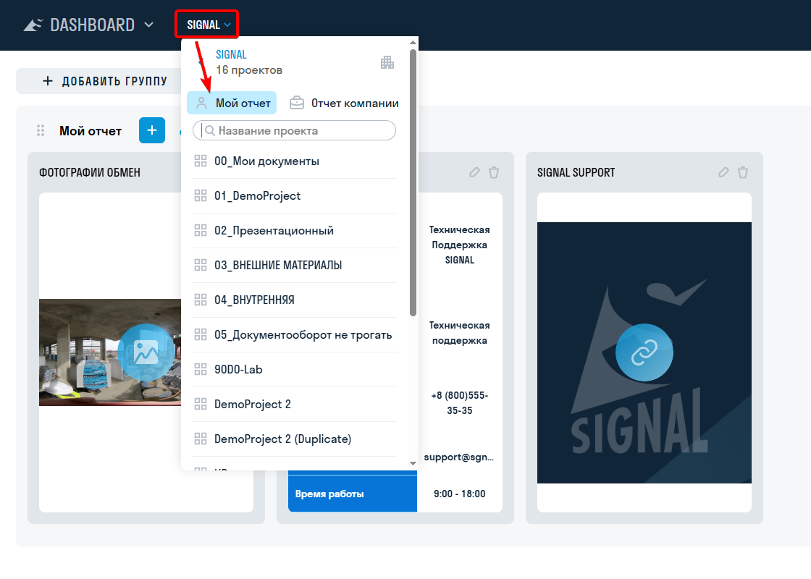
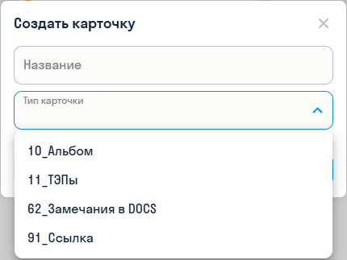

**[<   FORMS. Библиотека форм](/ru/forms/library)     **|**     [DASHBOARD. Настройки    >](/ru/dash/settings)**

---

**[SIGNAL DASHBOARD](https://dash.sgnl.pro/)** помогает отслеживать показатели строительных проектов. Отчёты состоят из групп и карточек: они показывают сроки, объёмы, деньги, данные DOCS и другие сведения. Доступные карточки перечислены в [каталоге](/dash/cards).

# Начало работы {#quick-start}

1. Откройте [DASHBOARD](https://dash.sgnl.pro/) и войдите в учётную запись SIGNAL. Выберите компанию, затем проект. Если компания, проект или модуль недоступны, обратитесь к администратору: одной ссылки недостаточно для получения доступа.
2. Для просмотра планового отчёта перейдите на вкладку «Отчёт» и выберите дату в списке. Откройте карточку нажатием; для карточек-ссылок нажатие ведёт во внешнюю систему. Группы можно сворачивать и разворачивать.
3. Для сведений из источников проекта откройте «Онлайн»; проверьте дату последнего обновления. Для новой выборки нажмите «Обновить данные».
4. Для своих проектов используйте «Мой отчёт», для сводных сведений компании — «Отчёт компании». Эти отчёты имеют собственные группы, карточки и настройки доступа.
5. Создание и подготовку планового отчёта выполняйте на компьютере во вкладке «Управление». Если вкладка или команда отсутствует, проверьте [доступ](/dash/access), а не создавайте копию учётной записи.

| Нужно | Руководство |
|---|---|
| Создать, скопировать или опубликовать отчёт | [Управление отчётом](/dash/settings#lifecycle) |
| Выдать права или встроить 3D-карточку | [Доступы и публичные ссылки](/dash/access) |
| Подключить таблицу или обновить файл | [Источники и обновление](/dash/data) |
| Объяснить показатель | [Формулы](/dash/formulas) и [корпоративные SLA](/dash/cards-company) |
| Получить документ или презентацию | [Экспорт](/dash/export) |
| Найти причину пустой карточки или ошибки | [Решение проблем](/dash/troubleshooting) |

Отчётная дата описывает актуальность показателей, а дата обновления — момент обращения к источникам. Для сравнения показателей проверяйте обе даты и фильтры. Список доступных типов зависит от вида отчёта и настроек продукта; [каталог](/dash/cards) не означает, что все карточки создаются на каждой вкладке.

# Виды отчётов{.tabset}

## Плановый отчёт по дате

Плановый отчёт создают на вкладке «Управление» с датой, на которую актуальны его данные. Группы и карточки можно заполнять вручную или [привязать к таблице](/dash/settings#updating). После публикации отчёт доступен на вкладке «Отчёт». Ранее опубликованные отчёты остаются доступны для просмотра.

Выбор типа карточки при её создании:

## Онлайн-отчёт

Онлайн-отчёт показывает данные карточек, связанных с DOCS. При первом открытии вкладки за день данные обновляются автоматически. Чтобы получить актуальные данные раньше, нажмите «Обновить данные». Рядом с кнопкой указана дата последнего обновления.

## Отчёт компании

Отчёт компании собирает сведения по проектам компании. Просмотр зависит от настроенного доступа. В отчёт можно добавить карточки [«01_Общий SLA по ролям»](/dash/cards-company#card-01), [«03_SLA по ролям»](/dash/cards-company#card-03), «10_Альбом», «11_ТЭПы» и «91_Ссылка». Данные карточек можно обновить кнопкой «Обновить данные»; рядом отображается дата последнего обновления.

## Мой отчёт

«Мой отчёт» содержит сведения пользователя по его проектам. В нём доступны группы и карточки «10_Альбом», «11_ТЭПы», «62_Замечания DOCS» и «91_Ссылка». Карточка замечаний собирает замечания пользователя из проектов, в которых он состоит; их можно фильтровать по проекту, типу и статусу. Для обновления данных используйте кнопку «Обновить данные».

#
**[<   FORMS. Библиотека форм](/ru/forms/library)     **|**     [DASHBOARD. Настройки    >](/ru/dash/settings)**
