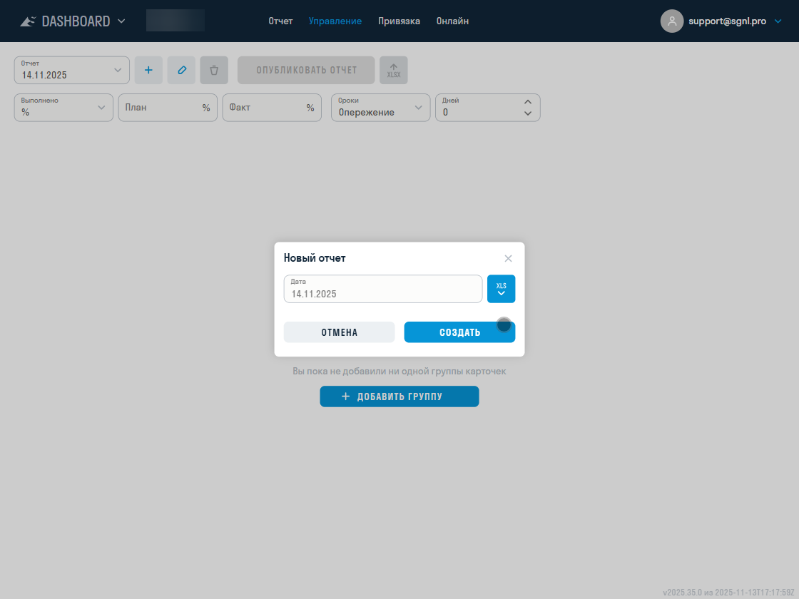
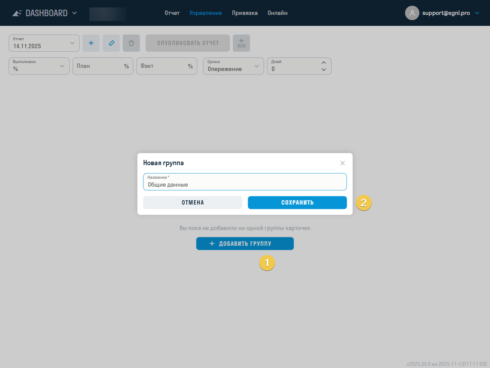
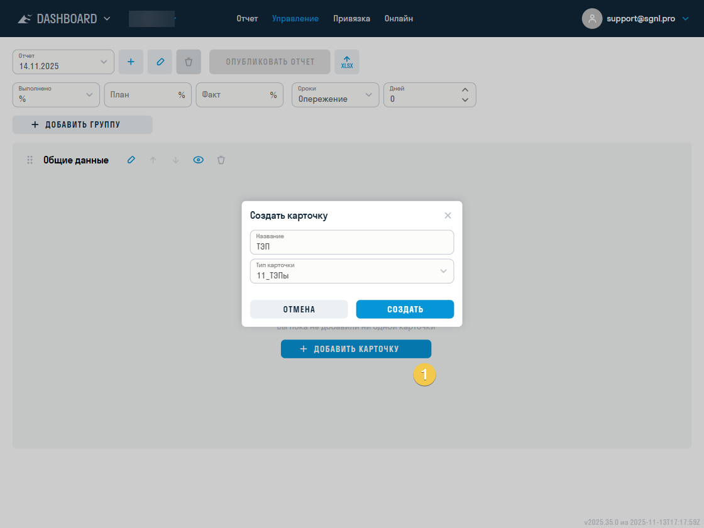
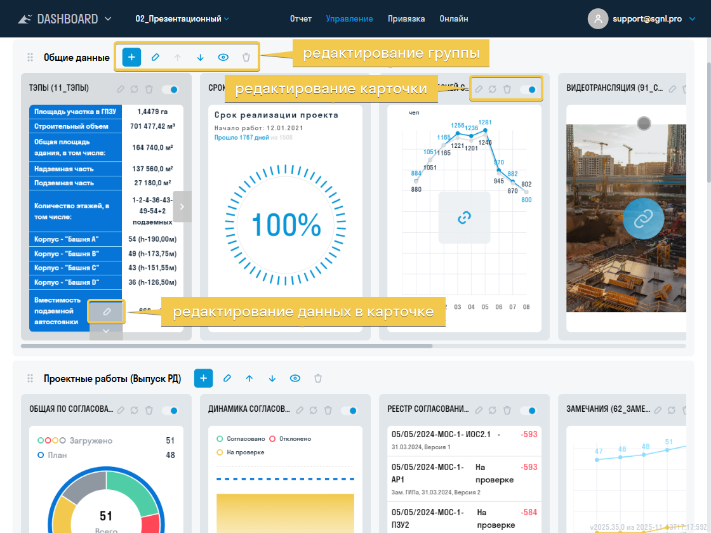
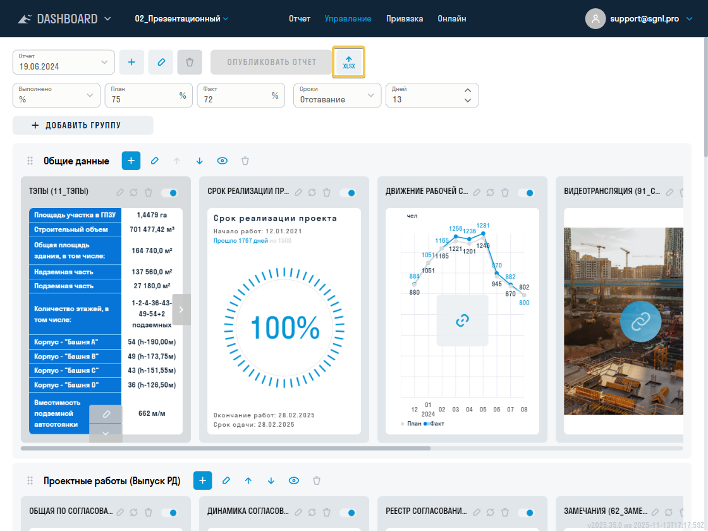
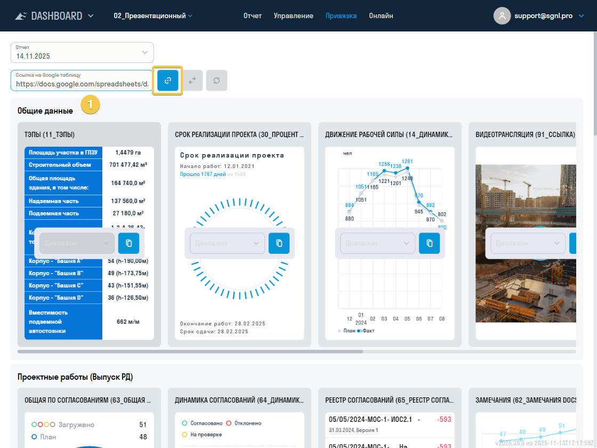
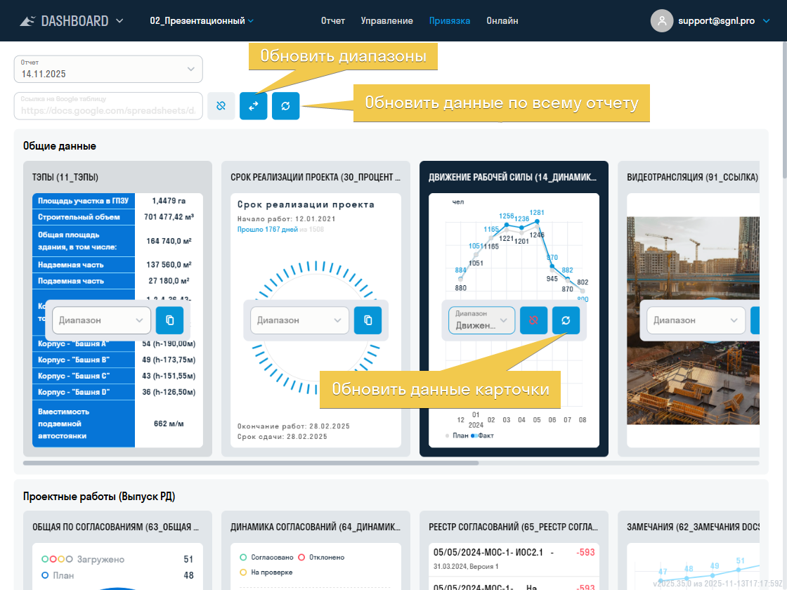
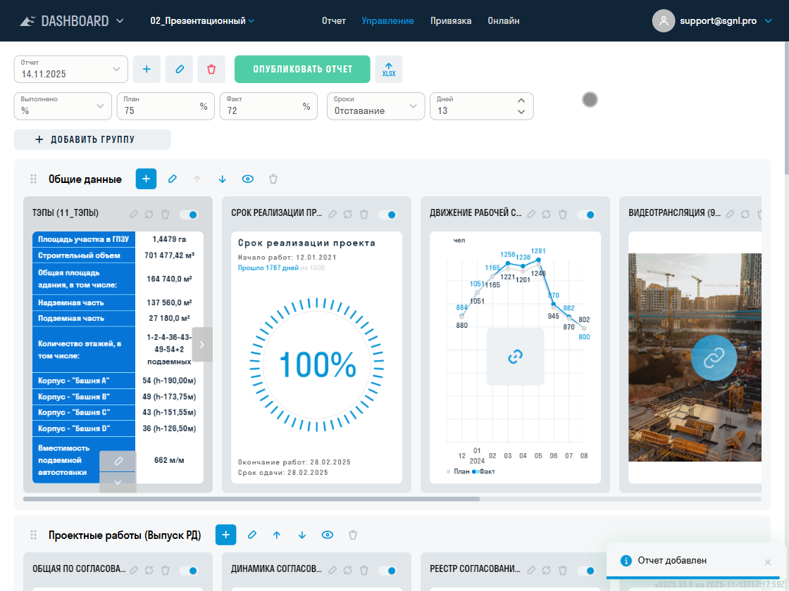

**[<   DASHBOARD. Введение](/ru/dash/intro)     **|**     [DASHBOARD. Все карточки    >](/ru/dash/cards)**

 <a href="/dash/settings/updates" onclick="event.stopPropagation();" style="color: inherit; text-decoration: none;">🔄 Что нового (история изменений этого функционала)</a>

----

# Подготовка отчёта

## 1. Создание отчёта {#creating}

Создание отчёта выполняется на вкладке «Управление» при наличии соответствующего доступа.

Для создания отчёта нажмите «+» и укажите дату, на которую будут актуальны его данные. Если при создании выбран существующий отчёт, новый создаётся на его основе. Перед нажатием «+» проверьте выбранную дату источника копирования. В окне создания можно также импортировать отчёт из Excel-файла.

> При создании проекта по шаблону отчёт формируется на основе отчёта из шаблона.
{.is-info}

## 2. Добавление карточек и групп {#adding_card}

Добавление и редактирование карточек выполняется на вкладке «Управление» при наличии доступа к группе или отчёту.

Сначала создайте группу. С помощью групп можно разделить карточки по строительным разделам или локациям для удобной навигации по отчёту.

Для создания группы введите её название, например «Общие данные», и нажмите «+».

Для создания карточки нажмите «+» внутри группы. Выберите тип карточки, введите её название и нажмите «Сохранить». Описание типов карточек приведено в [каталоге](/dash/cards).

Добавьте группы и карточки в отчёт, расположите их в нужном порядке и заполните данные карточек.

## 3. Обновление данных отчёта {#updating}

После создания отчёта обновите данные карточек. Их можно заполнить вручную или привязать к Google Таблице либо XLSX-файлу из DOCS. Доступность источников зависит от настроек продукта. На вкладке «Привязка» выберите источник данных для отчёта. При переключении источника система предупреждает о сбросе прежней привязки файла или диапазонов карточек. [Требования к файлам, последствия синхронизации и форматы JSON](/dash/data) описаны отдельно.

Для карточек, которые получают данные из DOCS, используйте кнопку обновления карточки, группы или отчёта. Во вкладках «Онлайн», «Мой отчёт» и «Отчёт компании» есть кнопка «Обновить данные» и дата последнего обновления. При первом открытии за день данные обновляются автоматически.

### Способы обновления
#### 1. Обновление данных на вкладке «Управление» {#manually}

Карточки с ручным вводом можно обновлять, заполняя поля в настройках карточки. Некоторые типы получают данные из DOCS и настраиваются иначе; подробности приведены в статьях о соответствующих [карточках](/dash/cards).

#### 2. Привязка через Google Таблицы {#google}

Если в продукте доступна привязка к Google Таблицам, выберите этот источник на вкладке «Привязка». Для каждой карточки понадобится отдельный именованный диапазон.

1. На вкладке «Управление» нажмите «Экспорт в Excel», чтобы скачать отчёт.

2. В новой [Google Таблице](https://docs.google.com/spreadsheets/u/0/) выберите «Файл» → «Импортировать» → «Добавить» и загрузите скачанный Excel-файл.

При необходимости переименуйте листы Google Таблицы по названиям карточек.

3. На вкладке «Привязка» вставьте ссылку на таблицу в поле «Ссылка на Google таблицу» и нажмите «Привязать отчёт».

> При создании следующего отчёта ссылка на Google Таблицу сохраняется.
{.is-warning}

4. Разместите данные карточек на одном листе, как в [шаблоне](https://docs.sgnl.pro/s/f/4d8f615a-27fd-4b1a-a631-c7529eb99f03/i/4b15b902-df5a-4795-b68b-50963eddf283?f=663dec15-0db0-4e70-b152-ceb803fe6ea6), или на разных листах. Чтобы перенести данные карточки, нажмите «Копировать данные карточки» в DASHBOARD и вставьте их в таблицу сочетанием Ctrl+V.

> Если карточки находятся на одном листе, располагайте их горизонтально и не вставляйте данные новой карточки поверх существующей.
{.is-warning}

5. Создайте отдельный именованный диапазон для каждой карточки. В Google Таблице выберите «Данные» → «Настроить именованные диапазоны».

-   Если карточки находятся на одном листе, выделите столбцы карточки, например A–C, введите название диапазона, например `КС_2`, и нажмите «Готово». Повторите для остальных карточек.

> Название диапазона может содержать буквы, цифры и подчёркивание. Оно не должно начинаться с цифры или содержать пробелы и знаки препинания.
{.is-info}

-   Если карточки находятся на отдельных листах, выделите ячейки нужного листа сочетанием Ctrl+A, введите название диапазона и нажмите «Готово».

6. Вернитесь в DASHBOARD и нажмите «Обновить список диапазонов». У каждой карточки выберите соответствующий диапазон из списка.

7. Нажмите кнопку обновления у карточки для синхронизации одной карточки или кнопку рядом со ссылкой на таблицу для синхронизации всего отчёта.

#### 3. Привязка через XLSX-файл из DOCS {#xlsx}

1. Загрузите XLSX-файл в проект DOCS. В файле создайте отдельный именованный диапазон для каждой карточки, данные которой хотите обновлять.
2. На вкладке «Привязка» выберите источник «XLSX-файл из SIGNAL DOCS». Нажмите на поле выбора файла и укажите загруженный XLSX-файл.
3. Если вы изменили именованные диапазоны в файле, нажмите кнопку обновления списка диапазонов рядом с выбранным файлом. Для нужной карточки выберите её диапазон в поле «Диапазон».
4. После изменения данных файла нажмите кнопку обновления у карточки или кнопку обновления всего отчёта на панели привязки. Файл в DOCS можно редактировать онлайн.

Карточки 33, 34 и 18 в списке привязки не показываются. Их источники данных выбираются в настройках самих карточек.

## 4. Публикация отчёта {#publication}

Неопубликованный отчёт недоступен пользователям на вкладке «Отчёт». Чтобы открыть его для просмотра, на вкладке «Управление» нажмите «Опубликовать отчёт». В окне публикации при необходимости добавьте комментарий и подтвердите действие. Ранее опубликованные отчёты остаются доступны для просмотра. Публикация требует соответствующего доступа. Подробности о текущем и историческом отчётах — в [жизненном цикле](/dash/settings#lifecycle).

## 5. Настройки проекта {#permissions}

Раздел «Настройки» доступен администратору. На уровне компании во вкладке «Доступы» можно выбрать роли и пользователей, которым разрешён просмотр отчёта компании. Выберите их в поле «Просмотр» и нажмите «Сохранить».

На уровне проекта во вкладке «Уведомления» настраиваются уведомления по проекту. Во вкладке «Публичные доступы» администратор управляет публичными ссылками на карточки.

Права на работу с конкретным отчётом задаются на вкладке «Управление»: через шестерёнку — на создание, удаление и публикацию отчёта, а также изменение показателей; через карандаш — на группы и карточки. Доступы к группам и карточкам можно настраивать отдельно. [Матрица прав и наследование](/dash/access#permissions) объясняют, почему назначение на карточку не отменяет права верхнего уровня.

# Управление отчётом {#lifecycle}

## Черновик, опубликованный и текущий отчёт

| Состояние | Как использовать |
|---|---|
| Черновик | Создан на дату, готовится в «Управлении» и не предлагается читателям на вкладке «Отчёт» |
| Опубликованный | Доступен на вкладке «Отчёт»; сохраняется в списке дат после публикации последующих отчётов |
| Текущий | Один выбранный отчёт проекта. При публикации нового отчёта интерфейс также назначает его текущим |

Опубликованный и текущий — разные признаки. Чтобы вернуться к истории, достаточно выбрать дату на вкладке «Отчёт»: менять текущий отчёт проекта для личного просмотра не требуется.

Чтобы назначить прежний опубликованный отчёт текущим для проекта, выберите его в «Управлении» и нажмите «Опубликовать отчёт». Для уже опубликованного отчёта эта кнопка меняет текущий отчёт без повторного окна комментария. Это действие не является новой первой публикацией и не запускает её уведомление. Для уже текущего отчёта кнопка недоступна.

Текущий отчёт нельзя удалить кнопкой удаления. Если требуется удалить другой отчёт, сначала проверьте выбранную дату. Не назначайте другой отчёт текущим только ради просмотра истории.

Публикация не является неизменяемой архивной копией всех внешних источников. Доступность изменения полей зависит от прав и состояния; общие показатели исторического опубликованного отчёта в форме заблокированы, а текущего могут заполняться по правам. Для сохранения внешнего вида на дату используйте [экспорт](/dash/export).

Если при публикации возникла ошибка, проверьте отдельно: появился ли отчёт в списке опубликованных и стал ли он текущим. Публикация и назначение текущим выполняются последовательно; не создавайте новый отчёт до проверки результата.

## Копирование и структура {#structure}

Для следующей отчётной даты выберите нужный исходный отчёт в «Управлении», нажмите «+», укажите новую дату и создайте отчёт. Проверьте скопированные значения, источники и диапазоны; копирование не обновляет показатели до новой даты само по себе. Импорт XLSX в этом окне использует структуру экспорта DASHBOARD — [отличия способов Excel](/dash/data#excel-modes).

| Операция | Что происходит |
|---|---|
| Сворачивание группы | Компактный вид группы; это не удаление и не запрет доступа |
| Переключение статуса карточки | Меняет её показ читателям; при привязке статус также может прийти из таблицы |
| Деактивация карточки/группы | Временно выключает элемент, сохраняя данные; администратор может включить его обратно. Деактивированная группа блокирует обычные действия с вложенными карточками |
| Удаление | Убирает выбранный элемент; не используйте его как способ временно скрыть данные |
| Перемещение | Меняет порядок или группу карточки; для переноса между группами требуется доступ к редактированию исходной и целевой группы |

Команды карточки доступны в её панели действий; порядок меняется перетаскиванием, перенос — командой перемещения между соседними группами. Названия и состав административных команд зависят от прав. Не путайте деактивацию и статус карточки с публикацией всего отчёта.

Если карточка связана с родительской, администратору доступна команда обновления данных из родительской карточки. Используйте её только после проверки источника: она заменяет данные связанным содержимым, а не открывает историю изменений.

## Импорт онлайн-групп {#online-import}

На вкладке «Онлайн» откройте импорт групп, выберите исходный проект/шаблон и настройте соответствие типов замечаний и согласований. Если тип из источника не найден в целевом проекте, выберите ему соответствие. Совпадение названий проектов не заменяет настройку типов.

Перед подтверждением проверьте параметр удаления прежних карточек, если он предложен: импорт с очисткой заменяет ранее настроенный состав. После импорта откройте карточки, проверьте типы и обновите данные.

# Общие показатели отчёта {#indicators}

Верхняя часть отчёта содержит собственные общие показатели. Они хранятся у выбранного отчёта и не пересчитываются автоматически из сумм всех карточек.

На вкладке «Управление» выберите тип показателя готовности/денег и тип показателя сроков, заполните поля. Корректные изменения сохраняются после ввода; дождитесь завершения сохранения перед сменой отчёта.

| Показатель | Что заполнить |
|---|---|
| План и факт | Проценты планового и фактического выполнения |
| Факт и отклонение | Фактический процент и отдельное значение отклонения |
| Деньги / деньги в миллионах | Общая сумма, план и факт в выбранной размерности; не смешивайте полные единицы и миллионы |
| Даты | Даты, предусмотренные формой показателя |
| Опережение / отставание | Число дней; это ручное значение данного общего показателя |

Для изменения значений нужно «Заполнение» в отдельных доступах действий с отчётом; для смены типа показателя готовности — «Редактирование». Для показателей сроков форма использует доступ к заполнению. В историческом опубликованном отчёте эти поля заблокированы; если требуется изменить текущий показатель, сначала убедитесь, что открыт текущий отчёт.

# Уведомления о публикации {#notifications}

1. Администратору открыть проект → «Настройки» → «Уведомления».
2. Добавить получателей события публикации отчёта: конкретного пользователя, роль или адрес email. Для роли проверить её участников; для email — написание адреса.
3. Сохранить настройки.
4. При первой публикации нового отчёта при необходимости заполнить комментарий. После публикации читатели могут открыть комментарий рядом с выбором даты отчёта.

Уведомление сообщает о публикации отчёта; его доставка зависит также от доступных каналов и настроек уведомлений получателя. Комментарий хранится у отчёта: проверяйте его в DASHBOARD, не рассчитывая на одинаковый состав сообщения во всех каналах. Заполнение карточки, обновление источника и назначение ранее опубликованного отчёта текущим не являются первой публикацией нового отчёта.

Если уведомление не пришло, проверьте, действительно ли впервые опубликован новый отчёт, сохранены ли получатели, состоит ли пользователь в выбранной роли, корректен ли email, папку спама и личные настройки уведомлений. Для обращения в поддержку зафиксируйте дату и время публикации и канал доставки.

# Дальнейшая работа

- [Права и публичные ссылки](/dash/access)
- [Источники данных и повторное обновление](/dash/data)
- [Экспорт PDF, DOCX, PPTX и XLSX](/dash/export)
- [Решение проблем](/dash/troubleshooting)

#

**[<   DASHBOARD. Введение](/ru/dash/intro)     **|**     [DASHBOARD. Все карточки    >](/ru/dash/cards)**
