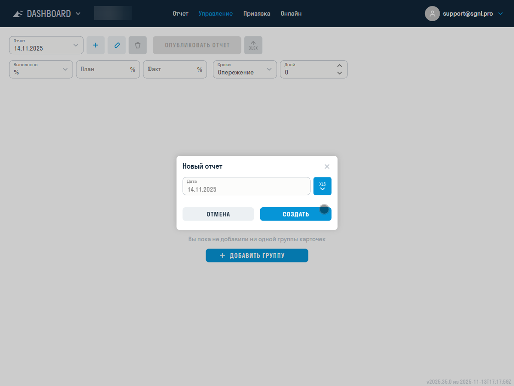
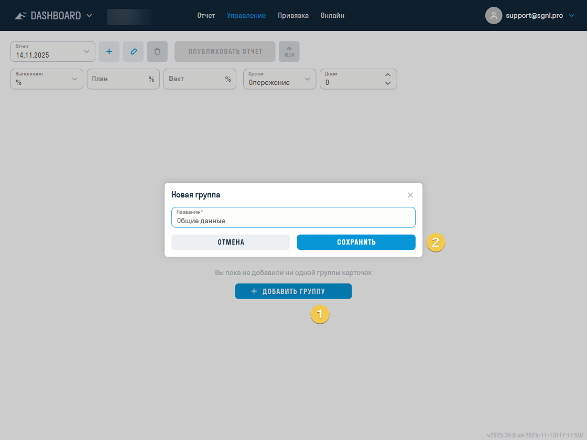
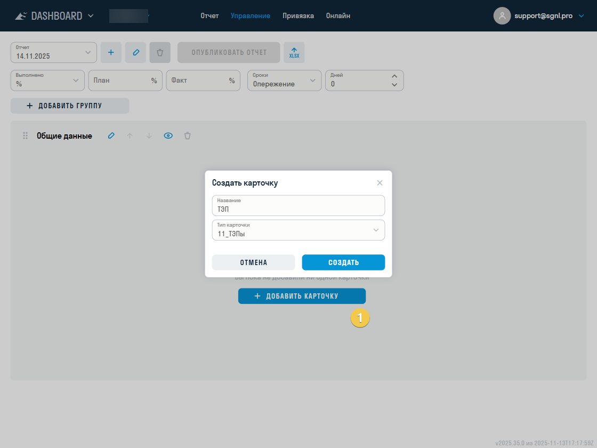
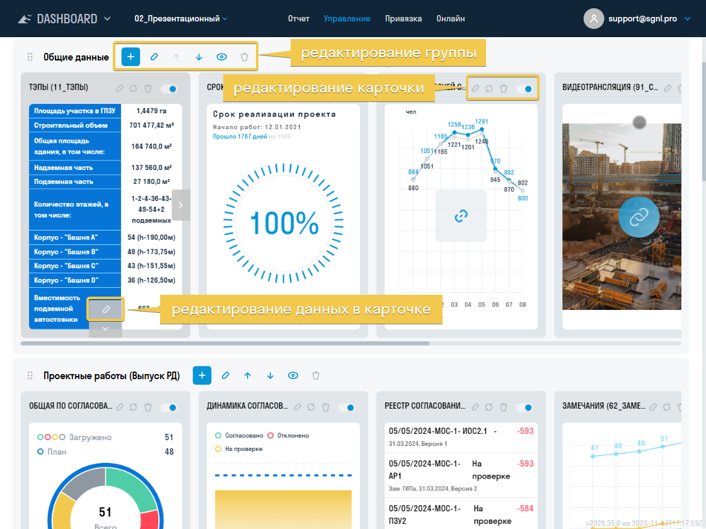
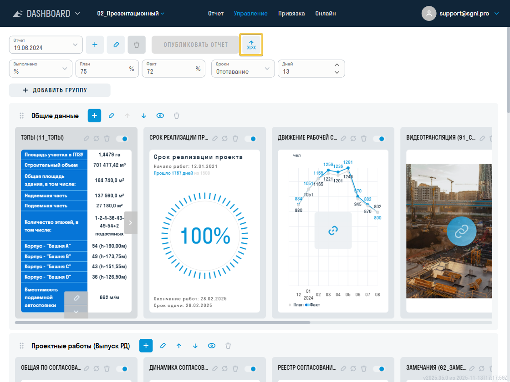
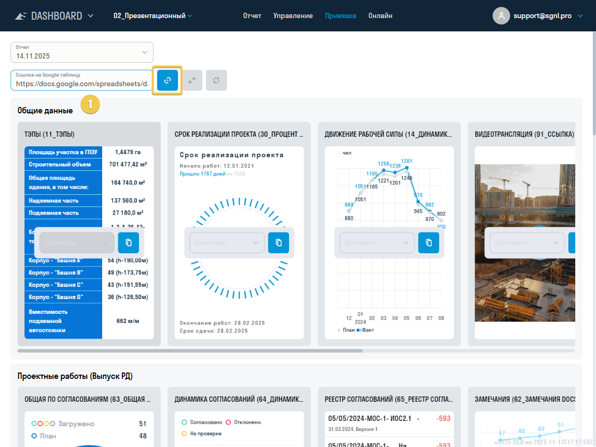
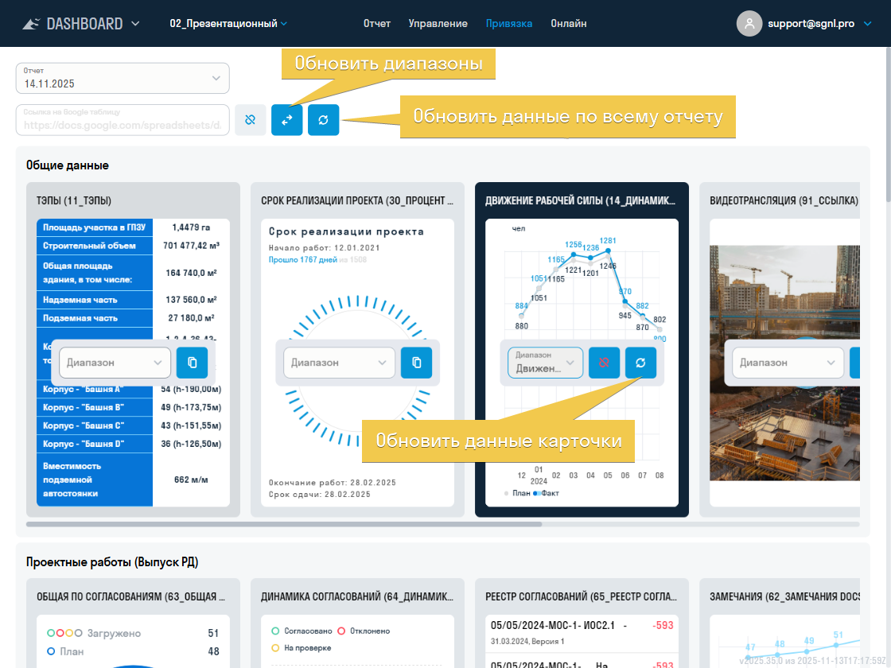
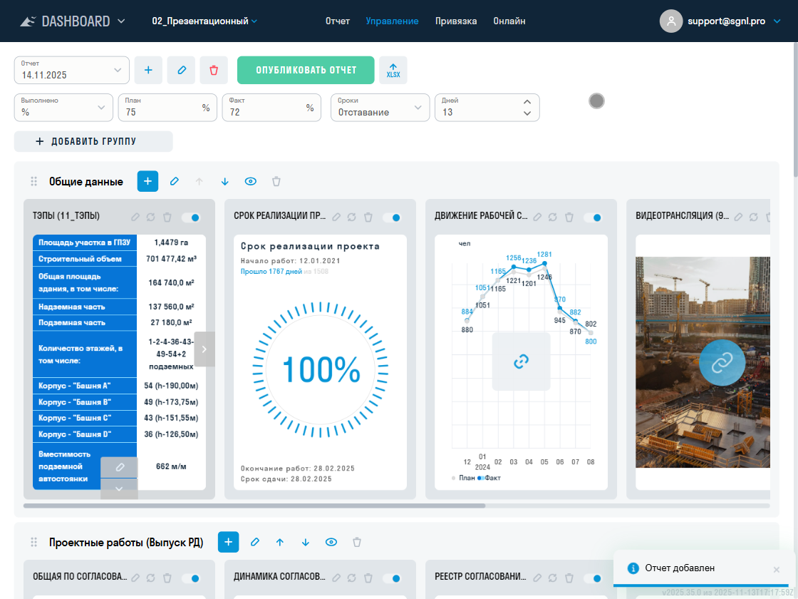
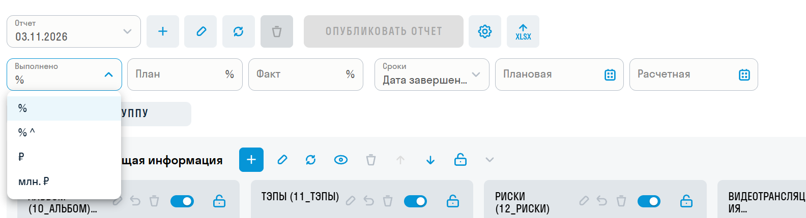

<sub>**[<   DASHBOARD. Введение](/ru/dash/intro)     **|**     [DASHBOARD. Все карточки    >](/ru/dash/cards)**</sub>

<summary style="font-size: 16px; color: #0D47A1; background: #E3F2FD; border-radius: 7px; border: 1px solid #64B5F6; display: flex; gap: 10px; padding: 5px 16px; display: block; margin-top: 10px;">
<span style="flex-grow: 1;"> <a href="/dash/settings/updates" onclick="event.stopPropagation();" style="color: inherit; text-decoration: none;">🔄 Что нового (история изменений этого функционала)</a></span>
</summary>

----

Назначение вкладок «Отчёт», «Управление», «Привязка» и «Онлайн» описано во [введении](/dash/intro#project-sections). Ниже — настройка отчётов, источников и доступов.

# Вкладки{.tabset}

## 1. Создание отчёта
###### 1. Создание отчёта {#creating}

Для настройки выберите компанию и проект, затем откройте «Управление» в полной версии интерфейса. Создание отчёта доступно администратору или роли с правом «Редактирование» в [доступах к действиям с отчётом](#report-actions).

1. Если отчёты уже есть, выберите в списке тот, который хотите использовать как основу.
2. Нажмите «+» рядом со списком отчётов и укажите отчётную дату.
3. Для переноса отчёта из Excel выберите файл в этом же окне. Используйте книгу, экспортированную из DASHBOARD; произвольная таблица с объёмами не заменяет формат отчёта.
4. Нажмите «Создать» и проверьте состав групп и карточек.

| Способ | Что получится |
|---|---|
| Без файла, выбран существующий отчёт | Новый отчёт на основе **выбранного** отчёта; он может отличаться от текущего опубликованного |
| Без файла, отчётов ещё нет | Новый отчёт без скопированных групп и карточек |
| С выбранным Excel-файлом | Новый отчёт со структурой и данными из файла |

Новый отчёт создаётся неопубликованным. Дата отчёта — дата представления данных, а не время отправки уведомления. Переход к просмотру для пользователей описан в [публикации](#publication).

> При создании проекта по шаблону отчёт формируется на основе отчёта из шаблона.
{.is-info}




## 2. Добавление карточек и групп
###### 2. Добавление карточек и групп {#adding_card}

Добавление и редактирование карточек выполняется на вкладке «Управление» при наличии доступа к группе или отчёту.

Сначала создайте группу. С помощью групп можно разделить карточки по строительным разделам или локациям для удобной навигации по отчёту.

Для создания группы введите её название, например «Общие данные», и нажмите «+».




Для создания карточки нажмите «+» внутри группы. Выберите тип карточки, введите её название и нажмите «Сохранить». Описание типов карточек приведено в [каталоге](/dash/cards).



Добавьте группы и карточки в отчёт, расположите их в нужном порядке и заполните данные карточек.



**Действия с готовой структурой**

Права ниже относятся к указанной карточке или группе и могут быть унаследованы от верхнего уровня. «Редактирование» включает «Заполнение» и «Просмотр»; администратору отдельное назначение не требуется.

| Действие | Требуемый доступ | Где выполнить и что изменится |
|---|---|---|
| Изменить название или настройки карточки | Редактирование карточки | Откройте настройки карточки и измените нужные параметры |
| Заполнить данные карточки | Заполнение карточки | Откройте форму заполнения. Если назначен диапазон, ручное заполнение может быть заблокировано |
| Изменить порядок карточек внутри группы | Редактирование группы | Перетащите карточку; заполнения или редактирования только самой карточки недостаточно |
| Перенести карточку в другую группу | Редактирование исходной и целевой групп | Используйте перемещение карточки в соседнюю доступную группу |
| Свернуть или развернуть группу | Просмотр группы | Нажмите кнопку сворачивания в доступной группе; данные и состав группы не меняются |
| Деактивировать карточку или группу, включить обратно | Администратор | Используйте кнопку деактивации. Элемент остаётся приглушённым; взаимодействие с ним ограничивается до обратного включения |
| Показать или скрыть карточку | Редактирование карточки | Используйте переключатель «Показать» / «Скрыть» в панели карточки. Для деактивированного элемента действие недоступно |
| Удалить карточку | Редактирование карточки | Нажмите удаление и подтвердите; карточка удаляется из структуры отчёта |
| Удалить группу | Администратор | Нажмите удаление у группы и подтвердите действие |

Переименование группы и изменение её прав доступны администратору. Назначение и наследование прав описаны во вкладке [«Доступы»](#card-access).

**Копирование групп из другого проекта**

1. На вкладке «Онлайн» нажмите «Копировать группы из другого проекта» и выберите исходный проект.
2. В окне сопоставления выберите соответствия типов замечаний и согласований исходного и целевого проектов.
3. Для отсутствующего типа укажите соответствие в целевом проекте. Проверьте и автоматически найденные соответствия.
4. Если предложено удаление текущих карточек, проверьте этот флажок: включение заменяет прежний состав карточек. Не выбирайте его для простого добавления.
5. Подтвердите копирование, откройте полученные карточки и проверьте выбранные типы.

Копирование относится к группам вкладки «Онлайн». Новый плановый отчёт создаётся отдельно — см. [создание отчёта](#creating).


## 3. Заполнение и обновление данных
<a id="updating"></a>

Порядок работы зависит от того, где находятся карточки:

- [Плановый отчёт *Заполнение в «Управлении» и получение данных из таблицы через «Привязку»*](#planned-data)
- [«Онлайн», «Мой отчёт» и «Отчёт компании» *Обновление сводных значений карточек*](#online-refresh)
{.links-list}

### Плановый отчёт {#planned-data}

Выберите нужный отчёт в «Управлении». Для карточек с привязанной таблицей используйте этот же отчёт во вкладке «Привязка».

Далее описаны три способа заполнения: вручную, из Google Таблицы и из XLSX в DOCS. Если карточка получает данные из собственного источника DOCS или MPP, порядок настройки и обновления приведён в [инструкции карточки](/dash/cards).

#### Вручную в «Управлении» {#manually}

Изменяйте значения через форму заполнения карточки. Для этого требуется [право «Заполнение»](#card-access); название и настройки меняются с правом «Редактирование».

Для вставки строк из Excel используйте порядок столбцов, указанный в [инструкции карточки](/dash/cards). Если у карточки уже назначен диапазон, изменяйте данные в источнике и синхронизируйте их.

#### Из Google Таблицы {#google}

Если источник доступен, выберите Google Таблицы во вкладке «Привязка». Для каждой карточки нужен отдельный именованный диапазон. При смене источника подтвердите сброс прежней привязки и проверьте назначение диапазонов заново.

**Подготовка таблицы**

- Таблица должна быть доступна для чтения без входа в Google: в текущем подключении не выполняется вход под Google-аккаунтом пользователя.
- Сохраняйте полный блок карточки, полученный экспортом или командой «Копировать данные карточки».
- Включайте служебные строки в диапазон вместе с данными. Порядок столбцов данных определяется типом карточки.

Если такой способ доступа к таблице не подходит для ваших данных, используйте [XLSX в DOCS](#xlsx) с доступом к файлу в проекте.

<details>
<summary>Пошаговое подключение Google Таблицы со скриншотами</summary>

1. На вкладке «Управление» нажмите «Экспорт в Excel», чтобы скачать отчёт.



2. В новой [Google Таблице](https://docs.google.com/spreadsheets/u/0/) выберите «Файл» → «Импортировать» → «Добавить» и загрузите скачанный Excel-файл.


При необходимости переименуйте листы Google Таблицы по названиям карточек.


3. На вкладке «Привязка» вставьте ссылку на таблицу в поле «Ссылка на Google таблицу» и нажмите «Привязать отчёт».




> При создании следующего отчёта ссылка на Google Таблицу сохраняется.
{.is-warning}

4. Разместите данные карточек на одном листе, как в [шаблоне](https://docs.sgnl.pro/s/f/4d8f615a-27fd-4b1a-a631-c7529eb99f03/i/4b15b902-df5a-4795-b68b-50963eddf283?f=663dec15-0db0-4e70-b152-ceb803fe6ea6), или на разных листах. Чтобы перенести данные карточки, нажмите «Копировать данные карточки» в DASHBOARD и вставьте их в таблицу сочетанием Ctrl+V.


> Если карточки находятся на одном листе, располагайте их горизонтально и не вставляйте данные новой карточки поверх существующей.
{.is-warning}


5. Создайте отдельный именованный диапазон для каждой карточки. В Google Таблице выберите «Данные» → «Настроить именованные диапазоны».


-   Если карточки находятся на одном листе, выделите столбцы карточки, например A–C, введите название диапазона, например `КС_2`, и нажмите «Готово». Повторите для остальных карточек.


> Название диапазона может содержать буквы, цифры и подчёркивание. Оно не должно начинаться с цифры или содержать пробелы и знаки препинания.
{.is-info}

-   Если карточки находятся на отдельных листах, выделите ячейки нужного листа сочетанием Ctrl+A, введите название диапазона и нажмите «Готово».


6. Вернитесь в DASHBOARD и нажмите «Обновить список диапазонов». У каждой карточки выберите соответствующий диапазон из списка.


7. Нажмите кнопку обновления у карточки для синхронизации одной карточки или кнопку рядом со ссылкой на таблицу для синхронизации всего отчёта.


</details>

**Что читается из именованного диапазона**

| Часть блока | Назначение |
|---|---|
| Название | Переносится в заголовок карточки |
| Статус | `TRUE` — показывать карточку, `FALSE` — скрыть. Это поле блока Excel, а в интерфейсе действие называется «Показать» / «Скрыть»; отчёт не публикуется |
| Тип карточки | Проверяется на совпадение с типом в DASHBOARD; несовпадение вызывает ошибку |
| Табличные данные после служебных строк | Заполняют поля по формату соответствующей карточки |

> Для привязки нужен полный блок карточки. Вставка только строк с датами и объёмами в форму заполнения — другая операция.
{.is-info}

**Если Google Таблица не читается**

| Что видно | Что проверить |
|---|---|
| Нет списка диапазонов | Ссылку на нужную таблицу, доступ без входа в Google и кнопку обновления диапазонов |
| Нет нужного диапазона | Сохранено ли его имя в Google Таблице; обновлён ли список в DASHBOARD |
| Ошибка типа или структуры | Совпадение типа карточки и полный блок служебных строк |
| Данные попали в другую карточку | Выбор диапазона у каждой карточки и отсутствие пересечения блоков в таблице |

После восстановления доступа обновите список диапазонов, проверьте их назначение и повторите синхронизацию нужной карточки.

#### Из XLSX-файла в DOCS {#xlsx}

**Подготовка файла**

| Требование | Что подготовить |
|---|---|
| Формат и размер | XLSX не больше **20 МиБ** (20 × 1024 × 1024 байт) |
| DOCS | Файл в нужном проекте; пользователю доступно его чтение и скачивание |
| Данные | Полный блок каждой карточки, включая служебные строки; проще начать с экспорта из DASHBOARD |
| Диапазоны | Отдельное имя для каждого блока с прямой ссылкой на один лист, например `'Отчёт'!$A$1:$C$20` |
| Формат ссылки | Поддерживаются ячейки и прямые диапазоны строк или столбцов. Формульные ссылки, например через OFFSET/СМЕЩ, не поддерживаются |

**Подключение и обновление**

1. Загрузите подготовленный XLSX в DOCS.
2. На вкладке «Привязка» выберите «XLSX-файл из SIGNAL DOCS» и укажите файл. При смене источника подтвердите сброс прежней привязки и проверьте диапазоны заново.
3. Дождитесь чтения книги. У каждой карточки выберите её именованный диапазон.
4. Синхронизируйте одну карточку и проверьте название, статус и значения. Затем можно обновить весь отчёт.
5. После изменения файла загрузите новую версию **того же файла** в DOCS или отредактируйте его онлайн. Обновите книгу и список диапазонов в панели привязки, затем синхронизируйте карточки.
6. Если вместо новой версии создан другой файл, выберите его заново и проверьте диапазоны.

Карточки 33, 34 и 18 в списке привязки не показываются: их источники выбираются в настройках самих карточек.

Служебные строки XLSX читаются так же, как в [Google Таблице](#google): синхронизация может изменить заголовок и статус, а несовпадение типа блокирует чтение карточки.

**Если XLSX не читается или обновилась только часть карточек**

| Что видно | Что проверить и сделать |
|---|---|
| Файл не найден | Существует ли выбранный файл DOCS; при замене выберите новый источник |
| Нет доступа | Права чтения и скачивания в DOCS под учётной записью этого пользователя |
| Ошибка скачивания | Доступность файла и соединения; повторите загрузку книги |
| Книга не распознана | Формат XLSX, целостность файла и возможность открыть его в Excel |
| Превышен размер | Размер не больше 20 МиБ; удалите ненужные листы и данные |
| Лист или имя не найдены | Имя диапазона, наличие листа и актуальность загруженной версии книги |
| Диапазон не поддерживается | Прямая ссылка на область одного листа, без формул и ошибочных ссылок |
| Ошибка одной карточки | Полный блок, тип карточки и порядок её данных |
| Есть успешные и неуспешные обновления | Успешные изменения уже сохранены. Исправьте диапазоны ошибочных карточек и повторите их синхронизацию по одной |

Массовое обновление XLSX обрабатывает карточки отдельно и показывает количество успешных и ошибочных операций; оно не откатывает успешно обновлённые карточки.

---

### «Онлайн», «Мой отчёт» и «Отчёт компании» {#online-refresh}

Во вкладках **«Онлайн»**, **«Мой отчёт»** и **«Отчёт компании»** нажмите «Обновить данные», чтобы обновить сводные значения превью. Рядом указана дата последнего обновления.

Обновление также запускается после открытия и загрузки карточек, если сохранённая дата синхронизации старше начала текущего дня. Непрерывного обновления в фоне нет.

Если раскрытая карточка показывает другие значения, проверьте дату обновления превью и фильтры самой карточки. Это отдельная операция от привязки таблицы к плановому отчёту.


## 4. Публикация отчёта
###### 4. Публикация отчёта {#publication}

| Состояние | Где используется |
|---|---|
| Неопубликованный | Подготавливается на вкладке «Управление»; в списке вкладки «Отчёт» его нет |
| Опубликованный | Доступен для просмотра с учётом прав на группы и карточки |
| Текущий | Отчёт, назначенный текущим для проекта. Это отдельный признак, а не обязательно самая поздняя дата |

**Первая публикация**

1. В «Управлении» выберите подготовленный отчёт.
2. Проверьте данные и доступы читателей.
3. Нажмите «Опубликовать отчёт», при необходимости заполните комментарий и подтвердите действие.
4. Откройте вкладку «Отчёт» и проверьте результат.

При первой публикации отчёт становится опубликованным и текущим. Отправляются [настроенные уведомления](#notifications). Для действия требуется администратор или «Редактирование» в доступах к действиям с отчётом.



**История и смена текущего отчёта**

| Задача | Действие |
|---|---|
| Посмотреть историю | На вкладке «Отчёт» выберите дату ранее опубликованного отчёта |
| Вернуть прежний отчёт в текущие | Выберите его в «Управлении» и нажмите «Опубликовать отчёт». Для уже опубликованного отчёта команда назначает его текущим |
| Снова опубликовать текущий | Кнопка недоступна, пока выбран уже текущий отчёт |
| Удалить отчёт | Выберите его в «Управлении» и используйте удаление; текущий отчёт удалить этой кнопкой нельзя |

Назначение ранее опубликованного отчёта текущим не является первой публикацией и не отправляет её уведомления. Для редактирования общих показателей исторического опубликованного отчёта действует отдельное ограничение — см. [общие показатели](#indicators).

Публикация не делает неизменяемую копию всех внешних источников. При просмотре карточка может обращаться к связанному источнику или применять собственную дату расчёта. Если нужен файл для передачи с зафиксированным видом, выполните [экспорт](#export).

**Если публикация или просмотр недоступны**

| Что видно | Что проверить |
|---|---|
| Нет кнопки создания, публикации или удаления | «Редактирование» в доступах к действиям с отчётом; редактирование карточки не заменяет это право |
| Кнопка публикации неактивна | Не выбран ли уже текущий отчёт; не выполняется ли другая операция |
| Читатель не видит новый отчёт | Опубликован ли он, выбран ли нужный проект и выдан ли доступ к содержимому |
| Удаление неактивно | Не является ли выбранный отчёт текущим |


## 5. Настройки проекта
###### 5. Настройки проекта {#permissions}

Раздел «Настройки» доступен администратору. Выберите тему ниже:

- **Доступы** — права на карточки, группы и действия с отчётом.
- **Общие показатели** — поля «Выполнено» и «Сроки» в верхней части отчёта.
- **Уведомления** — получатели сообщения о публикации.
- **Публичные ссылки** — создание и отзыв внешнего доступа к поддерживаемым карточкам.

##### Параметры проекта{.tabset}
###### Доступы

<a id="card-access"></a>

**Чем заполнение отличается от редактирования**

| Действие с карточкой | Просмотр | Заполнение | Редактирование |
|---|---|---|---|
| Видеть карточку и открыть просмотр | Да | Да | Да |
| Изменять значения, например факт за период | Нет | Да | Да |
| Менять название и настройки карточки | Нет | Нет | Да |
| Показать или скрыть карточку, удалить её | Нет | Нет | Да |

Права действуют в назначенной области. Для создания карточек и изменения их порядка нужны права соответствующей группы; административные операции с группами доступны администратору. Привязанный диапазон может блокировать ручное заполнение независимо от роли.

**Где назначить доступ**

На вкладке «Управление» администратор открывает настройки доступа отчёта, группы или карточки, добавляет роли в нужный уровень и сохраняет. Для «Онлайн» назначения отдельные. Доступ к просмотру отчёта компании задаётся на уровне компании → «Настройки» → «Доступы».

**Наследование и несколько ролей**

- Доступ всего отчёта распространяется на группы и карточки, доступ группы — на её карточки.
- Унаследованные назначения заблокированы в форме карточки: уменьшить их можно на том уровне, где они выданы.
- Если у пользователя несколько ролей, действует совокупность их прав.

Например, для заполнения только группы «Монолит» выдайте роли подрядчика «Заполнение» этой группы. Не выдавайте ей заполнение всего отчёта; проверьте, что такого широкого доступа нет и у другой роли пользователя.

<a id="report-actions"></a>

**Действия с отчётом и общие показатели**

В шестерёнке на вкладке «Управление» задаются отдельные права:

| Уровень | Разрешённые действия |
|---|---|
| Просмотр | Видеть общие показатели |
| Заполнение | Менять их значения и выбирать показатель сроков |
| Редактирование | Дополнительно создавать, удалять и публиковать отчёт, назначать его текущим, менять тип показателя «Выполнено» |

Редактирование карточки не даёт права публиковать отчёт. Администратор работает без отдельного назначения роли. Для показателей исторического отчёта действуют ограничения из [описания общих показателей](#indicators).

**Права DOCS**

Просмотр карточки в DASH не выдаёт доступ к исходному документу. Для выбора файла, чтения источника и перехода в DOCS нужны соответствующие права DOCS.

###### Общие показатели

<a id="indicators"></a>

**Общие показатели отчёта**

В верхней части «Управления» можно заполнить «Выполнено» и «Сроки». Это самостоятельные поля выбранного отчёта: они не суммируют значения всех карточек автоматически.
  
 

На панели «Управление» находятся два блока: **«Выполнено»** и **«Сроки»**. В каждом выпадающий список задаёт тип показателя, а справа появляются поля для ввода. Например, «%» — тип в блоке «Выполнено», а «План» и «Факт» — названия его полей.

**Блок «Выполнено»**

| Тип в списке | Поля в интерфейсе | Что указать |
|---|---|---|
| «%» | «План», «Факт» | Плановый и фактический проценты выполнения |
| «% ^» | «Факт», «Отклонение» | Фактический процент и отдельно отклонение |
| «₽» | «Всего», «План», «Факт» | Общую сумму, план и факт в денежных единицах |
| «млн. ₽» | «Всего», «План», «Факт» | Те же суммы в миллионах |

**Блок «Сроки»**

| Тип в списке | Поля в интерфейсе | Что указать |
|---|---|---|
| «Дата завершения» | «Плановая», «Расчетная» | Плановую и ожидаемую даты завершения. «Расчетная» вводится пользователем |
| «Опережение» | «Дней» | Число дней опережения |
| «Отставание» | «Дней» | Число дней отставания |

1. Выберите тип показателя и заполните поля выбранной формы.
2. Если начали заполнять составной показатель, заполните требуемые связанные поля.
3. Дождитесь автоматического сохранения корректных значений перед переключением отчёта.

Для значений и выбора показателя сроков требуется «Заполнение» действий с отчётом; для смены типа «Выполнено» — «Редактирование». В опубликованном отчёте, который не является текущим, общие показатели заблокированы.

###### Уведомления

<a id="notifications"></a>

**Уведомления о публикации**

1. Администратору откройте проект → «Настройки» → «Уведомления».
2. Добавьте строку получателя и выберите её тип.
3. Укажите пользователя, роль или email. Для нескольких получателей добавьте отдельные строки.
4. Нажмите «Сохранить». Чтобы исключить получателя, удалите его строку и сохраните изменения.

| Тип получателя | Что указать |
|---|---|
| Пользователь | Конкретного пользователя проекта |
| Роль | Роль, участники которой должны получить уведомление |
| Email | Корректный адрес; повтор одного email в списке не допускается |

Уведомление отправляется при [первой публикации отчёта](#publication). В данных уведомления используются компания, проект, дата отчёта, ссылка и комментарий публикации, если он заполнен; представление зависит от канала доставки.

Получение сообщения не выдаёт доступ к содержимому отчёта. Для читателя отдельно настройте права.

**Если уведомление не пришло**

| Что проверить | Где искать причину |
|---|---|
| Впервые ли опубликован отчёт | Повторное назначение текущим не отправляет такое уведомление |
| Сохранены ли получатели | Настройки проекта, выбранный пользователь, роль и её состав |
| Верен ли email | Адрес, папка спама и ограничения почты получателя |
| Доступен ли нужный канал | Личные настройки уведомлений и настройки продукта |

Для обращения в поддержку укажите проект, дату отчёта, время публикации, тип получателя и канал доставки.

###### Публичные ссылки

<a id="public-links"></a>

**Публичные ссылки на карточки**

Ссылка открывает отдельную карточку без входа в SIGNAL. Создание ссылки разрешает внешний просмотр карточки и связанных с ней 3D-данных; оно не выдаёт получателю обычный доступ ко всему проекту DOCS.

Поддерживаются [50](/dash/cards-50#card-50), [51](/dash/cards-50#card-51), [52](/dash/cards-50#card-52) и [52_2](/dash/cards-50#card-52-2). Управление ссылками в интерфейсе доступно администратору.

**Создание и использование**

1. Откройте настройки поддерживаемой карточки.
2. В блоке публичного доступа нажмите создание ссылки.
3. Скопируйте полученную ссылку и проверьте её в отдельном окне без входа в SIGNAL.
4. Передайте ссылку получателю или вставьте её в компонент встраивания внешней системы.

| Команда | Результат |
|---|---|
| Копировать | Копирует действующую ссылку |
| Перевыпустить | Создаёт новый адрес; прежний перестаёт работать. Обновите ранее настроенные встраивания |
| Удалить | Отзывает ссылку; обычная карточка остаётся в отчёте |

В проекте → «Настройки» → «Публичные доступы» показаны тип, название карточки, даты создания и изменения и ссылка. Здесь также доступны копирование, перевыпуск, удаление и экспорт всего реестра в CSV или XLSX.

**Пример встраивания**

Вставьте скопированный адрес вместо `ССЫЛКА_ИЗ_DASHBOARD` в блок HTML внешней системы:

```html
<iframe src="ССЫЛКА_ИЗ_DASHBOARD" title="Карточка DASHBOARD"
        width="100%" height="700"></iframe>
```

Внешняя система должна разрешать iframe. Публичная ссылка на карточку и [карточка 90 «Интеграция»](/dash/cards-90#card-90), которая показывает чужую страницу внутри DASH, решают разные задачи.


## 6. Экспорт отчёта
###### 6. Экспорт отчёта {#export}

Перед экспортом выберите проект, отчёт и дату. Дождитесь загрузки карточек. PDF, DOCX и PPTX запускаются на вкладке «Отчёт» в полной версии интерфейса; доступны данные, которые пользователь может просматривать.

| Формат | Где запустить | Что получится |
|---|---|---|
| PDF | «Отчёт» → экспорт PDF | Документ с представлением карточек: «С разбивкой полистно» или «Без разбивки» |
| DOCX, «Экспорт данных» | «Отчёт» → экспорт DOCX | Документ с данными поддерживаемых типов карточек; это не точная копия вида экрана |
| DOCX, «Экспорт карточек как в PDF» | То же окно DOCX | Документ с изображениями карточек |
| PPTX | «Отчёт» → экспорт PPTX | Презентация с изображениями карточек. Для 3D используется сохранённое изображение экспорта, а при его отсутствии — превью |
| XLSX отчёта | Администратору: «Управление» → «Экспорт в Excel» | Книга со структурой и блоками карточек для переноса или подготовки привязки |
| XLSX или CSV публичных ссылок | «Настройки» → «Публичные доступы» | Реестр ссылок; это не выгрузка данных карточек |
| Excel отдельной карточки | Внутри карточки, если поддерживается | Детальные данные этой карточки по её правилам |

**Порядок выгрузки**

1. Проверьте выбранный отчёт и доступные группы.
2. Обновите нужные данные. Для 3D перед PPTX подготовьте актуальный снимок средствами карточки.
3. Нажмите нужный формат; для PDF или DOCX выберите режим.
4. Дождитесь завершения и откройте скачанный файл.
5. Проверьте состав, даты, изображения и читаемость.

Файл не сохраняет интерактивность модели, фильтров и видеопотоков. Внешние страницы и встроенные окна могут выгружаться заглушкой. В режиме DOCX «Экспорт данных» неподдерживаемые типы не включаются.

**Если выгрузка неполная**

| Что видно | Что проверить |
|---|---|
| Нет кнопок PDF, DOCX или PPTX | Открыта ли вкладка «Отчёт» в полной версии интерфейса и загружены ли карточки |
| Нет Excel всего отчёта | Права администратора и вкладку «Управление» |
| Нет карточки в DOCX с данными | Поддерживает ли этот тип экспорт данных; попробуйте режим изображений |
| На слайде 3D «Нет данных» | Сохранённое изображение экспорта или превью; создайте актуальный снимок |
| Внешняя страница заменена заглушкой | Поддержку захвата встроенного содержимого; отдельно откройте исходную страницу |
| Значения не соответствуют ожидаемой дате | Выбранный отчёт, обновление источников и собственные правила даты конкретной карточки |

Для поддержки сохраните формат, выбранный режим, проект и дату отчёта, тип проблемной карточки и текст ошибки.


#

<sub>**[<   DASHBOARD. Введение](/ru/dash/intro)     **|**     [DASHBOARD. Все карточки    >](/ru/dash/cards)**</sub>
