**[<   FORMS. Генерация документов](/forms/generate)     **|**     [DASHBOARD. Введение   >](/ru/dash/intro)**

 <a href="/forms/library/updates" onclick="event.stopPropagation();" style="color: inherit; text-decoration: none;">🔄 Что нового (история изменений перечня форм)</a>

---

Ниже приведены рабочие типы форм из библиотеки конструктора, в которых не больше 50 действующих полей. Тестовые, архивные и помеченные «в планах» типы в перечень не включены.

## Пример связей форм {#links}

На схеме показаны основные связи при подготовке **акта освидетельствования скрытых работ (АОСР)**. Внутри блока «Заполнение форм» стрелка направлена от источника данных к форме, в которой эти данные используются.

Цвета помогают различить группы форм. Подписи под блоками показывают альтернативные источники данных в HUB, SIGNAL и DOCS. Справа перечислены действия с подготовленным актом: генерация документов, формирование комплекта согласования и подписание файлов.

Состав связей, обязательность и условия заполнения зависят от [настроек полей](/forms/builder). Нажмите на схему, чтобы открыть её в полном размере.

Подробнее: [генерация документов](/forms/generate), [согласование и подписание файлов](/docs/reviews).

## Разделы библиотеки {#contents}

| Раздел | Перечень форм и полей |
| :--- | :--- |
| Справочники | [Открыть раздел](#group-spravochniki) |
| Общие сведения | [Открыть раздел](#group-obschie-svedeniya) |
| Проектирование | [Открыть раздел](#group-proektirovanie) |
| Документы ИД | [Открыть раздел](#group-dokumenty-id) |
| Журналы общего управления, ЖВК и персонала | [Открыть раздел](#group-zhurnaly-obschego-upravleniya) |
| Журналы геодезических работ и ГРО | [Открыть раздел](#group-zhurnaly-geodezicheskih-rabot-i-gro) |
| Журналы земляных, буровых и свайных работ | [Открыть раздел](#group-zhurnaly-zemlyanyh-burovyh-i-svaynyh-rabot) |
| Несущие конструкции и общестроительные работы | [Открыть раздел](#group-nesuschie-konstruktsii-i-obschestroitelnye-raboty) |
| Журналы трубопроводов и кабельных сетей | [Открыть раздел](#group-zhurnaly-truboprovodov-i-kabelnyh-setey) |
| Журналы лаборатории и неразрушающего контроля | [Открыть раздел](#group-zhurnaly-laboratorii-i-nerazrushayuschego-kontrolya) |
| Акты ИД | [Открыть раздел](#group-akty-id) |
| Сопровождение строительства | [Открыть раздел](#group-soprovozhdenie-stroitelstva) |
| Строительный контроль | [Открыть раздел](#group-stroitelnyy-kontrol) |
| Организационные документы | [Открыть раздел](#group-organizatsionnye-dokumenty) |
| Финансовые документы | [Открыть раздел](#group-finansovye-dokumenty) |
| Структура объекта | [Открыть раздел](#group-struktura-obekta) |

## Поля и ключи для шаблонов {#fields}

В колонке «Тип» для поля «Форма» указана связанная форма. Нажмите на её название, чтобы перейти к перечню её полей.

В колонке «Ключ» указан тег с системным именем поля. Прочерк означает, что системное имя не задано: такое поле не передаётся в шаблон. Чтобы использовать его значение, задайте системное имя в [конструкторе форм](/forms/builder).

Для поля типа «Форма» используйте ключи полей связанной формы через точку, например `{{building.name}}`. Если в поле можно выбрать несколько форм, используйте цикл: `{{#allowedWorks}}{{name}}{{/allowedWorks}}`. Для вложений также используйте цикл, как описано в [синтаксисе генерации](/forms/generate#syntax).

<h2>Справочники</h2>

**Материалы**

| Поле | Тип | Ключ |
| :--- | :--- | :--- |
| Тип материала | `Список вариантов` | `{{type}}` |
| Наименование | `Строка` | `{{name}}` |
| Марка, тип | `Строка` | `{{mark}}` |
| Единица измерения | `Список вариантов` | `{{unit}}` |
| ГОСТ, ТУ | `Строка` | `{{gost}}` |

**Виды работ**

| Поле | Тип | Ключ |
| :--- | :--- | :--- |
| Тип | `Список вариантов` | `{{type}}` |
| Наименование | `Строка` | `{{name}}` |
| Единица измерения | `Список вариантов` | `{{unit}}` |
| НТД | `Форма` → [Нормативно-технические документы](#form-ntd) | `{{standarts}}` |

**Нормативно-технические документы (НТД)**

| Поле | Тип | Ключ |
| :--- | :--- | :--- |
| Тип | `Список вариантов` | `{{type}}` |
| Шифр | `Строка` | `{{code}}` |
| Наименование | `Строка` | `{{name}}` |
| Ссылка на НТД | `Строка` | — |
| Файл | `Файл` | `{{file}}` |

**Ключи динамометрические (Ключи)**

| Поле | Тип | Ключ |
| :--- | :--- | :--- |
| Тип ключа | `Строка` | `{{wrenchType}}` |
| Номер ключа | `Строка` | `{{wrenchNumber}}` |

**Техника строительная (Техника)**

| Поле | Тип | Ключ |
| :--- | :--- | :--- |
| Вид техники | `Список вариантов` | `{{equipmentType}}` |
| Инвентарный или регистрационный номер | `Строка` | `{{equipmentNumber}}` |
| Марка и модель | `Строка` | `{{model}}` |

**Установка для погружения свай**

| Поле | Тип | Ключ |
| :--- | :--- | :--- |
| Тип системы погружения свай | `Список вариантов` | `{{pileDrivingSystemType}}` |
| Инвентарный номер установки | `Строка` | `{{inventoryNumber}}` |
| Система копра (крана) | `Строка` | `{{headstockType}}` |
| Направляющее устройство | `Строка` | `{{guideDevice}}` |
| Тип наголовника | `Строка` | `{{headType}}` |
| Масса наголовника | `Число` | `{{headWeight}}` |
| Источник энергии молота | `Список вариантов` | `{{hammerPowerSource}}` |
| Тип молота | `Строка` | `{{hammerType}}` |
| Масса ударной части молота | `Число` | `{{hammerWeight}}` |
| Энергия удара молота | `Число` | `{{hammerEnergy}}` |
| Давление пара в системе | `Число` | `{{pressure}}` |
| Тип и модель вибропогружателя | `Строка` | `{{vibratoryDriverType}}` |
| Тип привода вибропогружателя | `Список вариантов` | `{{vibratoryPowerSource}}` |
| Наименование электродвигателя | `Строка` | `{{electricMotorName}}` |
| Мощность электродвигателя | `Число` | `{{electricMotorPower}}` |

**Каталог лицензий**

| Поле | Тип | Ключ |
| :--- | :--- | :--- |
| Наименование лицензии | `Строка` | `{{name}}` |
| Вид лицензии | `Список вариантов` | `{{kind}}` |
| Модель тарификации | `Список вариантов` | `{{tariff}}` |
| Цена, руб. | `Число` | `{{price}}` |
| Описание продукта | `Строка` | `{{description}}` |
| Функциональные возможности | `Строка` | `{{features}}` |

**Каталог услуг**

| Поле | Тип | Ключ |
| :--- | :--- | :--- |
| Наименование услуги / этапа | `Строка` | `{{name}}` |
| Описание услуги / этапа | `Строка` | `{{description}}` |
| Утверждённая стоимость, руб. | `Число` | `{{price}}` |
| Стандартный срок, рабочих дней | `Число` | `{{days}}` |

<h2>Общие сведения</h2>

**Организации**

| Поле | Тип | Ключ |
| :--- | :--- | :--- |
| Наименование | `Строка` | `{{name}}` |
| Тип организации | `Список вариантов` | `{{companyType}}` |
| Юридическое название | `Строка` | `{{fullName}}` |
| ОГРН | `Строка` | `{{ogrn}}` |
| ИНН | `Строка` | `{{inn}}` |
| КПП | `Строка` | `{{kpp}}` |
| Адрес | `Строка` | `{{address}}` |
| Телефон, факс | `Строка` | `{{tel}}` |
| Email | `Строка` | `{{email}}` |
| Наименование СРО | `Строка` | `{{sroName}}` |
| ОГРН СРО | `Строка` | `{{sroOgrn}}` |
| ИНН СРО | `Строка` | `{{sroInn}}` |
| Генеральный директор | `Форма` → [Руководители](#form-rukovoditeli) | `{{ceo}}` |
| Расчетный счет | `Строка` | `{{rs}}` |
| Название банка | `Строка` | `{{bank}}` |
| Корреспондентский счет | `Строка` | `{{ks}}` |
| БИК | `Строка` | `{{bik}}` |

**Приказы**

| Поле | Тип | Ключ |
| :--- | :--- | :--- |
| Номер | `Строка` | `{{number}}` |
| Дата | `Дата и время` | `{{date}}` |
| Фамилия И.О. | `Строка` | `{{name}}` |
| Файл | `Файл` | `{{file}}` |
| Наименование распорядительного документа | `Строка` | `{{documentName}}` |
| Начало полномочий | `Дата и время` | `{{beginingDate}}` |
| Окончание полномочий | `Дата и время` | `{{expirationDate}}` |

**Представители**

| Поле | Тип | Ключ |
| :--- | :--- | :--- |
| Фамилия | `Строка` | `{{surname}}` |
| Имя | `Строка` | `{{name}}` |
| Отчество | `Строка` | `{{patronymic}}` |
| Должность | `Строка` | `{{position}}` |
| Компания | `Форма` → [Организации](#form-organizatsii) | `{{company}}` |
| Номер НРС | `Строка` | `{{NRS}}` |
| Дата выдачи номера НРС | `Дата и время` | `{{NRSdate}}` |
| Приказ | `Форма` → [Приказы](#form-prikazy) | `{{order}}` |
| Телефон | `Строка` | `{{phone}}` |
| Профиль | `Форма` → Профили представителей (удалена) | `{{profile}}` |

**Машиночитаемые доверенности (МЧД)**

| Поле | Тип | Ключ |
| :--- | :--- | :--- |
| Номер документа | `Строка` | `{{docName}}` |
| Дата документа | `Дата и время` | `{{date}}` |
| Фамилия И.О. | `Строка` | `{{name}}` |
| Файл | `Файл` | `{{file}}` |

**Объект строительства**

| Поле | Тип | Ключ |
| :--- | :--- | :--- |
| Наименование объекта | `Строка` | `{{name}}` |
| Адрес объекта | `Строка` | `{{address}}` |
| Дата начала строительства | `Дата и время` | `{{startDate}}` |
| Дата окончания строительства | `Дата и время` | `{{endDate}}` |
| Краткая проектная характеристика | `Строка` | `{{objectInfo}}` |
| Вид строительства | `Список вариантов` | `{{constructionType}}` |
| Положительное заключение экспертизы ПД | `Форма` → [Документы](#form-dokumenty) | `{{approveExpertise}}` |
| Положительное заключение государственной экологической экспертизы ПД | `Форма` → [Документы](#form-dokumenty) | `{{buildingEcologyPermission}}` |
| Разрешение на строительство | `Форма` → [Документы](#form-dokumenty) | `{{buildingPermission}}` |
| Тип заказчика | `Список вариантов` | `{{customerType}}` |
| Заказчик | `Форма` → [Организации](#form-organizatsii) | `{{customer}}` |
| Представитель заказчика | `Форма` → [Представители](#form-predstaviteli) | `{{customerRepresentative}}` |
| Генподрядчик | `Форма` → [Организации](#form-organizatsii) | `{{contractor}}` |
| Представитель генподрядчика | `Форма` → [Представители](#form-predstaviteli) | `{{contractorRepresentative}}` |
| Представитель СК генподрядчика | `Форма` → [Представители](#form-predstaviteli) | `{{contractorControlRepresentative}}` |
| Проектировщик ПД | `Форма` → [Организации](#form-organizatsii) | `{{designer}}` |
| Представитель проектировщика ПД | `Форма` → [Представители](#form-predstaviteli) | `{{designerRepresentative}}` |
| Авторский надзор | `Форма` → [Организации](#form-organizatsii) | `{{author}}` |
| Представитель авторского надзора | `Форма` → [Представители](#form-predstaviteli) | `{{authorRepresentative}}` |
| Строительный контроль | `Форма` → [Организации](#form-organizatsii) | `{{inspector}}` |
| Представитель строительного контроля | `Форма` → [Представители](#form-predstaviteli) | `{{inspectorRepresentative}}` |
| Представитель эксплуатирующей компании | `Форма` → [Представители](#form-predstaviteli) | `{{operationRepresentative}}` |
| Организация ГСН | `Форма` → [Организации](#form-organizatsii) | `{{gsn}}` |
| Представитель ГСН | `Форма` → [Представители](#form-predstaviteli) | `{{gsnRepresentative}}` |
| Разделы ПД под авторским надзором | `Форма` → [Разделы проектной документации](#form-razdel-pd) | `{{projectDocSections}}` |
| Технический заказчик | `Форма` → [Организации](#form-organizatsii) | `{{technicalCustomer}}` |
| Представитель технического заказчика | `Форма` → [Представители](#form-predstaviteli) | `{{technicalCustomerRepresentative}}` |
| Эксплуатирующая организация | `Форма` → [Организации](#form-organizatsii) | `{{operation}}` |

<h2>Проектирование</h2>

**Задание на проектирование РД МАФ (ЗнП РД МАФ)**

| Поле | Тип | Ключ |
| :--- | :--- | :--- |
| Объект строительства | `Форма` → [Объект строительства](#form-obekt-stroitelstva) | `{{building}}` |
| Номер приложения к договору | `Строка` | `{{attachmentNumber}}` |
| Договор подряда | `Форма` → [Договор подряда](#form-dogovor-podryada) | `{{contract}}` |
| Основание для разработки МАФ | `Строка` | `{{reason}}` |
| Наименование иных исходных данных | `Строка` | `{{input}}` |
| НТД | `Форма` → [Нормативно-технические документы](#form-ntd) | `{{standarts}}` |
| Масштаб чертежа МАФ на ГП | `Список вариантов` | `{{scaleGP}}` |
| Масштаб чертежа РД на МАФ | `Список вариантов` | `{{scaleRD}}` |
| Масштаб чертежа на фундаменты | `Список вариантов` | `{{scaleFoundation}}` |
| Список требований к чертежам РД на МАФ | `Строка` | `{{RDdrawingsRequirments}}` |
| Список требований в задании на фундаменты | `Строка` | `{{foundationRequirments}}` |
| Есть задание на инженерные сети | `Список вариантов` | — |
| Задание на инженерные сети | `Строка` | `{{engineeringRequirments}}` |
| Масштаб чертежа на инженерные сети | `Список вариантов` | `{{scaleEngineering}}` |
| Технические требования к РД | `Строка` | `{{RDrequirments}}` |
| Приложения | `Строка` | `{{files}}` |

**Проектная документация (ПД)**

| Поле | Тип | Ключ |
| :--- | :--- | :--- |
| Тип | `Список вариантов` | `{{type}}` |
| Шифр | `Строка` | `{{code}}` |
| Наименование | `Строка` | `{{name}}` |
| Проектировщик | `Форма` → [Организации](#form-organizatsii) | `{{designer}}` |
| Представитель проектировщика | `Форма` → [Представители](#form-predstaviteli) | `{{designerRepresentative}}` |
| Дата выдачи в производство работ | `Дата и время` | `{{date}}` |
| Комплекты согласования | `Комплект согласования` | `{{reviewSets}}` |

**Разделы проектной документации (Раздел ПД)**

| Поле | Тип | Ключ |
| :--- | :--- | :--- |
| Наименование раздела | `Строка` | `{{name}}` |
| Обозначение / номер раздела | `Строка` | `{{code}}` |

<h2>Документы ИД</h2>

**Исполнительные схемы (ИС)**

| Поле | Тип | Ключ |
| :--- | :--- | :--- |
| Шифр | `Строка` | `{{code}}` |
| Наименование | `Строка` | `{{name}}` |
| Работы | `Форма` → [Записи общего журнала работ](#form-zapisi-ozhr) | `{{works}}` |
| Объем работ | `Число` | `{{volume}}` |
| Дата | `Дата и время` | `{{date}}` |
| Файл | `Файл` | `{{file}}` |
| Подписанты | `Форма` → [Представители](#form-predstaviteli) | `{{signatories}}` |

**Сведения об испытаниях (СОИ)**

| Поле | Тип | Ключ |
| :--- | :--- | :--- |
| Наименование | `Строка` | `{{name}}` |
| Дата | `Дата и время` | `{{date}}` |
| Номер | `Строка` | `{{number}}` |
| Организация | `Строка` | `{{company}}` |
| Файл | `Файл` | `{{file}}` |
| Местоположение испытания | `Строка` | `{{location}}` |
| Конструкция или система | `Строка` | `{{structureElementName}}` |
| Метод испытания | `Строка` | `{{workMethodsList}}` |
| Результат испытания/контроля | `Строка` | `{{controlResult}}` |
| Оценка соответствия | `Список вариантов` | `{{conformityAssessment}}` |

**Технические условия (ТУ)**

| Поле | Тип | Ключ |
| :--- | :--- | :--- |
| Наименование | `Строка` | `{{name}}` |
| Номер | `Строка` | `{{number}}` |
| Дата | `Дата и время` | `{{date}}` |
| Кем выданы | `Форма` → [Организации](#form-organizatsii) | `{{company}}` |
| Срок действия | `Дата и время` | — |
| Иные сведения | `Строка` | — |
| Файл | `Файл` | `{{file}}` |

**Документы, подтверждающие качество (ДПК)**

| Поле | Тип | Ключ |
| :--- | :--- | :--- |
| Дата | `Дата и время` | `{{date}}` |
| Номер | `Строка` | `{{number}}` |
| Наименование документа | `Строка` | `{{name}}` |
| Действителен до | `Дата и время` | `{{expire}}` |
| Количество листов | `Число` | `{{countSheets}}` |
| Файл | `Файл` | `{{file}}` |

**Исполнительные геодезические схемы (ИГС)**

| Поле | Тип | Ключ |
| :--- | :--- | :--- |
| Шифр | `Строка` | `{{code}}` |
| Наименование | `Строка` | `{{name}}` |
| Дата | `Дата и время` | `{{date}}` |
| Файл | `Файл` | `{{file}}` |

**Технологическая карта (ТК)**

| Поле | Тип | Ключ |
| :--- | :--- | :--- |
| Шифр | `Строка` | `{{code}}` |
| Наименование | `Строка` | `{{name}}` |
| Дата документа | `Дата и время` | `{{documentDate}}` |
| Файл | `Файл` | `{{file}}` |

<h2>Журналы общего управления, ЖВК и персонала</h2>

**Титульный лист общего журнала работ (Титульный лист ОЖР)**

| Поле | Тип | Ключ |
| :--- | :--- | :--- |
| Объект строительства | `Форма` → [Объект строительства](#form-obekt-stroitelstva) | `{{building}}` |
| Представители подрядчиков (других лиц, осуществляющих строительство) | `Форма` → [Представители](#form-predstaviteli) | `{{otherRepresentative}}` |
| Период ведения журнала | `Диапазон дат` | `{{period}}` |
| Изменения титульного листа | `Форма` → [Изменения титульного листа ОЖР](#form-izmeneniya-titulnogo-lista-ozhr) | `{{changes}}` |
| Наименование документа | `Строка` | `{{name}}` |
| Номер журнала | `Строка` | `{{number}}` |
| Объём журнала | `Число` | `{{journalVolumeValue}}` |
| Единица измерения объёма | `Строка` | `{{journalVolumeUnit}}` |
| Представитель застройщика, внёсший сведения | `Форма` → [Представители](#form-predstaviteli) | `{{developerRepresentative}}` |

**Изменения титульного листа ОЖР**

| Поле | Тип | Ключ |
| :--- | :--- | :--- |
| Дата внесения изменений | `Дата и время` | `{{date}}` |
| Изменения в записях с указанием основания | `Строка` | `{{description}}` |
| Лицо, внесшее изменения в титульный лист ОЖР | `Форма` → [Персонал ИТР](#form-personal-itr) | `{{itrStaff}}` |
| Порядковый номер | `Число` | `{{number}}` |
| Основание изменения | `Строка` | `{{basis}}` |
| Ответственный представитель | `Форма` → [Представители](#form-predstaviteli) | `{{responsibleRepresentative}}` |

**Записи общего журнала работ (Записи ОЖР)**

| Поле | Тип | Ключ |
| :--- | :--- | :--- |
| Дата | `Дата и время` | `{{date}}` |
| Комплекс работ | `Список вариантов` | `{{group}}` |
| Вид работ | `Форма` → [Виды работ](#form-vidy-rabot) | `{{work}}` |
| Местоположение | `Строка` | `{{location}}` |
| Расход материалов | `Форма` → [Расход материалов](#form-rashod-materialov) | `{{materialConsumption}}` |
| Источник проектной документации | `Список вариантов` | `{{projectDocumentationSource}}` |
| Проектная документация, по которой выполнены работы | `Форма` → [Проектная документация](#form-pd) | `{{drawings}}` |
| Комплекты согласования | `Комплект согласования` | `{{reviewSets}}` |
| Листы | `Строка` | `{{sheets}}` |
| Заполнил | `Список вариантов` | `{{filledBy}}` |
| Титульный лист | `Форма` → [Титульный лист общего журнала работ](#form-titulnyy-list-ozhr) | `{{journalTitle}}` |
| Представитель, внёсший запись | `Форма` → [Представители](#form-predstaviteli) | `{{representative}}` |
| Условия производства работ | `Строка` | `{{workConditions}}` |
| Сведения об испытаниях | `Форма` → [Сведения об испытаниях](#form-soi) | `{{testingsInfoListItem}}` |
| Исполнительные схемы по записи | `Форма` → [Исполнительные схемы](#form-is) | `{{asBuiltSchema}}` |
| Результаты экспертиз и обследований | `Форма` → [Документы](#form-dokumenty) | `{{examResult}}` |
| Содержание выполненных работ | `Строка` | `{{workDescription}}` |
| Дата окончания периода | `Дата и время` | `{{periodEndDate}}` |

**Реестр общих журналов работ (ОЖР)**

| Поле | Тип | Ключ |
| :--- | :--- | :--- |
| Наименование журнала | `Строка` | `{{name}}` |
| Номер журнала | `Строка` | `{{number}}` |
| ID журнала в системе ГСН | `Строка` | `{{journalID}}` |
| Титульный лист | `Форма` → [Титульный лист общего журнала работ](#form-titulnyy-list-ozhr) | `{{title}}` |
| Изменения титульного листа | `Форма` → [Изменения титульного листа ОЖР](#form-izmeneniya-titulnogo-lista-ozhr) | `{{generalWorkJournalTitleChangesList}}` |
| Раздел 1 — персонал ИТР | `Форма` → [Персонал ИТР](#form-personal-itr) | `{{engineeringAndTechnicalPersons}}` |
| Раздел 2 — специальные журналы | `Форма` → [Титульные листы специальных журналов](#form-titulnye-listy-spetszhurnalov) | `{{specialJournalsList}}` |
| Раздел 3 — выполненные работы | `Форма` → [Записи общего журнала работ](#form-zapisi-ozhr) | `{{generalWorkJournalRecord}}` |
| Раздел 5 — исполнительная документация | `Форма` → [Исполнительные схемы](#form-is) | `{{asBuiltSchema}}` |
| Раздел 4 — строительный контроль | `Форма` → [Записи строительного контроля ОЖР](#form-sk-ozhr) | `{{controlEventRecord}}` |
| Раздел 6 — государственный надзор | `Форма` → [Записи государственного надзора ОЖР](#form-gsn-ozhr) | `{{stateSupervisionRecords}}` |

**Титульный лист журнала входного контроля (Титульный лист ЖВК)**

| Поле | Тип | Ключ |
| :--- | :--- | :--- |
| Объект строительства | `Форма` → [Объект строительства](#form-obekt-stroitelstva) | `{{building}}` |
| Наименование строительной организации | `Форма` → [Организации](#form-organizatsii) | `{{subcontractor}}` |
| Дата начала журнала | `Дата и время` | `{{startDate}}` |
| Дата окончания журнала | `Дата и время` | `{{endDate}}` |

**Записи журнала входного контроля материалов (Записи ЖВК)**

| Поле | Тип | Ключ |
| :--- | :--- | :--- |
| Дата поставки | `Дата и время` | `{{date}}` |
| Материал | `Форма` → [Материалы](#form-materialy) | `{{material}}` |
| Номер партии | `Строка` | `{{batchNumber}}` |
| Количество | `Число` | `{{count}}` |
| Поставщик | `Строка` | `{{supplier}}` |
| Номер накладной или УПД | `Строка` | `{{numberUPD}}` |
| Дата накладной или УПД | `Дата и время` | `{{dateUPD}}` |
| Приложенные сканы накладной или УПД | `Файл` | `{{file}}` |
| Завод изготовитель | `Строка` | `{{manufacturer}}` |
| Документы, подтверждающие качество | `Форма` → [Документы, подтверждающие качество](#form-dpk) | `{{qualityDocs}}` |
| Вид контроля | `Список вариантов` | `{{controlType}}` |
| Материал соответствует нормам | `Да/Нет` | `{{result}}` |
| Отклонения | `Строка` | `{{deviations}}` |
| Примечание | `Строка` | `{{note}}` |
| Титульный лист | `Форма` → [Титульный лист журнала входного контроля](#form-titulnyy-list-zhvk) | `{{journalTitle}}` |

**Запись в перечне поступающей технической документации (Журнал геодезических работ - Раздел 3)**

| Поле | Тип | Ключ |
| :--- | :--- | :--- |
| Титульный лист журнала геодезических работ | `Форма` → [Титульный лист журнала геодезических работ](#form-titulnyy-list-zhurnala-geodezicheskih-rabot) | `{{title}}` |
| Дата поступления | `Дата и время` | `{{date}}` |
| Проектная документация | `Форма` → [Проектная документация](#form-pd) | `{{drawings}}` |
| Число экземпляров | `Число` | `{{number}}` |
| Примечание | `Строка` | `{{comments}}` |

**Персонал ИТР**

| Поле | Тип | Ключ |
| :--- | :--- | :--- |
| Фамилия | `Строка` | `{{surname}}` |
| Имя | `Строка` | `{{name}}` |
| Отчество | `Строка` | `{{patronymic}}` |
| Специальность и образование | `Строка` | `{{specialty}}` |
| Должность | `Строка` | `{{position}}` |
| Дата прохождения аттестации | `Дата и время` | `{{lisenceDate}}` |
| Период работы на объекте | `Диапазон дат` | `{{period}}` |
| Организация | `Форма` → [Организации](#form-organizatsii) | `{{organization}}` |
| Вид работ | `Строка` | `{{workType}}` |
| Представитель, внёсший сведения | `Форма` → [Представители](#form-predstaviteli) | `{{authorizedRepresentative}}` |

**Сварщики**

| Поле | Тип | Ключ |
| :--- | :--- | :--- |
| Фамилия | `Строка` | `{{surname}}` |
| Имя | `Строка` | `{{name}}` |
| Отчество | `Строка` | `{{patronymic}}` |
| Разряд | `Число` | `{{grade}}` |
| Номер личного клейма | `Строка` | `{{number}}` |
| Номер удостоверения на право сварочных работ | `Строка` | `{{lisenceNumber}}` |
| Срок действия удостоверения | `Дата и время` | `{{lisenceDate}}` |
| Допуск к производству шва (положение) | `Список вариантов` | `{{weldedSeamType}}` |
| Отметка о сварке контрольных образцов | `Строка` | `{{mark}}` |

**Монтажники конструкций на болтах**

| Поле | Тип | Ключ |
| :--- | :--- | :--- |
| Фамилия | `Строка` | — |
| Имя | `Строка` | — |
| Отчество | `Строка` | — |
| Разряд | `Число` | — |
| Номер личного знака / клейма | `Строка` | — |
| Дата выдачи квалификационного удостоверения | `Дата и время` | — |
| Кем выдано удостоверение | `Строка` | — |
| Примечание | `Строка` | — |

**Расход материалов**

| Поле | Тип | Ключ |
| :--- | :--- | :--- |
| Запись ЖВК | `Форма` → [Записи журнала входного контроля материалов](#form-zapisi-zhvk) | `{{material}}` |
| Количество | `Число` | `{{count}}` |

Каждая запись расхода связывает одну запись ЖВК с использованным количеством материала. Количество укажите в единице измерения материала. В поле «Расход материалов» записи ОЖР можно выбрать несколько таких записей. Для работы с ними добавьте тип «Расход материалов» в проект.

<h2>Журналы геодезических работ и ГРО</h2>

**Титульный лист журнала геодезических работ**

| Поле | Тип | Ключ |
| :--- | :--- | :--- |
| Объект строительства | `Форма` → [Объект строительства](#form-obekt-stroitelstva) | `{{building}}` |
| Представитель субподрядчика | `Форма` → [Представители](#form-predstaviteli) | `{{subcontractorRepresentative}}` |
| Дата начала журнала | `Дата и время` | `{{startDate}}` |
| Дата окончания журнала | `Дата и время` | `{{endDate}}` |

**Запись в перечне основного геодезического оборудования (Журнал геодезических работ - Раздел 2)**

| Поле | Тип | Ключ |
| :--- | :--- | :--- |
| Титульный лист журнала геодезических работ | `Форма` → [Титульный лист журнала геодезических работ](#form-titulnyy-list-zhurnala-geodezicheskih-rabot) | `{{title}}` |
| Наименование оборудования | `Строка` | `{{equipment}}` |
| Тип прибора | `Список вариантов` | `{{equipmentType}}` |
| Номер прибора | `Строка` | `{{number}}` |
| Год изготовления | `Число` | `{{year}}` |
| Срок поверки геодезического оборудования | `Дата и время` | `{{date}}` |

**Запись в ведомости координат пунктов ГРО (Журнал геодезических работ - Раздел 4)**

| Поле | Тип | Ключ |
| :--- | :--- | :--- |
| Титульный лист журнала геодезических работ | `Форма` → [Титульный лист журнала геодезических работ](#form-titulnyy-list-zhurnala-geodezicheskih-rabot) | `{{title}}` |
| Номер пункта ГРО | `Строка` | `{{number}}` |
| ПК на трассе | `Строка` | `{{pk}}` |
| Координата X | `Число` | `{{x}}` |
| Координата Y | `Число` | `{{y}}` |
| Отметка H | `Число` | `{{h}}` |

**Запись в ведомости закрепления трассы (Журнал геодезических работ - Раздел 5)**

| Поле | Тип | Ключ |
| :--- | :--- | :--- |
| Титульный лист журнала геодезических работ | `Форма` → [Титульный лист журнала геодезических работ](#form-titulnyy-list-zhurnala-geodezicheskih-rabot) | `{{title}}` |
| Номер знака на оси | `Строка` | `{{axisNumber}}` |
| Номер выносного знака | `Строка` | `{{signNumber}}` |
| Пикет на трассе | `Строка` | `{{pk}}` |
| Координата X | `Число` | `{{x}}` |
| Координата Y | `Число` | `{{y}}` |
| Отметка H | `Число` | `{{h}}` |

**Запись в журнале сведений о ведении геодезических работ (Журнал геодезических работ - Раздел 6)**

| Поле | Тип | Ключ |
| :--- | :--- | :--- |
| Титульный лист журнала геодезических работ | `Форма` → [Титульный лист журнала геодезических работ](#form-titulnyy-list-zhurnala-geodezicheskih-rabot) | `{{title}}` |
| Дата | `Дата и время` | `{{date}}` |
| Место производства работ (ПК+) | `Строка` | `{{pk}}` |
| Краткое описание работ и  методы их выполнения | `Строка` | `{{description}}` |
| Условия производства работ | `Строка` | `{{condition}}` |
| Рабочая схема | `Строка` | `{{scheme}}` |
| Исполнитель | `Форма` → [Персонал ИТР](#form-personal-itr) | `{{itrStaff}}` |
| Приложения | `Файл` | `{{files}}` |

<h2>Журналы земляных, буровых и свайных работ</h2>

**Титульный лист журнала земляных работ (Титул ЖЗР)**

| Поле | Тип | Ключ |
| :--- | :--- | :--- |
| Объект строительства | `Форма` → [Объект строительства](#form-obekt-stroitelstva) | `{{building}}` |
| Подрядная организация | `Форма` → [Организации](#form-organizatsii) | `{{contractor}}` |
| Номер журнала | `Число` | `{{journalNumber}}` |
| Дата начала ведения журнала | `Дата и время` | `{{journalStartDate}}` |
| Дата окончания ведения журнала | `Дата и время` | `{{journalEndDate}}` |
| Участок работ, км/ПК | `Строка` | `{{workSectionKmStation}}` |
| Ответственный за производство работ | `Форма` → [Персонал ИТР](#form-personal-itr) | `{{workSupervisor}}` |

**Записи журнала земляных работ (Записи ЖЗР)**

| Поле | Тип | Ключ |
| :--- | :--- | :--- |
| Титульный лист | `Форма` → [Титульный лист журнала земляных работ](#form-titul-zhzr) | `{{journalTitle}}` |
| Дата производства работ | `Дата и время` | `{{workDate}}` |
| Элемент линии и пикет | `Строка` | `{{lineElementStation}}` |
| Вид земляных работ | `Форма` → [Виды работ](#form-vidy-rabot) | `{{earthworkType}}` |
| Границы участка работ | `Строка` | `{{workAreaBoundaries}}` |
| Основание | `Строка` | `{{base}}` |
| Подстилающий слой | `Строка` | `{{underlyingLayer}}` |
| Противопучинные мероприятия | `Строка` | `{{frostHeavePrevention}}` |
| Проектная отметка дна | `Число` | `{{designBottomElevation}}` |
| Фактическая отметка дна | `Число` | `{{actualBottomElevation}}` |
| Результат нивелировки | `Строка` | `{{levelingResult}}` |
| Исполнительная геодезическая схема | `Форма` → [Исполнительные геодезические схемы](#form-igs) | `{{asBuiltSurveyDrawing}}` |
| Геодезист | `Форма` → [Персонал ИТР](#form-personal-itr) | `{{surveyor}}` |
| Замечания по контролю | `Замечание` | `{{inspectionIssues}}` |
| Меры по устранению замечаний | `Строка` | `{{issueCorrectionMeasures}}` |
| Дата устранения замечаний | `Дата и время` | `{{issueResolutionDate}}` |
| Ответственный исполнитель | `Форма` → [Персонал ИТР](#form-personal-itr) | `{{responsibleWorker}}` |
| Представитель подрядчика | `Форма` → [Представители](#form-predstaviteli) | `{{contractorRepresentative}}` |
| Отметка о приёмке | `Список вариантов` | `{{acceptanceStatus}}` |
| Примечание | `Строка` | `{{notes}}` |

**Титульный лист журнала буровых работ (Титул ЖБУР)**

| Поле | Тип | Ключ |
| :--- | :--- | :--- |
| Объект строительства | `Форма` → [Объект строительства](#form-obekt-stroitelstva) | `{{building}}` |
| Подрядная организация | `Форма` → [Организации](#form-organizatsii) | `{{contractor}}` |
| Номер журнала | `Число` | `{{journalNumber}}` |
| Дата начала ведения журнала | `Дата и время` | `{{journalStartDate}}` |
| Дата окончания ведения журнала | `Дата и время` | `{{journalEndDate}}` |
| Переход / участок работ | `Строка` | `{{crossingOrWorkSection}}` |
| Ответственный за буровые работы | `Форма` → [Персонал ИТР](#form-personal-itr) | `{{drillingSupervisor}}` |

**Записи журнала буровых работ (Записи ЖБУР)**

| Поле | Тип | Ключ |
| :--- | :--- | :--- |
| Титульный лист | `Форма` → [Титульный лист журнала буровых работ](#form-titul-zhbur) | `{{journalTitle}}` |
| Дата производства работ | `Дата и время` | `{{workDate}}` |
| Номер скважины / этап проходки | `Строка` | `{{boreholeNumberOrDrillingStage}}` |
| Состав дневной смены | `Строка` | `{{dayShiftCrew}}` |
| Состав ночной смены | `Строка` | `{{nightShiftCrew}}` |
| Буровая установка | `Форма` → [Техника строительная](#form-tehnika) | `{{drillingRigEquipment}}` |
| Буровая установка (кол-во) | `Число` | `{{drillingRigEquipmentCount}}` |
| Кран | `Форма` → [Техника строительная](#form-tehnika) | `{{craneEquipment}}` |
| Кран (кол-во) | `Число` | `{{craneEquipmentCount}}` |
| Бульдозер | `Форма` → [Техника строительная](#form-tehnika) | `{{bulldozerEquipment}}` |
| Бульдозер (кол-во) | `Число` | `{{bulldozerEquipmentCount}}` |
| Трубоукладчик | `Форма` → [Техника строительная](#form-tehnika) | `{{pipeLayerEquipment}}` |
| Трубоукладчик (кол-во) | `Число` | `{{pipeLayerEquipmentCount}}` |
| Дежурный автомобиль | `Форма` → [Техника строительная](#form-tehnika) | `{{serviceVehicleEquipment}}` |
| Дежурный автомобиль (кол-во) | `Число` | `{{serviceVehicleEquipmentCount}}` |
| Автоцистерна | `Форма` → [Техника строительная](#form-tehnika) | `{{waterTankerEquipment}}` |
| Автоцистерна (кол-во) | `Число` | `{{waterTankerEquipmentCount}}` |
| Диаметр расширения | `Число` | `{{reamingDiameter}}` |
| Длина проходки | `Число` | `{{drillingLength}}` |
| Скорость проходки | `Число` | `{{drillingRate}}` |
| Усилие протяжки | `Число` | `{{pullingForce}}` |
| Частота вращения | `Число` | `{{rotationSpeed}}` |
| Объём бурового раствора | `Число` | `{{drillingFluidVolume}}` |
| Производительность автоцистерны | `Число` | `{{tankerOutput}}` |
| Остаток дизельного топлива | `Число` | `{{remainingDieselFuel}}` |
| Примечание | `Строка` | `{{notes}}` |

**Титульный лист журнала вибропогружения свай-оболочек (Ф-42) (Титул журнала вибропогружения свай)**

| Поле | Тип | Ключ |
| :--- | :--- | :--- |
| Объект строительства | `Форма` → [Объект строительства](#form-obekt-stroitelstva) | `{{building}}` |
| Подрядная организация | `Форма` → [Организации](#form-organizatsii) | `{{subcontractor}}` |
| Даты ведения журнала | `Диапазон дат` | `{{period}}` |
| Номера свай | `Строка` | `{{pileNumbers}}` |
| Тип системы погружения свай | `Список вариантов` | `{{pileDrivingSystemType}}` |
| Установка для вибропогружения свай | `Форма` → [Установка для погружения свай](#form-ustanovka-dlya-pogruzheniya-svay) | `{{pileDrivingInstallation}}` |
| Диаметр сваи | `Число` | `{{diameter}}` |
| Толщина стенки сваи | `Число` | `{{thickness}}` |
| Материал сваи | `Строка` | `{{material}}` |
| Тип стыка секций | `Список вариантов` | `{{jointType}}` |
| Способ извлечения грунта | `Список вариантов` | `{{soilExtraction}}` |
| Способ защиты от гидравлического удара | `Строка` | `{{protectionType}}` |
| Отметка ур. воды | `Число` | `{{waterElevation}}` |
| Начальник участка | `Форма` → [Персонал ИТР](#form-personal-itr) | `{{siteManager}}` |

**Записи журнала вибропогружения свай (Ф-42)**

| Поле | Тип | Ключ |
| :--- | :--- | :--- |
| Титульный лист | `Форма` → [Титульный лист журнала вибропогружения свай-оболочек (Ф-42)](#form-titul-zhurnala-vibropogruzheniya-svay) | — |
| Номер сваи-оболочки | `Строка` | `{{number}}` |
| Длина | `Число` | `{{length}}` |
| Даты погружения сваи | `Диапазон дат` | `{{period}}` |
| Количество секций | `Число` | `{{sections}}` |
| Длина секции | `Число` | `{{sectionsLength}}` |
| № Паспорта секций | `Строка` | `{{sectionsNumber}}` |
| Отм. дна акватории | `Число` | `{{PileTopElevationPlan}}` |
| Отм. низа сваи-оболочки проектная | `Число` | `{{pileBottomElevationPlan}}` |
| Отм. низа сваи-оболочки фактическая | `Число` | `{{pileBottomElevationFact}}` |
| Отм. верха грунта в области сваи | `Число` | `{{groundPileTopElevation}}` |
| Погружение сваи от собственного веса, см | `Число` | `{{pileDepthOwnWeight}}` |
| Погружение сваи от массы вибропогружателя, см | `Число` | `{{pileDepthVibratiry}}` |
| Номер залога | `Число` | `{{seriesNumber}}` |
| Продолжительность залога | `Число` | `{{duration}}` |
| Погружение от залога | `Число` | `{{pileDepth}}` |
| Отдых после залога | `Число` | `{{recoveryTime}}` |
| Частота вращения вибропогружателя | `Число` | `{{frequency}}` |
| Напряжение тока вибропогружателя, В | `Число` | `{{U}}` |
| Сила тока вибропогружателя, А | `Число` | `{{I}}` |
| Показатель счетчика в начале залога, кВт*ч | `Число` | `{{kWthStart}}` |
| Показатель счетчика в конце залога, кВт*ч | `Число` | `{{kWthEnd}}` |
| Амплитуда колебания оболочки | `Число` | `{{amplitude}}` |
| Отм. низа сваи-оболочки проектная после залога | `Число` | `{{pileBottomElevationStep}}` |
| Отм. верха грунта в области сваи до удаления | `Число` | `{{groundPileTopElevationBeforeStep}}` |
| Отм. верха грунта в области сваи после удаления | `Число` | `{{groundPileTopElevationAfterStep}}` |
| Исполнитель (сменный мастер) | `Форма` → [Персонал ИТР](#form-personal-itr) | `{{executor}}` |
| Начальник участка | `Форма` → [Персонал ИТР](#form-personal-itr) | `{{siteManager}}` |
| Начальник ПТО | `Форма` → [Персонал ИТР](#form-personal-itr) | `{{ptoManager}}` |
| Примечание | `Строка` | `{{note}}` |

**Титульный лист журнала погружения свай и шпунта (Ф-36, Ф-39) (Титульный лист журнала погружения свай)**

| Поле | Тип | Ключ |
| :--- | :--- | :--- |
| Объект строительства | `Форма` → [Объект строительства](#form-obekt-stroitelstva) | `{{building}}` |
| Подрядная организация | `Форма` → [Организации](#form-organizatsii) | `{{subcontractor}}` |
| Вид журнала | `Список вариантов` | `{{type}}` |
| Номер журнала | `Число` | `{{number}}` |
| Даты работ | `Диапазон дат` | `{{period}}` |
| Начальник производственного отдела подрядной организации | `Форма` → [Представители](#form-predstaviteli) | `{{subcontractorHPTO}}` |
| Ответственный за ведение журнала | `Форма` → [Персонал ИТР](#form-personal-itr) | `{{itrStaff}}` |
| Тип системы погружения свай | `Список вариантов` | `{{pileDrivingSystemType}}` |
| Установка для погружения свай | `Форма` → [Установка для погружения свай](#form-ustanovka-dlya-pogruzheniya-svay) | `{{dropHammer}}` |
| Материал и сортамент шпунта | `Строка` | `{{sheetPileMaterial}}` |
| Длина шпунта | `Число` | `{{sheetPileLength}}` |
| Отметка поверхности грунта | `Число` | `{{groundElevation}}` |
| Отметка ур. грунтовых вод | `Число` | `{{groundwaterElevation}}` |

**Записи журнала погружения свай Ф-36**

| Поле | Тип | Ключ |
| :--- | :--- | :--- |
| Титульный лист | `Форма` → [Титульный лист журнала погружения свай и шпунта (Ф-36, Ф-39)](#form-titulnyy-list-zhurnala-pogruzheniya-svay) | — |
| Номер сваи | `Число` | `{{number}}` |
| Дата | `Дата и время` | `{{date}}` |
| Марка сваи | `Строка` | `{{mark}}` |
| Отметка поверхности | `Число` | `{{groundElevation}}` |
| Отметка острия сваи | `Число` | `{{pileElevationt}}` |
| Проектный отказ, см | `Число` | `{{designPileFailure}}` |
| Номер залога | `Число` | `{{seriesNumber}}` |
| Высота подъема ударной части | `Число` | `{{hummerHeight}}` |
| Число ударов в залоге | `Число` | `{{countStrike}}` |
| Глубина погружения сваи, см | `Число` | `{{pileDepth}}` |
| Отказ от одного удара, см | `Число` | `{{pileFailure}}` |
| Примечание | `Строка` | — |

**Записи журнала погружения шпунта (Ф-39)**

| Поле | Тип | Ключ |
| :--- | :--- | :--- |
| Титульный лист | `Форма` → [Титульный лист журнала погружения свай и шпунта (Ф-36, Ф-39)](#form-titulnyy-list-zhurnala-pogruzheniya-svay) | — |
| Номер шпунта по плану | `Строка` | `{{number}}` |
| Дата | `Дата и время` | `{{date}}` |
| Отм. верха шпунта по проекту | `Число` | `{{sheetPileTopElevationPlan}}` |
| Отм. низа шпунта по проекту | `Число` | `{{sheetPileBottomElevationPlan}}` |
| Отм. верха шпунта факт. | `Число` | `{{sheetPileTopElevationFact}}` |
| Отм. низа шпунта факт. | `Число` | `{{sheetPileBottomElevationFact}}` |
| Размер срезки или наращивания шпунта | `Число` | `{{cutOrExtension}}` |
| Глубина погружения шпунта от проектного обреза | `Число` | `{{sheetPilePenetrationDepth}}` |
| Исполнитель | `Форма` → [Персонал ИТР](#form-personal-itr) | `{{itrStaff}}` |

**Записи журнала погружения свай Ф-4.1**

| Поле | Тип | Ключ |
| :--- | :--- | :--- |
| Объект строительства | `Форма` → [Объект строительства](#form-obekt-stroitelstva) | `{{building}}` |
| Подрядная организация | `Форма` → [Организации](#form-organizatsii) | `{{subcontractor}}` |
| Дата | `Дата и время` | `{{date}}` |
| Установка для погружения свай | `Форма` → [Установка для погружения свай](#form-ustanovka-dlya-pogruzheniya-svay) | `{{dropHammer}}` |
| Номер сваи по плану | `Строка` | `{{number}}` |
| Номер сваи по журналу изготовления | `Число` | `{{manufacteredNumber}}` |
| Номер сваи по факту | `Строка` | `{{numberFact}}` |
| Диаметр сваи | `Число` | `{{diameter}}` |
| Длина сваи | `Число` | `{{length}}` |
| Материал сваи | `Строка` | `{{material}}` |
| Вес сваи | `Число` | `{{weight}}` |
| Отм. верха головы сваи проектная | `Число` | `{{topElevationPlan}}` |
| Отм. верха головы сваи факт | `Число` | `{{topElevationFact}}` |
| Отм. острия сваи проектная | `Число` | `{{bottomElevationPlan}}` |
| Отм. острия сваи факт. | `Число` | `{{bottomElevationFact}}` |
| Проектный отказ | `Число` | `{{pileFailure}}` |
| Тип снаряда молота | `Список вариантов` | `{{hammerType}}` |
| Номер залога | `Число` | `{{seriesNumber}}` |
| Число ударов в залоге | `Число` | `{{countStrike}}` |
| Частота ударов, мин | `Число` | `{{strikeFrequency}}` |
| Продолжительность работы | `Число` | `{{duration}}` |
| Высота подъема ударной части | `Число` | `{{hummerHeight}}` |
| Глубина погружения сваи от собственного веса | `Число` | `{{pileDepthOwnWeight}}` |
| Глубина погружения сваи от удара | `Число` | `{{pileDepthStrike}}` |
| Отказ при последнем залоге | `Число` | `{{pileFailureLastStrike}}` |
| Примечание | `Строка` | `{{note}}` |

**Журнал струйной цементации (ЖСЦ)**

| Поле | Тип | Ключ |
| :--- | :--- | :--- |
| Объект строительства | `Форма` → [Объект строительства](#form-obekt-stroitelstva) | `{{building}}` |
| Исполнитель работ | `Форма` → [Организации](#form-organizatsii) | `{{contractor}}` |
| Ответственный за производство работ и ведение журнала | `Форма` → [Представители](#form-predstaviteli) | `{{workSupervisor}}` |
| Основание для выполнения работ | `Строка` | `{{workReason}}` |
| Номер журнала | `Число` | `{{journalNumber}}` |
| Участок работ | `Строка` | `{{workSection}}` |
| Начало работ | `Дата и время` | `{{workStartDate}}` |
| Окончание работ | `Дата и время` | `{{workEndDate}}` |
| Количество пронумерованных страниц | `Число` | `{{pageCount}}` |
| Ответственный, выдавший журнал | `Форма` → [Представители](#form-predstaviteli) | `{{issuedBy}}` |
| Ответственный, заверивший нумерацию страниц | `Форма` → [Представители](#form-predstaviteli) | `{{certifiedBy}}` |
| Дата заверения журнала | `Дата и время` | `{{certificationDate}}` |
| Ответственный, закрывший журнал | `Форма` → [Представители](#form-predstaviteli) | `{{closedBy}}` |
| Дата закрытия журнала | `Дата и время` | `{{closeDate}}` |

**Записи журнала струйной цементации (Запись ЖСЦ)**

| Поле | Тип | Ключ |
| :--- | :--- | :--- |
| Журнал | `Форма` → [Журнал струйной цементации](#form-zhsts) | `{{journalTitle}}` |
| Дата работ | `Дата и время` | `{{workDate}}` |
| Смена | `Строка` | `{{shift}}` |
| Секция | `Форма` → [Секция](#form-sektsiya) | `{{section}}` |
| № скважины | `Строка` | `{{boreholeNumber}}` |
| Диаметр скважины | `Число` | `{{boreholeDiameter}}` |
| Угол наклона к вертикали, ° | `Число` | `{{inclinationAngle}}` |
| Длина скважины | `Число` | `{{boreholeLength}}` |
| Длина Jet-элемента | `Число` | `{{jetElementLength}}` |
| Абсолютная отметка верха элемента | `Число` | `{{topElevation}}` |
| Абсолютная отметка низа элемента | `Число` | `{{bottomElevation}}` |
| Количество форсунок | `Число` | `{{nozzleCount}}` |
| Диаметр форсунок | `Число` | `{{nozzleDiameter}}` |
| Скорость вращения монитора | `Число` | `{{rotationSpeed}}` |
| Скорость подъёма монитора, см/мин | `Число` | `{{liftingSpeed}}` |
| Давление нагнетания раствора | `Число` | `{{injectionPressure}}` |
| Цемент | `Форма` → [Материалы](#form-materialy) | `{{cement}}` |
| Водоцементное отношение | `Число` | `{{waterCementRatio}}` |
| Добавка | `Форма` → [Материалы](#form-materialy) | `{{additive}}` |
| Цемент на 1 пог. м Jet-сваи | `Число` | `{{cementPerJetMeter}}` |
| Цемент на 1 пог. м лидерного бурения | `Число` | `{{cementPerDrillingMeter}}` |
| Всего цемента на сваю | `Число` | `{{totalCement}}` |
| Добавка на 1 пог. м Jet-сваи | `Число` | `{{additivePerJetMeter}}` |
| Добавка на одну сваю | `Число` | `{{totalAdditive}}` |
| Ответственный за запись | `Форма` → [Представители](#form-predstaviteli) | `{{responsible}}` |
| Примечание | `Строка` | `{{notes}}` |

<h2>Несущие конструкции и общестроительные работы</h2>

**Титульные листы специальных журналов (Титульные листы спецжурналов)**

| Поле | Тип | Ключ |
| :--- | :--- | :--- |
| Объект строительства | `Форма` → [Объект строительства](#form-obekt-stroitelstva) | `{{building}}` |
| Номер журнала | `Число` | `{{number}}` |
| Тип журнала | `Список вариантов` | `{{type}}` |
| Подрядная организация | `Форма` → [Организации](#form-organizatsii) | `{{company}}` |
| Лицо ответственное за работы и ведение журнала | `Форма` → [Персонал ИТР](#form-personal-itr) | `{{itrStaff}}` |
| Шифр проекта | `Строка` | `{{projectNumber}}` |
| Организация разработавшая проект производства работ | `Форма` → [Организации](#form-organizatsii) | `{{designer}}` |
| Шифр проекта производства работ | `Строка` | `{{worksProjectNumber}}` |
| Изготовитель конструкций/изделий | `Форма` → [Организации](#form-organizatsii) | `{{manufacturer}}` |
| Шифр заказа | `Строка` | `{{orderNumber}}` |
| Даты ведения журнала | `Диапазон дат` | `{{period}}` |
| Объем стальных конструкций | `Число` | `{{steelVolume}}` |
| Объем ЖБ конструкций | `Число` | `{{concreteVolume}}` |
| Объем деревянных конструкций | `Число` | `{{woodenVolume}}` |
| Класс бетона | `Строка` | `{{concreteMark}}` |
| Объем бетона общий | `Число` | `{{totalConcreteVolume}}` |
| Объем бетона неармированного | `Число` | `{{nonReinforcedConcreteVolume}}` |
| Объем бетона армированного | `Число` | `{{reinforcedConcreteVolume}}` |
| Основание для проведения работ | `Строка` | `{{workReason}}` |
| Диаметры и классы прочности болтов КМ | `Строка` | `{{screwDiameterKM}}` |
| Диаметры и классы прочности болтов КМД | `Строка` | `{{screwDiameterKMD}}` |
| Начальник участка | `Форма` → [Персонал ИТР](#form-personal-itr) | `{{siteManager}}` |
| Старший прораб | `Форма` → [Персонал ИТР](#form-personal-itr) | `{{seniorForeman}}` |
| Документ о качестве | `Форма` → [Документы, подтверждающие качество](#form-dpk) | `{{qualityDocs}}` |
| Персонал ИТР для монтажа конструкций | `Форма` → [Персонал ИТР](#form-personal-itr) | `{{structureInstallationEngineers}}` |
| Акты освидетельствования скрытых работ для монтажа конструкций | `Форма` → [Акт освидетельствования скрытых работ](#form-aosr) | `{{concealedWorkInspectionCertificates}}` |
| Акты освидетельствования ответственных конструкций для монтажа | `Форма` → [Акт освидетельствования ответственных конструкций](#form-aook) | `{{structuralInspectionCertificates}}` |
| Монтажники конструкций на болтах | `Форма` → [Монтажники конструкций на болтах](#form-montazhniki-konstruktsiy-na-boltah) | `{{boltedStructureInstallers}}` |
| Дата передачи журнала | `Дата и время` | `{{transmissionDate}}` |
| Представитель, принявший журнал | `Форма` → [Представители](#form-predstaviteli) | `{{receiverRepresentative}}` |

**Записи журнала бетонных работ (Записи ЖБР)**

| Поле | Тип | Ключ |
| :--- | :--- | :--- |
| Тип журнала | `Список вариантов` | `{{journalType}}` |
| Титульный лист | `Форма` → [Титульные листы специальных журналов](#form-titulnye-listy-spetszhurnalov) | `{{titleSheet}}` |
| Дата укладки бетона | `Дата и время` | `{{concretePlacementDate}}` |
| Наименование бетонируемой конструкции и ее расположение | `Строка` | `{{concretedStructureAndLocation}}` |
| Изготовитель бетонной смеси | `Форма` → [Организации](#form-organizatsii) | `{{concreteMixManufacturer}}` |
| Условное обозначение бетонной смеси и номер документа о качестве | `Строка` | `{{concreteMixDesignationAndQualityDocument}}` |
| Объем партии бетонной смеси уложенной в конструкцию | `Число` | `{{placedConcreteMixVolume}}` |
| Температура наружного воздуха | `Число` | `{{ambientAirTemperature}}` |
| Способ твердения бетона | `Список вариантов` | `{{concreteCuringMethod}}` |
| Проектный класс прочности В нормируемое | `Строка` | `{{requiredConcreteStrengthClass}}` |
| Фактический класс прочности В | `Строка` | `{{actualConcreteStrengthClass}}` |
| Нормируемая прочность бетона | `Строка` | `{{requiredConcreteStrength}}` |
| Фактическая прочность бетона | `Строка` | `{{actualConcreteStrength}}` |
| Средняя прочность бетона в промежуточном возрасте | `Число` | `{{intermediateAgeMeanStrength}}` |
| Средняя прочность бетона в проектном возрасте | `Число` | `{{designAgeMeanStrength}}` |
| Ответственный исполнитель работ по бетонированию | `Форма` → [Персонал ИТР](#form-personal-itr) | `{{worksResponsible}}` |
| Ответственный по контролю качества | `Форма` → [Персонал ИТР](#form-personal-itr) | `{{qualityControlResponsible}}` |

**Записи журнала контроля по уходу за бетоном**

| Поле | Тип | Ключ |
| :--- | :--- | :--- |
| Тип журнала | `Список вариантов` | — |
| Титульный лист | `Форма` → [Титульные листы специальных журналов](#form-titulnye-listy-spetszhurnalov) | — |
| Дата и время окончания укладки бетона | `Дата и время` | — |
| Наименование забетонированной части сооружения | `Строка` | — |
| Объем бетона | `Число` | — |
| Модуль поверхности | `Число` | — |
| Метод выдерживания бетона | `Список вариантов` | — |
| Начало выдерживания бетона | `Дата и время` | — |
| Температура бетона | `Число` | — |
| Температура наружного воздуха | `Число` | — |

**Записи журнала замоноличивания монтажных стыков и узлов (Записи журнала замоноличивания стыков)**

| Поле | Тип | Ключ |
| :--- | :--- | :--- |
| Тип журнала | `Список вариантов` | — |
| Титульный лист | `Форма` → [Титульные листы специальных журналов](#form-titulnye-listy-spetszhurnalov) | — |
| Дата выполнения работ | `Дата и время` | — |
| Наименование стыков, место по чертежу | `Строка` | — |
| Марка бетонного раствора | `Строка` | — |
| Температура воздуха | `Число` | — |
| Температура предварительного обогрева элементов | `Число` | — |
| Результат испытания образцов бетона | `Число` | — |
| Дата распалубки | `Дата и время` | — |
| Исполнитель | `Форма` → [Персонал ИТР](#form-personal-itr) | — |
| Замечания | `Строка` | — |
| Запись журнала монтажных работ | `Форма` → [Записи журнала монтажных работ](#form-zapisi-zhurnala-montazhnyh-rabot) | — |

**Записи журнала монтажных работ**

| Поле | Тип | Ключ |
| :--- | :--- | :--- |
| Тип журнала | `Список вариантов` | — |
| Титульный лист | `Форма` → [Титульные листы специальных журналов](#form-titulnye-listy-spetszhurnalov) | — |
| Дата выполнения работ | `Дата и время` | — |
| Описание работ | `Строка` | — |
| Место монтажа | `Строка` | — |
| Технический паспорт конструкции | `Форма` → [Документы](#form-dokumenty) | — |
| Атмосферные условия | `Строка` | — |
| Исполнитель | `Форма` → [Персонал ИТР](#form-personal-itr) | — |
| Замечания | `Строка` | — |
| Принимающий работы | `Форма` → [Персонал ИТР](#form-personal-itr) | — |

**Записи журнала выполнения монтажных соединений на болтах (Записи журнала выполнения соединений на болтах)**

| Поле | Тип | Ключ |
| :--- | :--- | :--- |
| Тип журнала | `Список вариантов` | — |
| Титульный лист | `Форма` → [Титульные листы специальных журналов](#form-titulnye-listy-spetszhurnalov) | — |
| Дата выполнения работ | `Дата и время` | — |
| Номер чертежа КМД, наименование и расположение узла | `Строка` | — |
| Число болтов в соединении | `Число` | — |
| Тип ДПК | `Список вариантов` | — |
| Сертификат качества болтов | `Форма` → [Документы, подтверждающие качество](#form-dpk) | — |
| Способ обработки контактных поверхностей | `Список вариантов` | — |
| Расчетный момент закручивания, кгсм | `Число` | — |
| Расчетный угол поворота, град. | `Число` | — |
| Качество обработки поверхностей | `Строка` | — |
| Число проверенных болтов | `Число` | — |
| Фактический момент закручивания, кгсм | `Число` | — |
| Фактический угол поворота, град. | `Число` | — |
| Исполнитель | `Форма` → [Персонал ИТР](#form-personal-itr) | — |
| Принимающий работы | `Форма` → [Персонал ИТР](#form-personal-itr) | — |
| Контрольная тарировка динамометрического ключа | `Форма` → [Записи журнала контрольной тарировки динамометрических ключей](#form-zapisi-zhktdk) | — |

**Записи журнала контрольной тарировки динамометрических ключей (Записи ЖКТДК)**

| Поле | Тип | Ключ |
| :--- | :--- | :--- |
| Тип журнала | `Список вариантов` | `{{journalType}}` |
| Титульный лист | `Форма` → [Титульные листы специальных журналов](#form-titulnye-listy-spetszhurnalov) | `{{journalTitle}}` |
| Дата тарировки | `Дата и время` | `{{calibrationDate}}` |
| Ключ | `Форма` → [Ключи динамометрические](#form-klyuchi) | `{{wrench}}` |
| Контрольная нагрузка | `Число` | `{{testLoad}}` |
| Крутящий момент | `Число` | `{{torque}}` |
| Показание прибора | `Число` | `{{instrumentReading}}` |
| Срабатывание ключа | `Строка` | `{{wrenchActivation}}` |
| Бригадир | `Форма` → [Персонал ИТР](#form-personal-itr) | `{{foreman}}` |
| Примечание | `Строка` | `{{notes}}` |

**Записи журнала сварочных работ**

| Поле | Тип | Ключ |
| :--- | :--- | :--- |
| Тип журнала | `Список вариантов` | — |
| Титульный лист | `Форма` → [Титульные листы специальных журналов](#form-titulnye-listy-spetszhurnalov) | — |
| Дата выполнения работ | `Дата и время` | — |
| Смена | `Число` | — |
| Соединяемые элементы, марка стали | `Строка` | — |
| Место свариваемого элемента по чертежу | `Строка` | — |
| Руководитель сварочных работ | `Форма` → [Сварщики](#form-svarschiki) | — |
| Производитель сварки | `Форма` → [Сварщики](#form-svarschiki) | — |
| Марка применяемых сварочных материалов | `Строка` | — |
| Атмосферные условия | `Строка` | — |
| Сведения об испытаниях (СОИ) | `Форма` → [Сведения об испытаниях](#form-soi) | `{{inspectionRecords}}` |
| Замечания | `Строка` | — |
| Отметка о приемке сварного соединения | `Список вариантов` | `{{acceptanceStatus}}` |

**Записи журнала антикоррозийной защиты сварных соединений (Записи журнала антикоррозийной защиты)**

| Поле | Тип | Ключ |
| :--- | :--- | :--- |
| Тип журнала | `Список вариантов` | — |
| Титульный лист | `Форма` → [Титульные листы специальных журналов](#form-titulnye-listy-spetszhurnalov) | — |
| Дата выполнения работ | `Дата и время` | — |
| Соединяемые элементы, материал антикор. покрытия | `Строка` | — |
| Место стыкуемого элемента по чертежу | `Строка` | — |
| Руководитель работ по защите от коррозии | `Форма` → [Персонал ИТР](#form-personal-itr) | `{{manager}}` |
| Материал покрытия сварных соединений | `Строка` | — |
| Атмосферные условия | `Строка` | — |
| Исполнитель | `Форма` → [Персонал ИТР](#form-personal-itr) | `{{executor}}` |
| Результаты осмотра, толщина покрытия | `Строка` | — |
| Замечания | `Строка` | — |
| Запись журнала сварочных работ | `Форма` → [Записи журнала сварочных работ](#form-zapisi-zhurnala-svarochnyh-rabot) | — |

**Записи журнала производства антикоррозионных работ**

| Поле | Тип | Ключ |
| :--- | :--- | :--- |
| Тип журнала | `Список вариантов` | — |
| Титульный лист | `Форма` → [Титульные листы специальных журналов](#form-titulnye-listy-spetszhurnalov) | — |
| Дата выполнения работ | `Дата и время` | — |
| Наименование работ и материалов | `Строка` | — |
| Объем работ | `Число` | — |
| Температура на пов-ти материала | `Число` | — |
| Температура окружающего воздуха вблизи поверхности | `Число` | — |
| Протокол входного контроля | `Форма` → [Записи журнала входного контроля материалов](#form-zapisi-zhvk) | — |
| Толщина покрытия | `Число` | — |
| Число нанесенных слоев | `Число` | — |
| Температура сушки отдельных слоев покрытия | `Число` | — |
| Продолжительность сушки | `Число` | — |
| Исполнитель | `Форма` → [Персонал ИТР](#form-personal-itr) | — |
| Акт выполенных работ | `Форма` → [Акт освидетельствования скрытых работ](#form-aosr) | — |
| Примечание | `Строка` | — |

**Титульный лист журнала изготовления и освидетельствования арматурных каркасов (Титул ЖАК)**

| Поле | Тип | Ключ |
| :--- | :--- | :--- |
| Объект строительства | `Форма` → [Объект строительства](#form-obekt-stroitelstva) | `{{building}}` |
| Подрядная организация | `Форма` → [Организации](#form-organizatsii) | `{{contractor}}` |
| Номер журнала | `Число` | `{{journalNumber}}` |
| Дата начала ведения журнала | `Дата и время` | `{{journalStartDate}}` |
| Дата окончания ведения журнала | `Дата и время` | `{{journalEndDate}}` |
| Место изготовления | `Строка` | `{{manufacturingLocation}}` |
| Изделие или конструкция | `Строка` | `{{productOrStructure}}` |
| Ответственные лица | `Форма` → [Персонал ИТР](#form-personal-itr) | `{{responsiblePersons}}` |

**Записи журнала изготовления и освидетельствования арматурных каркасов (Записи ЖАК)**

| Поле | Тип | Ключ |
| :--- | :--- | :--- |
| Титульный лист | `Форма` → [Титульный лист журнала изготовления и освидетельствования арматурных каркасов](#form-titul-zhak) | `{{journalTitle}}` |
| Дата изготовления | `Дата и время` | `{{manufactureDate}}` |
| Смена | `Строка` | `{{shift}}` |
| Номер арматурного каркаса | `Строка` | `{{rebarCageNumber}}` |
| Наименование и марка изделия | `Строка` | `{{productNameAndGrade}}` |
| Проектный чертёж | `Форма` → [Проектная документация](#form-pd) | `{{designDrawing}}` |
| Запись входного контроля партии | `Форма` → [Записи журнала входного контроля материалов](#form-zapisi-zhvk) | `{{batchIncomingInspection}}` |
| Класс арматуры | `Строка` | `{{rebarGrade}}` |
| Марка стали | `Строка` | `{{steelGrade}}` |
| Диаметр стержней | `Число` | `{{barDiameter}}` |
| Длина стержней | `Число` | `{{barLength}}` |
| Масса арматуры | `Число` | `{{rebarMass}}` |
| Сведения об испытаниях арматуры | `Форма` → [Сведения об испытаниях](#form-soi) | `{{rebarTest}}` |
| Длина каркаса | `Число` | `{{cageLength}}` |
| Ширина каркаса | `Число` | `{{cageWidth}}` |
| Высота каркаса | `Число` | `{{cageHeight}}` |
| Масса каркаса | `Число` | `{{cageMass}}` |
| Бригадир | `Форма` → [Персонал ИТР](#form-personal-itr) | `{{foreman}}` |
| Выявленные дефекты | `Строка` | `{{identifiedDefects}}` |
| Меры по устранению дефектов | `Строка` | `{{defectCorrectionMeasures}}` |
| Контролёр | `Форма` → [Персонал ИТР](#form-personal-itr) | `{{qualityInspector}}` |
| Результат приёмки | `Список вариантов` | `{{acceptanceDecision}}` |
| Дата приёмки | `Дата и время` | `{{acceptanceDate}}` |
| Примечание | `Строка` | `{{notes}}` |

<h2>Журналы трубопроводов и кабельных сетей</h2>

**Титульный лист журнала сварки трубопроводов (Титул ЖСТ)**

| Поле | Тип | Ключ |
| :--- | :--- | :--- |
| Объект строительства | `Форма` → [Объект строительства](#form-obekt-stroitelstva) | `{{building}}` |
| Подрядная организация | `Форма` → [Организации](#form-organizatsii) | `{{contractor}}` |
| Номер журнала | `Число` | `{{journalNumber}}` |
| Дата начала ведения журнала | `Дата и время` | `{{journalStartDate}}` |
| Дата окончания ведения журнала | `Дата и время` | `{{journalEndDate}}` |
| Монтажная организация | `Форма` → [Организации](#form-organizatsii) | `{{installationCompany}}` |
| Наименование трубопровода | `Строка` | `{{pipelineName}}` |
| Чертежи и проектная документация | `Форма` → [Проектная документация](#form-pd) | `{{designDocuments}}` |
| Руководители сварочных работ | `Форма` → [Персонал ИТР](#form-personal-itr) | `{{weldingSupervisors}}` |

**Записи журнала сварки трубопроводов (Записи ЖСТ)**

| Поле | Тип | Ключ |
| :--- | :--- | :--- |
| Титульный лист | `Форма` → [Титульный лист журнала сварки трубопроводов](#form-titul-zhst) | `{{journalTitle}}` |
| Дата сварки | `Дата и время` | `{{weldingDate}}` |
| Номер стыка | `Строка` | `{{jointNumber}}` |
| Тип сварного соединения | `Список вариантов` | `{{weldJointType}}` |
| Участок стыка | `Строка` | `{{jointSection}}` |
| Номер трубы | `Строка` | `{{pipeNumber}}` |
| Марка стали | `Строка` | `{{steelGrade}}` |
| Стандарт или ТУ стали | `Форма` → [Нормативно-технические документы](#form-ntd) | `{{steelStandardDocument}}` |
| Сертификат трубы | `Форма` → [Документы, подтверждающие качество](#form-dpk) | `{{pipeQualityDocument}}` |
| Наружный диаметр трубы | `Число` | `{{pipeOuterDiameter}}` |
| Толщина стенки трубы | `Число` | `{{pipeWallThickness}}` |
| Температура воздуха | `Число` | `{{airTemperature}}` |
| Способ сварки | `Строка` | `{{weldingMethod}}` |
| Сварщик | `Форма` → [Сварщики](#form-svarschiki) | `{{welder}}` |
| Партии сварочных материалов — ЖВК | `Форма` → [Записи журнала входного контроля материалов](#form-zapisi-zhvk) | `{{weldingMaterialBatches}}` |
| Проверка партии материалов | `Форма` → [Записи журнала качества сварочных материалов и защитных газов](#form-zapisi-zhksm) | `{{materialBatchInspection}}` |
| Температура предварительного подогрева | `Число` | `{{initialPreheatTemperature}}` |
| Контроль корня шва | `Строка` | `{{weldRootInspection}}` |
| Сведения об испытаниях стилоскопирования | `Форма` → [Сведения об испытаниях](#form-soi) | `{{steelSpectroscopyTest}}` |
| Термообработка | `Строка` | `{{heatTreatment}}` |
| Исполнитель термообработки | `Форма` → [Персонал ИТР](#form-personal-itr) | `{{heatTreatmentExecutor}}` |
| Запись термообработки | `Форма` → [Записи журнала термической обработки сварных соединений](#form-zapisi-zhto) | `{{heatTreatmentRecord}}` |
| Данные о термообработке | `Файл` | `{{heatTreatmentDataFiles}}` |
| Сведения об испытаниях твёрдости | `Форма` → [Сведения об испытаниях](#form-soi) | `{{hardnessTest}}` |
| Результаты подтверждения твёрдости | `Файл` | `{{hardnessConfirmationFiles}}` |
| Сведения об испытаниях ВИК | `Форма` → [Сведения об испытаниях](#form-soi) | `{{visualInspectionTest}}` |
| Методы неразрушающего контроля | `Список вариантов` | `{{nonDestructiveMethods}}` |
| Сведения об испытаниях неразрушающего контроля | `Форма` → [Сведения об испытаниях](#form-soi) | `{{nonDestructiveTests}}` |
| Сведения об испытаниях ферритной фазы | `Форма` → [Сведения об испытаниях](#form-soi) | `{{ferritePhaseTest}}` |
| Заключение и замечания | `Строка` | `{{conclusionAndRemarks}}` |

**Титульный лист журнала сварки магистральных трубопроводов (Титул ЖСМТ)**

| Поле | Тип | Ключ |
| :--- | :--- | :--- |
| Объект строительства | `Форма` → [Объект строительства](#form-obekt-stroitelstva) | `{{building}}` |
| Подрядная организация | `Форма` → [Организации](#form-organizatsii) | `{{contractor}}` |
| Номер журнала | `Число` | `{{journalNumber}}` |
| Дата начала ведения журнала | `Дата и время` | `{{journalStartDate}}` |
| Дата окончания ведения журнала | `Дата и время` | `{{journalEndDate}}` |
| Подразделение | `Строка` | `{{department}}` |
| Наименование магистрального трубопровода | `Строка` | `{{trunkPipelineName}}` |
| Участок трассы, км/ПК | `Строка` | `{{routeSectionKmStation}}` |
| Субподрядная организация | `Форма` → [Организации](#form-organizatsii) | `{{subcontractor}}` |
| Ответственные лица | `Форма` → [Персонал ИТР](#form-personal-itr) | `{{responsiblePersons}}` |

**Записи журнала сварки магистральных трубопроводов (Записи ЖСМТ)**

| Поле | Тип | Ключ |
| :--- | :--- | :--- |
| Титульный лист | `Форма` → [Титульный лист журнала сварки магистральных трубопроводов](#form-titul-zhsmt) | `{{journalTitle}}` |
| Дата сварки | `Дата и время` | `{{weldingDate}}` |
| Температура наружного воздуха | `Число` | `{{outdoorTemperature}}` |
| Участок трассы, км/ПК | `Строка` | `{{routeSectionKmStation}}` |
| Номер стыка | `Строка` | `{{weldJointNumber}}` |
| Местоположение стыка | `Строка` | `{{jointLocation}}` |
| Диаметр трубы | `Число` | `{{pipeDiameter}}` |
| Толщина стенки | `Число` | `{{wallThickness}}` |
| Марка стали | `Строка` | `{{steelGrade}}` |
| Нормативный документ стали | `Форма` → [Нормативно-технические документы](#form-ntd) | `{{steelNormativeDocument}}` |
| Завод-изготовитель трубы | `Строка` | `{{pipeManufacturer}}` |
| Номер первой трубы | `Строка` | `{{firstPipeNumber}}` |
| Длина первой трубы | `Число` | `{{firstPipeLength}}` |
| Номер второй трубы | `Строка` | `{{secondPipeNumber}}` |
| Длина второй трубы | `Число` | `{{secondPipeLength}}` |
| Технологическая карта | `Форма` → [Технологическая карта](#form-tk) | `{{weldingProcessDocument}}` |
| Нормативные документы сварки и контроля | `Форма` → [Нормативно-технические документы](#form-ntd) | `{{weldingControlStandards}}` |
| Способ сварки | `Список вариантов` | `{{weldingMethod}}` |
| Положение сварки | `Строка` | `{{weldingPosition}}` |
| Температура подогрева кромок | `Число` | `{{edgePreheatTemperature}}` |
| Соблюдение технологии сварки | `Список вариантов` | `{{weldingTechnologyCompliance}}` |
| Партии сварочных материалов — ЖВК | `Форма` → [Записи журнала входного контроля материалов](#form-zapisi-zhvk) | `{{weldingMaterialBatches}}` |
| Номер бригады | `Строка` | `{{crewNumber}}` |
| Бригадир | `Форма` → [Персонал ИТР](#form-personal-itr) | `{{brigadier}}` |
| Сварщик | `Форма` → [Сварщики](#form-svarschiki) | `{{welder}}` |
| Документ со схемой расположения сварщиков | `Форма` → [Документы](#form-dokumenty) | `{{welderLayoutDocument}}` |
| Сведения об испытаниях первичного ВИК | `Форма` → [Сведения об испытаниях](#form-soi) | `{{initialVisualInspectionTest}}` |
| Сведения о первичном радиографическом контроле | `Форма` → [Сведения об испытаниях](#form-soi) | `{{initialRadiographyTest}}` |
| Сведения о первичном ультразвуковом контроле | `Форма` → [Сведения об испытаниях](#form-soi) | `{{initialUltrasoundTest}}` |
| Сведения о первичных механических испытаниях | `Форма` → [Сведения об испытаниях](#form-soi) | `{{initialMechanicalTest}}` |
| Заключение по первичному контролю | `Строка` | `{{initialInspectionConclusion}}` |
| Место и характер дефекта | `Строка` | `{{defectLocationAndType}}` |
| Способ ремонта | `Строка` | `{{repairMethod}}` |
| Дата ремонта | `Дата и время` | `{{repairDate}}` |
| Исполнитель ремонта | `Форма` → [Персонал ИТР](#form-personal-itr) | `{{repairExecutor}}` |
| Руководитель ремонта | `Форма` → [Персонал ИТР](#form-personal-itr) | `{{repairSupervisor}}` |
| Сведения о ВИК после ремонта | `Форма` → [Сведения об испытаниях](#form-soi) | `{{repairedVisualInspectionTest}}` |
| Сведения о радиографическом контроле после ремонта | `Форма` → [Сведения об испытаниях](#form-soi) | `{{repairedRadiographyTest}}` |
| Сведения об ультразвуковом контроле после ремонта | `Форма` → [Сведения об испытаниях](#form-soi) | `{{repairedUltrasoundTest}}` |
| Сведения о механических испытаниях после ремонта | `Форма` → [Сведения об испытаниях](#form-soi) | `{{repairedMechanicalTest}}` |
| Заключение после ремонта | `Строка` | `{{postRepairConclusion}}` |
| Отметка о приёмке стыка | `Список вариантов` | `{{jointAcceptanceDecision}}` |
| Примечание | `Строка` | `{{notes}}` |

**Титульный лист журнала качества сварочных материалов и газов (Титул ЖКСМ)**

| Поле | Тип | Ключ |
| :--- | :--- | :--- |
| Объект строительства | `Форма` → [Объект строительства](#form-obekt-stroitelstva) | `{{building}}` |
| Подрядная организация | `Форма` → [Организации](#form-organizatsii) | `{{contractor}}` |
| Номер журнала | `Число` | `{{journalNumber}}` |
| Дата начала ведения журнала | `Дата и время` | `{{journalStartDate}}` |
| Дата окончания ведения журнала | `Дата и время` | `{{journalEndDate}}` |
| Участок работ | `Строка` | `{{workSection}}` |
| Ответственные лица | `Форма` → [Персонал ИТР](#form-personal-itr) | `{{responsiblePersons}}` |

**Записи журнала качества сварочных материалов и защитных газов (Записи ЖКСМ)**

| Поле | Тип | Ключ |
| :--- | :--- | :--- |
| Титульный лист | `Форма` → [Титульный лист журнала качества сварочных материалов и газов](#form-titul-zhksm) | `{{journalTitle}}` |
| Проверяемая партия — ЖВК | `Форма` → [Записи журнала входного контроля материалов](#form-zapisi-zhvk) | `{{incomingInspectionBatch}}` |
| Дата изготовления | `Дата и время` | `{{manufactureDate}}` |
| Протокол проверки | `Форма` → [Сведения об испытаниях](#form-soi) | `{{inspectionReport}}` |
| Руководитель лаборатории | `Форма` → [Персонал ИТР](#form-personal-itr) | `{{laboratoryHead}}` |
| Дата передачи результата на участок | `Дата и время` | `{{resultDeliveryDate}}` |
| Ответственный за передачу | `Форма` → [Персонал ИТР](#form-personal-itr) | `{{deliveryResponsible}}` |

**Титульный лист журнала термической обработки сварных соединений (Титул ЖТО)**

| Поле | Тип | Ключ |
| :--- | :--- | :--- |
| Объект строительства | `Форма` → [Объект строительства](#form-obekt-stroitelstva) | `{{building}}` |
| Подрядная организация | `Форма` → [Организации](#form-organizatsii) | `{{contractor}}` |
| Номер журнала | `Число` | `{{journalNumber}}` |
| Дата начала ведения журнала | `Дата и время` | `{{journalStartDate}}` |
| Дата окончания ведения журнала | `Дата и время` | `{{journalEndDate}}` |
| Наименование трубопровода | `Строка` | `{{pipelineName}}` |
| Ответственные лица | `Форма` → [Персонал ИТР](#form-personal-itr) | `{{responsiblePersons}}` |

**Записи журнала термической обработки сварных соединений (Записи ЖТО)**

| Поле | Тип | Ключ |
| :--- | :--- | :--- |
| Титульный лист | `Форма` → [Титульный лист журнала термической обработки сварных соединений](#form-titul-zhto) | `{{journalTitle}}` |
| Дата термической обработки | `Дата и время` | `{{heatTreatmentDate}}` |
| Запись сварки трубопровода | `Форма` → [Записи журнала сварки трубопроводов](#form-zapisi-zhst) | `{{pipeWeldingRecord}}` |
| Вид термической обработки | `Строка` | `{{heatTreatmentType}}` |
| Способ нагрева | `Строка` | `{{heatingMethod}}` |
| Температура нагрева | `Число` | `{{heatingTemperature}}` |
| Скорость нагрева | `Число` | `{{heatingRate}}` |
| Время выдержки | `Число` | `{{holdingTime}}` |
| Режим охлаждения | `Строка` | `{{coolingMode}}` |
| Скорость охлаждения | `Число` | `{{coolingRate}}` |
| Метод контроля температуры | `Строка` | `{{temperatureControlMethod}}` |
| Время замера температуры | `Дата и время` | `{{temperatureMeasurementTime}}` |
| Диаграмма термообработки | `Форма` → [Документы](#form-dokumenty) | `{{heatTreatmentChart}}` |
| Данные о термообработке | `Файл` | `{{heatTreatmentDataFiles}}` |
| Оператор термообработки | `Форма` → [Персонал ИТР](#form-personal-itr) | `{{heatTreatmentOperatorPerson}}` |
| Протокол твёрдости | `Форма` → [Сведения об испытаниях](#form-soi) | `{{hardnessTestReport}}` |
| Результаты подтверждения твёрдости | `Файл` | `{{hardnessConfirmationFiles}}` |
| Оценка годности | `Список вариантов` | `{{fitnessAssessment}}` |
| Ответственный за термообработку | `Форма` → [Персонал ИТР](#form-personal-itr) | `{{heatTreatmentSupervisor}}` |

**Титульный лист журнала изоляционно-укладочных работ и ремонта изоляции (Титул ЖИУР)**

| Поле | Тип | Ключ |
| :--- | :--- | :--- |
| Объект строительства | `Форма` → [Объект строительства](#form-obekt-stroitelstva) | `{{building}}` |
| Подрядная организация | `Форма` → [Организации](#form-organizatsii) | `{{contractor}}` |
| Номер журнала | `Число` | `{{journalNumber}}` |
| Дата начала ведения журнала | `Дата и время` | `{{journalStartDate}}` |
| Дата окончания ведения журнала | `Дата и время` | `{{journalEndDate}}` |
| Линия трубопровода | `Строка` | `{{pipelineLine}}` |
| Участок трассы, км/ПК | `Строка` | `{{routeSectionKmStation}}` |
| Ответственные лица | `Форма` → [Персонал ИТР](#form-personal-itr) | `{{responsiblePersons}}` |

**Записи журнала изоляции трубопровода (Записи ЖИУР изоляция)**

| Поле | Тип | Ключ |
| :--- | :--- | :--- |
| Титульный лист | `Форма` → [Титульный лист журнала изоляционно-укладочных работ и ремонта изоляции](#form-titul-zhiur) | `{{journalTitle}}` |
| Дата изоляции | `Дата и время` | `{{insulationDate}}` |
| Участок трассы, км/ПК | `Строка` | `{{routeSectionKmStation}}` |
| Стык журнала сварки магистральных трубопроводов | `Форма` → [Записи журнала сварки магистральных трубопроводов](#form-zapisi-zhsmt) | `{{trunkPipelineWeldRecord}}` |
| Температура воздуха | `Число` | `{{airTemperature}}` |
| Степень очистки поверхности | `Строка` | `{{surfaceCleaningGrade}}` |
| Партии изоляционных материалов — ЖВК | `Форма` → [Записи журнала входного контроля материалов](#form-zapisi-zhvk) | `{{insulationMaterialBatches}}` |
| Температура подогрева трубы | `Число` | `{{pipePreheatTemperature}}` |
| Температура битума | `Число` | `{{bitumenTemperature}}` |
| Сведения об испытаниях контроля изоляции | `Форма` → [Сведения об испытаниях](#form-soi) | `{{insulationInspectionTests}}` |
| Оценка внешнего вида покрытия | `Список вариантов` | `{{coatingAppearanceAssessment}}` |
| Величина нахлёста на заводское покрытие | `Число` | `{{coatingOverlap}}` |
| Адгезия покрытия | `Число` | `{{coatingAdhesion}}` |
| Толщина покрытия | `Число` | `{{coatingThickness}}` |
| Диэлектрическая сплошность покрытия | `Список вариантов` | `{{coatingContinuity}}` |
| Выявленные дефекты | `Строка` | `{{identifiedDefects}}` |
| Меры устранения дефектов | `Строка` | `{{defectCorrectionMeasures}}` |
| Представитель службы качества подрядчика | `Форма` → [Представители](#form-predstaviteli) | `{{contractorQualityRepresentative}}` |
| Руководитель работ | `Форма` → [Персонал ИТР](#form-personal-itr) | `{{workManager}}` |
| Примечание | `Строка` | `{{notes}}` |

**Записи журнала укладки трубопровода и ремонта изоляции (Записи ЖИУР укладка)**

| Поле | Тип | Ключ |
| :--- | :--- | :--- |
| Титульный лист | `Форма` → [Титульный лист журнала изоляционно-укладочных работ и ремонта изоляции](#form-titul-zhiur) | `{{journalTitle}}` |
| Запись изоляции трубопровода | `Форма` → [Записи журнала изоляции трубопровода](#form-zapisi-zhiur-izolyatsiya) | `{{pipeInsulationRecord}}` |
| Дата укладки | `Дата и время` | `{{installationDate}}` |
| Участок трассы, км/ПК | `Строка` | `{{routeSectionKmStation}}` |
| Качество основания | `Строка` | `{{baseQuality}}` |
| Качество постели | `Строка` | `{{beddingQuality}}` |
| Проектная отметка оси трубопровода | `Число` | `{{designPipeAxisElevation}}` |
| Фактическая отметка оси трубопровода | `Число` | `{{actualPipeAxisElevation}}` |
| Исполнительная геодезическая схема | `Форма` → [Исполнительные геодезические схемы](#form-igs) | `{{asBuiltSurveyDrawing}}` |
| Геодезист | `Форма` → [Персонал ИТР](#form-personal-itr) | `{{surveyor}}` |
| Замечания заказчика | `Замечание` | `{{customerIssuesList}}` |
| Место ремонта изоляции | `Строка` | `{{insulationRepairLocation}}` |
| Характер ремонта изоляции | `Строка` | `{{insulationRepairType}}` |
| Дата ремонта изоляции | `Дата и время` | `{{insulationRepairDate}}` |
| Отметка о ремонте | `Список вариантов` | `{{repairDecision}}` |
| Температура воздуха | `Число` | `{{airTemperature}}` |
| Качество обратной засыпки | `Строка` | `{{backfillQuality}}` |
| Представитель службы качества подрядчика | `Форма` → [Представители](#form-predstaviteli) | `{{contractorQualityRepresentative}}` |
| Руководитель работ | `Форма` → [Персонал ИТР](#form-personal-itr) | `{{workManager}}` |
| Отметка о приёмке | `Список вариантов` | `{{acceptanceDecision}}` |
| Примечание | `Строка` | `{{notes}}` |

**Титульный лист журнала прокладки кабелей (Титул ЖПК)**

| Поле | Тип | Ключ |
| :--- | :--- | :--- |
| Объект строительства | `Форма` → [Объект строительства](#form-obekt-stroitelstva) | `{{building}}` |
| Подрядная организация | `Форма` → [Организации](#form-organizatsii) | `{{contractor}}` |
| Номер журнала | `Число` | `{{journalNumber}}` |
| Дата начала ведения журнала | `Дата и время` | `{{journalStartDate}}` |
| Дата окончания ведения журнала | `Дата и время` | `{{journalEndDate}}` |
| Место производства работ | `Строка` | `{{workLocation}}` |

**Записи журнала прокладки кабелей (Записи ЖПК)**

| Поле | Тип | Ключ |
| :--- | :--- | :--- |
| Титульный лист | `Форма` → [Титульный лист журнала прокладки кабелей](#form-titul-zhpk) | `{{journalTitle}}` |
| Дата прокладки | `Дата и время` | `{{layingDate}}` |
| Номер кабеля | `Строка` | `{{cableNumber}}` |
| Марка кабеля | `Строка` | `{{cableGrade}}` |
| Номинальное напряжение | `Число` | `{{nominalVoltage}}` |
| Сечение жил | `Число` | `{{coreCrossSection}}` |
| Длина кабеля | `Число` | `{{cableLength}}` |
| Номера барабанов | `Строка` | `{{drumNumbers}}` |
| Длины кабеля на барабанах | `Строка` | `{{cableLengthsOnDrums}}` |
| Количество соединительных муфт | `Число` | `{{jointCount}}` |
| Температура воздуха при прокладке | `Число` | `{{layingAirTemperature}}` |
| Способ прогрева кабеля | `Строка` | `{{cablePreheatingMethod}}` |
| Продолжительность прогрева | `Число` | `{{preheatingDuration}}` |
| Ответственный за прокладку | `Форма` → [Персонал ИТР](#form-personal-itr) | `{{layingSupervisor}}` |

**Титульный лист кабельного журнала (Титул КЖ)**

| Поле | Тип | Ключ |
| :--- | :--- | :--- |
| Объект строительства | `Форма` → [Объект строительства](#form-obekt-stroitelstva) | `{{building}}` |
| Подрядная организация | `Форма` → [Организации](#form-organizatsii) | `{{contractor}}` |
| Номер журнала | `Число` | `{{journalNumber}}` |
| Дата начала ведения журнала | `Дата и время` | `{{journalStartDate}}` |
| Дата окончания ведения журнала | `Дата и время` | `{{journalEndDate}}` |
| Город | `Строка` | `{{city}}` |
| Электромонтажная организация | `Форма` → [Организации](#form-organizatsii) | `{{electricalInstallationCompany}}` |
| Наименование электроустановки | `Строка` | `{{electricalInstallationName}}` |

**Записи кабельного журнала (Записи КЖ)**

| Поле | Тип | Ключ |
| :--- | :--- | :--- |
| Титульный лист | `Форма` → [Титульный лист кабельного журнала](#form-titul-kzh) | `{{journalTitle}}` |
| Обозначение кабеля | `Строка` | `{{cableDesignation}}` |
| Начало трассы | `Строка` | `{{routeStart}}` |
| Конец трассы | `Строка` | `{{routeEnd}}` |
| Способ прокладки | `Строка` | `{{layingMethod}}` |
| Проектная марка кабеля | `Строка` | `{{designCableGrade}}` |
| Проектное число жил | `Число` | `{{designCoreCount}}` |
| Проектное сечение жил | `Число` | `{{designCoreCrossSection}}` |
| Проектная длина | `Число` | `{{designLength}}` |
| Фактически уложенная марка кабеля | `Строка` | `{{installedCableGrade}}` |
| Фактическое число жил | `Число` | `{{actualCoreCount}}` |
| Фактическое сечение жил | `Число` | `{{actualCoreCrossSection}}` |
| Фактическая длина | `Число` | `{{actualLength}}` |
| Примечание | `Строка` | `{{notes}}` |

**Титульный лист журнала монтажа кабельных муфт (Титул ЖМКМ)**

| Поле | Тип | Ключ |
| :--- | :--- | :--- |
| Объект строительства | `Форма` → [Объект строительства](#form-obekt-stroitelstva) | `{{building}}` |
| Подрядная организация | `Форма` → [Организации](#form-organizatsii) | `{{contractor}}` |
| Номер журнала | `Число` | `{{journalNumber}}` |
| Дата начала ведения журнала | `Дата и время` | `{{journalStartDate}}` |
| Дата окончания ведения журнала | `Дата и время` | `{{journalEndDate}}` |
| Город | `Строка` | `{{city}}` |
| Электромонтажная организация | `Форма` → [Организации](#form-organizatsii) | `{{electricalInstallationCompany}}` |
| Подразделение | `Строка` | `{{department}}` |
| Место производства работ | `Строка` | `{{workLocation}}` |

**Записи журнала монтажа кабельных муфт (Записи ЖМКМ)**

| Поле | Тип | Ключ |
| :--- | :--- | :--- |
| Титульный лист | `Форма` → [Титульный лист журнала монтажа кабельных муфт](#form-titul-zhmkm) | `{{journalTitle}}` |
| Дата монтажа муфты | `Дата и время` | `{{jointInstallationDate}}` |
| Номер кабеля | `Строка` | `{{cableNumber}}` |
| Марка кабеля | `Строка` | `{{cableGrade}}` |
| Сечение кабеля | `Число` | `{{cableCrossSection}}` |
| Напряжение кабеля | `Число` | `{{cableVoltage}}` |
| Номер муфты | `Строка` | `{{jointNumber}}` |
| Тип муфты | `Строка` | `{{jointType}}` |
| Размер муфты | `Строка` | `{{jointSize}}` |
| Муфта как материал | `Форма` → [Материалы](#form-materialy) | `{{jointMaterial}}` |
| Исполнитель монтажа | `Форма` → [Персонал ИТР](#form-personal-itr) | `{{installationWorker}}` |
| Мастер | `Форма` → [Персонал ИТР](#form-personal-itr) | `{{supervisor}}` |

<h2>Журналы лаборатории и неразрушающего контроля</h2>

**Титульный лист журналов неразрушающего контроля (Титул ЖНК)**

| Поле | Тип | Ключ |
| :--- | :--- | :--- |
| Объект строительства | `Форма` → [Объект строительства](#form-obekt-stroitelstva) | `{{building}}` |
| Подрядная организация | `Форма` → [Организации](#form-organizatsii) | `{{contractor}}` |
| Номер журнала | `Число` | `{{journalNumber}}` |
| Дата начала ведения журнала | `Дата и время` | `{{journalStartDate}}` |
| Дата окончания ведения журнала | `Дата и время` | `{{journalEndDate}}` |
| Тип журнала | `Список вариантов` | `{{journalType}}` |
| Линия и участок | `Строка` | `{{lineAndSection}}` |
| Ответственные лица | `Форма` → [Персонал ИТР](#form-personal-itr) | `{{responsiblePersons}}` |

**Титульный лист журнала контрольных сварных соединений (Титул ЖКСС)**

| Поле | Тип | Ключ |
| :--- | :--- | :--- |
| Объект строительства | `Форма` → [Объект строительства](#form-obekt-stroitelstva) | `{{building}}` |
| Подрядная организация | `Форма` → [Организации](#form-organizatsii) | `{{contractor}}` |
| Номер журнала | `Число` | `{{journalNumber}}` |
| Дата начала ведения журнала | `Дата и время` | `{{journalStartDate}}` |
| Дата окончания ведения журнала | `Дата и время` | `{{journalEndDate}}` |
| Наименование трубопровода | `Строка` | `{{pipelineName}}` |
| Ответственные лица | `Форма` → [Персонал ИТР](#form-personal-itr) | `{{responsiblePersons}}` |

**Записи журнала контрольных сварных соединений (Записи ЖКСС)**

| Поле | Тип | Ключ |
| :--- | :--- | :--- |
| Титульный лист | `Форма` → [Титульный лист журнала контрольных сварных соединений](#form-titul-zhkss) | `{{journalTitle}}` |
| Дата сварки контрольного соединения | `Дата и время` | `{{testJointWeldingDate}}` |
| Номер контрольного соединения | `Строка` | `{{testJointNumber}}` |
| Сварщик | `Форма` → [Сварщики](#form-svarschiki) | `{{welder}}` |
| Марка стали | `Строка` | `{{steelGrade}}` |
| Диаметр трубы | `Число` | `{{pipeDiameter}}` |
| Толщина стенки | `Число` | `{{wallThickness}}` |
| Способ сварки | `Строка` | `{{weldingMethod}}` |
| Партии сварочных материалов — ЖВК | `Форма` → [Записи журнала входного контроля материалов](#form-zapisi-zhvk) | `{{weldingMaterialBatches}}` |
| Температура подогрева | `Число` | `{{preheatTemperature}}` |
| Сведения об испытаниях стилоскопирования | `Форма` → [Сведения об испытаниях](#form-soi) | `{{alloyVerificationTest}}` |
| Диаграмма термообработки | `Форма` → [Документы](#form-dokumenty) | `{{heatTreatmentDiagramDocument}}` |
| Сведения об испытаниях ВИК | `Форма` → [Сведения об испытаниях](#form-soi) | `{{visualInspectionTest}}` |
| Сведения об испытаниях твёрдости | `Форма` → [Сведения об испытаниях](#form-soi) | `{{hardnessTest}}` |
| Методы неразрушающего контроля | `Список вариантов` | `{{nonDestructiveMethods}}` |
| Сведения о неразрушающем контроле | `Форма` → [Сведения об испытаниях](#form-soi) | `{{nonDestructiveTests}}` |
| Сведения о механических испытаниях | `Форма` → [Сведения об испытаниях](#form-soi) | `{{mechanicalTest}}` |
| Сведения о металлографических испытаниях | `Форма` → [Сведения об испытаниях](#form-soi) | `{{metallographicTest}}` |
| Сведения об испытаниях ферритной фазы | `Форма` → [Сведения об испытаниях](#form-soi) | `{{ferritePhaseTest}}` |
| Сведения об испытаниях на межкристаллитную коррозию | `Форма` → [Сведения об испытаниях](#form-soi) | `{{intergranularCorrosionTest}}` |
| Итоговое заключение о качестве | `Строка` | `{{finalQualityConclusion}}` |
| Допуск сварщика | `Список вариантов` | `{{welderQualification}}` |

**Записи журнала радиографического контроля (Записи ЖРК)**

| Поле | Тип | Ключ |
| :--- | :--- | :--- |
| Тип журнала | `Список вариантов` | `{{journalType}}` |
| Титульный лист | `Форма` → [Титульный лист журналов неразрушающего контроля](#form-titul-zhnk) | `{{journalTitle}}` |
| Дата контроля | `Дата и время` | `{{inspectionDate}}` |
| Номер заявки | `Строка` | `{{requestNumber}}` |
| Линия и участок | `Строка` | `{{lineAndSection}}` |
| Чертёж по проектной документации | `Форма` → [Проектная документация](#form-pd) | `{{designDocumentDrawing}}` |
| Запись сварки трубопровода | `Форма` → [Записи журнала сварки трубопроводов](#form-zapisi-zhst) | `{{pipeWeldingRecord}}` |
| Номер контролируемого участка | `Строка` | `{{inspectedSectionNumber}}` |
| Источник излучения | `Строка` | `{{radiationSource}}` |
| Параметры съёмки | `Строка` | `{{imagingParameters}}` |
| Требуемая чувствительность | `Число` | `{{requiredSensitivity}}` |
| Фактическая чувствительность | `Число` | `{{actualSensitivity}}` |
| Оценка снимка | `Строка` | `{{imageAssessment}}` |
| Снимки | `Форма` → [Документы](#form-dokumenty) | `{{radiographicImages}}` |
| Вид и характер дефектов | `Строка` | `{{defectTypeAndDescription}}` |
| Координаты дефектов | `Строка` | `{{defectCoordinates}}` |
| Размеры дефектов | `Число` | `{{defectSizes}}` |
| Нормативный суммарный балл | `Число` | `{{specifiedRadiographyScore}}` |
| Фактический суммарный балл | `Число` | `{{actualRadiographyScore}}` |
| Заключение | `Форма` → [Сведения об испытаниях](#form-soi) | `{{report}}` |
| Дефектоскопист | `Форма` → [Персонал ИТР](#form-personal-itr) | `{{ndtInspector}}` |
| Утвердивший заключение | `Форма` → [Персонал ИТР](#form-personal-itr) | `{{reportApprover}}` |
| Примечание | `Строка` | `{{notes}}` |

**Записи журнала ультразвукового контроля (Записи ЖУЗК)**

| Поле | Тип | Ключ |
| :--- | :--- | :--- |
| Тип журнала | `Список вариантов` | `{{journalType}}` |
| Титульный лист | `Форма` → [Титульный лист журналов неразрушающего контроля](#form-titul-zhnk) | `{{journalTitle}}` |
| Дата контроля | `Дата и время` | `{{inspectionDate}}` |
| Запись сварки трубопровода | `Форма` → [Записи журнала сварки трубопроводов](#form-zapisi-zhst) | `{{pipeWeldingRecord}}` |
| Объём контроля | `Число` | `{{inspectionScope}}` |
| Дефектоскоп | `Форма` → [Техника строительная](#form-tehnika) | `{{flawDetectorEquipment}}` |
| Частота преобразователя | `Число` | `{{transducerFrequency}}` |
| Угол ввода преобразователя | `Число` | `{{transducerAngle}}` |
| Преобразователь | `Строка` | `{{transducer}}` |
| Браковочная чувствительность | `Строка` | `{{rejectionSensitivity}}` |
| Количество дефектов на 100 мм шва | `Число` | `{{defectCount}}` |
| Условная протяжённость дефектов на 100 мм шва | `Число` | `{{defectLength}}` |
| Координаты и характеристики дефекта | `Строка` | `{{defectLocationAndCharacteristics}}` |
| Заключение | `Форма` → [Сведения об испытаниях](#form-soi) | `{{report}}` |
| Сведения о повторной проверке | `Форма` → [Сведения об испытаниях](#form-soi) | `{{repeatInspectionTest}}` |
| Дефектоскопист | `Форма` → [Персонал ИТР](#form-personal-itr) | `{{ndtInspector}}` |
| Примечание | `Строка` | `{{notes}}` |

**Записи журнала цветной дефектоскопии (Записи ЖЦД)**

| Поле | Тип | Ключ |
| :--- | :--- | :--- |
| Тип журнала | `Список вариантов` | `{{journalType}}` |
| Титульный лист | `Форма` → [Титульный лист журналов неразрушающего контроля](#form-titul-zhnk) | `{{journalTitle}}` |
| Дата контроля | `Дата и время` | `{{inspectionDate}}` |
| Линия и участок | `Строка` | `{{lineAndSection}}` |
| Запись сварки трубопровода | `Форма` → [Записи журнала сварки трубопроводов](#form-zapisi-zhst) | `{{pipeWeldingRecord}}` |
| Документ со схемой | `Форма` → [Документы](#form-dokumenty) | `{{schemeDocument}}` |
| Номер контролируемого участка | `Строка` | `{{inspectedSectionNumber}}` |
| Применённые реагенты | `Строка` | `{{reagentsUsed}}` |
| Характер дефектов | `Строка` | `{{defectType}}` |
| Размеры дефектов | `Число` | `{{defectSizes}}` |
| Координаты дефектов | `Строка` | `{{defectCoordinates}}` |
| Заключение | `Форма` → [Сведения об испытаниях](#form-soi) | `{{report}}` |
| Дефектоскопист | `Форма` → [Персонал ИТР](#form-personal-itr) | `{{ndtInspector}}` |
| Примечание | `Строка` | `{{notes}}` |

<h2>Акты ИД</h2>

**Акт освидетельствования скрытых работ (АОСР)**

| Поле | Тип | Ключ |
| :--- | :--- | :--- |
| Объект строительства | `Форма` → [Объект строительства](#form-obekt-stroitelstva) | `{{building}}` |
| Номер акта | `Строка` | `{{number}}` |
| Дата акта | `Дата и время` | `{{date}}` |
| Комплекс работ | `Список вариантов` | `{{group}}` |
| Записи ОЖР о работах и материалах | `Форма` → [Записи общего журнала работ](#form-zapisi-ozhr) | `{{works}}` |
| Даты работ | `Диапазон дат` | `{{period}}` |
| Представитель подрядчика | `Форма` → [Представители](#form-predstaviteli) | `{{subcontractorRepresentative}}` |
| Исполнительные схемы | `Форма` → [Исполнительные схемы](#form-is) | `{{asBuiltSchemas}}` |
| Исполнительные геодезические схемы | `Форма` → [Исполнительные геодезические схемы](#form-igs) | `{{asBuiltGeoSchemas}}` |
| НТД | `Форма` → [Нормативно-технические документы](#form-ntd) | `{{standards_aosr}}` |
| Разрешается производство последующих работ | `Форма` → [Виды работ](#form-vidy-rabot) | `{{allowedWorks}}` |
| Приложения | `Файл` | `{{files}}` |
| Количество экземпляров | `Число` | `{{copies}}` |
| Сведения об испытаниях | `Форма` → [Сведения об испытаниях](#form-soi) | `{{testingInfo}}` |

**Акт освидетельствования ответственных конструкций (АООК)**

| Поле | Тип | Ключ |
| :--- | :--- | :--- |
| Номер акта | `Строка` | `{{number}}` |
| Дата акта | `Дата и время` | `{{date}}` |
| Строительные конструкции | `Строка` | `{{elements}}` |
| АОСР | `Форма` → [Акт освидетельствования скрытых работ](#form-aosr) | `{{aosr}}` |
| Результаты экспертиз, обследований и испытаний | `Форма` → [Документы, подтверждающие качество](#form-dpk) | `{{testingInfo}}` |
| Разрешается использование конструкций | `Строка` | `{{usage}}` |
| Количество экземпляров | `Число` | `{{copies}}` |
| Приложения | `Файл` | `{{files}}` |

**Акт освидетельствования участков сетей инженерно-технического обеспечения (АОУСИТО)**

| Поле | Тип | Ключ |
| :--- | :--- | :--- |
| Номер акта | `Строка` | `{{number}}` |
| Дата акта | `Дата и время` | `{{date}}` |
| Участки сетей | `Строка` | `{{sections}}` |
| АОСР | `Форма` → [Акт освидетельствования скрытых работ](#form-aosr) | `{{aosr}}` |
| Технические условия | `Форма` → [Технические условия](#form-tu) | `{{technicalSpecifications}}` |
| Результаты экспертиз | `Форма` → [Сведения об испытаниях](#form-soi) | `{{expertResults}}` |
| Сведения об испытаниях | `Форма` → [Сведения об испытаниях](#form-soi) | `{{testingInfo}}` |
| Даты работ | `Диапазон дат` | `{{period}}` |
| Количество экземпляров | `Число` | `{{copies}}` |
| Приложения | `Файл` | `{{files}}` |

**Акт освидетельствования ГРО**

| Поле | Тип | Ключ |
| :--- | :--- | :--- |
| Объект строительства | `Форма` → [Объект строительства](#form-obekt-stroitelstva) | `{{building}}` |
| Номер акта | `Строка` | `{{number}}` |
| Дата акта | `Дата и время` | `{{date}}` |
| Проектная документация | `Форма` → [Проектная документация](#form-pd) | `{{drawings}}` |
| Листы | `Строка` | `{{sheets}}` |
| НТД | `Форма` → [Нормативно-технические документы](#form-ntd) | `{{standarts}}` |
| Исполнительные геодезические схемы | `Форма` → [Исполнительные геодезические схемы](#form-igs) | `{{asBuiltGeoSchemas}}` |
| Представитель подрядчика | `Форма` → [Представители](#form-predstaviteli) | `{{subcontractorRepresentative}}` |
| Количество экземпляров | `Число` | `{{copies}}` |

**Акт приемки-передачи ГРО**

| Поле | Тип | Ключ |
| :--- | :--- | :--- |
| Объект строительства | `Форма` → [Объект строительства](#form-obekt-stroitelstva) | `{{building}}` |
| Номер | `Строка` | `{{number}}` |
| Дата акта | `Дата и время` | `{{date}}` |
| Город | `Строка` | `{{city}}` |
| Представитель подрядчика | `Форма` → [Представители](#form-predstaviteli) | `{{subcontractorRepresentative}}` |
| Проектная документация | `Форма` → [Проектная документация](#form-pd) | `{{drawings}}` |
| Листы | `Строка` | `{{sheets}}` |
| Исполнительные геодезические схемы | `Форма` → [Исполнительные геодезические схемы](#form-igs) | `{{asBuiltGeoSchemas}}` |
| Приложения | `Файл` | `{{files}}` |

**Акт разбивки осей объекта капитального строительства на местности (Акт разбивки осей)**

| Поле | Тип | Ключ |
| :--- | :--- | :--- |
| Объект строительства | `Форма` → [Объект строительства](#form-obekt-stroitelstva) | `{{building}}` |
| Номер | `Строка` | `{{number}}` |
| Дата акта | `Дата и время` | `{{date}}` |
| Представитель подрядчика | `Форма` → [Представители](#form-predstaviteli) | `{{subcontractorRepresentative}}` |
| Проектная документация | `Форма` → [Проектная документация](#form-pd) | `{{drawings}}` |
| Листы | `Строка` | `{{sheets}}` |
| НТД | `Форма` → [Нормативно-технические документы](#form-ntd) | `{{standarts}}` |
| Исполнительные геодезические схемы | `Форма` → [Исполнительные геодезические схемы](#form-igs) | `{{asBuiltGeoSchemas}}` |
| Приложения | `Файл` | `{{files}}` |
| Количество экземпляров | `Число` | `{{copies}}` |

**Акт освидетельствования свай и шпунта**

| Поле | Тип | Ключ |
| :--- | :--- | :--- |
| Объект строительства | `Форма` → [Объект строительства](#form-obekt-stroitelstva) | `{{building}}` |
| Дата акта | `Дата и время` | `{{date}}` |
| Объект освидетельствования | `Список вариантов` | `{{object}}` |
| Паспорта/сертификаты | `Форма` → [Документы, подтверждающие качество](#form-dpk) | `{{qualityDocs}}` |
| Состав комиссии | `Форма` → [Персонал ИТР](#form-personal-itr) | `{{staff}}` |
| Марки изделий | `Строка` | `{{mark}}` |
| Для чего применяется свая или шпунт | `Строка` | `{{elmentsUseFor}}` |
| Диаметр деревянных свай (от и до), см | `Строка` | `{{woodenPileDiameter}}` |
| Прораб | `Форма` → [Персонал ИТР](#form-personal-itr) | `{{foreman}}` |
| Исполнитель | `Форма` → [Персонал ИТР](#form-personal-itr) | `{{worker}}` |

**Акт гидростатического/манометрического испытания**

| Поле | Тип | Ключ |
| :--- | :--- | :--- |
| Объект строительства | `Форма` → [Объект строительства](#form-obekt-stroitelstva) | `{{building}}` |
| Дата акта | `Дата и время` | `{{date}}` |
| Наименование системы | `Строка` | `{{systemName}}` |
| Город | `Строка` | `{{city}}` |
| Представитель подрядчика | `Форма` → [Представители](#form-predstaviteli) | `{{subcontractorRepresentative}}` |
| Проектная документация | `Форма` → [Проектная документация](#form-pd) | `{{drawings}}` |
| Метод испытания | `Строка` | `{{method}}` |
| Давление | `Число` | `{{pressureMPa}}` |
| Давление, кг/кв.см | `Число` | `{{pressureKgSm2}}` |
| Время | `Число` | `{{duration}}` |
| Падение давления | `Число` | `{{pressureFallMPa}}` |
| Падение давления, кг/кв.см | `Число` | `{{pressureFallKgSm2}}` |

**Акт приемки внутренних систем ХГВС**

| Поле | Тип | Ключ |
| :--- | :--- | :--- |
| Объект строительства | `Форма` → [Объект строительства](#form-obekt-stroitelstva) | `{{building}}` |
| Дата акта | `Дата и время` | `{{date}}` |
| Номер акта | `Строка` | `{{number}}` |
| Представитель подрядчика | `Форма` → [Представители](#form-predstaviteli) | `{{subcontractorRepresentative}}` |
| Договор подряда | `Форма` → [Договор подряда](#form-dogovor-podryada) | `{{contract}}` |
| Испытательное давление, атм | `Число` | `{{pressure}}` |
| Акты испытаний на герметичность | `Форма` → [Акт гидростатического/манометрического испытания](#form-akt-gidrostaticheskogo-manometricheskogo-ispytaniya) | `{{leakTestReport}}` |

**Акт приемки оборудования после комплексного опробования (Акт приемки оборудования)**

| Поле | Тип | Ключ |
| :--- | :--- | :--- |
| Объект строительства | `Форма` → [Объект строительства](#form-obekt-stroitelstva) | `{{building}}` |
| Номер акта | `Строка` | `{{number}}` |
| Дата акта | `Дата и время` | `{{date}}` |
| Представитель подрядчика | `Форма` → [Представители](#form-predstaviteli) | `{{subcontractorRepresentative}}` |
| Проектная документация | `Форма` → [Проектная документация](#form-pd) | `{{drawings}}` |
| Наименование оборудования | `Строка` | `{{equipment}}` |
| Локация оборудования | `Строка` | `{{equipmentLocation}}` |
| Наименование предприятия, очереди, пускового комплекса | `Строка` | `{{manufactureName}}` |
| Период проведения комплексного опробования | `Диапазон дат` | `{{period}}` |
| Длительность работ по комплексному опробованию | `Строка` | `{{duration}}` |
| Наименование документа для проведения комплексного обследования | `Строка` | `{{docName}}` |
| Договор подряда | `Форма` → [Договор подряда](#form-dogovor-podryada) | `{{contract}}` |
| Недоделки | `Строка` | `{{unfinished}}` |
| Дата начала использования оборудования | `Дата и время` | `{{startDate}}` |
| Приложения | `Файл` | `{{files}}` |

**Акт об окончании пусконаладочных работ (Акт об окончании ПНР)**

| Поле | Тип | Ключ |
| :--- | :--- | :--- |
| Наименование ПНР | `Строка` | `{{PNRName}}` |
| Дата акта | `Дата и время` | `{{date}}` |
| Дата проведения ПНР | `Диапазон дат` | `{{period}}` |
| Договор подряда | `Форма` → [Договор подряда](#form-dogovor-podryada) | `{{contract}}` |
| Список проведенных ПНР | `Строка` | `{{PNRList}}` |
| Представитель подрядчика | `Форма` → [Представители](#form-predstaviteli) | `{{subcontractorRepresentative}}` |
| Приложения | `Файл` | `{{files}}` |

**Акт испытания систем внутренней канализации и водостоков (Акт испытания систем канализации и водостоков)**

| Поле | Тип | Ключ |
| :--- | :--- | :--- |
| Объект строительства | `Форма` → [Объект строительства](#form-obekt-stroitelstva) | `{{building}}` |
| Номер акта | `Строка` | `{{number}}` |
| Дата акта | `Дата и время` | `{{date}}` |
| Наименование системы | `Строка` | `{{systemName}}` |
| Расположение системы | `Строка` | `{{systemLocation}}` |
| Представитель подрядчика | `Форма` → [Представители](#form-predstaviteli) | `{{subcontractorRepresentative}}` |
| Проектная документация | `Форма` → [Проектная документация](#form-pd) | `{{drawings}}` |
| Количество открытых приборов | `Число` | `{{quantity}}` |
| Время открытия приборов | `Число` | `{{duration}}` |

**Акт теплового испытания системы центрального отопления на эффект действия (Акт теплового испытания системы ЦО)**

| Поле | Тип | Ключ |
| :--- | :--- | :--- |
| Объект строительства | `Форма` → [Объект строительства](#form-obekt-stroitelstva) | `{{building}}` |
| Номер акта | `Строка` | `{{number}}` |
| Дата акта | `Дата и время` | `{{date}}` |
| Представитель подрядчика | `Форма` → [Представители](#form-predstaviteli) | `{{subcontractorRepresentative}}` |
| Проектная документация | `Форма` → [Проектная документация](#form-pd) | `{{drawings}}` |
| t наружного воздуха | `Число` | `{{outsideTemp}}` |
| t в котлах и узле управления | `Число` | `{{boilerTemp}}` |
| t в обратной магистрали | `Число` | `{{returnLineTemp}}` |
| Циркуляционный напор, мм.рт.ст. | `Число` | `{{pressure}}` |
| t в помещении | `Число` | `{{insideTemp}}` |
| Приложения | `Файл` | `{{files}}` |

**Акт о проведении промывки и дезинфекции трубопроводов (Акт о проведении дезинфекции трубопроводов)**

| Поле | Тип | Ключ |
| :--- | :--- | :--- |
| Объект строительства | `Форма` → [Объект строительства](#form-obekt-stroitelstva) | `{{building}}` |
| Номер акта | `Строка` | `{{number}}` |
| Дата акта | `Дата и время` | `{{date}}` |
| Длина, диаметр, объем трубопровода/наименование объекта | `Строка` | `{{objectName}}` |
| Название реагента для промывки | `Строка` | `{{reagent}}` |
| Концентрация хлора, мг/л | `Число` | `{{concentration}}` |
| Продолжительность контакта с реагентом | `Число` | `{{duration}}` |
| Представитель подрядчика | `Форма` → [Представители](#form-predstaviteli) | `{{subcontractorRepresentative}}` |
| Представитель СЭС | `Форма` → [Представители](#form-predstaviteli) | `{{SESRepresentative}}` |
| Город | `Строка` | `{{city}}` |
| Проектная документация | `Форма` → [Проектная документация](#form-pd) | `{{drawings}}` |
| Приложения | `Файл` | `{{files}}` |

**Акт индивидуального испытания оборудования (Акт испытания оборудования)**

| Поле | Тип | Ключ |
| :--- | :--- | :--- |
| Объект строительства | `Форма` → [Объект строительства](#form-obekt-stroitelstva) | `{{building}}` |
| Номер акта | `Строка` | `{{number}}` |
| Дата акта | `Дата и время` | `{{date}}` |
| Номера и названия систем в испытании | `Строка` | `{{systemName}}` |
| Представитель подрядчика | `Форма` → [Представители](#form-predstaviteli) | `{{subcontractorRepresentative}}` |
| Длительность обкатки системы | `Строка` | `{{duration}}` |
| Проектная документация | `Форма` → [Проектная документация](#form-pd) | `{{drawings}}` |

**Акт о проведении промывки (продувки) трубопроводов (Акт о проведении промывки трубопроводов)**

| Поле | Тип | Ключ |
| :--- | :--- | :--- |
| Объект строительства | `Форма` → [Объект строительства](#form-obekt-stroitelstva) | `{{building}}` |
| Номер акта | `Строка` | `{{number}}` |
| Дата акта | `Дата и время` | `{{date}}` |
| Наименование трубопровода | `Строка` | `{{systemName}}` |
| Длительность обкатки системы | `Строка` | `{{duration}}` |
| Длина трубопровода | `Число` | `{{length}}` |
| Наименование среды, давление, расход | `Строка` | `{{conditions}}` |
| Проектная документация | `Форма` → [Проектная документация](#form-pd) | `{{drawings}}` |
| Представитель подрядчика | `Форма` → [Представители](#form-predstaviteli) | `{{subcontractorRepresentative}}` |

**Акт испытания противопожарного водопровода на водоотдачу (Акт испытания противопож. водопровода)**

| Поле | Тип | Ключ |
| :--- | :--- | :--- |
| Объект строительства | `Форма` → [Объект строительства](#form-obekt-stroitelstva) | `{{building}}` |
| Номер акта | `Строка` | `{{number}}` |
| Дата акта | `Дата и время` | `{{date}}` |
| Представитель подрядчика | `Форма` → [Представители](#form-predstaviteli) | `{{subcontractorRepresentative}}` |

<h2>Сопровождение строительства</h2>

**Документы**

| Поле | Тип | Ключ |
| :--- | :--- | :--- |
| Тип | `Список вариантов` | `{{type}}` |
| Наименование | `Строка` | `{{name}}` |
| Номер | `Строка` | `{{number}}` |
| Дата | `Дата и время` | `{{date}}` |
| Файл | `Файл` | `{{file}}` |
| Орган, выдавший документ | `Строка` | `{{executiveAuthorityName}}` |
| Действителен до | `Дата и время` | `{{expirationDate}}` |
| Дата внесения изменений | `Дата и время` | `{{docChangeDate}}` |

**Request for Information (RFI)**

| Поле | Тип | Ключ |
| :--- | :--- | :--- |
| Раздел | `Список вариантов` | — |
| Другой раздел | `Строка` | — |
| Срочность | `Список вариантов` | — |
| Описание запроса | `Строка` | — |
| Типы вложений | `Список вариантов` | — |
| Вложения | `Файл` | — |
| Уровень сложности | `Список вариантов` | — |
| Требуется дополнительное согласование | `Да/Нет` | — |
| Требуется дополнительное согласование 2 | `Да/Нет` | — |
| Требуется дополнительное согласование 3 | `Да/Нет` | — |
| Решение | `Строка` | — |
| Файлы решения | `Файл` | — |

**Записи журнала авторского надзора (Записи АН)**

| Поле | Тип | Ключ |
| :--- | :--- | :--- |
| Дата | `Дата и время` | `{{date}}` |
| Нарушения | `Строка` | `{{violations}}` |
| Замечание АН | `Замечание` | — |
| Дата устранения | `Дата и время` | `{{dateElimination}}` |
| Отметка об устранении замечания | `Строка` | `{{eliminationSign}}` |
| Исполнитель авторского надзора | `Форма` → [Персонал ИТР](#form-personal-itr) | `{{inspector}}` |
| Файлы | `Файл` | `{{files}}` |
| Титульный лист | `Форма` → [Титульный лист журнала авторского надзора](#form-titul-zhan) | `{{journalTitle}}` |

**Проектные вопросы (ПВ)**

| Поле | Тип | Ключ |
| :--- | :--- | :--- |
| Вид запроса | `Форма` → [Виды запросов](#form-vz) | — |
| Приоритет запроса | `Список вариантов` | — |
| Текст запроса | `Строка` | — |
| Комплект согласования | `Комплект согласования` | — |
| Приложение | `Файл` | — |
| Кто решает вопрос | `Список вариантов` | — |
| Уровень сложности | `Список вариантов` | — |
| Нужно согласование смежника | `Список вариантов` | — |
| Способ решения запроса | `Список вариантов` | — |
| Текст решения | `Строка` | — |
| Корректировка П | `Да/Нет` | — |
| Приложение к ЛПС | `Файл` | — |
| Результат реализации | `Файл` | — |
| Трудозатраты | `Число` | — |

**Виды запросов (ВЗ)**

| Поле | Тип | Ключ |
| :--- | :--- | :--- |
| Наименование | `Строка` | — |
| Код | `Строка` | — |
| Примечание | `Строка` | — |

**Продуктовые замечания**

| Поле | Тип | Ключ |
| :--- | :--- | :--- |
| Корпус | `Форма` → [Корпус](#form-korpus) | — |
| Секция | `Форма` → [Секция](#form-sektsiya) | — |
| Этаж | `Форма` → [Этаж](#form-etazh) | — |
| Помещение | `Форма` → [Помещение](#form-pomeschenie) | — |
| Комплект согласования | `Комплект согласования` | — |
| Дата проведения | `Дата и время` | — |
| Категория работы ДСК | `Список вариантов` | — |
| Замечание | `Замечание` | — |

**Записи журнала ежедневного обхода прораба**

| Поле | Тип | Ключ |
| :--- | :--- | :--- |
| Участок/зона ответственности | `Строка` | `{{location}}` |
| СИЗ | `Список вариантов` | `{{SIZ}}` |
| Рабочие места | `Список вариантов` | `{{workStation}}` |
| Высота и Котлованы | `Список вариантов` | `{{pits}}` |
| Механизмы | `Список вариантов` | `{{mechanisms}}` |
| Электробезопасность | `Список вариантов` | `{{electricalSafety}}` |
| Пожарная безопасность | `Список вариантов` | `{{fireSafety}}` |
| Контроль перед уходом | `Список вариантов` | `{{finalControl}}` |

**Замена материала/оборудования (МТР)**

| Поле | Тип | Ключ |
| :--- | :--- | :--- |
| Номер договора | `Строка` | `{{number}}` |
| Объект строительства | `Форма` → [Объект строительства](#form-obekt-stroitelstva) | `{{object}}` |
| Наименование организации | `Строка` | `{{companyName}}` |
| Дата обращения | `Дата и время` | `{{date}}` |
| Тип замены | `Список вариантов` | — |
| Обоснование | `Список вариантов` | — |
| Вложения | `Файл` | — |
| Описание | `Строка` | — |
| Приложение | `Файл` | — |

**Объект надзора (ОН)**

| Поле | Тип | Ключ |
| :--- | :--- | :--- |
| Наименование | `Строка` | — |
| Примечание | `Строка` | — |

**Предмет надзора (ПН)**

| Поле | Тип | Ключ |
| :--- | :--- | :--- |
| Объект надзора | `Форма` → [Объект надзора](#form-on) | — |
| Наименование | `Строка` | — |
| Примечание | `Строка` | — |

**Титульный лист журнала авторского надзора (Титул ЖАН)**

| Поле | Тип | Ключ |
| :--- | :--- | :--- |
| Объект строительства | `Форма` → [Объект строительства](#form-obekt-stroitelstva) | `{{building}}` |
| Номер журнала | `Число` | `{{journalNumber}}` |
| Дата начала ведения журнала | `Дата и время` | `{{journalStartDate}}` |
| Дата окончания ведения журнала | `Дата и время` | `{{journalEndDate}}` |
| Представители подрядных организаций | `Форма` → [Представители](#form-predstaviteli) | `{{contractorRepresentatives}}` |

<h2>Строительный контроль</h2>

**Записи журнала вызова строительного контроля (Записи журнала вызова)**

| Поле | Тип | Ключ |
| :--- | :--- | :--- |
| Дата и время | `Дата и время` | `{{dateTime}}` |
| Местоположение | `Строка` | `{{location}}` |
| Вид работ | `Форма` → [Виды работ](#form-vidy-rabot) | `{{workType}}` |
| Работы | `Форма` → [Записи общего журнала работ](#form-zapisi-ozhr) | `{{works}}` |
| Причина вызова (конструкция) | `Строка` | `{{elements}}` |
| Предъявленные к устранению предписания | `Форма` → [Предписания СК](#form-predpisaniya-sk) | `{{orders}}` |
| Чек-лист приемки | `Форма` → [Чек-листы](#form-chek-listy) | — |

**Чек-листы**

| Поле | Тип | Ключ |
| :--- | :--- | :--- |
| Объект строительства | `Форма` → [Объект строительства](#form-obekt-stroitelstva) | `{{building}}` |
| Дата | `Дата и время` | `{{date}}` |
| Местоположение | `Строка` | `{{location}}` |
| Проектная документация | `Форма` → [Проектная документация](#form-pd) | `{{drawings}}` |
| Листы | `Строка` | `{{sheets}}` |
| Исполнительные схемы | `Форма` → [Исполнительные схемы](#form-is) | `{{asBuiltSchemas}}` |
| Тип чек-листа | `Список вариантов` | — |
| Устройство распорной системы по шпунтовому ограждению котлована | `Список вариантов` | — |
| Устройство «стены в грунте» | `Список вариантов` | — |
| Устройство шпунтового ограждения котлована из труб | `Список вариантов` | — |
| Устройство буронабивных свай | `Список вариантов` | — |
| Подготовка основания под устройство фундамента | `Список вариантов` | — |
| Горизонтальная гидроизоляция ПВХ мембраной | `Список вариантов` | — |
| Вертикальная гидроизоляция ПВХ мембраной | `Список вариантов` | — |
| Устранение дефектов монолитных бетонных поверхностей | `Список вариантов` | — |
| Устройство армирования фундаментной плиты | `Список вариантов` | — |
| Устройство армирования вертикальной конструкции | `Список вариантов` | — |
| Устройство армирования горизонтальной конструкции | `Список вариантов` | — |
| Кирпичная кладка несущих наружных стен из керамического кирпича | `Список вариантов` | — |
| Каменная кладка перегородок из газобетонных блоков | `Список вариантов` | — |
| Монтаж стальных конструкций | `Список вариантов` | — |
| Вентилируемый фасад | `Список вариантов` | — |
| Входной контроль окон ПВХ | `Список вариантов` | — |
| Монтаж окон ПВХ | `Список вариантов` | — |
| Оклеечная гидроизоляция кровли | `Список вариантов` | — |
| Устройство внутридворового проезда | `Список вариантов` | — |
| Все пункты проверены | `Список вариантов` | — |

**Акт приемки СК**

| Поле | Тип | Ключ |
| :--- | :--- | :--- |
| Объект строительства | `Форма` → [Объект строительства](#form-obekt-stroitelstva) | `{{building}}` |
| Номер | `Строка` | `{{number}}` |
| Дата акта | `Дата и время` | `{{date}}` |
| Работы | `Форма` → [Записи общего журнала работ](#form-zapisi-ozhr) | `{{works}}` |
| Представитель СК | `Форма` → [Представители](#form-predstaviteli) | `{{inspectorRepresentative}}` |
| Представитель подрядчика | `Форма` → [Представители](#form-predstaviteli) | `{{subcontractorRepresentative}}` |
| Проектная документация | `Форма` → [Проектная документация](#form-pd) | `{{drawings}}` |
| Листы | `Строка` | `{{sheets}}` |
| Приложения | `Файл` | `{{files}}` |

**Предписания СК**

| Поле | Тип | Ключ |
| :--- | :--- | :--- |
| Объект строительства | `Форма` → [Объект строительства](#form-obekt-stroitelstva) | `{{building}}` |
| Номер | `Строка` | `{{number}}` |
| Дата акта | `Дата и время` | `{{date}}` |
| Этап / корпус | `Строка` | `{{stage}}` |
| Местоположение | `Строка` | `{{location}}` |
| Описание нарушения | `Строка` | `{{description}}` |
| Рекомендации по устранению | `Строка` | `{{recomendation}}` |
| Вложения | `Файл` | `{{files}}` |
| Нормативно-технические документы | `Форма` → [Нормативно-технические документы](#form-ntd) | `{{standart}}` |
| Ссылка на НТД | `Строка` | — |
| Представители компании получателя | `Форма` → [Представители](#form-predstaviteli) | `{{receiverRepresentative}}` |
| Ответ подрядчика на предписание | `Список вариантов` | — |
| Комментарий от подрядчика | `Строка` | — |
| Причина неустранения | `Строка` | — |
| Подтверждающие файлы | `Файл` | — |
| Отметка об устранении | `Список вариантов` | `{{corrected}}` |
| Файлы | `Файл` | — |
| Отметка об устранении Главным инженером | `Список вариантов` | `{{correctedGIP}}` |
| Файлы (Этап 3) | `Файл` | — |

**Предписания ОТ**

| Поле | Тип | Ключ |
| :--- | :--- | :--- |
| Объект строительства | `Форма` → [Объект строительства](#form-obekt-stroitelstva) | `{{building}}` |
| Номер | `Строка` | `{{number}}` |
| Дата акта | `Дата и время` | `{{date}}` |
| Этап / корпус | `Строка` | `{{stage}}` |
| Местоположение | `Строка` | `{{location}}` |
| Описание нарушения | `Строка` | `{{description}}` |
| Рекомендации по устранению | `Строка` | `{{recomendation}}` |
| Вложения | `Файл` | `{{files}}` |
| Нормативно-технические документы | `Форма` → [Нормативно-технические документы](#form-ntd) | `{{standart}}` |
| Ссылка на НТД | `Строка` | — |
| Представители компании получателя | `Форма` → [Представители](#form-predstaviteli) | `{{receiverRepresentative}}` |
| Ответ подрядчика на предписание | `Список вариантов` | — |
| Комментарий от подрядчика | `Строка` | — |
| Причина неустранения | `Строка` | — |
| Подтверждающие файлы | `Файл` | — |
| Отметка об устранении | `Список вариантов` | `{{corrected}}` |
| Файлы | `Файл` | — |
| Отметка об устранении Главным инженером | `Список вариантов` | `{{correctedGIP}}` |
| Файлы (Этап 3) | `Файл` | — |

**Предписания СК из замечаний**

| Поле | Тип | Ключ |
| :--- | :--- | :--- |
| Объект строительства | `Форма` → [Объект строительства](#form-obekt-stroitelstva) | `{{building}}` |
| Номер | `Строка` | `{{number}}` |
| Дата акта | `Дата и время` | `{{date}}` |
| Этап / корпус | `Строка` | `{{stage}}` |
| Замечания | `Замечание` | — |
| Вложения | `Файл` | `{{files}}` |
| Подтверждающие файлы | `Файл` | — |
| Отметка об устранении | `Список вариантов` | `{{corrected}}` |

**Записи строительного контроля ОЖР (СК ОЖР)**

| Поле | Тип | Ключ |
| :--- | :--- | :--- |
| Начало мероприятия | `Дата и время` | `{{dateStart}}` |
| Окончание мероприятия | `Дата и время` | `{{dateEnd}}` |
| Результат проверки | `Список вариантов` | `{{result}}` |
| Описание недостатка | `Строка` | `{{identifiedDefect}}` |
| Плановая дата устранения | `Дата и время` | `{{defectFixingPlanDate}}` |
| Фактическая дата устранения | `Дата и время` | `{{defectFixingFactDate}}` |
| Представитель строительного контроля | `Форма` → [Представители](#form-predstaviteli) | `{{defectFixingInspectionEmployee}}` |
| Акт о выявлении недостатка | `Форма` → [Документы](#form-dokumenty) | `{{identifiedDefectActId}}` |
| Акт об устранении недостатка | `Форма` → [Документы](#form-dokumenty) | `{{fixedDefectActId}}` |
| Нарушенные требования | `Форма` → [Нормативно-технические документы](#form-ntd) | `{{technicalRegulations}}` |

**Записи государственного надзора ОЖР (ГСН ОЖР)**

| Поле | Тип | Ключ |
| :--- | :--- | :--- |
| Акт контрольного мероприятия | `Форма` → [Документы](#form-dokumenty) | `{{controlEventActInfo}}` |
| Учётный номер проверки | `Строка` | `{{controlEventRegistryNumber}}` |
| Представитель ГСН | `Форма` → [Представители](#form-predstaviteli) | `{{rpresentative}}` |
| Плановая дата устранения | `Дата и время` | `{{date}}` |
| Документ-основание срока устранения | `Форма` → [Документы](#form-dokumenty) | `{{idDoc}}` |
| Документ об устранении | `Форма` → [Документы](#form-dokumenty) | `{{defectsFixingIdDoc}}` |
| Причина снятия с контроля | `Строка` | `{{defectControlDenialReason}}` |
| Представитель ГСН, снявший с контроля | `Форма` → [Представители](#form-predstaviteli) | `{{rpresentativeClosed}}` |

<h2>Организационные документы</h2>

**Сотрудники**

| Поле | Тип | Ключ |
| :--- | :--- | :--- |
| Фамилия | `Строка` | `{{surname}}` |
| Имя | `Строка` | `{{name}}` |
| Отчество | `Строка` | `{{patronymic}}` |
| Должность | `Строка` | `{{position}}` |
| Организация | `Форма` → [Организации](#form-organizatsii) | `{{company}}` |
| Руководитель | `Форма` → [Сотрудники](#form-sotrudniki) | `{{boss}}` |
| От должности (слесаря) | `Строка` | `{{fromPosition}}` |
| К должности (слесарю) | `Строка` | `{{toPosition}}` |
| От ФИО (Иванова Ивана Ивановича) | `Строка` | `{{fromFullName}}` |
| К ФИО (Иванову Ивану Ивановичу) | `Строка` | `{{toFullName}}` |

**Руководители**

| Поле | Тип | Ключ |
| :--- | :--- | :--- |
| Фамилия | `Строка` | `{{surname}}` |
| Имя | `Строка` | `{{name}}` |
| Отчество | `Строка` | `{{patronymic}}` |
| Должность | `Строка` | `{{position}}` |
| От должности (слесаря) | `Строка` | `{{fromPosition}}` |
| К должности (слесарю) | `Строка` | `{{toPosition}}` |
| От ФИО (Иванова Ивана Ивановича) | `Строка` | `{{fromFullName}}` |
| К ФИО (Иванову Ивану Ивановичу) | `Строка` | `{{toFullName}}` |

**Заявление на отпуск**

| Поле | Тип | Ключ |
| :--- | :--- | :--- |
| Дата заявления | `Дата и время` | `{{sendDate}}` |
| От сотрудника | `Форма` → [Сотрудники](#form-sotrudniki) | `{{employee}}` |
| Дата выхода в отпуск | `Дата и время` | `{{date}}` |
| Количество дней | `Число` | `{{duration}}` |
| Согласовано | `Да/Нет` | `{{approved}}` |
| Приказ номер | `Строка` | `{{orderNumber}}` |
| Дата приказа | `Дата и время` | `{{orderDate}}` |

**Заявление на перевод**

| Поле | Тип | Ключ |
| :--- | :--- | :--- |
| Дата заявления | `Дата и время` | `{{sendDate}}` |
| Перевод сотрудника | `Форма` → [Сотрудники](#form-sotrudniki) | `{{employee}}` |
| Название новой должности | `Строка` | `{{newPosition}}` |
| Дата назначения | `Дата и время` | `{{date}}` |
| Согласовано | `Да/Нет` | `{{approved}}` |
| Приказ номер | `Строка` | `{{orderNumber}}` |
| Дата приказа | `Дата и время` | `{{orderDate}}` |

**Заявление на увольнение**

| Поле | Тип | Ключ |
| :--- | :--- | :--- |
| Дата заявления | `Дата и время` | `{{sendDate}}` |
| От сотрудника | `Форма` → [Сотрудники](#form-sotrudniki) | `{{employee}}` |
| Дата увольнения | `Дата и время` | `{{date}}` |
| Согласовано | `Да/Нет` | `{{approved}}` |
| Приказ номер | `Строка` | `{{orderNumber}}` |
| Дата приказа | `Дата и время` | `{{orderDate}}` |

**Коммерческое предложение (КП)**

| Поле | Тип | Ключ |
| :--- | :--- | :--- |
| Дата КП | `Дата и время` | `{{proposalDate}}` |
| Компания-клиент | `Строка` | `{{clientName}}` |
| Контактное лицо | `Строка` | `{{contactName}}` |
| Электронная почта | `Строка` | `{{contactEmail}}` |
| Варианты предложения | `Форма` → [Варианты КП](#form-variant-kp) | `{{variants}}` |

**Лицензионный договор (ЛД)**

| Поле | Тип | Ключ |
| :--- | :--- | :--- |
| Номер договора | `Строка` | `{{contractNumber}}` |
| Дата договора | `Дата и время` | `{{contractDate}}` |
| Полное наименование Лицензиата | `Строка` | `{{licenseeFullName}}` |
| Сокращённое наименование Лицензиата | `Строка` | `{{licenseeShortName}}` |
| Организационно-правовая форма | `Строка` | `{{licenseeLegalForm}}` |
| Должность подписанта | `Строка` | `{{signerTitle}}` |
| ФИО подписанта | `Строка` | `{{signerName}}` |
| Подписант в преамбуле | `Строка` | `{{signerPreamble}}` |
| Основание полномочий | `Строка` | `{{signerAuthority}}` |
| ФИО подписанта для подписи | `Строка` | `{{signerShortName}}` |
| ИНН Лицензиата | `Строка` | `{{licenseeInn}}` |
| КПП Лицензиата | `Строка` | `{{licenseeKpp}}` |
| ОГРН / ОГРНИП Лицензиата | `Строка` | `{{licenseeOgrn}}` |
| Юридический адрес Лицензиата | `Строка` | `{{licenseeAddress}}` |
| Расчётный счёт Лицензиата | `Строка` | `{{licenseeAccount}}` |
| Наименование банка Лицензиата | `Строка` | `{{licenseeBank}}` |
| БИК банка Лицензиата | `Строка` | `{{licenseeBik}}` |
| Корреспондентский счёт Лицензиата | `Строка` | `{{licenseeCorrAccount}}` |
| Лицевой счёт Лицензиата | `Строка` | `{{licenseePersonalAccount}}` |
| Состав лицензий | `Форма` → [Позиции лицензий](#form-pozitsiya-litsenzii) | `{{positions}}` |
| Номер спецификации в комплекте | `Строка` | `{{specificationNumber}}` |
| Срок действия прав — согласованная формулировка | `Строка` | `{{rightsTermClause}}` |
| Дополнительные лицензии — согласованная формулировка срока | `Строка` | `{{additionalRightsTermClause}}` |

**Спецификация к лицензионному договору (СП)**

| Поле | Тип | Ключ |
| :--- | :--- | :--- |
| Номер спецификации | `Строка` | `{{specificationNumber}}` |
| Лицензионный договор | `Форма` → [Лицензионный договор](#form-ld) | `{{contract}}` |
| Состав лицензий спецификации | `Форма` → [Позиции лицензий](#form-pozitsiya-litsenzii) | `{{positions}}` |

**Варианты КП (Вариант КП)**

| Поле | Тип | Ключ |
| :--- | :--- | :--- |
| Название варианта | `Строка` | `{{name}}` |
| Включить в КП | `Да/Нет` | `{{included}}` |
| Модель размещения и вид лицензии | `Список вариантов` | `{{kind}}` |
| Состав лицензий варианта | `Форма` → [Позиции лицензий](#form-pozitsiya-litsenzii) | `{{positions}}` |
| Вид скидки на лицензии | `Список вариантов` | `{{discountType}}` |
| Скидка на лицензии, % | `Число` | `{{discountPercent}}` |
| Скидка на лицензии, руб. | `Число` | `{{discountAmount}}` |
| Услуги и этапы внедрения | `Форма` → [Услуги и этапы внедрения](#form-usluga-kp) | `{{services}}` |
| Включить платные обновления со второго года | `Да/Нет` | `{{includeUpdates}}` |
| База расчёта обновлений | `Список вариантов` | `{{updatesBase}}` |
| Включить DASHBOARD в подарок | `Да/Нет` | `{{dashboardGift}}` |
| Технические требования к инфраструктуре | `Строка` | `{{technicalRequirements}}` |
| Условия технической поддержки | `Строка` | `{{supportTerms}}` |

**Позиции лицензий (Позиция лицензии)**

| Поле | Тип | Ключ |
| :--- | :--- | :--- |
| Наименование позиции | `Строка` | `{{name}}` |
| Вид лицензии | `Список вариантов` | `{{kind}}` |
| Модель тарификации | `Список вариантов` | `{{tariff}}` |
| Лицензия из каталога | `Форма` → [Каталог лицензий](#form-katalog-litsenziy) | `{{license}}` |
| Количество лицензий / единиц | `Число` | `{{quantity}}` |
| Срок облачной подписки, месяцев | `Число` | `{{months}}` |
| Дата начала действия прав | `Дата и время` | `{{startDate}}` |
| Дата окончания действия прав | `Дата и время` | `{{endDate}}` |

**Услуги и этапы внедрения (Услуга КП)**

| Поле | Тип | Ключ |
| :--- | :--- | :--- |
| Услуга / этап из каталога | `Форма` → [Каталог услуг](#form-katalog-uslug) | `{{service}}` |
| Срок в предложении, рабочих дней | `Число` | `{{days}}` |
| Стоимость в предложении, руб. | `Число` | `{{price}}` |

<h2>Финансовые документы</h2>

**Договор подряда**

| Поле | Тип | Ключ |
| :--- | :--- | :--- |
| Номер | `Строка` | `{{number}}` |
| Город | `Строка` | `{{city}}` |
| Дата | `Дата и время` | `{{date}}` |
| Объект строительства | `Форма` → [Объект строительства](#form-obekt-stroitelstva) | `{{building}}` |
| Заказчик | `Форма` → [Организации](#form-organizatsii) | `{{customer}}` |
| Подрядчик | `Форма` → [Организации](#form-organizatsii) | `{{contractor}}` |
| Рабочая документация | `Форма` → [Проектная документация](#form-pd) | `{{drawings}}` |
| График производства работ | `Форма` → [Документы](#form-dokumenty) | `{{workSchedule}}` |
| Сметный расчет | `Форма` → [Локальные сметные расчеты](#form-lsr) | `{{costEstimate}}` |

**Локальные сметные расчеты (ЛСР)**

| Поле | Тип | Ключ |
| :--- | :--- | :--- |
| Наименование | `Строка` | `{{name}}` |
| Номер | `Строка` | `{{number}}` |
| Дата | `Дата и время` | `{{date}}` |
| Версия | `Число` | `{{version}}` |
| Стоимость, руб. | `Число` | `{{cost}}` |
| Стоимость текстом | `Строка` | `{{costText}}` |
| НДС процент | `Список вариантов` | `{{ndsPercent}}` |
| НДС цена | `Число` | `{{nds}}` |
| НДС текстом | `Строка` | `{{ndsText}}` |
| Файлы | `Файл` | `{{files}}` |

**Акт КС2**

| Поле | Тип | Ключ |
| :--- | :--- | :--- |
| Объект строительства | `Форма` → [Объект строительства](#form-obekt-stroitelstva) | `{{building}}` |
| Номер КС-2 | `Строка` | `{{number}}` |
| Дата | `Дата и время` | `{{date}}` |
| Отчетный период | `Диапазон дат` | `{{period}}` |
| Сметная стоимость согласно договору подряда, руб. | `Число` | `{{cost}}` |
| Итого по акту, руб. | `Число` | `{{totalCost}}` |
| Файлы | `Файл` | `{{files}}` |

<h2>Структура объекта</h2>

**Корпус**

| Поле | Тип | Ключ |
| :--- | :--- | :--- |
| Наименование | `Строка` | `{{name}}` |

**Секция**

| Поле | Тип | Ключ |
| :--- | :--- | :--- |
| Корпус | `Форма` → [Корпус](#form-korpus) | `{{buildingBlock}}` |
| Наименование | `Строка` | `{{name}}` |

**Этаж**

| Поле | Тип | Ключ |
| :--- | :--- | :--- |
| Корпус | `Форма` → [Корпус](#form-korpus) | `{{buildingBlock}}` |
| Секция | `Форма` → [Секция](#form-sektsiya) | `{{section}}` |
| Наименование | `Строка` | `{{name}}` |

**Помещение**

| Поле | Тип | Ключ |
| :--- | :--- | :--- |
| Корпус | `Форма` → [Корпус](#form-korpus) | `{{buildingBlock}}` |
| Секция | `Форма` → [Секция](#form-sektsiya) | `{{section}}` |
| Этаж | `Форма` → [Этаж](#form-etazh) | `{{floor}}` |
| Наименование | `Строка` | `{{name}}` |
| Номер | `Строка` | `{{number}}` |

**Зона**

| Поле | Тип | Ключ |
| :--- | :--- | :--- |
| Наименование | `Строка` | `{{name}}` |

---
**[<   FORMS. Генерация документов](/forms/generate)     **|**     [DASHBOARD. Введение   >](/ru/dash/intro)**
