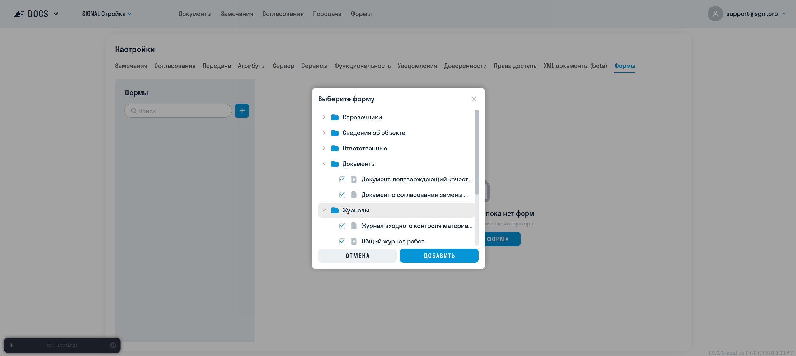
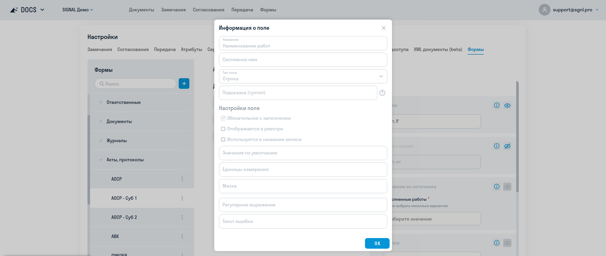
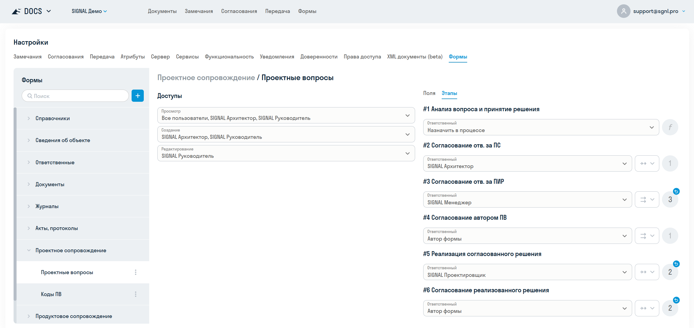
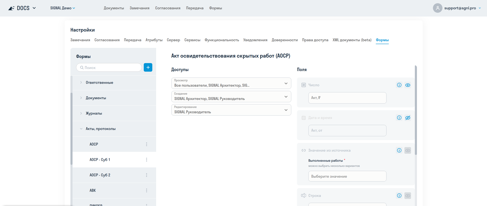

**[<   FORMS. Конструктор](/ru/forms/builder)     **|**     [FORMS. Заполнение формы   >](/ru/forms/create)**
  

 <a href="/forms/settings/updates" onclick="event.stopPropagation();" style="color: inherit; text-decoration: none;">🔄 Что нового (история изменений этого функционала)</a>

  
---
  
> Описанные здесь функции доступны только **Администратору организации**
> {.is-warning}

После того как типы форм и полей созданы в конструкторе суперадмином, их нужно добавить в конкретный проект. Этим занимается администратор проекта.

# Вкладки{.tabset}
## 1. Добавление типа формы в проект
### 1. Добавление типа формы в проект {#add-form-type}

Нажмите **+** и выберите нужные типы форм из конструктора:
  

После добавления по умолчанию для роли **Все пользователи** включены права на чтение и создание форм. При необходимости настройте доступы для ролей проекта.

После добавления вы можете смотреть список полей формы и свойства полей, для этого нажмите на значок информации:
  

#### Шаблон документа и системная папка

При добавлении типа формы в проект шаблон DOCX по умолчанию из конструктора передаётся в настройки проекта. Здесь его можно заменить или восстановить исходный шаблон.

В настройках типа формы можно создать системную папку для вложений и документов, созданных по шаблону. После создания папку можно открыть в «Файлах проекта» или синхронизировать её доступы. Выберите группировку файлов: без вложенности, по году, году и месяцу либо году, месяцу и дню.

#### Тип согласования DOCS {#docs-review-type}

В настройках типа формы проекта выберите **тип согласования DOCS**, по которому должны проверяться и подписываться документы. Настройка применяется к этому типу формы в текущем проекте.

После выбора типа в завершённых формах становится доступна команда **«Создать комплект»**. Она создаёт черновик согласования с PDF и вложениями формы и связанных форм. Маршрут не запускается автоматически: откройте черновик, проверьте файлы и отправьте его на согласование. Подробнее — [в инструкции по заполнению форм](/forms/create#docs-review).

Если тип согласования не выбран, команда создания комплекта из формы недоступна.

#### Корзина

Чтобы открыть удалённые типы форм, нажмите **Корзина** в нижней части панели со списком типов. В корзине можно восстановить тип формы. Если в проекте уже есть тип с таким же префиксом и суффиксом, система предложит изменить суффикс при восстановлении.

## 2. Настройка прав доступа, полей и этапов
### 2. Настройка прав доступа, полей и этапов {#access-fields-stages}
  
#### Настройка прав доступа

Для каждого типа формы в проекте можно задать права на три действия:
- **Чтение** – просмотр существующих экземпляров форм;
- **Создание** – возможность создать новый черновик формы и редактировать этот черновик до завершения;
- **Редактирование** – возможность изменять существующие экземпляры форм других авторов.

Доступы выдаются на роли пользователей.
  
#### Настройка видимости полей

У типа формы в проекте можно скрывать необязательные поля, для этого нажмите на глазик. Скрытое поле не отображается при заполнении и не может быть заполнено. Это полезно, если какой-то реквизит не требуется для данного проекта или подрядчика.

#### Значения полей по умолчанию

На вкладке **Поля** можно задать значения, которые будут автоматически подставляться при создании экземпляров формы в этом проекте.

Изначально отображаются значения по умолчанию из конструктора. Изменённое значение применяется только к выбранному типу формы в текущем проекте и не влияет на его настройки в конструкторе.

Значения по умолчанию доступны для поддерживаемых типов полей, в том числе для полей-источников: связанных форм, файлов, замечаний, комплектов согласования, передач, справочников HUB, пользователей и контрагентов.

Чтобы применить изменения, нажмите ✓ над списком полей. Кнопка сброса у отдельного поля возвращает значение из конструктора, а кнопка сброса над списком — значения всех изменённых полей.

Значение нельзя изменить у скрытого поля и у поля даты, для которого в конструкторе настроена автоматическая подстановка текущей даты.
  
#### Бронирование времени сотрудников {#booking-settings}

Для поля **«Бронирование времени»** откройте вкладку **«Поля»**, нажмите значок информации и заполните список **«Пользователи и роли»**. Он ограничивает сотрудников, чьи интервалы предлагаются при заполнении формы. Доступны отдельно выбранные пользователи и участники выбранных ролей проекта. Пустой список не ограничивает выбор сотрудников проекта. Настройка действует только для этого поля в текущем типе формы проекта.

Расписание сотрудников должно быть подготовлено заранее через API; интерфейс управления календарями пока отсутствует. Одиночный или множественный выбор интервалов задаётся в [конструкторе](/forms/builder#field-types). Само бронирование выполняется при [отправке заполненной формы](/forms/create#time-booking).

#### Настройка этапов
  
Если у типа формы в конструкторе настроены этапы, то на каждый этап можно назначить ответственного: пользователя, роль, автора формы или оставить по умолчанию `Назначить в процессе`.

Также можно изменить срок этапа на конкретное количество дней, либо вернуть настройки по умолчанию, в т.ч. формулу расчета из конструктора.
  

  
#### Наблюдатели

Для каждого типа формы в проекте можно назначить **наблюдателей** – пользователей или роли, которые будут получать уведомления о ходе согласования, но не обязаны участвовать в этапах. Наблюдатели видят форму в режиме «только чтение» на всех этапах.

Назначение наблюдателей полезно для руководителей и других участников проекта, которые хотят отслеживать процесс без участия в утверждении.
  
## 3. Копирование типа формы
### 3. Копирование типа формы {#copy-type}
  
Один и тот же тип формы может быть продублирован в рамках проекта для разных потоков документов:
- для разделения доступов между участниками проекта (например субподрядчиками, которые должны создавать и видеть каждый свой перечень форм);
- для логического разделения экземпляров форм (например форма журнала работ может быть использована для разных видов работ, но экземпляры должны отображаться в разных таблицах).
  
Для этого нажмите **Копировать** и введите суффикс. Например, для подрядчика «Субподряд-1» можно задать суффикс ` -СУБ-1`.
  
При копировании настройки доступов, видимости полей и все настройки этапов также копируются, но могут быть изменены независимо для каждой копии.
  

## 4. Копирование настроек в новый проект
### 4. Копирование настроек в новый проект {#copy-project}

При [создании проекта на основе существующего](/hub/admin#projects) можно выбрать FORMS среди приложений для переноса настроек. После создания добавьте нужных пользователей и роли в новый проект и откройте его в DOCS: при подготовке проекта переносятся активные подключения типов форм, в том числе подключения одного типа с разными суффиксами.

Переносятся доступы, видимость полей, значения по умолчанию обычных полей, настройки этапов, доступные ответственные и наблюдатели, шаблон DOCX и разрешение редактировать завершённые формы. Значения полей «Пользователь», «Контрагент» и справочников сохраняются в поддерживаемых случаях; ссылки на экземпляры форм, файлы и объекты DOCS исходного проекта не переносятся. Недоступные пользователи исключаются, а для недоступного ответственного остаётся назначение в процессе.

После переноса проверьте настройки копии. Тип согласования DOCS и системную папку нужно выбрать заново. Сами формы, их статусы, история, вложения и ранее созданные документы не копируются. Настройки копии можно менять независимо от исходного проекта; повторное открытие проекта не создаёт дубликаты подключений.

Для подготовки FORMS нужны доступ к проекту, лицензия FORMS и включённый модуль. Если лицензия выдана позже, настройки подготавливаются при следующем входе в DOCS.

#
---
**[<   FORMS. Конструктор](/ru/forms/builder)     **|**     [FORMS. Заполнение формы   >](/ru/forms/create)**
