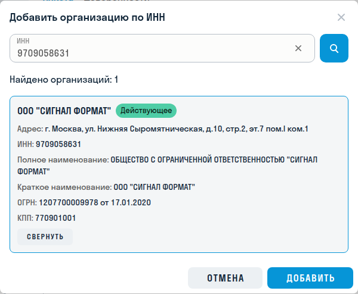
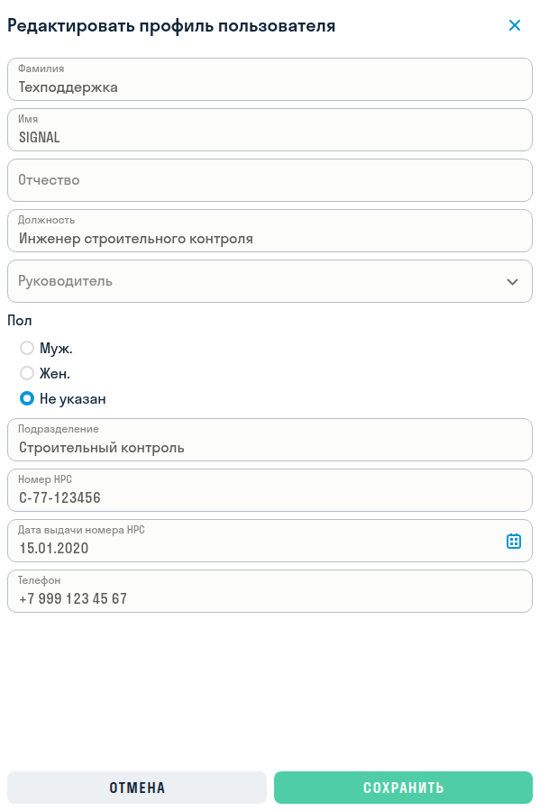
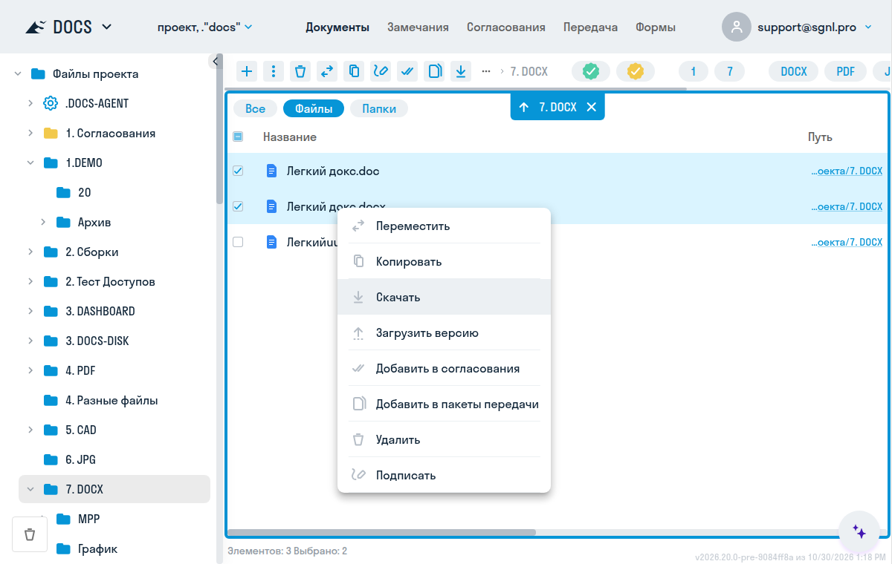
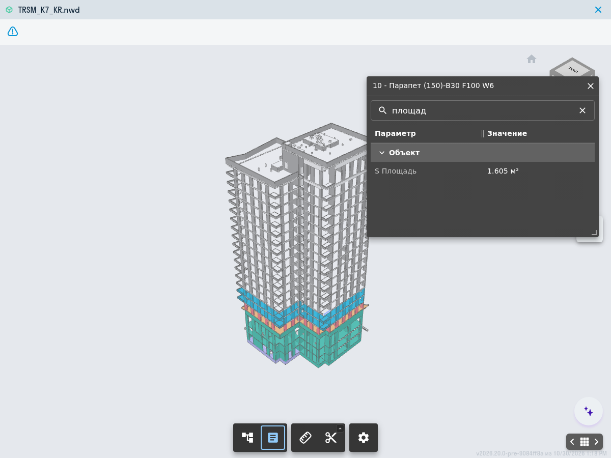
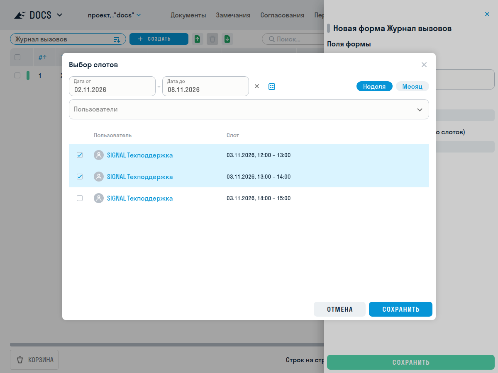
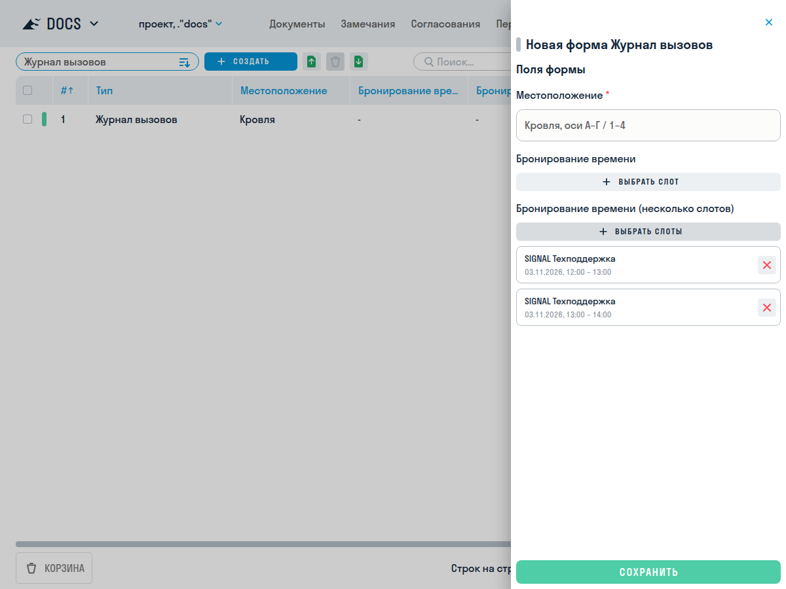
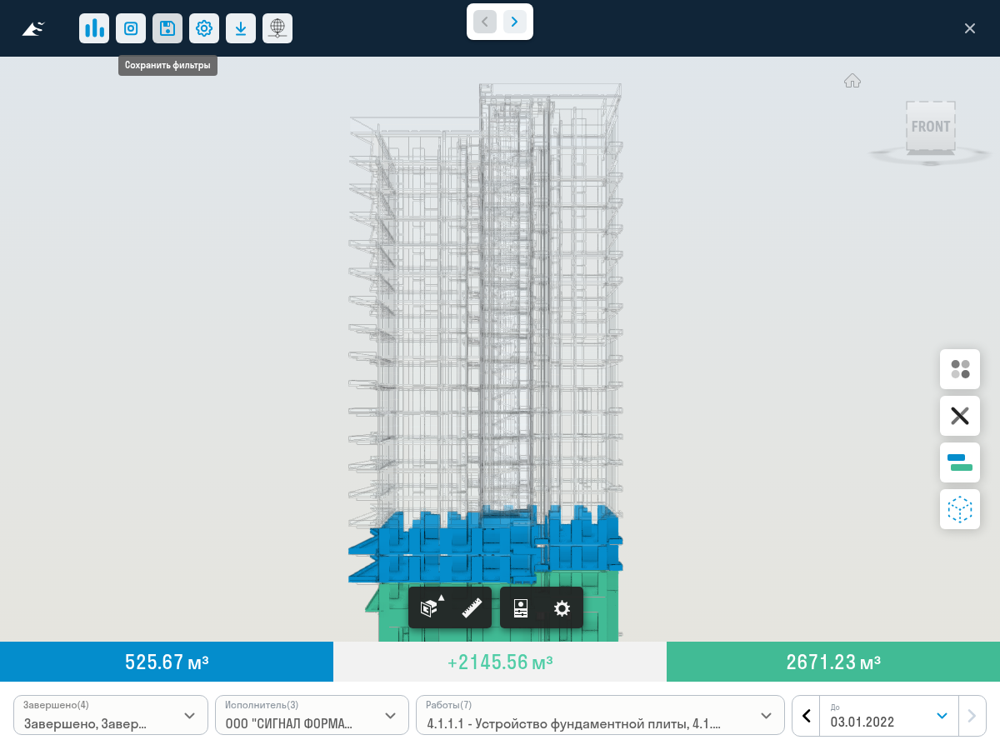

**[Релиз 2026.19   >](/general/updates/2026-19)**

> Релиз готовится к выпуску.
{.is-info}

---

HUB

**:fire: Заполнение реквизитов компании по ИНН**

В разделе [«Компании»](/hub/admin#counterparties) можно найти организацию по ИНН и подставить её реквизиты в карточку: наименование, адрес, регистрационные номера и другие доступные данные. Полученные значения можно исправить вручную или заменить, выбрав другую организацию.

**:fire: Дополнительные сведения о сотрудниках**

В карточках [пользователей](/hub/admin#users) появились должность, руководитель, подразделение, телефон, пол, номер НРС и дата его выдачи. Эти сведения включаются в экспорт пользователей в XLSX.

**:sparkles: Доработки функционала**

- В списке участников [проекта](/hub/admin#projects) отображаются компания пользователя и наличие активной доверенности. Добавили фильтр по компаниям и быстрый отбор пользователей с действующей доверенностью.
- Проекты можно искать по коду вместе с названием.
- В карточке компании можно не заполнять ИНН, ОГРН или ОГРНИП, адрес и полное наименование. Для физического лица паспортные данные также необязательны.
- Для позиции [справочника материалов](/hub/admin#directory-materials) можно выбрать одного или нескольких исполнителей из компаний.
- В [журнале действий](/hub/admin#log) фиксируются изменения планового начала и плановой даты согласования: кто изменил дату, когда, прежнее и новое значения.
- Для [корпоративного входа SSO](/hub/admin#adsso) можно подготовить ссылку, которая сразу направит пользователя на авторизацию его организации. В приветственных письмах новым пользователям появилась явная ссылка для входа и пояснение дальнейших действий.

---

DOCS

**:fire: Команды для нескольких файлов в контекстном меню**

Выделите несколько [файлов](/docs/folders) и откройте меню правой кнопкой мыши на одном из них. Команды применяются ко всему выделению: можно переместить, скопировать, скачать или удалить файлы, добавить их в согласование или передачу, подписать и запустить обработку моделей. Доступность действий зависит от состава выделения, прав и настроек проекта.

Команды для одного файла, например переименование и создание публичной ссылки, при множественном выборе скрываются. Если открыть меню на невыделенном файле, действия будут относиться к нему.

**:sparkles: Доработки функционала**

- В [просмотрщике BIM-моделей](/docs/viewers#bim) обновили управление камерой:
	- удержание колеса мыши перемещает вид, а `Shift` с удержанием колеса вращает модель;
	- прокрутка приближает и отдаляет модель относительно указателя, двойное нажатие колеса показывает всю видимую модель;
	- в контекстном меню можно закрепить точку вращения по выбранным элементам и затем сбросить её;
	- на сенсорном экране один палец вращает модель, два перемещают вид, сведение и разведение пальцев меняют масштаб.
- В панели «Свойства» появился поиск по названию и значению параметра, включая единицы измерения. Ширину колонок «Параметр» и «Значение» можно менять перетаскиванием границы. Обрезанные имена элементов и значения свойств читаются целиком в подсказках:

- Если обработать модель в SIGNAL не удалось, отображается причина: например, отсутствие геометрии, повреждение исходного файла, неподдерживаемая версия Revit или ошибка загрузки. Повторный запуск доступен для ошибок, при которых он может помочь; в остальных случаях потребуется устранить причину.

**:hammer_and_wrench: Исправление ошибок**

- Убрали лишнюю прокрутку в окне [перезапуска согласования](/docs/reviews#restart).
- Исправили перезапуск комплекта, у которого удалён тип согласования: для полного перезапуска требуется выбрать действующий тип.
- Исправили изменение плановой даты окончания при одновременной очистке планового начала.

---

FORMS

**:fire: Бронирование времени сотрудника из формы**

В [форму](/forms/create#time-booking) можно добавить поле «Бронирование времени» и выбрать свободные интервалы из заранее подготовленного расписания сотрудников. Например, так можно записаться на встречу или согласовать время выезда на объект.

> Управление календарями сотрудников пока доступно только через API. Для бронирования необходимо заранее подготовить расписания.
{.is-warning}

В настройках поля задаётся одиночный или множественный выбор, а в настройках типа формы проекта можно ограничить доступных сотрудников пользователями и ролями. При заполнении формы интервалы ищутся по датам и сотрудникам; время показывается в часовом поясе проекта.

Сохранение черновика не бронирует время. Бронь создаётся при отправке формы на согласование, а для формы без маршрута — при завершении. Если выбранный интервал уже занят, система сообщает об этом и предлагает изменить выбор.

При редактировании отправленной формы добавленные интервалы бронируются, а удалённые освобождаются. Удаление формы освобождает её брони; завершение согласования само по себе время не освобождает.

**:sparkles: Доработки функционала**

- Унифицировали оформление заголовков полей формы, расположение признака обязательности, подсказок и описаний. Длинные названия полей и варианты выбора переносятся на следующую строку.
- В [конструкторе](/forms/builder#field-properties) у поля можно отдельно задать описание, которое постоянно видно под заголовком, и подсказку, открывающуюся по значку вопроса.
- В [шаблонах DOCX](/forms/generate) доступны свойства выбранных видов работ, материалов, НТД и компаний: например, стоимость за единицу, даты действия НТД, ИНН, банковские реквизиты и сведения о СРО. Для множественного выбора можно вывести несколько записей. Генерация по реквизитам компаний доступна участникам без прав администратора. Паспортные данные физлиц этим способом не подставляются.

**:hammer_and_wrench: Исправление ошибок**

- При повторном открытии черновика формы корректно подставляются значения по умолчанию условных полей.
- В полях выбора видов работ и материалов единицы измерения отображаются на языке интерфейса; служебное значение единицы не показывается.

---

DASHBOARD

**:fire: Сохранение вида 3D-карточек**

В [карточках 50 и 51](/dash/cards-50#card-50) пользователь с правом редактирования может сохранить выбранные работы, исполнителей и даты кнопкой с дискетой. При следующем открытии карточка показывает сохранённое состояние, в том числе на вкладке «Отчёт».

При просмотре можно временно изменить фильтры и изучить другие данные модели. Сохранённые настройки меняются только после нового сохранения.

**:sparkles: Доработки функционала**

- В [карточке 31 «Вехи на проекте»](/dash/cards-30#card-31) рядом с отклонением по срокам отображаются конкретные значения «Выполнено / Всего».

**:hammer_and_wrench: Исправление ошибок**

- Пользователи с правом просмотра отчёта компании могут сворачивать и разворачивать группы карточек.
- В карточке 31 исправили обмен с Excel и Google Sheets: значения «Всего», «Выполнено» и дата завершения сохраняют свои колонки.
- В карточке 21 длинные суммы и названия больше не сливаются: обрезанный текст можно прочитать в подсказке.

---

TOOLS

**:sparkles: Выбор плагинов для загрузки**

На [странице загрузки плагинов SIGNAL](https://tools.sgnl.pro/plugins) сгруппировали инструменты по Revit, Navisworks и AutoCAD. Для каждой программы указаны поддерживаемые версии, отдельно выделены варианты FREE, BASIC и PRO. Фильтр помогает оставить плагины для нужной программы.

---

API

**:fire: Получение данных фотомониторинга из INSPECTION**

В [публичном API](/general/api) для интеграций с фотомониторингом доступны чтение папок, планов и точек съёмки, а также подсчёт записей по фильтру:

| Действие | Метод |
| --- | --- |
| Получить папки проекта | `POST /public/v1/inspection/folders` |
| Подсчитать папки | `POST /public/v1/inspection/folders/count` |
| Получить планы | `POST /public/v1/inspection/plans` |
| Подсчитать планы | `POST /public/v1/inspection/plans/count` |
| Получить точки съёмки | `POST /public/v1/inspection/points` |
| Подсчитать точки съёмки | `POST /public/v1/inspection/points/count` |
| Получить точку по идентификатору | `GET /public/v1/inspection/points/{pointId}` |

**:fire: Управление типами согласований**

Добавили операции для настройки типов согласований DOCS:

| Действие | Метод |
| --- | --- |
| Создать тип согласования | `POST /public/v1/reviews/types/create` |
| Изменить тип согласования | `PATCH /public/v1/reviews/types` |

**:sparkles: Дополнительные данные в ответах API**

- `GET /public/v1/versions` и `POST /public/v1/versions/find-batch` возвращают идентификатор пользователя, загрузившего версию, в поле `itemVersionAddedBy`.
- `POST /public/v1/user-logs` возвращает поле `entityId` — идентификатор объекта, к которому относится событие журнала.

Для новых операций нужны соответствующие разрешения интеграции на чтение или изменение данных.

---

**[Релиз 2026.19   >](/general/updates/2026-19)**
