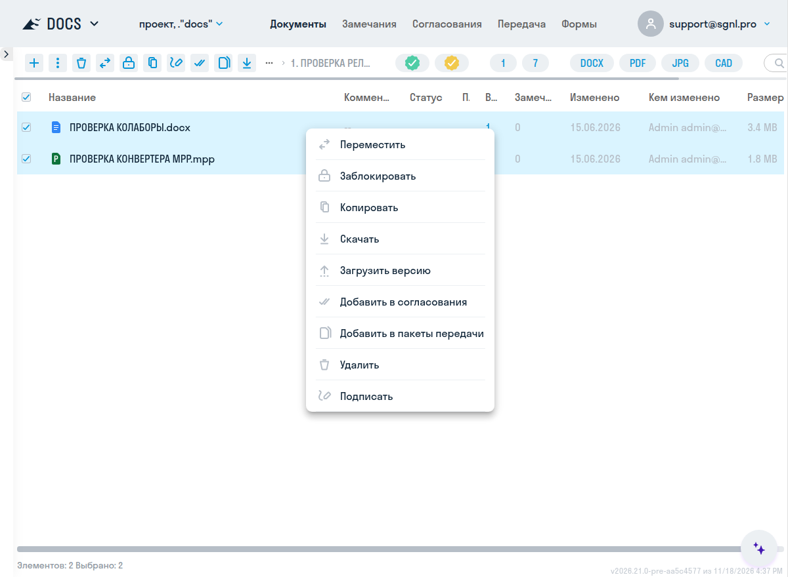
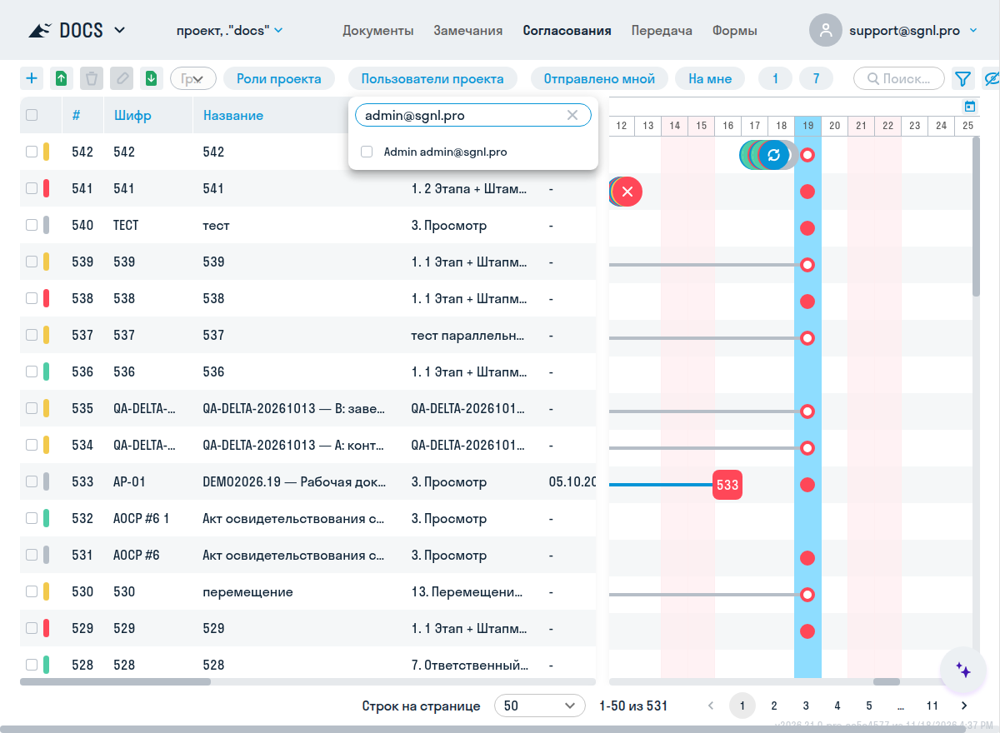
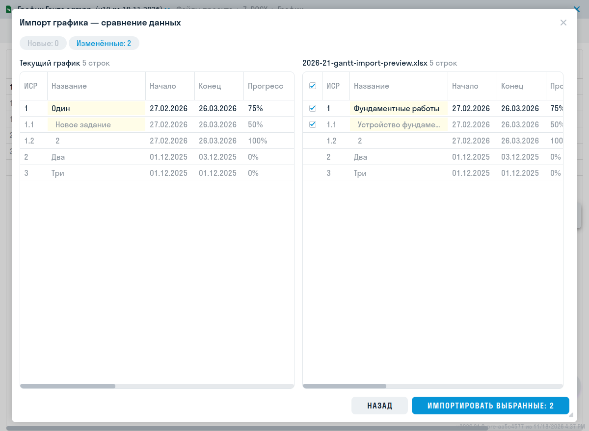
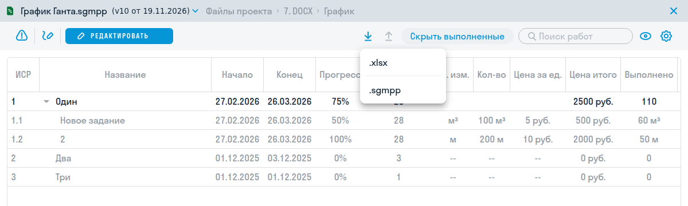
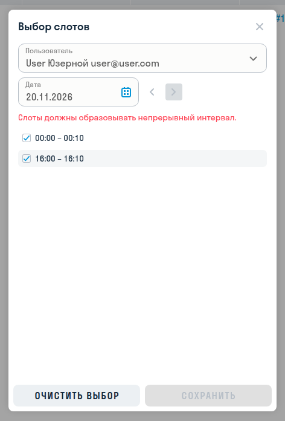
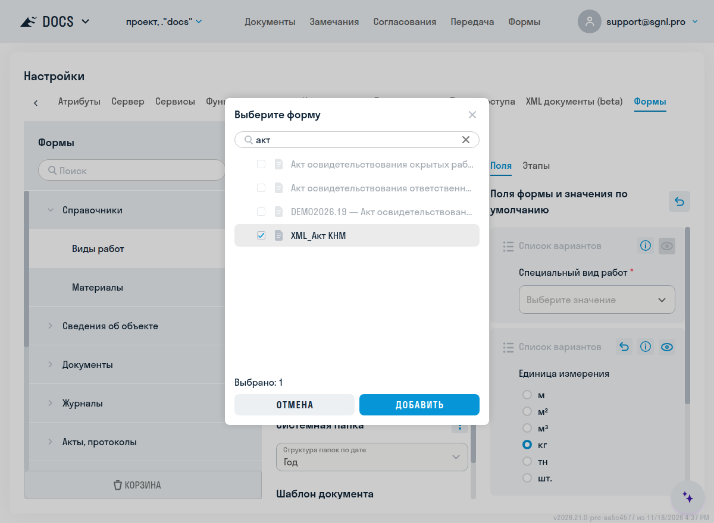

**[Релиз 2026.20   >](/general/updates/2026-20)**

> Релиз готовится к выпуску. Плановая дата поставки — **23 ноября 2026 года**.
{.is-info}

---

HUB

**:sparkles: Доработки функционала**

- В карточке [компании](/hub/admin#counterparties) для юридического лица можно выбрать генерального директора из пользователей этой компании. Если подходящего пользователя нет, ФИО можно ввести вручную.
- На вкладке [«Проекты»](/hub/admin#projects) можно применить один набор проектных ролей к нескольким выбранным участникам. Если у кого-то из них отключится наследование ролей компании, HUB запросит подтверждение. В окне добавления участников фильтры по компании, роли и доверенности и поиск находятся рядом с кнопкой «Добавить».
- Переключатель компаний HUB показывает активные компании, в которых вы состоите, в том числе без доступа к DOCS. В DOCS доступны компании, для которых вам выдан доступ к этому модулю. Работать со [справочниками](/hub/admin#directory-accesses) в HUB можно по назначенным правам на нужный справочник, в том числе с ролью участника компании.

**:hammer_and_wrench: Исправление ошибок**

- Исправили повторный вход в SIGNAL, когда открыто несколько вкладок браузера.
- Исправили сохранение настройки [уведомлений о согласованиях](/hub/user#notifications) в профиле.
- При сохранении ФИО убираются лишние пробелы по краям, а поиск пользователей корректно обрабатывает лишние пробелы в запросе.

---

DOCS

**:fire: Ручная блокировка файлов**

Чтобы защитить файл от изменений, редактор папки может выбрать **«Заблокировать»** в контекстном меню. Команда работает и для [нескольких выделенных файлов](/docs/folders#bulk-actions), если все они свободны. По значку замка можно узнать, кто и когда установил блокировку.

Заблокированный файл можно просматривать, скачивать и копировать при наличии соответствующих прав. Чтобы изменить файл, загрузить новую версию, переименовать, переместить или удалить его, сначала выберите **«Разблокировать»**. Снять ручную блокировку может любой редактор папки. Если файл открыт для редактирования в Collabora, ручную блокировку можно установить после завершения сессии.

**:sparkles: Доработки функционала**

- В [реестре согласований](/docs/reviews#register_reviews) появился быстрый фильтр по ответственным пользователям проекта. Выбор сохраняется в адресе страницы, поэтому ссылкой на отфильтрованный реестр можно поделиться.

  

- В окне [создания комплекта](/docs/reviews#start_reviews) изменили порядок полей. В [настройках штампа](/docs/reviews#stamps) заголовок может содержать до 255 символов.
- Пользователи с [правом загрузки в папку](/docs/folders#access_folders) могут заполнять, изменять и очищать значения атрибутов файлов в этой папке.
- В [график Ганта `.sgmpp`](/docs/viewers#mpp) можно импортировать работы из Excel-файла `.xlsx` с компьютера или из DOCS. Перед применением импорта можно проверить, какие работы добавятся или изменятся. График можно выгрузить в `.xlsx`, а выделенные строки — скопировать в Excel через `Ctrl+C`.

  

  

- При создании первого [замечания](/docs/issues) за сессию, если доступны несколько типов, пользователь сам выбирает тип. Если доступен единственный тип, он подставляется автоматически.
- В [журнале действий HUB](/hub/admin#log) фиксируется изменение договорной даты комплекта согласования. В записи видны автор, время изменения, прежняя и новая даты.

**:hammer_and_wrench: Исправление ошибок**

- После отмены отдельных файлов очередь загрузки продолжает загружать остальные.
- В предыдущей итерации согласования нельзя заменить версию файла. При перезапуске комплекта комментарий можно изменить до финального подтверждения.
- Для незавершённых согласований отклонения от договорного и планового сроков рассчитываются от текущей даты в часовом поясе проекта. Исправили сохранение изменений дат в существующем комплекте и ускорили переключение между типами согласований в настройках проекта.
- В окне [добавления файлов в передачу](/docs/documentsTransfers#creating) исправили выбор всех файлов. [Акт приёма-передачи](/docs/documentsTransfers#act) теперь формируется в том числе при недоступности CDN Cloudflare.
- В [Autodesk Viewer](/docs/viewers#bim) исправили ошибку при открытии моделей и поиск объектов Navisworks по ID в смешанных сборках.
- При длительном [редактировании офисных документов](/docs/viewers#office) Collabora чаще продлевает сессию. Это снижает риск ошибки сохранения, когда документ долго открыт.
- Повысили надёжность открытия и скачивания файлов в Chrome при сбоях записи в хранилище браузера.

---

FORMS

**:sparkles: Доработки функционала**

- В [шаблонах DOCX](/forms/generate#system-properties) можно подставлять больше данных из форм.
  - Из поля «Форма» — номер связанной формы, автора, даты создания и изменения, сведения об этапах. Например, `{{relatedForm._form.number}}` подставляет номер, а `{{relatedForm._stage[1].responsible.fullName}}` — имя ответственного за первый этап. `relatedForm` — системное имя поля.
  - Из поля «Пользователь» — должность, роли в проекте, сведения о руководителе, компании и НРС, если эти данные заполнены.
  - Из поля «Бронирование времени» — начало и конец выбранного интервала в часовом поясе проекта. Например, `{{booking._start}}` и `{{booking._end}}` подставляют дату и время, а `{{booking._startOnlyDate}}` и `{{booking._endOnlyDate}}` — только даты.
- При [бронировании времени](/forms/create#time-booking) сначала выберите сотрудника. Календарь подскажет доступные даты, а стрелки помогут перейти к соседнему дню со свободными интервалами. Если можно выбрать несколько интервалов, объединить их получится, только когда они идут подряд.

  

- В окне [добавления типов форм в проект](/forms/settings#add-form-type) появился поиск по названию и префиксу. Можно выбирать типы из разных результатов поиска. Уже выбранные типы остаются в подборке при смене запроса.

  

- В окне [создания формы](/forms/create#create) появился поиск по доступным типам. В реестре увеличили ширину столбца с номером формы.

**:hammer_and_wrench: Исправление ошибок**

- Исправили расчёт порядка типов форм при создании, перемещении и восстановлении из корзины.

---

DASHBOARD

**:sparkles: Доработки функционала**

- На вкладке [«Управление»](/dash/settings#adding_card) редактор группы может скрыть её из отчёта и снова показать. Скрытая группа остаётся доступной редактору на вкладке «Управление».

---

TOOLS

**:sparkles: Доработки функционала**

- При обработке NWD в SGBIM конвертер автоматически выбирает самую новую из установленных версий Navisworks, для которой у него есть совместимый плагин.

**:hammer_and_wrench: Исправление ошибок**

- Исправили сбой при построении рёбер в ходе конвертации больших сборных моделей NWD в SGBIM.
- При конвертации IFC в SGBIM сохраняются системные свойства элементов, например размеры окон и высотные отметки этажей, если они заданы в исходной модели. После конвертации эти данные видны в [панели «Свойства» SIGNAL Viewer](/docs/viewers#signal-properties).

---

API

**:fire: Копирование папок DOCS**

Через [публичный API](/general/api#doc) можно копировать папки внутри проекта и между проектами одной компании. Можно перенести только структуру либо скопировать папки с актуальными или всеми версиями вложенных файлов. Для копирования с файлами целевая папка должна быть без действующей маски. Файлы копируются в фоне.

| Метод и путь | Что делает |
| --- | --- |
| `POST /public/v1/folders/copy-structure` | Копирует дерево выбранных папок без файлов. |
| `POST /public/v1/folders/copy-structure-with-files` | Запускает копирование папок с файлами и возвращает идентификаторы фоновых заданий. |
| `POST /public/v1/folders/copy-jobs-statuses` | Возвращает состояние фоновых заданий, в том числе число файлов, которые не удалось скопировать. |

**:fire: Пакетное создание ролей компании**

| Метод и путь | Что делает |
| --- | --- |
| `POST /public/v1/company/roles/create-batch` | Создаёт от 1 до 200 ролей компании за один запрос и возвращает их идентификаторы. Если хотя бы одна роль не проходит проверку, весь запрос отклоняется. |

**:hammer_and_wrench: Исправление ошибок**

- `GET /public/v1/projects` учитывает список проектов, разрешённых API-клиенту. `POST /public/v1/user-logs` проверяет доступ API-клиента к проектам, указанным в фильтре.
- Публичный API возвращает ошибку `400`, если запрос содержит недопустимое значение перечисления.

---

**[Релиз 2026.20   >](/general/updates/2026-20)**
