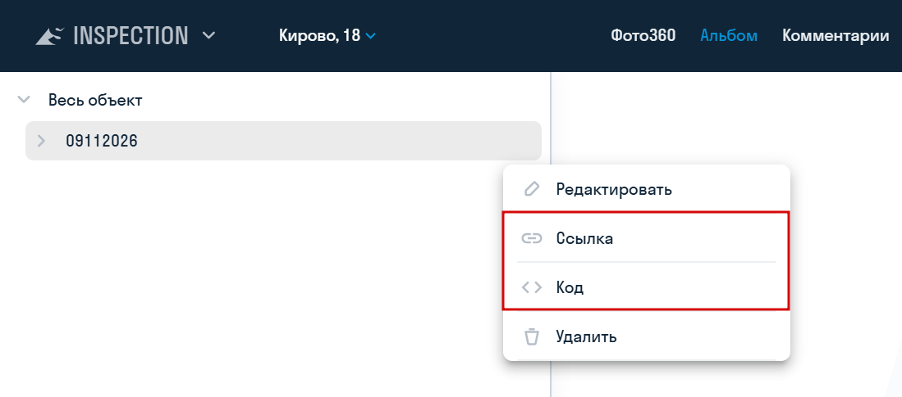
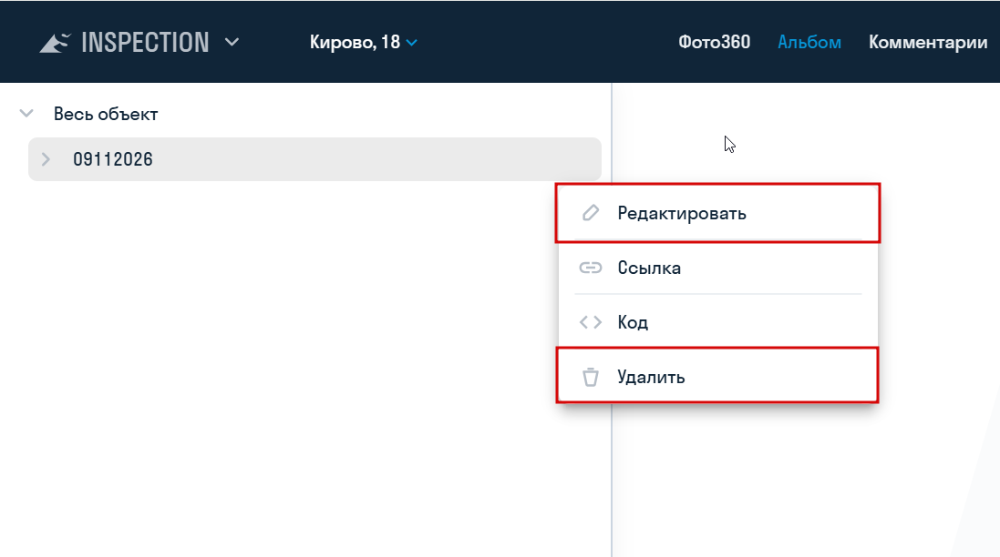

**[<   INSPECTION. Запросы](/ru/insp/inquiries)     **|**     [INSPECTION. Приложение Photomaker    >](/ru/insp/app)**

---

> В SIGNAL INSPECTION можно опубликовать выбранные фотографии в альбоме. Альбом доступен для просмотра всем, у кого есть ссылка: вход и лицензия SIGNAL не требуются. Защита паролем и срок действия ссылки при создании альбома не настраиваются.
{.is-info}

Создавать и настраивать альбомы может администратор приложения INSPECTION в административном интерфейсе (pa.sgnl.pro). Для публикации одной фотографии без альбома используйте [ссылку на фотографию](/ru/insp/photo360).

## Создание альбома

1. Перейдите на pa.sgnl.pro в раздел «Альбом».
2. Нажмите три точки напротив «Весь объект» и выберите «Добавить альбом».

3. Введите название альбома.
4. При необходимости заполните «Список доменов» — адреса сайтов, на которых планируется разместить альбом с помощью кода. Указывайте каждый адрес с новой строки и полностью, с протоколом, например `https://example.com`.

## Выбор содержимого

Содержимое альбома определяется двумя настройками: какие точки входят в альбом и какие фотографии этих точек опубликованы. В альбоме показываются только опубликованные фотографии отмеченных точек. Изменения сохраняются сразу.

1. Раскройте альбом в дереве и выберите блок и план.
2. Отметьте нужные точки. Чтобы отметить или снять все точки плана, используйте флажок у этого плана: он доступен, когда план выбран.

3. Выберите точку. В блоке «Список опубликованных фотографий» включите переключатели у нужных фотографий. Чтобы опубликовать или снять с публикации все фотографии точки, нажмите «Опубликовать все фото».

> Если в [настройках проекта](/ru/insp/settings) включена «Авто публикация фотографий», новые фотографии публикуются автоматически во всех альбомах проекта. Новые точки всё равно нужно отметить вручную.
{.is-info}

## Публикация

Нажмите три точки рядом с названием альбома и выберите форму публикации:

- «Ссылка» — откроется окно со ссылкой на альбом. Нажмите «Копировать».
- «Код» — откроется окно с HTML-кодом для вставки альбома на сайт. Нажмите «Копировать».

Ссылкой можно поделиться с пользователями, не обладающими лицензией SIGNAL.

## Изменение и удаление

В том же меню альбома доступны:

- «Редактировать» — изменение названия и списка доменов;
- «Удалить» — удаление альбома. После удаления ссылка перестаёт работать. Фотографии в проекте при этом не удаляются.
  
  

#
**[<   INSPECTION. Запросы](/ru/insp/inquiries)     **|**     [INSPECTION. Приложение Photomaker    >](/ru/insp/app)**
