**[<   INSPECTION. Настройки проекта](/ru/insp/settings)     **|**     [INSPECTION. Альбом    >](/ru/insp/album)**

 <a href="/insp/photo360/updates" onclick="event.stopPropagation();" style="color: inherit; text-decoration: none;">🔄 Что нового (история изменений этого функционала)</a>

---

# Вкладки{.tabset}
## Планы. Создание и настройка

>Структура проекта состоит из блоков (корпуса, секции, строения и т.д.) и планов (этажей, уровней, локаций) с точками и фотографиями.{.is-info}

1.  Для создания блока нажмите три точки напротив «Весь объект» → «Добавить блок»

2.  Для создания плана нажмите три точки напротив блока → «Добавить план»

>В открывшемся окне введите название плана, например, Этаж 1, и загрузите изображение плана в формате PNG, JPEG или WEBP. Размер файла - не более 25 МБ.{.is-info}

3.  Добавьте остальные блоки и этажи по аналогии

В дереве рядом с блоками и планами показаны количество точек со статусами «Выполнено» и «Требуется» и дата последней активности.

### Редактирование и удаление планов

1.  Чтобы изменить название или заменить изображение плана, нажмите три точки напротив плана → «Редактировать»
2.  Чтобы удалить план, нажмите три точки напротив плана → «Удалить». Удалённый план можно восстановить в корзине.

Блоки редактируются и удаляются так же, через меню трёх точек.

### Настройка плана

>Чтобы задать север относительно плана, перейдите на вкладку «План» и, передвигая ползунок, выставьте правильное расположение севера (буква «N»). Затем нажмите значок сохранения с подсказкой «Установить азимут».{.is-info}

>Вкладки «План», «Точка» и «Фото» скрываются, если область плана слишком маленькая по высоте. Чтобы они появились, растяните область за правый нижний угол.{.is-info}

## Точки. Создание и настройка

### Создание точки

Точку можно создать двумя способами:

1.  Зажмите CTRL на клавиатуре (Cmd на macOS) и левой кнопкой мыши нажмите в нужной области на плане

2.  На вкладке «Точка» нажмите «Добавить». В центре плана появится указатель. Переместите план так, чтобы указатель оказался в нужном месте, и нажмите «Добавить» ещё раз

В появившемся окне введите название точки, например, 1, и нажмите «Сохранить»

Точка появится на плане

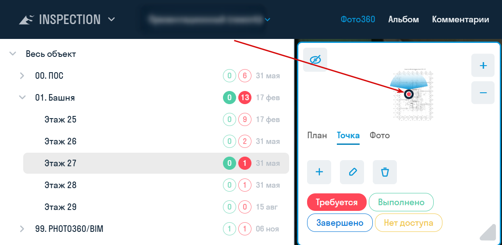

### Настройка точек

После выбора точки на вкладке «Точка» станут активны её настройки

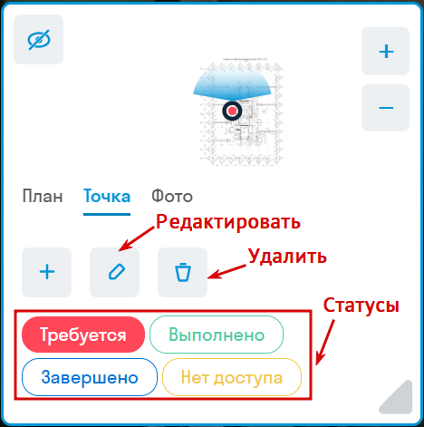

- Чтобы переименовать точку, нажмите «Редактировать».
- Чтобы переместить точку, перетащите её на плане.
- Чтобы удалить точку, нажмите «Удалить». Удалённую точку можно восстановить в корзине.

**Точкам можно присвоить один из четырёх статусов:**

-   «Требуется» — красная точка. На точке требуется сделать фотографию.
-   «Выполнено» — зелёная точка. На точку загружена фотография, статус ещё не сброшен.
-   «Завершено» — синяя точка. На точке больше не требуется снимать фотографии. Автоматически этот статус не меняется.
-   «Нет доступа» — жёлтая точка. Фотомейкер не смог попасть на точку и отметил это в приложении Photomaker.

Статусы помогают инженеру цифрового измерения определить точки, с которыми ему предстоит работать на объекте. Чтобы изменить статус вручную, выберите точку и нажмите нужный статус на вкладке «Точка».

Можно настроить автоматический сброс статуса с «Выполнено» на «Требуется» в любой день недели, чтобы фотомейкер при синхронизации с проектом получал точки, на которые требуется загрузить фотографии. Подробнее — в разделе [«Настройки проекта»](/insp/settings).

**Пример работы со статусами точек**

Изначально точки создаются со статусом «Требуется» (красные). Инженер цифрового измерения (фотомейкер) приезжает на объект, синхронизируется в приложении Photomaker и получает точки, которые требуется пройти.

После съёмки точка окрашивается в зелёный цвет в приложении, что упрощает поиск ещё не пройденных точек. Если попасть на точку нельзя, фотомейкер нажимает «Нет доступа», и точка становится жёлтой.

После прохождения объекта фотомейкер отправляет данные в сервис INSPECTION. Статус «Нет доступа» передаётся при отправке. Если в настройках проекта включено [«Изменять статус на «Выполнено»…»](/insp/settings), точки с новыми фотографиями получат статус «Выполнено» (зелёные). Инженеры ПТО, СК, РП просматривают фотографии и добавляют новые точки.

Рекомендуется в настройках проекта выставить автоматический сброс статуса точек с «Выполнено» обратно на «Требуется» перед следующим приходом фотомейкера. Тогда после синхронизации фотомейкер снова получит точки, которые требуется пройти. Статус «Нет доступа» по расписанию не сбрасывается: его сбрасывает кнопка «Сбросить сейчас», новая фотография на точке при включённой настройке изменения статуса или ручная смена статуса.
  
## Фото. Загрузка и настройка

1.  Чтобы добавить фотографию, выберите точку, перейдите на вкладку «Фото» и нажмите «Добавить»

  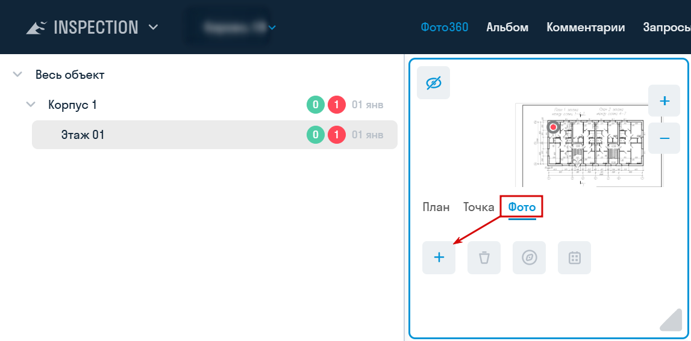

2.  В появившемся окне выберите дату создания фото (по умолчанию — сегодня) и загрузите фотографию в формате PNG, JPEG или WEBP размером до 25 МБ. В поле «Тип фото» выберите «2D» или «Фото360» (по умолчанию). Нажмите «Сохранить»

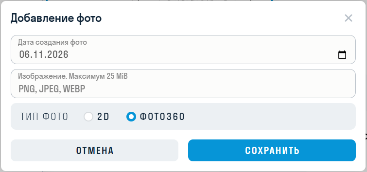

>Для фотографий типа «2D» недоступны сравнение, выравнивание и комментарии.{.is-info}

Добавленные фотографии можно просматривать в хронологическом порядке

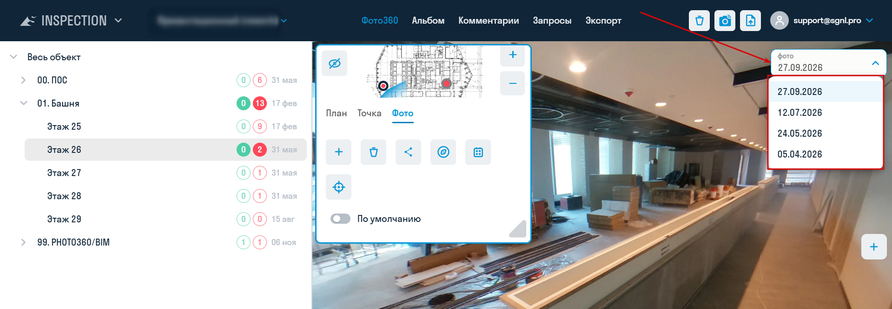

### Настройка фотографий

После выбора фотографии на вкладке «Фото» станут активны её настройки. Изменять фотографию можно только в обычном режиме просмотра: не в режиме сравнения или выравнивания.
  
  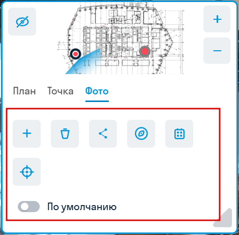

**Дата фотографии**

Чтобы исправить дату, нажмите «Выбрать дату», укажите дату и сохраните.
  
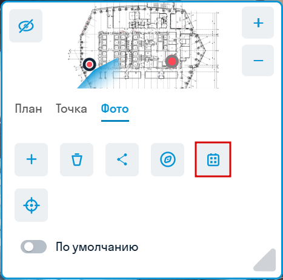

**Фото по умолчанию**

Переключатель «По умолчанию» определяет, какая фотография откроется при выборе точки. На одной точке такая фотография может быть только одна, в списке она отмечена звёздочкой. Если фотография по умолчанию не задана, откроется первая в списке. Фотография, отправленная из приложения Photomaker, автоматически становится фотографией по умолчанию.
  
  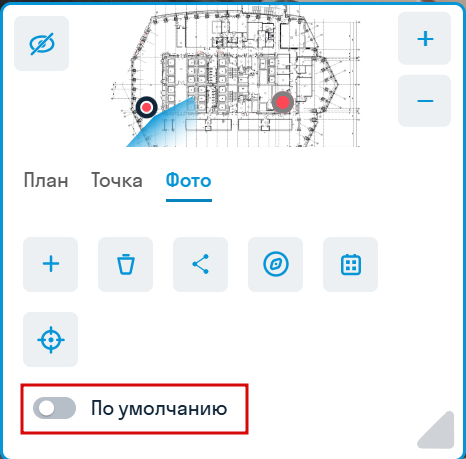

**Удаление фотографии**

Нажмите «Удалить» и подтвердите действие. Удалённую фотографию можно восстановить в корзине.
  
  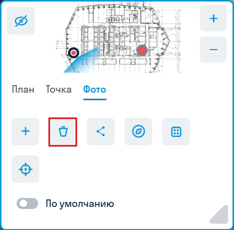

**Настройка азимута**

Чтобы настроить направление фотографии относительно плана, поверните фотографию на север и нажмите «Установить азимут».

**Настройка азимута с помощью выравнивания фото**

>Выравнивание используется для выставления азимута фотографии по другой фотографии, например, для снимков с квадрокоптера, когда проблематично определить направление на север. Кнопка доступна для фотографий 360, если на точке не меньше двух фотографий.{.is-info}

1.  Выберите фото, которое требуется выровнять, и нажмите «Выравнивание»
2.  Появившийся прицел на фотографии наведите на статичный объект, который не будет меняться от фотографии к фотографии. Например, это может быть здание.
3.  Нажмите «Выбрать эталонную фотографию» в нижней части экрана.

4.  Справа появится эталонная фотография, по которой будет выровнена левая. По умолчанию выбирается предыдущая в списке фотография. Можно выбрать другую фотографию из списка.
5.  С помощью ползунка наведите прицел правой фотографии на объект, выбранный в пункте 2.
6.  Нажмите «Сохранить».

7.  Левая фотография примет ориентацию эталонной, т.е. их север будет смотреть в одну сторону.

## Создание ссылки на фотографию

>Ссылки расшариваются на конкретную фотографию для использования, например, специалистами стройконтроля в замечании или департаментом продаж для отправки клиенту фото360 из его квартиры во время строительства.{.is-info}

1.  Выберите фотографию и во вкладке ФОТО нажмите «Создать ссылку»    

1.  В появившемся окне введите название для ссылки и нажмите «Сохранить». Ссылка будет скопирована в буфер обмена и сохранится в «Списке общедоступных фотографий»
     
 

1.  Все созданные ссылки хранятся в «Списке общедоступных фотографий». Нажмите кнопку «Ссылки на фото» (иконка фотоаппарата) и скопируйте ссылку.

## Сравнение со сборной ЦИМ

### Экспорт фото

>Инструмент позволяет экспортировать выбранные точки обзора как панорамное изображение, чтобы в последующем вставить его в модуль INSPECTION.{.is-info}

1. Для создания точки обзора необходимо выбрать место, где вы хотите получить панорамное фото, и расположить свой вид в этом месте.

>**Внимание!** Следует выровнять вид точно по вертикали с помощью команды «Выровнять камеру по вертикали». В противном случае, если камера не будет строго параллельна полу, при публикации в INSPECTION изображение сошьётся некорректно.{.is-warning}

После этого нужно сохранить точку обзора, дав ей название.

2. Нажмите на вкладке SIGNAL на панели Экспорт | Импорт ➤ Фото360

3. Выберите необходимые точки обзора, укажите настройки освещения и разрешение фотографии. Нажмите «ОК».

>**Примечание:** Если на панорамном фото возникают засветы, то рекомендуется выбрать другой тип освещения.{.is-info}

>**Примечание:** Разрешение панорамного фото влияет на продолжительность его выгрузки. Низкое — 5–10 секунд. Среднее — 30–60 секунд. Высокое — 3–5 минут.{.is-info}

4. Получившиеся панорамы в формате .png можно добавить в модуль INSPECTION для сравнения с фактическим состоянием на стройплощадке: выберите точку, на вкладке «Фото» нажмите «Добавить» и укажите тип «Фото360». Размер файла — до 25 МБ.

### Публикация фото360

Инструмент позволяет загрузить в сервис INSPECTION точки обзора, сделанные в модели Navisworks, для сравнения модели с фактическим состоянием объекта строительства. Для загрузки фото необходимы права администратора в сервисе INSPECTION.

1. Сперва создайте точки обзора в Navisworks. Для создания точки обзора необходимо выбрать место, где вы хотите получить панорамное фото, и расположить свой вид в этом месте.

>**Внимание!** Следует выровнять вид точно по вертикали с помощью команды «Выровнять камеру по вертикали». В противном случае, если камера не будет строго параллельна полу, при публикации в INSPECTION изображение сошьётся некорректно.{.is-warning}

После этого нужно сохранить точку обзора, дав ей соответствующее название. Рекомендуется соблюдать структуру дерева БЛОК-ЭТАЖ-ТОЧКА для автоматического сопоставления точек обзора с точками INSPECTION (см. пункт 4).

2. В [_настройках SIGNAL_](/ru/tools/navis/settings) выберите проект, в который необходимо выгрузить панорамы 360

3. Нажмите на вкладке SIGNAL PRO на панели Экспорт | Импорт ➤ Публикация Фото360

4. В открывшемся окне в левой части раскройте нужный план, а в правой части сопоставьте точку из INSPECTION с точкой обзора из Navisworks, выбрав последнюю из списка в столбце «Точка обзора».

Для автоматического сопоставления точек обзора с точками из INSPECTION нажмите ОПРЕДЕЛИТЬ вверху окна.

Точки обзора заполнятся самостоятельно при условии, что расположение точки обзора в дереве соответствует расположению точки в INSPECTION, т.е. совпадает структура дерева БЛОК-ЭТАЖ-ТОЧКА.

5. Выберите тип освещения. Если на панорамном фото возникают засветы, то рекомендуется выбрать другой тип освещения.

6. Выберите разрешение. Чем выше разрешение, тем дольше будет выгружаться панорамное фото. Низкое — 5–10 секунд. Среднее — 30–60 секунд. Высокое — 3–5 минут.

7. Укажите дату публикации фотографии и, при необходимости, комментарий. Комментарий отображается в списке фотографий сервиса INSPECTION, необходим для обозначения фотографий, выгруженных из модели, и ограничен пятью символами.

8. Нажмите «Опубликовать» и дождитесь окончания загрузки фотографий в сервис INSPECTION

## Просмотр фотографий

Пользователи INSPECTION могут просматривать фотографии на pb.sgnl.pro в разделе «Фото360».

-   В левой части экрана выберите план этажа.
-   После загрузки на плане можно выбрать точку съёмки фотографии.
-   Размер области с планом настраивается нажатием и растягиванием за правый нижний угол области плана.
-   Чтобы скрыть или показать план, нажмите значок глаза в углу области плана или клавишу «Пробел». Клавиша работает, когда фокус не находится на поле ввода или кнопке.
-   Чтобы сравнить две фотографии одной точки, выберите фотографию и нажмите кнопку сравнения на панели инструментов. Кнопка доступна для фотографий 360, если на точке не меньше двух фотографий. Вторая фотография выбирается в поле «Сплит-фото»: по умолчанию это предыдущая в списке.

## Комментарии к фото {#comments}

Комментарий можно добавить к фотографии типа «Фото360». В режиме сравнения добавление недоступно. Создавать комментарии могут все пользователи проекта.
  
  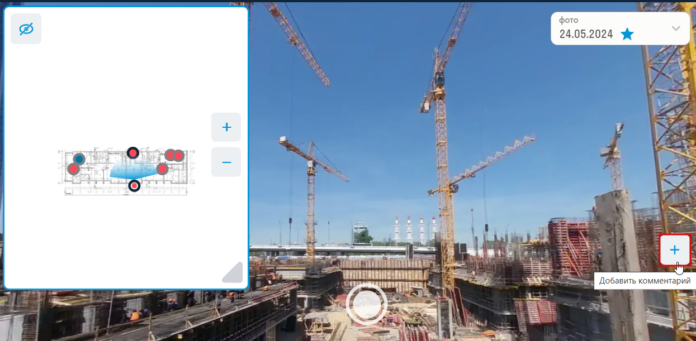

1. Откройте проект в разделе «Фото360», выберите точку и фотографию.
2. Нажмите кнопку «Добавить комментарий» справа на фотографии.
3. Укажите место на фотографии.
4. Заполните форму и сохраните:

| Поле | Что указать |
| --- | --- |
| «Название» | Обязательное поле |
| «Дата» | Срок устранения: в реестре отображается как «Дата устранения». По умолчанию — сегодня |
| «Ссылка» | Полный адрес, до 300 символов |
| «Статус» | «Открыт» (по умолчанию), «Закрыт» или «Удален» |
| «Приоритет» | «Низкий» (по умолчанию), «Средний» или «Высокий» |
| «Описание» | До 1000 символов |
| Вложения | До 20 файлов или документов из DOCS. Размер файла — от 1 КБ до 25 МБ |

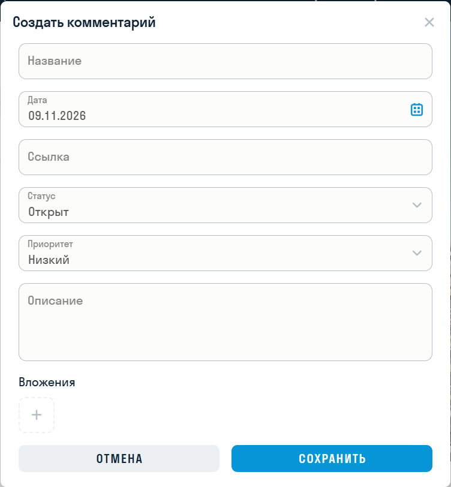

Редактировать комментарий может его автор или администратор. Для остальных пользователей карточка доступна только для просмотра.

### Реестр комментариев

Откройте раздел «Комментарии» в меню проекта. Здесь можно просматривать комментарии по проекту, открывать их карточки и создавать новые кнопкой добавления. Комментарий, созданный в реестре, не привязан к фотографии.
  
  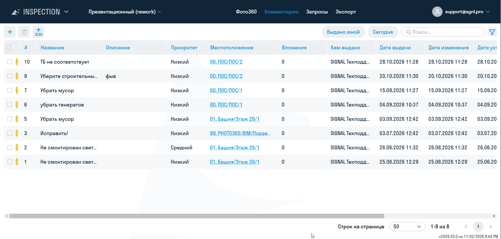

В реестре видны столбцы: номер, «Название», «Описание», «Приоритет», «Местоположение», «Вложения», «Кем выдано», «Дата выдачи», «Дата изменения», «Дата устранения», «Просрочено» и «Ссылка». Цветная метка в начале строки показывает статус. Для комментария, привязанного к фотографии, ссылка в столбце «Местоположение» ведёт к месту на фото.

Для поиска используйте строку поиска, быстрые фильтры «Выдано мной» и «Сегодня» и панель фильтров по номеру, статусу, приоритету, автору, датам добавления и изменения.

Чтобы выгрузить комментарии в формате XLSX, нажмите кнопку экспорта в верхней левой части реестра.

Удалить выбранные в реестре комментарии может администратор. Автор может удалить свой комментарий, выбрав в его карточке статус «Удален». Удалённый комментарий к фотографии администратор может восстановить в корзине.

#
**[<   INSPECTION. Настройки проекта](/ru/insp/settings)     **|**     [INSPECTION. Альбом    >](/ru/insp/album)**