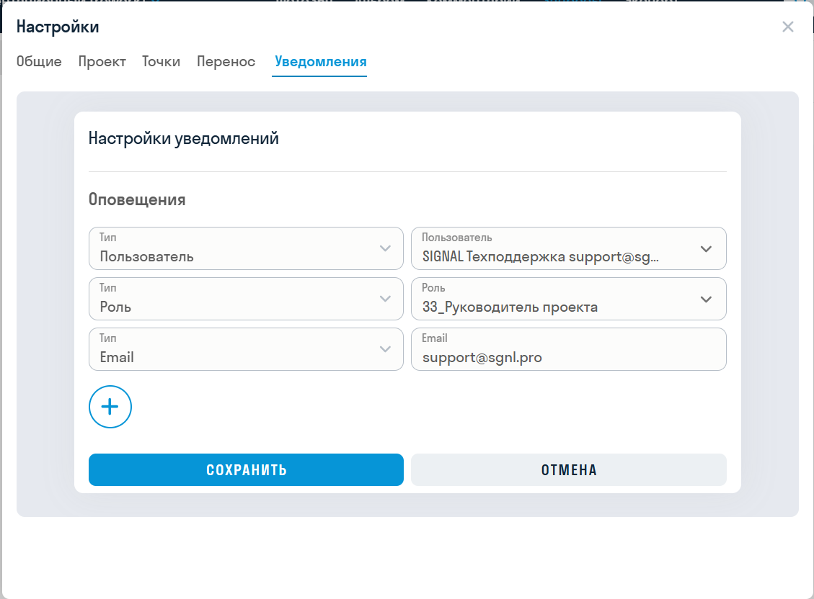
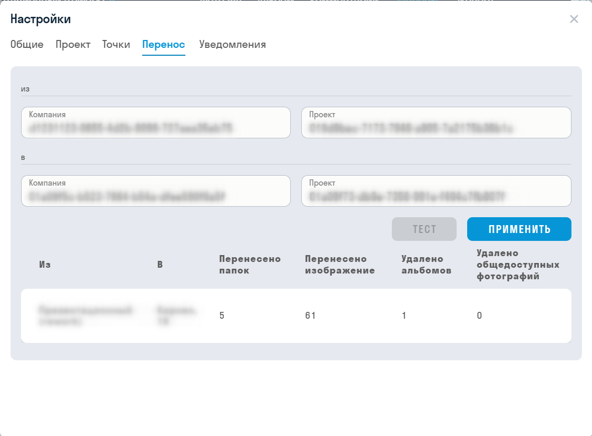

**[<   INSPECTION. Введение](/ru/insp/intro)     **|**     [INSPECTION. Фото360    >](/ru/insp/photo360)**

---

Чтобы открыть настройки проекта, выберите проект, нажмите на своё имя в правом верхнем углу и выберите «Настройки».

Набор вкладок зависит от интерфейса и роли:

| Вкладка | Кому доступна |
| --- | --- |
| «Общие» | Всем пользователям проекта |
| «Проект», «Точки», «Уведомления» | В административном интерфейсе: администратору приложения INSPECTION и суперпользователю |
| «Перенос» | В административном интерфейсе: только суперпользователю |

### Вкладка «Общие»

В поле «Качество изображений» выберите, в каком качестве показывать планы и фотографии: «Исходное», «Оптимальное» или «Низкое». Чем выше качество, тем больше ресурсов потребляет браузер.

По умолчанию выбрано «Оптимальное», на мобильных устройствах — «Низкое». Настройка сохраняется в браузере, поэтому действует только на вашем устройстве и не меняется для других пользователей.

### Вкладка «Проект»

Переключатели действуют сразу после нажатия. В новом проекте оба выключены.

**Авто публикация фотографий** — новая фотография автоматически отмечается как опубликованная во всех альбомах проекта.

- Фотография появится на странице альбома, только если её точка отмечена в этом альбоме. Новые точки в альбомы автоматически не добавляются.
- Если настройка включена в момент создания альбома, в нём сразу публикуются все фотографии проекта. Точки всё равно нужно отметить — см. [«Альбом»](/ru/insp/album).
- На фотографии, загруженные до включения настройки, в уже созданных альбомах она не влияет.

**Изменять статус на «Выполнено» при появлении новой фотографии в точке** — при загрузке фотографии статус точки меняется с «Требуется» или «Нет доступа» на «Выполнено». Это работает и для загрузки через браузер, и для отправки из приложения Photomaker.

Если вам необходимо отслеживать выполненные фотографии, рекомендуется держать переключатель включённым. Также рекомендуется настроить автоматический сброс на вкладке «Точки», чтобы фотомейкер при синхронизации с проектом всегда получал актуальный список точек, которые требуется снять.

### Вкладка «Точки»

Здесь настраивается сброс статуса всех точек проекта с «Выполнено» на «Требуется» по расписанию.

Обычно фотомейкеру достаточно посетить объект один раз в неделю, поэтому рекомендуется выставить сброс перед его приходом. Тогда после синхронизации фотомейкер получит точки со статусом «Требуется».

**Как добавить расписание**

1. Выберите день недели и время в UTC.
2. Нажмите «+». Строка появится в таблице.

Можно добавить несколько расписаний. В таблице видны день недели, время, «Последний запуск», «Обработано в последнем запуске» и «Следующий запуск». Чтобы удалить расписание, нажмите значок корзины в его строке и подтвердите удаление.

Сброс выполняется автоматически в течение нескольких минут после указанного времени.

**Как сбросить статусы сразу**

Нажмите «Сбросить сейчас» и подтвердите действие.

> Расписание и кнопка «Сбросить сейчас» работают по-разному:
> - по расписанию сбрасывается только статус «Выполнено»;
> - кнопка «Сбросить сейчас» сбрасывает статусы «Выполнено» и «Нет доступа».
>
> Статус «Завершено» не сбрасывается ни в одном из этих случаев.
{.is-info}

### Вкладка «Уведомления»

Здесь настраиваются получатели уведомления о загрузке фотографий в проект.

1. Нажмите кнопку добавления.
2. В поле «Тип» выберите «Пользователь», «Роль» или «Email».
3. Укажите получателя. Одного и того же получателя нельзя добавить дважды.
4. Нажмите «Сохранить».

Чтобы удалить получателя, наведите курсор на его строку, нажмите крестик и сохраните изменения.
  
  

> Уведомление приходит не на каждую фотографию, а одной сводкой по серии загрузок.{.is-info}

### Вкладка «Перенос»

Вкладка позволяет перенести данные из одного проекта в другой.
  
  

1. В блоках «из» и «в» укажите идентификаторы компании и проекта.
2. Нажмите «Тест». Проверка покажет, что будет перенесено, но данные не изменит.
3. Проверьте результат: проекты, количество перенесённых папок и изображений, количество удаляемых альбомов и общедоступных фотографий.
4. Нажмите «Применить». Кнопка доступна только после успешного теста. Если изменить любое поле, тест нужно выполнить заново.

Исходный и целевой проекты должны различаться, а каждый проект - принадлежать указанной компании.

> В целевой проект переносятся блоки вместе с планами, точками и фотографиями. Комментарии, запросы, расписание сброса и настройки проекта остаются в исходном проекте.{.is-info}

  
**[<   INSPECTION. Введение](/ru/insp/intro)     **|**     [INSPECTION. Фото360    >](/ru/insp/photo360)**
