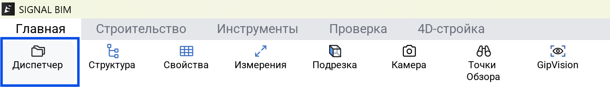

<strong><a href="/ru/signalbim/window">&lt; &nbsp; Окно приложения</a> &nbsp; &nbsp; | &nbsp; &nbsp; <a href="/ru/signalbim/structure">Структура &nbsp; &gt;</a></strong>

**Открыть:** 

Диспетчер показывает модели текущей сборки. Рядом с названием каждой модели отображается её версия.

**Действия:**

- **Добавить модель:** нажмите «Добавить», выберите файл проекта и нажмите «Загрузить».
- **Показать или скрыть модель** в сцене.
- **Обновить модель**, если доступна новая версия в DOCS.
- **Удалить модель из сборки.** Исходный файл в DOCS сохраняется.

После настройки нажмите **«Сохранить»**. Если нужно только временно убрать модель с экрана, скройте её.

Для каждой модели можно выбрать способ совмещения:

| Режим | Действие |
| --- | --- |
| **По общим координатам** | Размещение в общей системе координат моделей |
| **Совмещение внутренних начал** | Совмещение внутренних начал координат |
| **Совмещение центров** | Совмещение с центром опорной модели сборки |
| **Указать координаты** | Ручная настройка положения и поворота |

Если модели расположены неверно относительно друг друга, проверьте выбранный режим.

#

<strong><a href="/ru/signalbim/window">&lt; &nbsp; Окно приложения</a> &nbsp; &nbsp; | &nbsp; &nbsp; <a href="/ru/signalbim/structure">Структура &nbsp; &gt;</a></strong>
