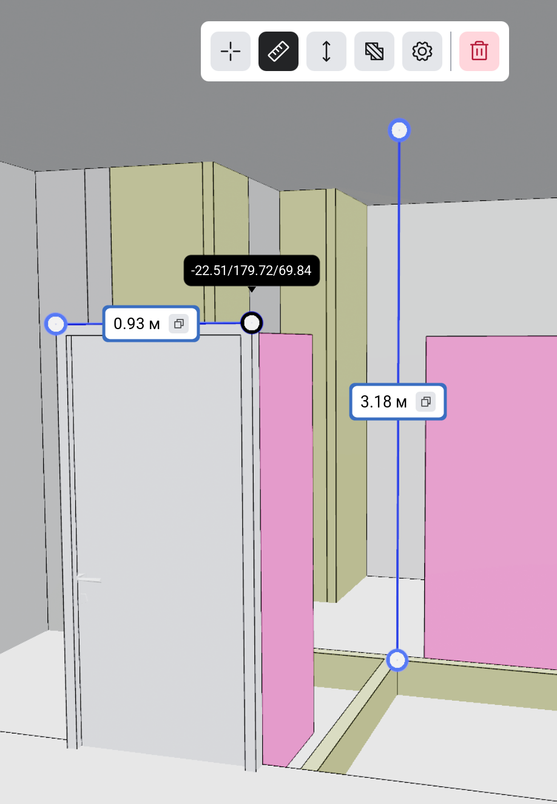

<strong><a href="/ru/signalbim/properties">&lt; &nbsp; Свойства</a> &nbsp; &nbsp; | &nbsp; &nbsp; <a href="/ru/signalbim/viewpoints">Точки обзора &nbsp; &gt;</a></strong>

## Измерения

### Инструменты

| Измерение | Действие |
| --- | --- |
| **Координаты** | Укажите точку модели |
| **Длина** | Укажите две точки |
| **Высота** | Укажите две точки для измерения разницы по высоте |
| **Площадь** | Укажите не менее трёх точек и замкните контур нажатием на первую точку |

Для площади точки должны лежать в одной плоскости, а контур — не пересекать сам себя. Привязки помогают выбирать вершины, рёбра и их середины.

### Настройки

В настройках измерений выберите:

- единицы длины и высоты;
- единицы площади;
- точность отображения результатов.

Нажмите **«Сохранить»**. Настройки применятся и к уже созданным измерениям.

#

<strong><a href="/ru/signalbim/properties">&lt; &nbsp; Свойства</a> &nbsp; &nbsp; | &nbsp; &nbsp; <a href="/ru/signalbim/viewpoints">Точки обзора &nbsp; &gt;</a></strong>
