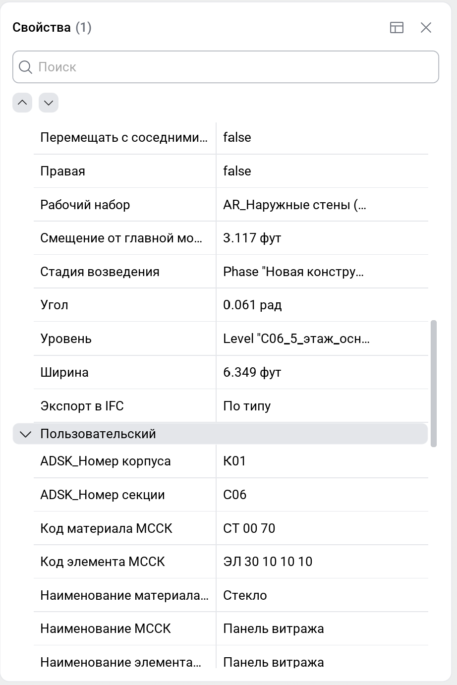

<strong><a href="/ru/signalbim/structure">&lt; &nbsp; Структура</a> &nbsp; &nbsp; | &nbsp; &nbsp; <a href="/ru/signalbim/measurements">Измерения &nbsp; &gt;</a></strong>

Выберите элемент в модели или через «Структуру». Панель покажет его свойства по категориям.

- Используйте **«Поиск»**, чтобы найти свойство.
- Раскрывайте категории для просмотра значений.
- При выборе нескольких элементов показываются общие свойства; разные значения отмечены как **«Различается»**.

При наведении на конкретное свойство доступны 2 кнопки:
- **скопировать** свойство и его значение в буфер обмена
- **добавить свойство в набор** в виде условия, где Имя набора = "Название свойства = Значение свойства"

Виды работ выбранного элемента доступны в категории **«Строительная модель»**.

<strong><a href="/ru/signalbim/structure">&lt; &nbsp; Структура</a> &nbsp; &nbsp; | &nbsp; &nbsp; <a href="/ru/signalbim/measurements">Измерения &nbsp; &gt;</a></strong>
