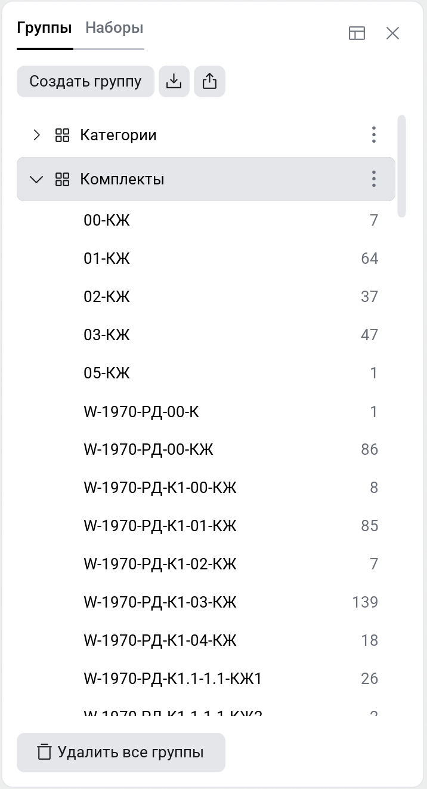
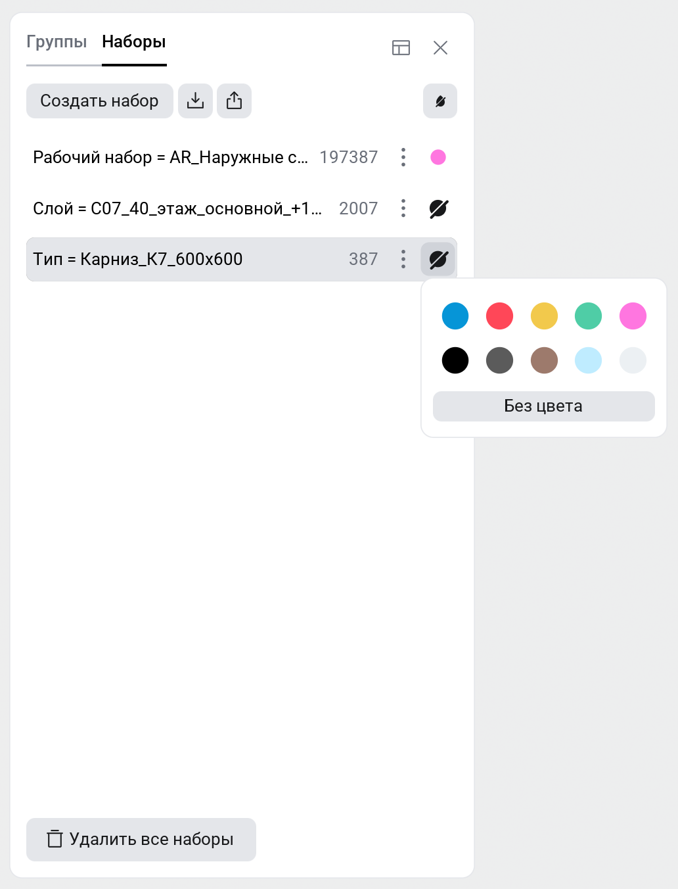

<strong><a href="/ru/signalbim/file-manager">&lt; &nbsp; Диспетчер файлов</a> &nbsp; &nbsp; | &nbsp; &nbsp; <a href="/ru/signalbim/properties">Свойства &nbsp; &gt;</a></strong>

## Структура

**Группы** распределяют элементы по значениям свойства. 

**Наборы** отбирают элементы по условиям.

Группы и наборы можно импортировать и экспортировать.

## Структура {.tabset}

### Группы

1. Нажмите **«Создать группу»** и введите название.
2. Нажмите **«Добавить параметр»** и выберите свойство для группировки.
3. Нажмите **«Сохранить»**.

Если свойство в разных моделях называется по-разному, добавьте несколько параметров. Для каждого элемента используется первое доступное значение.

Раскройте группу и выберите строку: соответствующие элементы выделятся в модели. Справа указано их количество.

Группу можно:
- отредактировать
- скопировать
- удалить

### Наборы

1. Нажмите **«Создать набор»** и введите название.
2. Кнопкой **«Добавить условие»** задайте параметр, сравнение и значение.
3. При необходимости добавьте условия и выберите «И» или «ИЛИ».
4. Нажмите **«Сохранить»**.

| Сравнение | Значение |
| --- | --- |
| `=` / `!=` | Равно / не равно |
| `>` / `<` / `>=` / `<=` | Сравнение чисел |
| `?` | Текст содержит указанную строку |

> В текстовых сравнениях учитывается регистр букв.
{.is-info}

**Действия с Набором:**
- отредактировать
- скопировать
- окрасить
- удалить

#

<strong><a href="/ru/signalbim/file-manager">&lt; &nbsp; Диспетчер файлов</a> &nbsp; &nbsp; | &nbsp; &nbsp; <a href="/ru/signalbim/properties">Свойства &nbsp; &gt;</a></strong>
