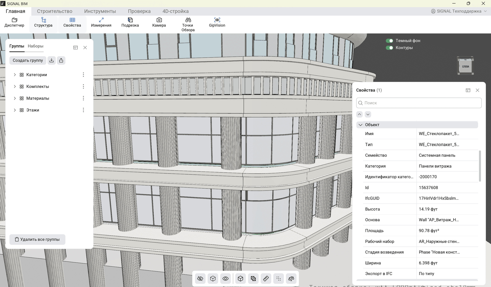

<strong><a href="/ru/signalbim">&lt; &nbsp; SIGNAL BIM</a> &nbsp; &nbsp; | &nbsp; &nbsp; <a href="/ru/signalbim/file-manager">Диспетчер файлов &nbsp; &gt;</a></strong>

### Область модели и панели

- **Область модели** — просмотр и выбор элементов.
- **Структура** — выбор элементов через группы и наборы.
- **Свойства** — данные выбранных элементов.
- **Видовой куб** — изменение направления вида.
- **Тёмный фон** и **Контуры** — настройка отображения модели.

#

<strong><a href="/ru/signalbim">&lt; &nbsp; SIGNAL BIM</a> &nbsp; &nbsp; | &nbsp; &nbsp; <a href="/ru/signalbim/file-manager">Диспетчер файлов &nbsp; &gt;</a></strong>
