**[<   INSPECTION. Введение](/ru/insp/intro)     **|**     [INSPECTION. Пользователь    >](/ru/insp/user)**

---

> Страница для администратора приложения INSPECTION и суперпользователя. Разделы 1–7, 9 и 10 выполняются в административном интерфейсе — pa.sgnl.pro. Просмотр фотографий и работа с комментариями описаны на странице [«Пользователь»](/ru/insp/user), съёмка — на странице [«Приложение Photomaker»](/ru/insp/app).
{.is-info}

  <h4 class="toc-card-title"><a href="?toc_target=plans#plans">1. Планы</a></h4>
  <ul class="toc-list">
    <li><a href="?toc_target=plans_edit#plans_edit">1.1 Редактирование и удаление планов</a></li>
    <li><a href="?toc_target=plans_setup#plans_setup">1.2 Настройка плана</a></li>
  </ul>

  <h4 class="toc-card-title"><a href="?toc_target=points#points">2. Точки</a></h4>
  <ul class="toc-list">
    <li><a href="?toc_target=points_create#points_create">2.1 Создание точки</a></li>
    <li><a href="?toc_target=points_setup#points_setup">2.2 Настройка точек</a></li>
  </ul>

  <h4 class="toc-card-title"><a href="?toc_target=photos#photos">3. Фото</a></h4>
  <ul class="toc-list">
    <li><a href="?toc_target=photos_setup#photos_setup">3.1 Настройка фотографий</a></li>
  </ul>

  <h4 class="toc-card-title"><a href="?toc_target=settings#settings">4. Настройки проекта</a></h4>
  <ul class="toc-list">
    <li><a href="?toc_target=settings_project#settings_project">4.1 Вкладка «Проект»</a></li>
    <li><a href="?toc_target=settings_points#settings_points">4.2 Вкладка «Точки»</a></li>
    <li><a href="?toc_target=settings_notifications#settings_notifications">4.3 Вкладка «Уведомления»</a></li>
    <li><a href="?toc_target=settings_transfer#settings_transfer">4.4 Вкладка «Перенос»</a></li>
  </ul>

  <h4 class="toc-card-title"><a href="?toc_target=photo_links#photo_links">5. Ссылки на фото</a></h4>

  <h4 class="toc-card-title"><a href="?toc_target=album#album">6. Альбом</a></h4>
  <ul class="toc-list">
    <li><a href="?toc_target=album_create#album_create">6.1 Создание альбома</a></li>
    <li><a href="?toc_target=album_content#album_content">6.2 Выбор содержимого</a></li>
    <li><a href="?toc_target=album_publish#album_publish">6.3 Публикация</a></li>
    <li><a href="?toc_target=album_edit#album_edit">6.4 Изменение и удаление</a></li>
  </ul>

  <h4 class="toc-card-title"><a href="?toc_target=bim#bim">7. Сравнение с ЦИМ</a></h4>
  <ul class="toc-list">
    <li><a href="?toc_target=bim_export#bim_export">7.1 Экспорт фото</a></li>
    <li><a href="?toc_target=bim_publish#bim_publish">7.2 Публикация фото360</a></li>
  </ul>

  <h4 class="toc-card-title"><a href="?toc_target=moderation#moderation">8. Комментарии</a></h4>

  <h4 class="toc-card-title"><a href="?toc_target=trash#trash">9. Корзина</a></h4>

  <h4 class="toc-card-title"><a href="?toc_target=export#export">10. Экспорт</a></h4>
  <ul class="toc-list">
    <li><a href="?toc_target=export_statistics#export_statistics">10.1 Экспорт статистики</a></li>
    <li><a href="?toc_target=export_section#export_section">10.2 Раздел «Экспорт»</a></li>
  </ul>

# Вкладки {.tabset}

## 1. Планы

### 1. Планы {#plans}

1.  Для создания блока нажмите три точки напротив «Весь объект» → «Добавить блок»

2.  Для создания плана нажмите три точки напротив блока → «Добавить план»

>В открывшемся окне введите название плана, например, Этаж 1, и загрузите изображение плана в формате PNG, JPEG или WEBP. Размер файла - не более 25 МБ.{.is-info}

3.  Добавьте остальные блоки и этажи по аналогии

#### 1.1. Редактирование и удаление планов {#plans_edit}

1.  Чтобы изменить название или заменить изображение плана, нажмите три точки напротив плана → «Редактировать»
2.  Чтобы удалить план, нажмите три точки напротив плана → «Удалить». Удалённый план можно восстановить в [корзине](?toc_target=trash#trash).

Блоки редактируются и удаляются так же, через меню трёх точек.

#### 1.2. Настройка плана {#plans_setup}

>Чтобы задать север относительно плана, перейдите на вкладку «План» и, передвигая ползунок, выставьте правильное расположение севера (буква «N»). Затем нажмите значок сохранения с подсказкой «Установить азимут».{.is-info}

>Вкладки «План», «Точка» и «Фото» скрываются, если область плана слишком маленькая по высоте. Чтобы они появились, растяните область за правый нижний угол.{.is-info}

## 2. Точки

### 2. Точки {#points}

#### 2.1. Создание точки {#points_create}

Точку можно создать двумя способами:

1.  Зажмите CTRL на клавиатуре (Cmd на macOS) и левой кнопкой мыши нажмите в нужной области на плане

2.  На вкладке «Точка» нажмите «Добавить». В центре плана появится указатель. Переместите план так, чтобы указатель оказался в нужном месте, и нажмите «Добавить» ещё раз

В появившемся окне введите название точки, например, 1, и нажмите «Сохранить»

Точка появится на плане

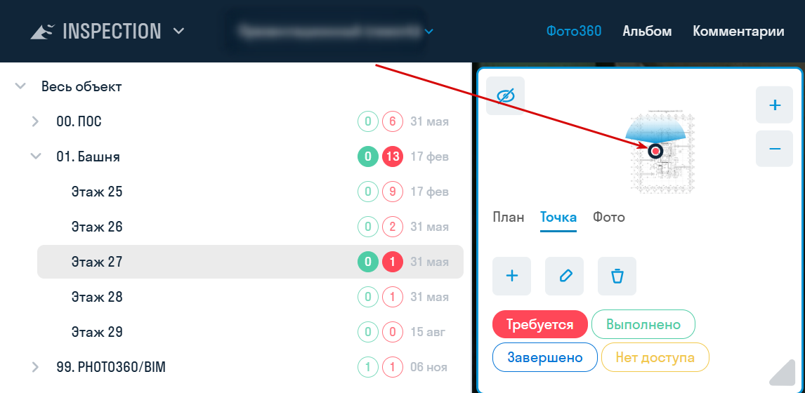

#### 2.2. Настройка точек {#points_setup}

После выбора точки на вкладке «Точка» станут активны её настройки

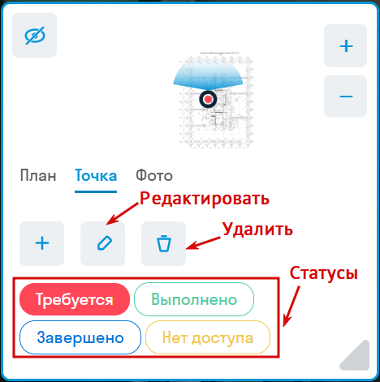

- Чтобы переименовать точку, нажмите «Редактировать».
- Чтобы переместить точку, перетащите её на плане.
- Чтобы удалить точку, нажмите «Удалить». Удалённую точку можно восстановить в [корзине](?toc_target=trash#trash).

**Статус точки**

Чтобы изменить статус вручную, выберите точку и нажмите нужный статус на вкладке «Точка». Значения статусов и пример работы с ними — на странице [«Введение»](/ru/insp/intro?toc_target=point_statuses#point_statuses).

Можно настроить автоматический сброс статуса с «Выполнено» на «Требуется» в любой день недели, чтобы фотомейкер при синхронизации с проектом получал точки, на которые требуется загрузить фотографии. Подробнее — в разделе [«Настройки проекта»](?toc_target=settings_points#settings_points).

## 3. Фото

### 3. Фото {#photos}

1.  Чтобы добавить фотографию, выберите точку, перейдите на вкладку «Фото» и нажмите «Добавить»

  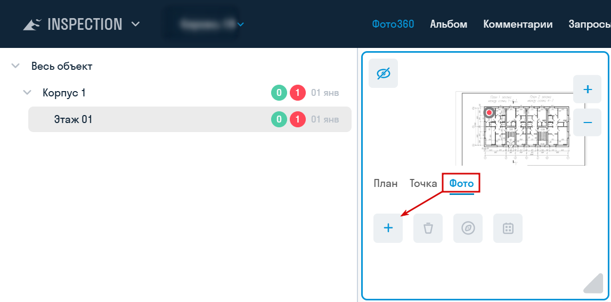

2.  В появившемся окне выберите дату создания фото (по умолчанию — сегодня) и загрузите фотографию в формате PNG, JPEG или WEBP размером до 25 МБ. В поле «Тип фото» выберите «2D» или «Фото360» (по умолчанию). Нажмите «Сохранить»

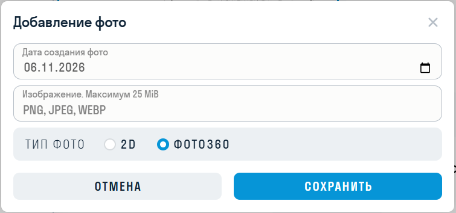

>Для фотографий типа «2D» недоступны сравнение, выравнивание и комментарии.{.is-info}

Добавленные фотографии можно просматривать в хронологическом порядке

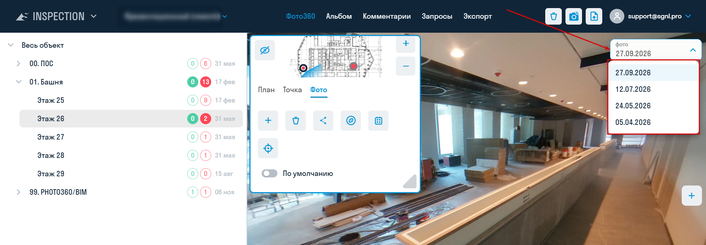

#### 3.1. Настройка фотографий {#photos_setup}

После выбора фотографии на вкладке «Фото» станут активны её настройки. Изменять фотографию можно только в обычном режиме просмотра: не в режиме сравнения или выравнивания.
  
  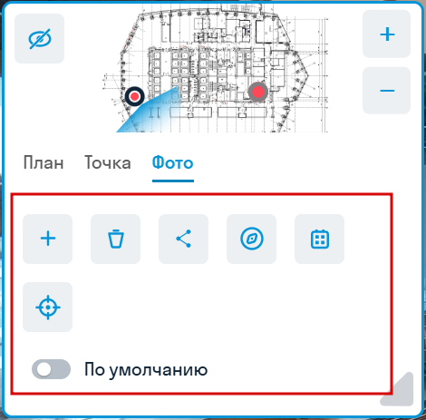

**Дата фотографии**

Чтобы исправить дату, нажмите «Выбрать дату», укажите дату и сохраните.
  
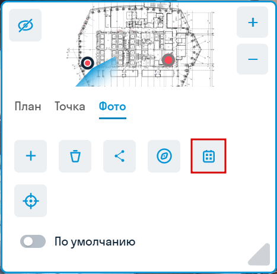

**Фото по умолчанию**

Переключатель «По умолчанию» определяет, какая фотография откроется при выборе точки. На одной точке такая фотография может быть только одна, в списке она отмечена звёздочкой. Если фотография по умолчанию не задана, откроется первая в списке. Фотография, отправленная из приложения Photomaker, автоматически становится фотографией по умолчанию.
  
  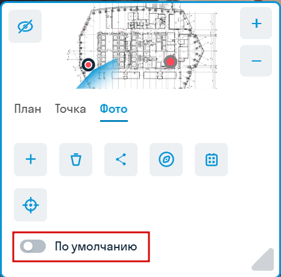

**Удаление фотографии**

Нажмите «Удалить» и подтвердите действие. Удалённую фотографию можно восстановить в [корзине](?toc_target=trash#trash).
  
  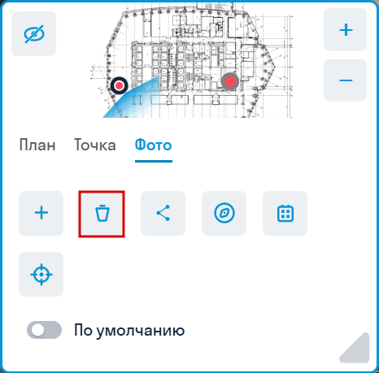

**Настройка азимута**

Чтобы настроить направление фотографии относительно плана, поверните фотографию на север и нажмите «Установить азимут».

**Настройка азимута с помощью выравнивания фото**

>Выравнивание используется для выставления азимута фотографии по другой фотографии, например, для снимков с квадрокоптера, когда проблематично определить направление на север. Кнопка доступна для фотографий 360, если на точке не меньше двух фотографий.{.is-info}

1.  Выберите фото, которое требуется выровнять, и нажмите «Выравнивание»
2.  Появившийся прицел на фотографии наведите на статичный объект, который не будет меняться от фотографии к фотографии. Например, это может быть здание.
3.  Нажмите «Выбрать эталонную фотографию» в нижней части экрана.

4.  Справа появится эталонная фотография, по которой будет выровнена левая. По умолчанию выбирается предыдущая в списке фотография. Можно выбрать другую фотографию из списка.
5.  С помощью ползунка наведите прицел правой фотографии на объект, выбранный в пункте 2.
6.  Нажмите «Сохранить».

7.  Левая фотография примет ориентацию эталонной, т.е. их север будет смотреть в одну сторону.

## 4. Настройки проекта

### 4. Настройки проекта {#settings}

Чтобы открыть настройки проекта, выберите проект, нажмите на своё имя в правом верхнем углу и выберите «Настройки».

Набор вкладок зависит от интерфейса и роли:

| Вкладка | Кому доступна |
| --- | --- |
| «Общие» | Всем пользователям проекта |
| «Проект», «Точки», «Уведомления» | В административном интерфейсе: администратору приложения INSPECTION и суперпользователю |
| «Перенос» | В административном интерфейсе: только суперпользователю |

Вкладка «Общие» описана на странице [«Пользователь»](/ru/insp/user?toc_target=image_quality#image_quality).

### Вкладки {.tabset}

#### 4.1. Проект

##### 4.1. Вкладка «Проект» {#settings_project}

Переключатели действуют сразу после нажатия. В новом проекте оба выключены.

**Авто публикация фотографий** — новая фотография автоматически отмечается как опубликованная во всех альбомах проекта.

- Фотография появится на странице альбома, только если её точка отмечена в этом альбоме. Новые точки в альбомы автоматически не добавляются.
- Если настройка включена в момент создания альбома, в нём сразу публикуются все фотографии проекта. Точки всё равно нужно отметить — см. [«Альбом»](?toc_target=album#album).
- На фотографии, загруженные до включения настройки, в уже созданных альбомах она не влияет.

**Изменять статус на «Выполнено» при появлении новой фотографии в точке** — при загрузке фотографии статус точки меняется с «Требуется» или «Нет доступа» на «Выполнено». Это работает и для загрузки через браузер, и для отправки из приложения Photomaker.

Если вам необходимо отслеживать выполненные фотографии, рекомендуется держать переключатель включённым. Также рекомендуется настроить автоматический сброс на вкладке «Точки», чтобы фотомейкер при синхронизации с проектом всегда получал актуальный список точек, которые требуется снять.

#### 4.2. Точки

##### 4.2. Вкладка «Точки» {#settings_points}

Здесь настраивается сброс статуса всех точек проекта с «Выполнено» на «Требуется» по расписанию.

Обычно фотомейкеру достаточно посетить объект один раз в неделю, поэтому рекомендуется выставить сброс перед его приходом. Тогда после синхронизации фотомейкер получит точки со статусом «Требуется».

**Как добавить расписание**

1. Выберите день недели и время в UTC.
2. Нажмите «+». Строка появится в таблице.

Можно добавить несколько расписаний. В таблице видны день недели, время, «Последний запуск», «Обработано в последнем запуске» и «Следующий запуск». Чтобы удалить расписание, нажмите значок корзины в его строке и подтвердите удаление.

Сброс выполняется автоматически в течение нескольких минут после указанного времени.

**Как сбросить статусы сразу**

Нажмите «Сбросить сейчас» и подтвердите действие.

> Расписание и кнопка «Сбросить сейчас» работают по-разному:
> - по расписанию сбрасывается только статус «Выполнено»;
> - кнопка «Сбросить сейчас» сбрасывает статусы «Выполнено» и «Нет доступа».
>
> Статус «Завершено» не сбрасывается ни в одном из этих случаев.
{.is-info}

#### 4.3. Уведомления

##### 4.3. Вкладка «Уведомления» {#settings_notifications}

Здесь настраиваются получатели уведомления о загрузке фотографий в проект.

1. Нажмите кнопку добавления.
2. В поле «Тип» выберите «Пользователь», «Роль» или «Email».
3. Укажите получателя. Одного и того же получателя нельзя добавить дважды.
4. Нажмите «Сохранить».

Чтобы удалить получателя, наведите курсор на его строку, нажмите крестик и сохраните изменения.
  
  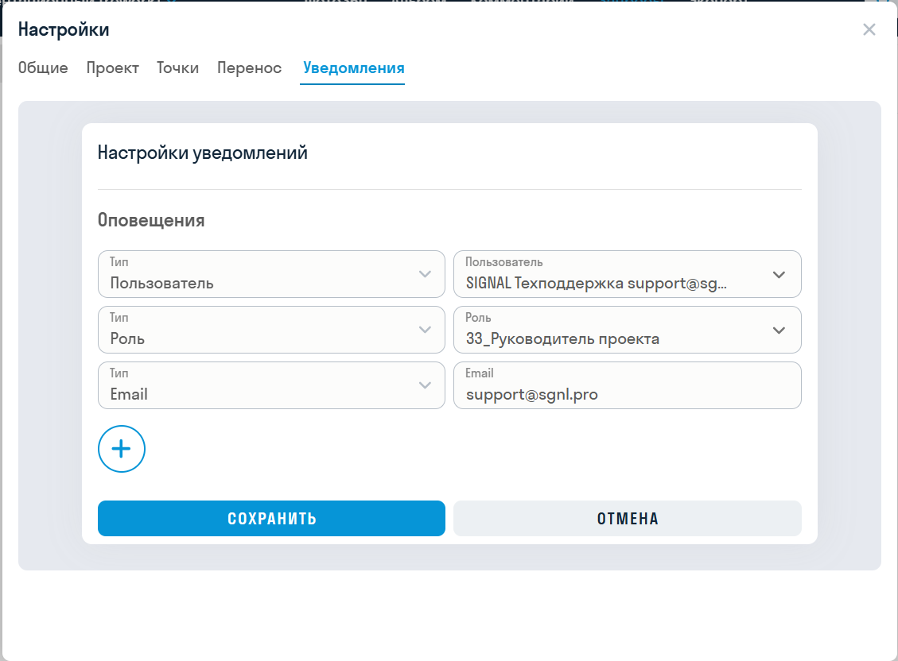

> Уведомление приходит не на каждую фотографию, а одной сводкой по серии загрузок.{.is-info}

#### 4.4. Перенос

##### 4.4. Вкладка «Перенос» {#settings_transfer}

> Вкладка доступна только суперпользователю.
{.is-warning}

Вкладка позволяет перенести данные из одного проекта в другой.
  
  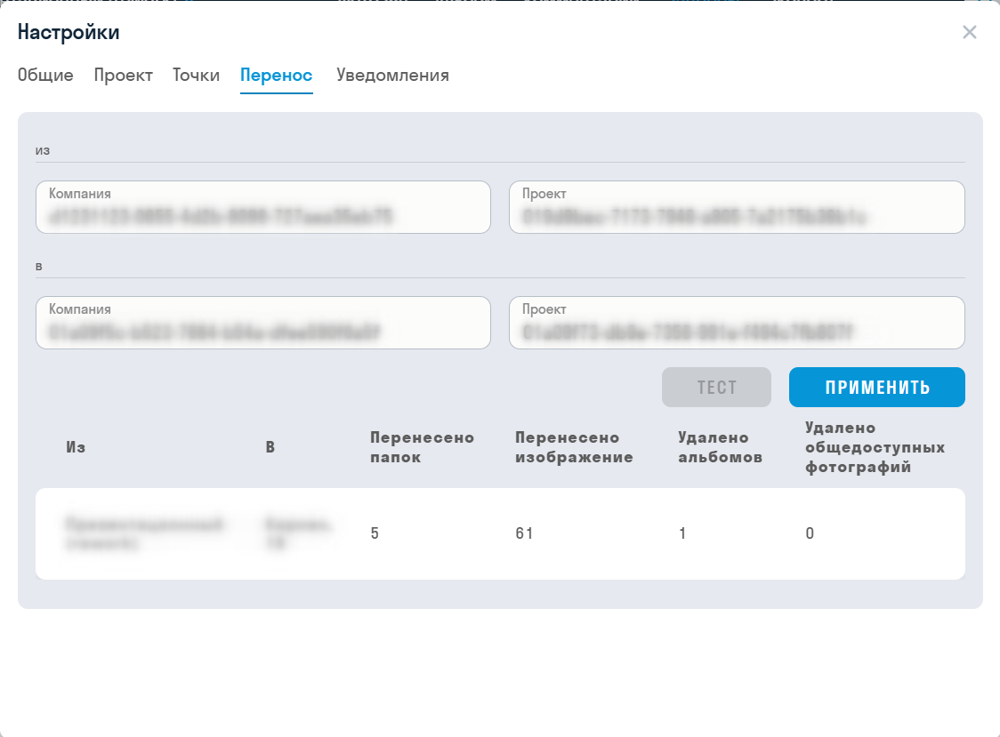

1. В блоках «из» и «в» укажите идентификаторы компании и проекта.
2. Нажмите «Тест». Проверка покажет, что будет перенесено, но данные не изменит.
3. Проверьте результат: проекты, количество перенесённых папок и изображений, количество удаляемых альбомов и общедоступных фотографий.
4. Нажмите «Применить». Кнопка доступна только после успешного теста. Если изменить любое поле, тест нужно выполнить заново.

Исходный и целевой проекты должны различаться, а каждый проект - принадлежать указанной компании.

> В целевой проект переносятся блоки вместе с планами, точками и фотографиями. Комментарии, запросы, расписание сброса и настройки проекта остаются в исходном проекте.{.is-info}

## 5. Ссылки на фото

### 5. Создание ссылки на фотографию {#photo_links}

>Ссылки расшариваются на конкретную фотографию для использования, например, специалистами стройконтроля в замечании или департаментом продаж для отправки клиенту фото360 из его квартиры во время строительства.{.is-info}

1.  Выберите фотографию и во вкладке ФОТО нажмите «Создать ссылку»    

1.  В появившемся окне введите название для ссылки и нажмите «Сохранить». Ссылка будет скопирована в буфер обмена и сохранится в «Списке общедоступных фотографий»
     
 

1.  Все созданные ссылки хранятся в «Списке общедоступных фотографий». Нажмите кнопку «Ссылки на фото» (иконка фотоаппарата) и скопируйте ссылку.

## 6. Альбом

### 6. Альбом {#album}

> В SIGNAL INSPECTION можно опубликовать выбранные фотографии в альбоме. Альбом доступен для просмотра всем, у кого есть ссылка: вход и лицензия SIGNAL не требуются. Защита паролем и срок действия ссылки при создании альбома не настраиваются.
{.is-info}

Создавать и настраивать альбомы может администратор приложения INSPECTION в административном интерфейсе (pa.sgnl.pro). Для публикации одной фотографии без альбома используйте [ссылку на фотографию](?toc_target=photo_links#photo_links).

#### 6.1. Создание альбома {#album_create}

1. Перейдите на pa.sgnl.pro в раздел «Альбом».
2. Нажмите три точки напротив «Весь объект» и выберите «Добавить альбом».

3. Введите название альбома.
4. При необходимости заполните «Список доменов» — адреса сайтов, на которых планируется разместить альбом с помощью кода. Указывайте каждый адрес с новой строки и полностью, с протоколом, например `https://example.com`.

#### 6.2. Выбор содержимого {#album_content}

Содержимое альбома определяется двумя настройками: какие точки входят в альбом и какие фотографии этих точек опубликованы. В альбоме показываются только опубликованные фотографии отмеченных точек. Изменения сохраняются сразу.

1. Раскройте альбом в дереве и выберите блок и план.
2. Отметьте нужные точки. Чтобы отметить или снять все точки плана, используйте флажок у этого плана: он доступен, когда план выбран.

3. Выберите точку. В блоке «Список опубликованных фотографий» включите переключатели у нужных фотографий. Чтобы опубликовать или снять с публикации все фотографии точки, нажмите «Опубликовать все фото».

> Если в [настройках проекта](?toc_target=settings_project#settings_project) включена «Авто публикация фотографий», новые фотографии публикуются автоматически во всех альбомах проекта. Новые точки всё равно нужно отметить вручную.
{.is-info}

#### 6.3. Публикация {#album_publish}

Нажмите три точки рядом с названием альбома и выберите форму публикации:

- «Ссылка» — откроется окно со ссылкой на альбом. Нажмите «Копировать».
- «Код» — откроется окно с HTML-кодом для вставки альбома на сайт. Нажмите «Копировать».

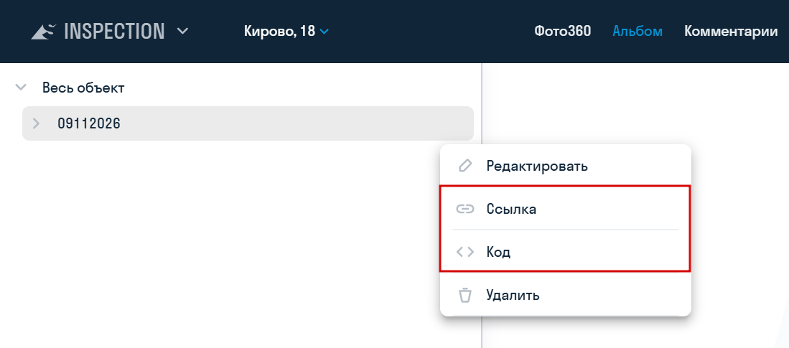

Ссылкой можно поделиться с пользователями, не обладающими лицензией SIGNAL.

#### 6.4. Изменение и удаление {#album_edit}

В том же меню альбома доступны:

- «Редактировать» — изменение названия и списка доменов;
- «Удалить» — удаление альбома. После удаления ссылка перестаёт работать. Фотографии в проекте при этом не удаляются.
  
  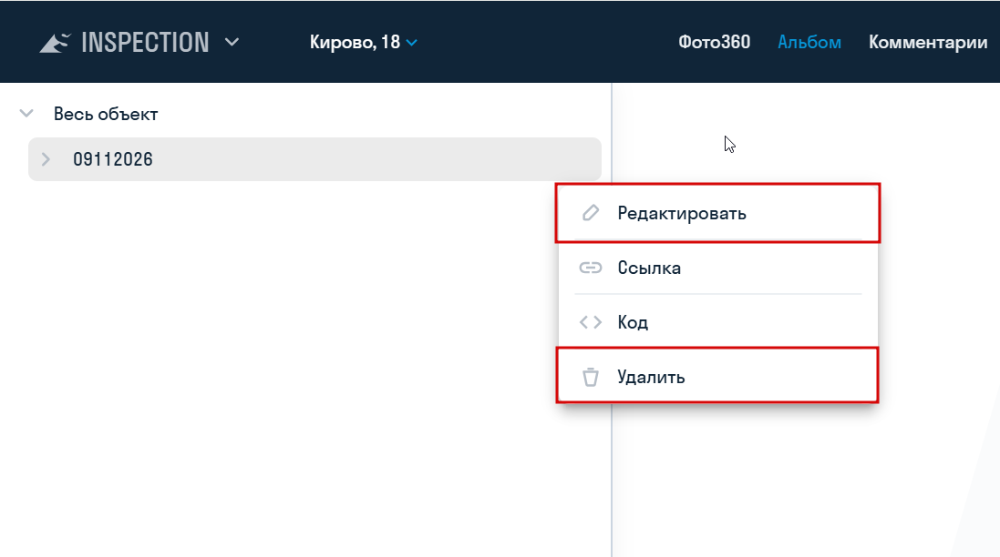

## 7. Сравнение с ЦИМ

### 7. Сравнение со сборной ЦИМ {#bim}

#### 7.1. Экспорт фото {#bim_export}

>Инструмент позволяет экспортировать выбранные точки обзора как панорамное изображение, чтобы в последующем вставить его в модуль INSPECTION.{.is-info}

1. Для создания точки обзора необходимо выбрать место, где вы хотите получить панорамное фото, и расположить свой вид в этом месте.

>**Внимание!** Следует выровнять вид точно по вертикали с помощью команды «Выровнять камеру по вертикали». В противном случае, если камера не будет строго параллельна полу, при публикации в INSPECTION изображение сошьётся некорректно.{.is-warning}

После этого нужно сохранить точку обзора, дав ей название.

2. Нажмите на вкладке SIGNAL на панели Экспорт | Импорт ➤ Фото360

3. Выберите необходимые точки обзора, укажите настройки освещения и разрешение фотографии. Нажмите «ОК».

>**Примечание:** Если на панорамном фото возникают засветы, то рекомендуется выбрать другой тип освещения.{.is-info}

>**Примечание:** Разрешение панорамного фото влияет на продолжительность его выгрузки. Низкое — 5–10 секунд. Среднее — 30–60 секунд. Высокое — 3–5 минут.{.is-info}

4. Получившиеся панорамы в формате .png можно добавить в модуль INSPECTION для сравнения с фактическим состоянием на стройплощадке: выберите точку, на вкладке «Фото» нажмите «Добавить» и укажите тип «Фото360». Размер файла — до 25 МБ.

#### 7.2. Публикация фото360 {#bim_publish}

Инструмент позволяет загрузить в сервис INSPECTION точки обзора, сделанные в модели Navisworks, для сравнения модели с фактическим состоянием объекта строительства. Для загрузки фото необходимы права администратора в сервисе INSPECTION.

1. Сперва создайте точки обзора в Navisworks. Для создания точки обзора необходимо выбрать место, где вы хотите получить панорамное фото, и расположить свой вид в этом месте.

>**Внимание!** Следует выровнять вид точно по вертикали с помощью команды «Выровнять камеру по вертикали». В противном случае, если камера не будет строго параллельна полу, при публикации в INSPECTION изображение сошьётся некорректно.{.is-warning}

После этого нужно сохранить точку обзора, дав ей соответствующее название. Рекомендуется соблюдать структуру дерева БЛОК-ЭТАЖ-ТОЧКА для автоматического сопоставления точек обзора с точками INSPECTION (см. пункт 4).

2. В [_настройках SIGNAL_](/ru/tools/navis/settings) выберите проект, в который необходимо выгрузить панорамы 360

3. Нажмите на вкладке SIGNAL PRO на панели Экспорт | Импорт ➤ Публикация Фото360

4. В открывшемся окне в левой части раскройте нужный план, а в правой части сопоставьте точку из INSPECTION с точкой обзора из Navisworks, выбрав последнюю из списка в столбце «Точка обзора».

Для автоматического сопоставления точек обзора с точками из INSPECTION нажмите ОПРЕДЕЛИТЬ вверху окна.

Точки обзора заполнятся самостоятельно при условии, что расположение точки обзора в дереве соответствует расположению точки в INSPECTION, т.е. совпадает структура дерева БЛОК-ЭТАЖ-ТОЧКА.

5. Выберите тип освещения. Если на панорамном фото возникают засветы, то рекомендуется выбрать другой тип освещения.

6. Выберите разрешение. Чем выше разрешение, тем дольше будет выгружаться панорамное фото. Низкое — 5–10 секунд. Среднее — 30–60 секунд. Высокое — 3–5 минут.

7. Укажите дату публикации фотографии и, при необходимости, комментарий. Комментарий отображается в списке фотографий сервиса INSPECTION, необходим для обозначения фотографий, выгруженных из модели, и ограничен пятью символами.

8. Нажмите «Опубликовать» и дождитесь окончания загрузки фотографий в сервис INSPECTION

## 8. Комментарии

### 8. Комментарии {#moderation}

Создание комментариев и работа с реестром описаны на странице [«Пользователь»](/ru/insp/user?toc_target=comments#comments). Администратор дополнительно может:

- редактировать любой комментарий;
- удалить выбранные в реестре комментарии;
- восстановить удалённый комментарий к фотографии в [корзине](?toc_target=trash#trash).

## 9. Корзина

### 9. Корзина {#trash}

В корзине отображаются удалённые блоки, планы, точки, фотографии и комментарии к фотографиям. Альбомы в корзине не отображаются.

1. Выберите проект и нажмите кнопку «Корзина» (значок корзины) в верхней панели. Повторное нажатие вернёт вас на предыдущую страницу.
2. В дереве слева выберите уровень. В таблице появятся удалённые элементы этого уровня:

| Выбрано в дереве | Что показывает таблица |
| --- | --- |
| «Весь объект» | Удалённые блоки |
| Блок | Удалённые планы |
| План | Удалённые точки |
| Точка | Удалённые фотографии |
| Фотография | Удалённые комментарии к этой фотографии |

3. Отметьте нужные строки и нажмите кнопку «Восстановить» над таблицей. Чтобы восстановить один элемент, нажмите на его строку правой кнопкой мыши и выберите «Восстановить».

> В дереве показаны только неудалённые элементы. Чтобы восстановить, например, точку удалённого плана, сначала восстановите сам план.
{.is-info}

## 10. Экспорт

### 10. Экспорт {#export}

#### 10.1. Экспорт статистики {#export_statistics}

Отчёт показывает состояние точек и объём съёмки за выбранную дату.

1. Выберите проект и нажмите кнопку «Экспорт статистики» в верхней панели.
2. В окне «Настройки отчета» укажите дату. По умолчанию выбрана текущая.
3. Нажмите «Экспорт». Отчёт скачается в формате Excel.

В отчёте есть итоговая строка по проекту и строки по каждому блоку и плану:

| Столбец | Что показывает |
| --- | --- |
| «Проект», «Блок», «План» | К какому уровню относится строка |
| «Всего точек, шт.» | Точки, созданные не позднее выбранной даты |
| По одному столбцу на каждый статус точки | Количество точек в этом статусе на момент выгрузки |
| «Выполнено за дату отчета, шт.» | Точки, на которых есть фотография с выбранной датой съёмки |
| «Время» | Время между первой и последней фотографией за выбранную дату в формате ЧЧ:ММ:СС |

> Столбцы статусов показывают текущее состояние точек, а не состояние на выбранную дату. Границы суток считаются по UTC.
{.is-info}

#### 10.2. Раздел «Экспорт» {#export_section}

> Раздел виден только суперпользователю.
{.is-warning}

Выберите проект и откройте раздел «Экспорт» в меню проекта. Выгрузка доступна на двух вкладках. Ход выгрузки виден в таблице под кнопками, прервать её можно кнопкой «Отмена».

**Вкладка «Фото»** — выгрузка фотографий за период в ZIP-архив.

1. Укажите период в полях «Начало» и «Конец». По умолчанию выбран последний месяц.
2. В поле «Качество изображений» выберите «Исходное», «Оптимальное» (по умолчанию) или «Низкое».
3. Нажмите «Экспорт».

В архиве фотографии разложены по папкам блоков и планов. В названии файла указаны точка, дата и время съёмки. Если за период нет фотографий, появится сообщение «Отсутствуют фото для экспорта».

**Вкладка «Проект»** — выгрузка всех планов и фотографий проекта в исходном качестве.

1. Нажмите «Экспорт».
2. Выберите папку на компьютере и разрешите браузеру запись в неё. Для этого нужен браузер с поддержкой выбора папки, например Chrome или Edge.

Файлы планов и фотографий сохраняются с именами-идентификаторами. Структура проекта записывается в отдельный файл JSON.

#

**[<   INSPECTION. Введение](/ru/insp/intro)     **|**     [INSPECTION. Пользователь    >](/ru/insp/user)**
