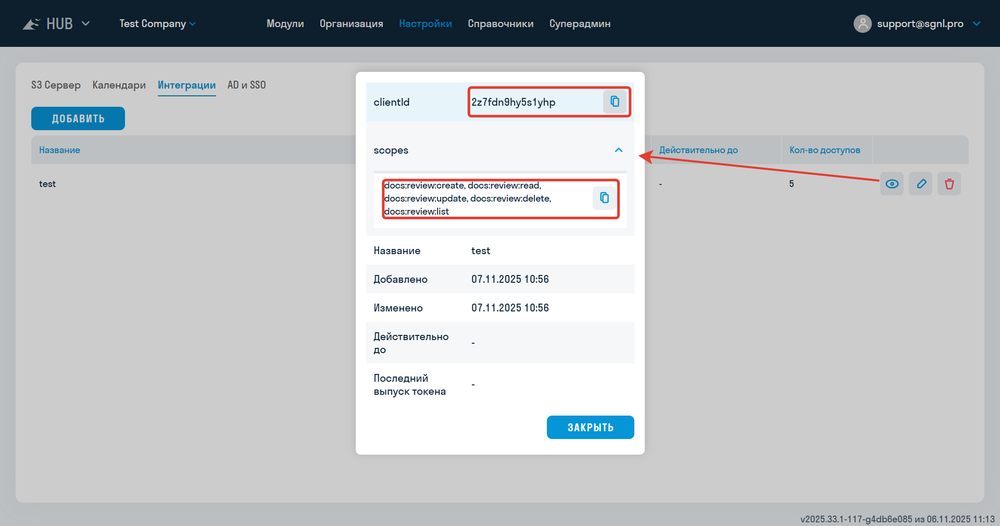
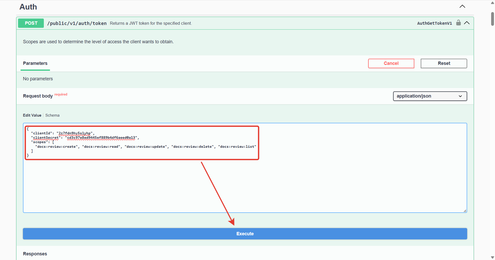

<sub>**[<   SIGNAL. Что нового](/ru/general/updates)     **|**     [HUB. Введение   >](/ru/hub/intro)**</sub>

<summary style="font-size: 16px; color: #0D47A1; background: #E3F2FD; border-radius: 7px; border: 1px solid #64B5F6; display: flex; gap: 10px; padding: 5px 16px; display: block; margin-top: 10px;">
<span style="flex-grow: 1;"> <a href="/general/api/updates" onclick="event.stopPropagation();" style="color: inherit; text-decoration: none;">Что нового в API</a></span>
</summary>

> Через API можно работать с файлами, замечаниями, согласованиями и другими данными SIGNAL из своей системы.
{.is-info}

<div class="toc-grid">
  <div class="toc-card toc-green">
    <h4 class="toc-card-title"><a href="#doc">1. Начало работы</a></h4>
    <ul class="toc-list">
      <li><a href="#api-docs"><span class="toc-badge">1.1</span> Адрес и документация</a></li>
      <li><a href="#swagger"><span class="toc-badge">1.2</span> Подключение и авторизация в Swagger</a></li>
      <li><a href="#api-rules"><span class="toc-badge">1.3</span> Запросы, ответы и ограничения</a></li>
    </ul>
  </div>
  <div class="toc-card toc-green">
    <h4 class="toc-card-title"><a href="#examples">2. Примеры</a></h4>
    <ul class="toc-list">
      <li><a href="#example-setup"><span class="toc-badge">2.1</span> Подготовка</a></li>
      <li><a href="#example-auth"><span class="toc-badge">2.2</span> Авторизация</a></li>
      <li><a href="#example-upload"><span class="toc-badge">2.3</span> Загрузка файла</a></li>
      <li><a href="#example-download"><span class="toc-badge">2.4</span> Скачивание файла</a></li>
      <li><a href="#example-review"><span class="toc-badge">2.5</span> Данные согласования</a></li>
      <li><a href="#example-issues"><span class="toc-badge">2.6</span> Реестр замечаний</a></li>
      <li><a href="#example-videos"><span class="toc-badge">2.7</span> Видео и интеграции</a></li>
    </ul>
  </div>
  <div class="toc-card toc-green">
    <h4 class="toc-card-title"><a href="#reference">3. Справочник API</a></h4>
    <ul class="toc-list">
      <li><a href="#reference-v1"><span class="toc-badge">3.1</span> Файлы и версии</a></li>
      <li><a href="#reference-folders"><span class="toc-badge">3.2</span> Папки и доступ</a></li>
      <li><a href="#reference-issues"><span class="toc-badge">3.3</span> Замечания</a></li>
      <li><a href="#reference-reviews"><span class="toc-badge">3.4</span> Согласования</a></li>
      <li><a href="#reference-transfers"><span class="toc-badge">3.5</span> Передачи</a></li>
      <li><a href="#reference-forms"><span class="toc-badge">3.6</span> Формы</a></li>
      <li><a href="#reference-attributes"><span class="toc-badge">3.7</span> Атрибуты</a></li>
      <li><a href="#reference-access"><span class="toc-badge">3.8</span> Компания и проекты</a></li>
      <li><a href="#reference-models"><span class="toc-badge">3.9</span> Модели и подписи</a></li>
      <li><a href="#reference-modules"><span class="toc-badge">3.10</span> Другие модули</a></li>
      <li><a href="#reference-v2"><span class="toc-badge">3.11</span> Методы v2</a></li>
      <li><a href="#reference-errors"><span class="toc-badge">3.12</span> Коды ответов</a></li>
    </ul>
  </div>
</div>

----

# Вкладки {.tabset}
## 1. Начало работы
###### 1. Начало работы {#doc}

### Подразделы {.tabset}

#### 1.1. Адрес и документация
###### 1.1. Адрес и документация {#api-docs}

Адрес API — `https://api.sgnl.pro`. Версия входит в путь запроса, например `/public/v1/projects`.

- [Swagger](https://api.sgnl.pro/openapi/swagger/index.html) — описание методов и запуск запросов.
- ReDoc — документация [v1](https://api.sgnl.pro/openapi/redoc-v1/index.html) и [v2](https://api.sgnl.pro/openapi/redoc-v2/index.html).
- Схемы OpenAPI для генерации клиентов — [v1](https://api.sgnl.pro/openapi/v1/schema.yml) и [v2](https://api.sgnl.pro/openapi/v2/schema.yml).

#### 1.2. Подключение и авторизация в Swagger
###### 1.2. Подключение и авторизация в Swagger {#swagger}

1. Откройте [настройки компании в HUB](/hub/admin#settings) и добавьте интеграцию. Выберите разрешения (scopes) для нужных методов. При необходимости задайте срок действия интеграции. Нажмите **Сохранить**.

   

2. Скопируйте **Secret key**. Если ключ утерян, его можно сбросить в настройках интеграции.

   

3. Нажмите :eye: у интеграции и скопируйте `clientId` и названия разрешений.

   

4. Откройте [Swagger](https://api.sgnl.pro/openapi/swagger/index.html). Если у кнопки **Authorize** закрытый замок, нажмите её и выберите **Logout**.

   

5. Откройте **POST /public/v1/auth/token** и нажмите **Try it out**. В **Edit Value** укажите `clientId`, `clientSecret` и массив `scopes`. Включите в массив разрешения из колонки **Scope** для методов, которые будете вызывать. Нажмите **Execute**.

   

6. Если Swagger вернул `200`, скопируйте значение `token`. Поле `expiresIn` показывает срок действия токена в секундах. По истечении этого срока запросите токен снова.

   

7. Нажмите **Authorize**, вставьте токен и нажмите **Authorize** ещё раз.

   

#### 1.3. Запросы, ответы и ограничения
###### 1.3. Запросы, ответы и ограничения {#api-rules}

В запросах к API передавайте токен в заголовке `Authorization: Bearer <token>`. Для тела в формате JSON используйте `Content-Type: application/json`.

- В методах с `Take` и `Skip` увеличивайте `Skip` на число полученных записей. Для списка согласований `Take` — до 50, для списка замечаний — до 200.
- Для передачи файлов используйте `signedUrl` из билета. Ссылка действует `ttlSec` секунд. Заголовок `Authorization` нужен в запросе к API за билетом. В хранилище передавайте только подписанную ссылку.
- При `429` повторите запрос после паузы, указанной в `Retry-After`. Если сервер не ответил на запрос записи, проверьте результат перед повтором.

## 2. Примеры
###### 2. Примеры {#examples}

### Подразделы {.tabset}

#### 2.1. Подготовка
###### 2.1. Подготовка {#example-setup}

Для Python 3.10 и новее установите `requests` командой `python -m pip install requests`. На macOS используйте `python3`, если команды `python` нет. Примеры JavaScript запускаются в Node.js 22 и новее.

Сохраните файл авторизации и нужный скрипт в одну папку. В переменных окружения укажите `SIGNAL_CLIENT_ID` и `SIGNAL_CLIENT_SECRET` из HUB.

| Сценарий | Необходимые разрешения интеграции |
| --- | --- |
| [Загрузка файла](#example-upload) | `docs:object:create`, `docs:version:create`, `docs:item:create` |
| [Скачивание файла](#example-download) | `docs:item:read` |
| [Данные согласования](#example-review) | `docs:review:list` |
| [Реестр замечаний](#example-issues) | `docs:issue:list` |

Идентификаторы для примеров можно получить через API.

| Что нужно найти | Запрос |
| --- | --- |
| Проект | `GET /public/v1/projects` |
| Папка | `GET /public/v1/projects/{projectId}/folders/tree` |
| Файл | `GET /public/v1/items` |
| Версия файла | `GET /public/v1/versions` |
| Согласование | `POST /public/v1/reviews` |

Разрешения для этих запросов указаны в [справочнике](#reference). Файлы с результатами сохраняются в папке запуска, если Вы не указали другой путь. При совпадении имён скрипт перезапишет выходные файлы.

#### 2.2. Авторизация
###### 2.2. Авторизация {#example-auth}

Чтобы проверить интеграцию отдельно, задайте `SIGNAL_SCOPES` — разрешения через пробел, например `docs:item:read`. Запустите `python signal_api.py` или `node signal_api.mjs`. Скрипт выведет срок действия токена в секундах. Остальные примеры сами запрашивают токен со своими scopes.

**Python** — `signal_api.py`. Запуск — `python signal_api.py`.

```python
import os

import requests

BASE_URL = os.environ.get("SIGNAL_API_URL", "https://api.sgnl.pro").rstrip("/")


def get_token(scopes):
    response = requests.post(
        f"{BASE_URL}/public/v1/auth/token",
        json={
            "clientId": os.environ["SIGNAL_CLIENT_ID"],
            "clientSecret": os.environ["SIGNAL_CLIENT_SECRET"],
            "scopes": scopes,
        },
        timeout=30,
        allow_redirects=False,
    )
    if response.status_code != 200:
        raise RuntimeError(f"Получение токена: HTTP {response.status_code}")
    return response.json()


def api_request(token, method, path, *, body=None, params=None):
    response = requests.request(
        method, BASE_URL + path,
        headers={"Authorization": f"Bearer {token}"},
        json=body, params=params, timeout=60, allow_redirects=False,
    )
    if not 200 <= response.status_code < 300:
        raise RuntimeError(f"{method} {path}: HTTP {response.status_code}")
    return response.json() if response.content else None


if __name__ == "__main__":
    auth = get_token(os.environ["SIGNAL_SCOPES"].split())
    print("Токен получен. Срок действия в секундах:", auth["expiresIn"])
```

**Node.js** — `signal_api.mjs`. Запуск — `node signal_api.mjs`.

```javascript
import { pathToFileURL } from "node:url";

const baseUrl = (process.env.SIGNAL_API_URL || "https://api.sgnl.pro").replace(/\/+$/, "");

export function env(name) {
  const value = process.env[name];
  if (!value) throw new Error("Задайте переменную " + name);
  return value;
}

export async function getToken(scopes) {
  const response = await fetch(baseUrl + "/public/v1/auth/token", {
    method: "POST",
    headers: { "Content-Type": "application/json" },
    body: JSON.stringify({
      clientId: env("SIGNAL_CLIENT_ID"),
      clientSecret: env("SIGNAL_CLIENT_SECRET"),
      scopes,
    }),
    signal: AbortSignal.timeout(30000),
    redirect: "error",
  });
  if (response.status !== 200) throw new Error("Получение токена: HTTP " + response.status);
  return response.json();
}

export async function apiRequest(token, method, path, { body, params } = {}) {
  const url = new URL(baseUrl + path);
  if (params) url.search = new URLSearchParams(params).toString();
  const headers = { Authorization: `Bearer ${token}` };
  if (body !== undefined) headers["Content-Type"] = "application/json";
  const response = await fetch(url, {
    method, headers, body: JSON.stringify(body), redirect: "error",
    signal: AbortSignal.timeout(60000),
  });
  if (!response.ok) throw new Error(`${method} ${path}: HTTP ${response.status}`);
  const text = await response.text();
  return text ? JSON.parse(text) : null;
}

if (process.argv[1] && import.meta.url === pathToFileURL(process.argv[1]).href) {
  const auth = await getToken(env("SIGNAL_SCOPES").trim().split(/\s+/));
  console.log("Токен получен. Срок действия в секундах:", auth.expiresIn);
}
```

#### 2.3. Загрузка файла
###### 2.3. Загрузка файла {#example-upload}

Укажите `SIGNAL_PROJECT_ID`, `SIGNAL_FOLDER_ID` и путь к файлу в `SIGNAL_FILE`. Папка должна находиться в указанном проекте. Допустимый размер файла — от 10 байт до 5 ГиБ. Для явного выбора MIME-типа задайте `SIGNAL_MIME_TYPE`, например `application/pdf`. Если папка использует правило именования, задайте `SIGNAL_NAMING_PATTERN_ID` и выберите имя файла по этому правилу.

1. Получить билет через `PUT /public/v1/objects`.
2. Передать содержимое файла методом `PUT` по `signedUrl`.
3. Подтвердить загрузку через `POST /public/v1/objects/{objectId}/uploading/commit`.
4. Создать версию через `POST /public/v1/versions`.
5. Создать файл в папке через `PUT /public/v1/items/file`.

Скрипт печатает идентификаторы по мере выполнения. Если загрузка прервалась, по уже выведенным `objectId` и `versionId` можно проверить, на каком шаге она остановилась. Для добавления версии к существующему файлу используйте `PUT /public/v1/items/versions` на последнем шаге.

**Python** — `upload.py`. Запуск — `python upload.py`.

```python
import mimetypes
import os
from pathlib import Path
import requests
from signal_api import api_request, get_token

source = Path(os.environ["SIGNAL_FILE"])
project_id = os.environ["SIGNAL_PROJECT_ID"]
folder_id = os.environ["SIGNAL_FOLDER_ID"]
if not source.is_file():
    raise ValueError("Укажите локальный файл")
size = source.stat().st_size
if not 10 <= size <= 5368709120:
    raise ValueError("Размер файла должен быть от 10 байт до 5 ГиБ")
mime_type = (
    os.environ.get("SIGNAL_MIME_TYPE")
    or mimetypes.guess_type(source.name)[0]
    or "application/octet-stream"
)

token = get_token(["docs:object:create", "docs:version:create", "docs:item:create"])["token"]

ticket = api_request(token, "PUT", "/public/v1/objects", body={
    "projectId": project_id, "mimeType": mime_type, "size": size,
})
object_id = ticket["objectId"]
print("objectId:", object_id, flush=True)
with source.open("rb") as content:
    try:
        response = requests.put(
            ticket["signedUrl"], data=content, headers={"Content-Type": mime_type},
            timeout=300, allow_redirects=False,
        )
    except requests.RequestException:
        raise RuntimeError("Передача файла в хранилище прервалась") from None
if not 200 <= response.status_code < 300:
    raise RuntimeError(f"Загрузка в хранилище: HTTP {response.status_code}")
api_request(token, "POST", f"/public/v1/objects/{object_id}/uploading/commit")
version = api_request(token, "POST", "/public/v1/versions", body={
    "objectId": object_id, "projectId": project_id, "name": source.name,
})
print("versionId:", version["data"], flush=True)
file_item = {"folderId": folder_id, "versionId": version["data"], "name": source.name}
naming_pattern_id = os.environ.get("SIGNAL_NAMING_PATTERN_ID")
if naming_pattern_id:
    file_item["namingPatternId"] = naming_pattern_id
item = api_request(token, "PUT", "/public/v1/items/file", body=file_item)
print("itemId:", item["data"])
```

**Node.js** — `upload.mjs`. Запуск — `node upload.mjs`.

```javascript
import { createReadStream } from "node:fs";
import { stat } from "node:fs/promises";
import { basename } from "node:path";
import { apiRequest, env, getToken } from "./signal_api.mjs";

const source = env("SIGNAL_FILE");
const projectId = env("SIGNAL_PROJECT_ID");
const folderId = env("SIGNAL_FOLDER_ID");
const name = basename(source);
const file = await stat(source);
if (!file.isFile()) throw new Error("Укажите локальный файл");
const { size } = file;
if (size < 10 || size > 5368709120) throw new Error("Размер файла: от 10 байт до 5 ГиБ");
const mimeType = process.env.SIGNAL_MIME_TYPE || "application/octet-stream";
const { token } = await getToken(["docs:object:create", "docs:version:create", "docs:item:create"]);
const ticket = await apiRequest(token, "PUT", "/public/v1/objects", {
  body: { projectId, mimeType, size },
});
console.log("objectId:", ticket.objectId);
const stream = createReadStream(source);
try {
  const response = await fetch(ticket.signedUrl, {
    method: "PUT", body: stream, duplex: "half",
    headers: { "Content-Type": mimeType, "Content-Length": String(size) },
    signal: AbortSignal.timeout(300000), redirect: "error",
  }).catch(() => { throw new Error("Передача файла в хранилище прервалась"); });
  if (!response.ok) throw new Error("Загрузка в хранилище: HTTP " + response.status);
} finally {
  stream.destroy();
}
await apiRequest(token, "POST", "/public/v1/objects/" + ticket.objectId + "/uploading/commit");
const version = await apiRequest(token, "POST", "/public/v1/versions", {
  body: { objectId: ticket.objectId, projectId, name },
});
console.log("versionId:", version.data);
const body = { folderId, versionId: version.data, name };
if (process.env.SIGNAL_NAMING_PATTERN_ID) {
  body.namingPatternId = process.env.SIGNAL_NAMING_PATTERN_ID;
}
const item = await apiRequest(token, "PUT", "/public/v1/items/file", { body });
console.log("itemId:", item.data);
```

#### 2.4. Скачивание файла
###### 2.4. Скачивание файла {#example-download}

Задайте `SIGNAL_ITEM_ID` и `SIGNAL_VERSION_ID`. Возьмите `id` версии из ответа `GET /public/v1/versions` и передайте его как `versionId`. В `SIGNAL_OUTPUT` можно указать имя файла с расширением, например `document.pdf`. По умолчанию файл сохранится как `download.bin`.

Скрипт получает билет через `GET /public/v1/items/download` и скачивает файл по `signedUrl`. Итоговый файл появляется после завершения скачивания.

**Python** — `download.py`. Запуск — `python download.py`.

```python
import os
from pathlib import Path
from tempfile import NamedTemporaryFile

import requests
from signal_api import api_request, get_token

destination = Path(os.environ.get("SIGNAL_OUTPUT", "download.bin"))
item_id = os.environ["SIGNAL_ITEM_ID"]
version_id = os.environ["SIGNAL_VERSION_ID"]

token = get_token(["docs:item:read"])["token"]
ticket = api_request(token, "GET", "/public/v1/items/download", params={
    "itemId": item_id, "versionId": version_id,
})

temporary = None
try:
    with requests.get(ticket["signedUrl"], stream=True, timeout=(10, 120)) as response:
        if response.status_code != 200:
            raise RuntimeError(f"Скачивание из хранилища: HTTP {response.status_code}")
        with NamedTemporaryFile(dir=destination.parent, suffix=".part", delete=False) as output:
            temporary = Path(output.name)
            for chunk in response.iter_content(chunk_size=1024 * 1024):
                output.write(chunk)
    temporary.replace(destination)
except requests.RequestException:
    raise RuntimeError("Загрузка данных из хранилища прервалась") from None
finally:
    if temporary is not None:
        temporary.unlink(missing_ok=True)

print("Файл сохранён:", destination)
```

**Node.js** — `download.mjs`. Запуск — `node download.mjs`.

```javascript
import { createWriteStream } from "node:fs";
import { mkdtemp, rename, rm } from "node:fs/promises";
import { dirname, join } from "node:path";
import { Readable } from "node:stream";
import { pipeline } from "node:stream/promises";
import { apiRequest, env, getToken } from "./signal_api.mjs";

const destination = process.env.SIGNAL_OUTPUT || "download.bin";
const itemId = env("SIGNAL_ITEM_ID");
const versionId = env("SIGNAL_VERSION_ID");

const { token } = await getToken(["docs:item:read"]);
const ticket = await apiRequest(token, "GET", "/public/v1/items/download", {
  params: { itemId, versionId },
});
const response = await fetch(ticket.signedUrl, {
  signal: AbortSignal.timeout(300000),
}).catch(() => { throw new Error("Запрос к хранилищу не выполнен"); });
if (response.status !== 200 || !response.body) {
  throw new Error("Скачивание из хранилища: HTTP " + response.status);
}

const directory = await mkdtemp(join(dirname(destination), ".signal-download-"));
const temporary = join(directory, "download.part");
try {
  await pipeline(Readable.fromWeb(response.body), createWriteStream(temporary));
  await rename(temporary, destination);
} finally {
  await rm(directory, { recursive: true, force: true });
}
console.log("Файл сохранён:", destination);
```

#### 2.5. Данные согласования
###### 2.5. Данные согласования {#example-review}

Укажите `SIGNAL_PROJECT_ID` и `SIGNAL_REVIEW_ID`. Скрипт сохраняет данные согласования в `review.json`. Чтобы задать другое имя файла, используйте `SIGNAL_OUTPUT`.

- `review` — карточка из `POST /public/v1/reviews`. Идентификаторы проекта и согласования передаются в объекте `find`. Этапы и данные подписаний последней версии находятся в `topVersion.stages` и `topVersion.signings`.
- `itemVersionIdsByReviewVersion` — ответ `POST /public/v1/reviews/versions/item-versions`. Ключ — идентификатор версии согласования, значение — список идентификаторов версий элементов.

Для другой версии согласования используйте `POST /public/v1/reviews/versions`. Данные о конкретной версии элемента возвращает `GET /public/v1/items/item-version`.

**Python** — `review.py`. Запуск — `python review.py`.

```python
import json
import os
from pathlib import Path
from signal_api import api_request, get_token

review_id = os.environ["SIGNAL_REVIEW_ID"]
project_id = os.environ["SIGNAL_PROJECT_ID"]
token = get_token(["docs:review:list"])["token"]

reviews = api_request(token, "POST", "/public/v1/reviews", body={
    "find": {"projectId": project_id, "ids": [review_id]},
}, params={"Take": 1, "Skip": 0})
if len(reviews) != 1 or reviews[0]["id"].lower() != review_id.lower():
    raise RuntimeError("Указанное согласование не найдено")
review = reviews[0]
version_id = review["topVersion"]["id"]
item_versions = api_request(token, "POST", "/public/v1/reviews/versions/item-versions", body={
    "reviewVersionIds": [version_id],
})
result = {"review": review, "itemVersionIdsByReviewVersion": item_versions}
destination = Path(os.environ.get("SIGNAL_OUTPUT", "review.json"))
destination.write_text(json.dumps(result, ensure_ascii=False, indent=2), encoding="utf-8")
print("Данные согласования сохранены:", destination)
```

**Node.js** — `review.mjs`. Запуск — `node review.mjs`.

```javascript
import { writeFile } from "node:fs/promises";
import { apiRequest, env, getToken } from "./signal_api.mjs";

const reviewId = env("SIGNAL_REVIEW_ID");
const projectId = env("SIGNAL_PROJECT_ID");
const { token } = await getToken(["docs:review:list"]);
const reviews = await apiRequest(token, "POST", "/public/v1/reviews", {
  body: { find: { projectId, ids: [reviewId] } },
  params: { Take: 1, Skip: 0 },
});
if (reviews.length !== 1 || reviews[0].id.toLowerCase() !== reviewId.toLowerCase()) {
  throw new Error("Указанное согласование не найдено");
}
const review = reviews[0];
const itemVersions = await apiRequest(token, "POST", "/public/v1/reviews/versions/item-versions", {
  body: { reviewVersionIds: [review.topVersion.id] },
});
const destination = process.env.SIGNAL_OUTPUT || "review.json";
await writeFile(destination, JSON.stringify({
  review, itemVersionIdsByReviewVersion: itemVersions,
}, null, 2), "utf8");
console.log("Данные согласования сохранены:", destination);
```

#### 2.6. Реестр замечаний
###### 2.6. Реестр замечаний {#example-issues}

Задайте `SIGNAL_PROJECT_ID`. Скрипт выгружает неудалённые замечания проекта в `issues.csv` и `issues.json`. Для другого имени файлов задайте `SIGNAL_OUTPUT_PREFIX` без расширения.

- CSV можно открыть в Excel. Разделитель — точка с запятой, кодировка — UTF-8 с BOM. Значения статусов берутся из API.
- JSON содержит записи целиком. Для комментариев, вложений и атрибутов используйте соответствующие методы из справочника.

Чтобы выгрузить замечания определённого типа или статуса, добавьте в фильтр `issueTypeId` или `statuses`. Скрипт прерывает выгрузку при дубликатах или расхождении с `POST /public/v1/issues/count`. Запускайте его, когда реестр не редактируют.

**Python** — `issues.py`. Запуск — `python issues.py`.

```python
import csv
import json
import os
from pathlib import Path
from signal_api import api_request, get_token

filters = {
    "projectId": os.environ["SIGNAL_PROJECT_ID"], "deleted": False,
    "order": "Number", "isOrderAsc": True,
}
token = get_token(["docs:issue:list"])["token"]

def count():
    return api_request(token, "POST", "/public/v1/issues/count", body=filters)["data"]

expected = count()
issues = []
seen = set()
skip = 0
while skip < expected:
    page = api_request(token, "POST", "/public/v1/issues", body=filters,
                       params={"Take": 200, "Skip": skip})
    if not page:
        break
    for issue in page:
        if issue["id"] in seen:
            raise RuntimeError("Повтор записи: повторите выгрузку после окончания изменений")
        seen.add(issue["id"])
        issues.append(issue)
    skip += len(page)
    if len(issues) > expected:
        raise RuntimeError("Состав замечаний изменился во время выгрузки; повторите её")
actual = count()
if len(issues) != expected or actual != expected:
    raise RuntimeError("Число замечаний изменилось или выгрузка неполная; повторите её")

fields = ["id", "number", "name", "status", "description", "placement",
          "eliminationDate", "added", "modified", "responsible"]


def cell(value):
    if isinstance(value, (dict, list)):
        value = json.dumps(value, ensure_ascii=False)
    text = "" if value is None else str(value)
    # Текст из API не должен становиться формулой при открытии CSV.
    return "'" + text if text.lstrip().startswith(("=", "+", "-", "@")) else text


stem = Path(os.environ.get("SIGNAL_OUTPUT_PREFIX", "issues"))
with Path(str(stem) + ".csv").open("w", encoding="utf-8-sig", newline="") as output:
    writer = csv.writer(output, delimiter=";")
    writer.writerow(fields)
    writer.writerows([cell(issue.get(key)) for key in fields] for issue in issues)
Path(str(stem) + ".json").write_text(
    json.dumps(issues, ensure_ascii=False, indent=2), encoding="utf-8",
)
print(f"Сохранено {len(issues)} замечаний: {stem}.csv и {stem}.json")
```

**Node.js** — `issues.mjs`. Запуск — `node issues.mjs`.

```javascript
import { writeFile } from "node:fs/promises";
import { apiRequest, env, getToken } from "./signal_api.mjs";

const filters = {
  projectId: env("SIGNAL_PROJECT_ID"), deleted: false,
  order: "Number", isOrderAsc: true,
};
const { token } = await getToken(["docs:issue:list"]);
async function count() {
  return (await apiRequest(token, "POST", "/public/v1/issues/count", { body: filters })).data;
}
const expected = await count();
const issues = [];
const seen = new Set();
let skip = 0;
while (skip < expected) {
  const page = await apiRequest(token, "POST", "/public/v1/issues", {
    body: filters, params: { Take: 200, Skip: skip },
  });
  if (!page.length) break;
  for (const issue of page) {
    if (seen.has(issue.id)) throw new Error("Повтор записи: повторите выгрузку после окончания изменений");
    seen.add(issue.id);
    issues.push(issue);
  }
  skip += page.length;
  if (issues.length > expected) throw new Error("Состав замечаний изменился; повторите выгрузку");
}
const actual = await count();
if (issues.length !== expected || actual !== expected) {
  throw new Error("Число замечаний изменилось или выгрузка неполная; повторите её");
}
const fields = ["id", "number", "name", "status", "description", "placement",
                "eliminationDate", "added", "modified", "responsible"];
function cell(value) {
  let text = value == null ? "" : typeof value === "object" ? JSON.stringify(value) : String(value);
  if (/^[=+\-@]/.test(text.trimStart())) text = "'" + text;
  return '"' + text.replaceAll('"', '""') + '"';
}
const rows = [fields.map(cell).join(";"),
  ...issues.map(issue => fields.map(key => cell(issue[key])).join(";"))];
const stem = process.env.SIGNAL_OUTPUT_PREFIX || "issues";
await writeFile(stem + ".csv", "\uFEFF" + rows.join("\r\n") + "\r\n", "utf8");
await writeFile(stem + ".json", JSON.stringify(issues, null, 2), "utf8");
console.log("Сохранено " + issues.length + " замечаний: " + stem + ".csv и " + stem + ".json");
```

#### 2.7. Видео и интеграции
###### 2.7. Видео и интеграции {#example-videos}

Авторизация

- [Google Apps Script](https://vkvideo.ru/video890470724_456239019)
- [IronPython](https://vkvideo.ru/video890470724_456239020)
- [1С](https://vkvideo.ru/video890470724_456239021)
  
Загрузка и скачивание файлов из DOCS

- [PowerShell](https://vkvideo.ru/video-230401166_456239017)
- [VBA Excel](https://vkvideo.ru/video-230401166_456239018)
- [Python](https://vkvideo.ru/video-230401166_456239019)

Примеры на n8n

- [Интеграция SIGNAL DOCS с n8n](https://vkvideo.ru/video-230401166_456239022)
- [Сбор аналитики в SIGNAL DOCS](https://vkvideo.ru/video-230401166_456239023)
- [Ежедневный отчет в Telegram по событиям в SIGNAL DOCS](https://vkvideo.ru/video-230401166_456239026)

## 3. Справочник API
###### 3. Справочник API {#reference}

При запросе токена передайте значение из колонки **Scope** в массиве `scopes`. Звёздочка отмечает обязательный параметр. Доступные поля и примеры ответов приведены в ReDoc по ссылке в строке метода.

### Разделы справочника {.tabset}
#### 3.1. Файлы и версии
###### 3.1. Файлы и версии {#reference-v1}

| Метод и путь | Назначение | Scope | Параметры и ответ |
| --- | --- | --- | --- |
| <span id="ref-v1-item"></span>`PUT /public/v1/items/file`<br>[ReDoc](https://api.sgnl.pro/openapi/redoc-v1/index.html#tag/Item) | Создаёт элемент типа «файл» вместе с версией и возвращает идентификатор элемента. | `docs:item:create` | <details><summary>Контракт</summary><br>Тело: `FileItemCreate`<br>Обязательные поля: `folderId`, `name`, `versionId`<br>**Ответ:** `200` → `GuidSimpleDto`</details> |
| `PUT /public/v1/items/link`<br>[ReDoc](https://api.sgnl.pro/openapi/redoc-v1/index.html#tag/Item) | Создаёт элемент типа «ссылка» и возвращает его идентификатор. | `docs:item:create` | <details><summary>Контракт</summary><br>Тело: `LinkItemCreate`<br>Обязательные поля: `folderId`, `link`, `name`<br>**Ответ:** `200` → `GuidSimpleDto`</details> |
| `GET /public/v1/items`<br>[ReDoc](https://api.sgnl.pro/openapi/redoc-v1/index.html#tag/Item/operation/ItemListV1) | Возвращает файлы и ссылки в папке. | `docs:item:list` | <details><summary>Контракт</summary><br>`folderId`* (query), `deleted` (query), `Take` (query), `Skip` (query)<br>**Ответ:** `200` → `массив ItemsListItem`</details> |
| `GET /public/v1/items/count`<br>[ReDoc](https://api.sgnl.pro/openapi/redoc-v1/index.html#tag/Item/operation/ItemListCountV1) | Возвращает число файлов и ссылок в папке. | `docs:item:list` | <details><summary>Контракт</summary><br>`folderId`* (query), `deleted` (query)<br>**Ответ:** `200` → `Int32SimpleDto`</details> |
| `POST /public/v1/items/search`<br>[ReDoc](https://api.sgnl.pro/openapi/redoc-v1/index.html#tag/Item/operation/ItemSearchV1) | Ищет элементы внутри папки, включая вложенные. | `docs:item:list` | <details><summary>Контракт</summary><br>`Take` (query), `Skip` (query)<br>Тело: `ItemSearch`<br>Обязательные поля: `folderId`<br>**Ответ:** `200` → `массив ItemsListItem`</details> |
| `GET /public/v1/items/item-version`<br>[ReDoc](https://api.sgnl.pro/openapi/redoc-v1/index.html#tag/Item/operation/ItemGetItemVersionV1) | Возвращает версию элемента по её идентификатору. | `docs:item:read` | <details><summary>Контракт</summary><br>`id`* (query)<br>**Ответ:** `200` → `ItemVersion`</details> |
| `GET /public/v1/items/download`<br>[ReDoc](https://api.sgnl.pro/openapi/redoc-v1/index.html#tag/Item/operation/ItemDownloadV1) | Выдаёт билет для скачивания файла из S3. | `docs:item:read` | <details><summary>Контракт</summary><br>`itemId`* (query), `versionId`* (query), `fileName` (query), `urlTtlSecOverride` (query)<br>**Ответ:** `200` → `ItemDownloadTicket`</details> |
| `PUT /public/v1/items/versions`<br>[ReDoc](https://api.sgnl.pro/openapi/redoc-v1/index.html#tag/Item/operation/ItemAttachVersionV1) | Прикрепляет новую версию к существующему элементу. | `docs:version:create` | <details><summary>Контракт</summary><br>Тело: `ItemAttachVersion`<br>Обязательные поля: `itemId`, `versionId`<br>**Ответ:** `204`</details> |
| `PATCH /public/v1/items/update`<br>[ReDoc](https://api.sgnl.pro/openapi/redoc-v1/index.html#tag/Item/operation/ItemUpdateV1) | Обновляет существующий элемент. | `docs:item:update` | <details><summary>Контракт</summary><br>Тело: `ItemUpdate`<br>Обязательные поля: `id`<br>**Ответ:** `204`</details> |
| `PATCH /public/v1/items/move`<br>[ReDoc](https://api.sgnl.pro/openapi/redoc-v1/index.html#tag/Item/operation/ItemMoveV1) | Перемещает элемент в другую папку. | `docs:item:update` | <details><summary>Контракт</summary><br>Тело: `ItemMove`<br>Обязательные поля: `id`, `newFolderId`<br>**Ответ:** `200`</details> |
| `PATCH /public/v1/items/versions/update`<br>[ReDoc](https://api.sgnl.pro/openapi/redoc-v1/index.html#tag/Item/operation/ItemUpdateVersionV1) | Обновляет существующую версию элемента. | `docs:version:update` | <details><summary>Контракт</summary><br>Тело: `ItemVersionUpdate`<br>Обязательные поля: `id`<br>**Ответ:** `204`</details> |
| `DELETE /public/v1/items/{itemId}`<br>[ReDoc](https://api.sgnl.pro/openapi/redoc-v1/index.html#tag/Item/operation/ItemDeleteV1) | Перемещает элемент в корзину. | `docs:item:delete` | <details><summary>Контракт</summary><br>`itemId`* (путь)<br>**Ответ:** `204`</details> |
| <span id="ref-v1-version"></span>`POST /public/v1/versions`<br>[ReDoc](https://api.sgnl.pro/openapi/redoc-v1/index.html#tag/Version/operation/VersionCreateV1) | Создаёт новую версию объекта и возвращает её идентификатор. | `docs:version:create` | <details><summary>Контракт</summary><br>Тело: `VersionCreate`<br>Обязательные поля: `name`, `objectId`, `projectId`<br>**Ответ:** `200` → `GuidSimpleDto`</details> |
| `GET /public/v1/versions`<br>[ReDoc](https://api.sgnl.pro/openapi/redoc-v1/index.html#tag/Version/operation/VersionListV1) | Возвращает версии элемента. | `docs:version:list` | <details><summary>Контракт</summary><br>`itemId`* (query), `Take` (query), `Skip` (query)<br>**Ответ:** `200` → `массив VersionListItem`</details> |
| `POST /public/v1/versions/find-batch`<br>[ReDoc](https://api.sgnl.pro/openapi/redoc-v1/index.html#tag/Version/operation/VersionListBatchV1) | Возвращает версии для набора элементов. | `docs:version:list` | <details><summary>Контракт</summary><br>Тело: `VersionsByItemsFind`<br>Обязательные поля: `itemIds`, `projectId`<br>**Ответ:** `200` → `массив VersionListItemsBatch`</details> |
| `GET /public/v1/versions/count`<br>[ReDoc](https://api.sgnl.pro/openapi/redoc-v1/index.html#tag/Version/operation/VersionCountV1) | Подсчитывает версии элемента. | `docs:version:list` | <details><summary>Контракт</summary><br>`itemId`* (query), `Take` (query), `Skip` (query)<br>**Ответ:** `200` → `Int32SimpleDto`</details> |
| <span id="ref-v1-object"></span>`PUT /public/v1/objects`<br>[ReDoc](https://api.sgnl.pro/openapi/redoc-v1/index.html#tag/Object/operation/ObjectCreateV1) | Выдаёт билет для загрузки объекта; после загрузки объект требуется подтвердить отдельным запросом. | `docs:object:create` | <details><summary>Контракт</summary><br>Тело: `ObjectCreate`<br>Обязательные поля: `mimeType`, `projectId`, `size`<br>**Ответ:** `200` → `ObjectUploadTicket`</details> |
| `POST /public/v1/objects/{objectId}/uploading/commit`<br>[ReDoc](https://api.sgnl.pro/openapi/redoc-v1/index.html#tag/Object/operation/ObjectCommitUploadingV1) | Подтверждает завершение загрузки объекта в S3. | `docs:object:create` | <details><summary>Контракт</summary><br>`objectId`* (путь)<br>**Ответ:** `200`</details> |
| <span id="ref-v1-share"></span>`POST /public/v1/shares`<br>[ReDoc](https://api.sgnl.pro/openapi/redoc-v1/index.html#tag/Share/operation/ShareListV1) | Ищет публикации файлов по фильтру. | `docs:share:list` | <details><summary>Контракт</summary><br>`Take` (query), `Skip` (query)<br>Тело: `ShareFind`<br>Обязательные поля: `projectId`<br>**Ответ:** `200` → `массив ShareListItem`</details> |
| `PUT /public/v1/shares`<br>[ReDoc](https://api.sgnl.pro/openapi/redoc-v1/index.html#tag/Share/operation/ShareCreateV1) | Создаёт публикацию элемента. | `docs:share:create` | <details><summary>Контракт</summary><br>Тело: `ShareCreate`<br>Обязательные поля: `sharedItemId`, `sharedItemType`, `shareType`<br>**Ответ:** `200` → `GuidSimpleDto`</details> |
| `PATCH /public/v1/shares`<br>[ReDoc](https://api.sgnl.pro/openapi/redoc-v1/index.html#tag/Share/operation/ShareUpdateV1) | Обновляет существующую публикацию. | `docs:share:update` | <details><summary>Контракт</summary><br>Тело: `ShareUpdate`<br>Обязательные поля: `id`<br>**Ответ:** `200`</details> |
| `DELETE /public/v1/shares`<br>[ReDoc](https://api.sgnl.pro/openapi/redoc-v1/index.html#tag/Share/operation/ShareDeleteV1) | Изменяет состояние удаления существующей публикации. | `docs:share:delete` | <details><summary>Контракт</summary><br>Тело: `ShareDelete`<br>Обязательные поля: `deleted`, `id`<br>**Ответ:** `200`</details> |
| `POST /public/v1/shares/count`<br>[ReDoc](https://api.sgnl.pro/openapi/redoc-v1/index.html#tag/Share/operation/ShareListCountV1) | Подсчитывает публикации по фильтру. | `docs:share:list` | <details><summary>Контракт</summary><br>Тело: `ShareFind`<br>Обязательные поля: `projectId`<br>**Ответ:** `200` → `Int32SimpleDto`</details> |

#### 3.2. Папки и доступ
###### 3.2. Папки и доступ {#reference-folders}

| Метод и путь | Назначение | Scope | Параметры и ответ |
| --- | --- | --- | --- |
| <span id="ref-v1-folder"></span>`GET /public/v1/folders/{folderId}/children`<br>[ReDoc](https://api.sgnl.pro/openapi/redoc-v1/index.html#tag/Folder/operation/FolderListChildrenV1) | Возвращает непосредственных потомков папки. | `docs:folder:list` | <details><summary>Контракт</summary><br>`folderId`* (путь), `deleted` (query)<br>**Ответ:** `200` → `массив FolderListItem`</details> |
| `PUT /public/v1/folders`<br>[ReDoc](https://api.sgnl.pro/openapi/redoc-v1/index.html#tag/Folder/operation/FolderCreateV1) | Создаёт папку и возвращает её идентификатор. | `docs:folder:create` | <details><summary>Контракт</summary><br>Тело: `FolderCreate`<br>Обязательные поля: `name`, `parentId`<br>**Ответ:** `200` → `GuidSimpleDto`</details> |
| `PATCH /public/v1/folders`<br>[ReDoc](https://api.sgnl.pro/openapi/redoc-v1/index.html#tag/Folder/operation/FolderUpdateV1) | Обновляет папку. | `docs:folder:update` | <details><summary>Контракт</summary><br>Тело: `FolderUpdate`<br>Обязательные поля: `id`<br>**Ответ:** `204`</details> |
| `DELETE /public/v1/folders/{folderId}`<br>[ReDoc](https://api.sgnl.pro/openapi/redoc-v1/index.html#tag/Folder/operation/FolderDeleteV1) | Перемещает папку в корзину. | `docs:folder:delete` | <details><summary>Контракт</summary><br>`folderId`* (путь)<br>**Ответ:** `204`</details> |
| `GET /public/v1/projects/{projectId}/folders/tree`<br>[ReDoc](https://api.sgnl.pro/openapi/redoc-v1/index.html#tag/Folder/operation/FolderGetProjectTreeV1) | Возвращает полное дерево папок проекта с правами пользователя. | `docs:folder:read` | <details><summary>Контракт</summary><br>`projectId`* (путь)<br>**Ответ:** `200` → `FolderNodeUserPermissions`</details> |
| <span id="ref-v1-folderitemsnamingpattern"></span>`GET /public/v1/naming-patterns/folder-items/find`<br>[ReDoc](https://api.sgnl.pro/openapi/redoc-v1/index.html#tag/FolderItemsNamingPattern/operation/FolderItemsNamingPatternFindV1) | Возвращает правила именования файлов в папке. | `docs:item:create` | <details><summary>Контракт</summary><br>`folderId`* (query)<br>**Ответ:** `200` → `FolderItemsNamingPatternsValueDto`</details> |
| <span id="ref-v1-storage"></span>`POST /public/v1/storages`<br>[ReDoc](https://api.sgnl.pro/openapi/redoc-v1/index.html#tag/Storage/operation/StorageListV1) | Ищет хранилища документов по фильтру. | `docs:storage:list` | <details><summary>Контракт</summary><br>Тело: `StorageFind`<br>**Ответ:** `200` → `массив StorageListItem`</details> |
| <span id="ref-v1-permissions"></span>`POST /public/v1/permissions/folders/upsert`<br>[ReDoc](https://api.sgnl.pro/openapi/redoc-v1/index.html#tag/Permissions/operation/PermissionsUpsertBatchV1) | Создаёт или обновляет права пользователей и ролей на конкретную папку. | `docs:permissions:update` | <details><summary>Контракт</summary><br>Тело: `PermissionUpsertBatch`<br>Обязательные поля: `folderId`, `items`<br>**Ответ:** `200`; `204`</details> |
| `GET /public/v1/permissions/tree`<br>[ReDoc](https://api.sgnl.pro/openapi/redoc-v1/index.html#tag/Permissions/operation/PermissionsGetProjectPermissionsTreeV1) | Возвращает дерево папок проекта с назначенными правами. | `docs:permissions:read` | <details><summary>Контракт</summary><br>`projectId`* (query)<br>**Ответ:** `200` → `FolderNodePermissions`</details> |
| `DELETE /public/v1/permissions/{permissionId}`<br>[ReDoc](https://api.sgnl.pro/openapi/redoc-v1/index.html#tag/Permissions/operation/PermissionsDeleteV1) | Удаляет конкретное разрешение. | `docs:permissions:update` | <details><summary>Контракт</summary><br>`permissionId`* (путь)<br>**Ответ:** `200`</details> |

#### 3.3. Замечания
###### 3.3. Замечания {#reference-issues}

| Метод и путь | Назначение | Scope | Параметры и ответ |
| --- | --- | --- | --- |
| <span id="ref-v1-issue"></span>`POST /public/v1/issues`<br>[ReDoc](https://api.sgnl.pro/openapi/redoc-v1/index.html#tag/Issue/operation/IssueListV1) | Ищет замечания по фильтру с пагинацией. | `docs:issue:list` | <details><summary>Контракт</summary><br>`Take` (query), `Skip` (query)<br>Тело: `IssueFind`<br>Обязательные поля: `projectId`<br>**Ответ:** `200` → `массив IssueListItem`</details> |
| `PATCH /public/v1/issues`<br>[ReDoc](https://api.sgnl.pro/openapi/redoc-v1/index.html#tag/Issue/operation/IssueUpdateV1) | Пакетно обновляет несколько замечаний. | `docs:issue:update` | <details><summary>Контракт</summary><br>Тело: `массив IssueUpdate`<br>**Ответ:** `200`</details> |
| `POST /public/v1/issues/count`<br>[ReDoc](https://api.sgnl.pro/openapi/redoc-v1/index.html#tag/Issue/operation/IssueListCountV1) | Подсчитывает замечания по фильтру. | `docs:issue:list` | <details><summary>Контракт</summary><br>Тело: `IssueFind`<br>Обязательные поля: `projectId`<br>**Ответ:** `200` → `Int32SimpleDto`</details> |
| `POST /public/v1/issues/items/counts`<br>[ReDoc](https://api.sgnl.pro/openapi/redoc-v1/index.html#tag/Issue/operation/IssueListItemIssuesCountV1) | Возвращает число замечаний, связанных с каждым из указанных элементов. | `docs:issue:list` | <details><summary>Контракт</summary><br>Тело: `ItemsIssuesCountGet`<br>Обязательные поля: `itemIds`, `projectId`<br>**Ответ:** `200` → `массив IssueCountListItem`</details> |
| `POST /public/v1/issues/create`<br>[ReDoc](https://api.sgnl.pro/openapi/redoc-v1/index.html#tag/Issue/operation/IssueCreateV1) | Создаёт замечание. | `docs:issue:create` | <details><summary>Контракт</summary><br>Тело: `IssueCreate`<br>Обязательные поля: `authorId`, `issueTypeId`, `name`, `projectId`, `responsible`, `status`<br>**Ответ:** `200` → `uuid`</details> |
| <span id="ref-v1-issueaccesses"></span>`POST /public/v1/issues/accesses`<br>[ReDoc](https://api.sgnl.pro/openapi/redoc-v1/index.html#tag/IssueAccesses/operation/IssueAccessesListV1) | Возвращает правила доступа к замечаниям. | `docs:issue:list` | <details><summary>Контракт</summary><br>Тело: `IssueAccessesFind`<br>Обязательные поля: `issueTypeIds`<br>**Ответ:** `200` → `массив IssueAccessListItem`</details> |
| <span id="ref-v1-issueattachment"></span>`POST /public/v1/issues/attachments`<br>[ReDoc](https://api.sgnl.pro/openapi/redoc-v1/index.html#tag/IssueAttachment/operation/IssueAttachmentListV1) | Возвращает вложения указанного замечания. | `docs:issue:list` | <details><summary>Контракт</summary><br>Тело: `IssueAttachmentFind`<br>Обязательные поля: `issueId`<br>**Ответ:** `200` → `массив IssueAttachmentListItem`</details> |
| `POST /public/v1/issues/attachments/object/download`<br>[ReDoc](https://api.sgnl.pro/openapi/redoc-v1/index.html#tag/IssueAttachment/operation/IssueAttachmentDownloadObjectV1) | Создаёт билет для скачивания объекта вложения. | `docs:issue:read` | <details><summary>Контракт</summary><br>Тело: `IssueAttachmentDownloadObject`<br>Обязательные поля: `issueAttachmentId`<br>**Ответ:** `200` → `IssueAttachmentDownloadTicket`</details> |
| <span id="ref-v1-issuecomment"></span>`POST /public/v1/issues/comments`<br>[ReDoc](https://api.sgnl.pro/openapi/redoc-v1/index.html#tag/IssueComment/operation/IssueCommentListV1) | Возвращает комментарии к замечаниям проекта. | `docs:issue:list` | <details><summary>Контракт</summary><br>`Take` (query), `Skip` (query)<br>Тело: `IssueCommentFind`<br>Обязательные поля: `issueIds`, `projectId`<br>**Ответ:** `200` → `массив IssueCommentListItem`</details> |
| `PUT /public/v1/issues/comments`<br>[ReDoc](https://api.sgnl.pro/openapi/redoc-v1/index.html#tag/IssueComment/operation/IssueCommentCreateV1) | Создаёт комментарий к указанному замечанию. | `docs:issue:create` | <details><summary>Контракт</summary><br>Тело: `IssueCommentCreate`<br>Обязательные поля: `issueId`, `text`<br>**Ответ:** `200` → `GuidSimpleDto`</details> |
| `POST /public/v1/issues/comments/count`<br>[ReDoc](https://api.sgnl.pro/openapi/redoc-v1/index.html#tag/IssueComment/operation/IssueCommentListCountV1) | Подсчитывает комментарии по фильтру. | `docs:issue:list` | <details><summary>Контракт</summary><br>Тело: `IssueCommentFind`<br>Обязательные поля: `issueIds`, `projectId`<br>**Ответ:** `200` → `Int32SimpleDto`</details> |
| <span id="ref-v1-issueevents"></span>`POST /public/v1/issues/events`<br>[ReDoc](https://api.sgnl.pro/openapi/redoc-v1/index.html#tag/IssueEvents/operation/IssueEventsListV1) | Возвращает события замечаний по фильтру с пагинацией. | `docs:issue:list` | <details><summary>Контракт</summary><br>`Take` (query), `Skip` (query)<br>Тело: `IssueEventFind`<br>Обязательные поля: `issueId`<br>**Ответ:** `200` → `массив IssueEventListItem`</details> |
| `POST /public/v1/issues/events/count`<br>[ReDoc](https://api.sgnl.pro/openapi/redoc-v1/index.html#tag/IssueEvents/operation/IssueEventsListCountV1) | Подсчитывает события замечаний по фильтру. | `docs:issue:list` | <details><summary>Контракт</summary><br>Тело: `IssueEventFind`<br>Обязательные поля: `issueId`<br>**Ответ:** `200` → `Int32SimpleDto`</details> |
| <span id="ref-v1-issueprojectsettings"></span>`GET /public/v1/issues/settings/project`<br>[ReDoc](https://api.sgnl.pro/openapi/redoc-v1/index.html#tag/IssueProjectSettings/operation/IssueProjectSettingsGetV1) | Возвращает настройки замечаний для проекта. | `docs:issue:read` | <details><summary>Контракт</summary><br>`projectId`* (query)<br>**Ответ:** `200` → `IssueProjectSettings`</details> |
| <span id="ref-v1-issuetype"></span>`POST /public/v1/issues/types`<br>[ReDoc](https://api.sgnl.pro/openapi/redoc-v1/index.html#tag/IssueType/operation/IssueTypeListV1) | Ищет типы замечаний по фильтру. | `docs:issue:list` | <details><summary>Контракт</summary><br>Тело: `IssueTypeFind`<br>Обязательные поля: `projectId`<br>**Ответ:** `200` → `массив IssueTypeListItem`</details> |

#### 3.4. Согласования
###### 3.4. Согласования {#reference-reviews}

| Метод и путь | Назначение | Scope | Параметры и ответ |
| --- | --- | --- | --- |
| <span id="ref-v1-review"></span>`POST /public/v1/reviews`<br>[ReDoc](https://api.sgnl.pro/openapi/redoc-v1/index.html#tag/Review/operation/ReviewListV1) | Возвращает согласования проекта. | `docs:review:list` | <details><summary>Контракт</summary><br>`Take` (query), `Skip` (query)<br>Тело: `ReviewFindOrdered`<br>Обязательные поля: `find`<br>**Ответ:** `200` → `массив ReviewListItem`</details> |
| `PATCH /public/v1/reviews`<br>[ReDoc](https://api.sgnl.pro/openapi/redoc-v1/index.html#tag/Review/operation/ReviewUpdateV1) | Изменяет основные сведения согласования. | `docs:review:update` | <details><summary>Контракт</summary><br>Тело: `ReviewUpdate`<br>Обязательные поля: `id`<br>**Ответ:** `200`</details> |
| `POST /public/v1/reviews/count`<br>[ReDoc](https://api.sgnl.pro/openapi/redoc-v1/index.html#tag/Review/operation/ReviewListCountV1) | Подсчитывает согласования по фильтру. | `docs:review:list` | <details><summary>Контракт</summary><br>Тело: `ReviewFind`<br>Обязательные поля: `projectId`<br>**Ответ:** `200` → `Int32SimpleDto`</details> |
| `POST /public/v1/reviews/versions`<br>[ReDoc](https://api.sgnl.pro/openapi/redoc-v1/index.html#tag/Review/operation/ReviewGetVersionsV1) | Возвращает версии согласований по указанным идентификаторам. | `docs:review:list` | <details><summary>Контракт</summary><br>Тело: `ReviewVersionsGet`<br>Обязательные поля: `reviewVersionIds`<br>**Ответ:** `200` → `массив ReviewVersion`</details> |
| `POST /public/v1/reviews/versions/item-versions`<br>[ReDoc](https://api.sgnl.pro/openapi/redoc-v1/index.html#tag/Review/operation/ReviewFindItemVersionIdsByReviewVersionIdsV1) | Возвращает идентификаторы версий элементов, сгруппированные по версиям согласований. | `docs:review:list` | <details><summary>Контракт</summary><br>Тело: `ReviewVersionItemVersionIdsFind`<br>Обязательные поля: `reviewVersionIds`<br>**Ответ:** `200` → `object`</details> |
| `POST /public/v1/reviews/create`<br>[ReDoc](https://api.sgnl.pro/openapi/redoc-v1/index.html#tag/Review/operation/ReviewCreateV1) | Создаёт согласование. | `docs:review:create` | <details><summary>Контракт</summary><br>Тело: `ReviewCreate`<br>Обязательные поля: `behalfUserId`, `cipher`, `name`, `projectId`, `reviewTypeId`<br>**Ответ:** `200` → `uuid`</details> |
| `PATCH /public/v1/reviews/type`<br>[ReDoc](https://api.sgnl.pro/openapi/redoc-v1/index.html#tag/Review/operation/ReviewSetTypeV1) | Устанавливает или изменяет тип согласования. | `docs:review:update` | <details><summary>Контракт</summary><br>Тело: `ReviewSetType`<br>Обязательные поля: `id`, `reviewTypeId`<br>**Ответ:** `200`</details> |
| `PATCH /public/v1/reviews/comment`<br>[ReDoc](https://api.sgnl.pro/openapi/redoc-v1/index.html#tag/Review/operation/ReviewSetCommentV1) | Устанавливает или очищает комментарий последней версии согласования, кроме удалённого согласования. | `docs:review:update` | <details><summary>Контракт</summary><br>Тело: `ReviewSetComment`<br>Обязательные поля: `authorId`, `comment`, `id`<br>**Ответ:** `200`</details> |
| <span id="ref-v1-reviewgroup"></span>`POST /public/v1/reviews/groups`<br>[ReDoc](https://api.sgnl.pro/openapi/redoc-v1/index.html#tag/ReviewGroup/operation/ReviewGroupListV1) | Возвращает группы согласований проекта. | `docs:review:list` | <details><summary>Контракт</summary><br>`Take` (query), `Skip` (query)<br>Тело: `ReviewGroupFind`<br>Обязательные поля: `projectId`<br>**Ответ:** `200` → `массив ReviewGroupListItem`</details> |
| <span id="ref-v1-reviewitem"></span>`POST /public/v1/reviews/items`<br>[ReDoc](https://api.sgnl.pro/openapi/redoc-v1/index.html#tag/ReviewItem/operation/ReviewItemGetReviewItemsStatusesV1) | Возвращает статусы согласования указанных версий элементов. | `docs:review:list` | <details><summary>Контракт</summary><br>Тело: `ReviewItemsStatusesGet`<br>Обязательные поля: `itemVersionIds`, `projectId`<br>**Ответ:** `200` → `массив ReviewItemStatusListItem`</details> |
| `POST /public/v1/reviews/items/add`<br>[ReDoc](https://api.sgnl.pro/openapi/redoc-v1/index.html#tag/ReviewItem/operation/ReviewItemAddItemV1) | Добавляет версию элемента в существующее согласование. | `docs:review:update` | <details><summary>Контракт</summary><br>Тело: `ReviewItemAdd`<br>Обязательные поля: `itemVersionId`, `reviewId`<br>**Ответ:** `200`</details> |
| `POST /public/v1/reviews/items/remove`<br>[ReDoc](https://api.sgnl.pro/openapi/redoc-v1/index.html#tag/ReviewItem/operation/ReviewItemRemoveItemV1) | Удаляет версию элемента из согласования. | `docs:review:update` | <details><summary>Контракт</summary><br>Тело: `ReviewItemRemove`<br>Обязательные поля: `itemVersionId`, `reviewId`<br>**Ответ:** `200`</details> |
| <span id="ref-v1-reviewprocess"></span>`POST /public/v1/reviews/process/start`<br>[ReDoc](https://api.sgnl.pro/openapi/redoc-v1/index.html#tag/ReviewProcess/operation/ReviewProcessStartV1) | Запускает процесс указанного согласования. | `docs:review:update` | <details><summary>Контракт</summary><br>Тело: `ReviewStart`<br>Обязательные поля: `behalfUserId`, `reviewId`<br>**Ответ:** `200`</details> |
| <span id="ref-v1-reviewtype"></span>`GET /public/v1/reviews/types/names`<br>[ReDoc](https://api.sgnl.pro/openapi/redoc-v1/index.html#tag/ReviewType/operation/ReviewTypeFindNamesV1) | Возвращает названия типов согласований проекта. | `docs:review:list` | <details><summary>Контракт</summary><br>`projectId`* (query)<br>**Ответ:** `200` → `массив ReviewTypeName`</details> |
| `POST /public/v1/reviews/types/create`<br>[ReDoc](https://api.sgnl.pro/openapi/redoc-v1/index.html#tag/ReviewType/operation/ReviewTypeCreateV1) | Создаёт тип согласования проекта. | `docs:review:create` | <details><summary>Контракт</summary><br>Тело: `ReviewTypeCreate`<br>Обязательные поля: `name`, `projectId`, `version`<br>**Ответ:** `200` → `uuid`</details> |
| `PATCH /public/v1/reviews/types`<br>[ReDoc](https://api.sgnl.pro/openapi/redoc-v1/index.html#tag/ReviewType/operation/ReviewTypeUpdateV1) | Обновляет существующий тип согласования. | `docs:review:update` | <details><summary>Контракт</summary><br>Тело: `ReviewTypeUpdate`<br>Обязательные поля: `id`, `projectId`<br>**Ответ:** `200`</details> |

#### 3.5. Передачи
###### 3.5. Передачи {#reference-transfers}

| Метод и путь | Назначение | Scope | Параметры и ответ |
| --- | --- | --- | --- |
| <span id="ref-v1-documentstransfer"></span>`POST /public/v1/documents-transfers`<br>[ReDoc](https://api.sgnl.pro/openapi/redoc-v1/index.html#tag/DocumentsTransfer/operation/DocumentsTransferListV1) | Ищет передачи документов по фильтру с пагинацией. | `docs:docs_transfer:list` | <details><summary>Контракт</summary><br>`Take` (query), `Skip` (query)<br>Тело: `DocumentsTransfersFind`<br>Обязательные поля: `projectId`<br>**Ответ:** `200` → `массив DocumentsTransferListItem`</details> |
| `GET /public/v1/documents-transfers`<br>[ReDoc](https://api.sgnl.pro/openapi/redoc-v1/index.html#tag/DocumentsTransfer/operation/DocumentsTransferGetAllDataV1) | Возвращает подробные сведения об одной передаче документов по её идентификатору. | `docs:docs_transfer:read` | <details><summary>Контракт</summary><br>`id`* (query)<br>**Ответ:** `200` → `DocumentsTransferAllData`</details> |
| `POST /public/v1/documents-transfers/count`<br>[ReDoc](https://api.sgnl.pro/openapi/redoc-v1/index.html#tag/DocumentsTransfer/operation/DocumentsTransferListCountV1) | Подсчитывает передачи документов по фильтру. | `docs:docs_transfer:list` | <details><summary>Контракт</summary><br>Тело: `DocumentsTransfersFind`<br>Обязательные поля: `projectId`<br>**Ответ:** `200` → `Int32SimpleDto`</details> |
| `POST /public/v1/documents-transfers/create`<br>[ReDoc](https://api.sgnl.pro/openapi/redoc-v1/index.html#tag/DocumentsTransfer/operation/DocumentsTransferCreateV1) | Создаёт передачу документов. | `docs:docs_transfer:create` | <details><summary>Контракт</summary><br>Тело: `DocumentsTransferCreate`<br>Обязательные поля: `authorId`, `cipher`, `documentsTransferTypeId`, `name`<br>**Ответ:** `200` → `uuid`</details> |
| <span id="ref-v1-documentstransferacceptance"></span>`POST /public/v1/documents-transfer-acceptances/send`<br>[ReDoc](https://api.sgnl.pro/openapi/redoc-v1/index.html#tag/DocumentsTransferAcceptance/operation/DocumentsTransferAcceptanceSendV1) | Отправляет подготовленную передачу документов получателю. | `docs:docs_transfer:update` | <details><summary>Контракт</summary><br>Тело: `DocumentsTransferSend`<br>Обязательные поля: `authorId`, `documentsTransferId`, `recipient`<br>**Ответ:** `200`</details> |
| <span id="ref-v1-documentstransferaccesses"></span>`POST /public/v1/documents-transfers/accesses`<br>[ReDoc](https://api.sgnl.pro/openapi/redoc-v1/index.html#tag/DocumentsTransferAccesses/operation/DocumentsTransferAccessesListV1) | Возвращает правила доступа для указанных типов передачи документов. | `docs:docs_transfer:list` | <details><summary>Контракт</summary><br>JSON: `DocumentsTransferAccessesFind`<br>Обязательные поля: `documentsTransferTypeIds`<br>**Ответ:** `200` → `массив DocumentsTransferAccessListItem`</details> |
| <span id="ref-v1-documentstransferitem"></span>`POST /public/v1/documents-transfer-items`<br>[ReDoc](https://api.sgnl.pro/openapi/redoc-v1/index.html#tag/DocumentsTransferItem/operation/DocumentsTransferItemListV1) | Возвращает элементы указанной передачи документов с пагинацией. | `docs:docs_transfer:list` | <details><summary>Контракт</summary><br>`Take` (query), `Skip` (query)<br>Тело: `DocumentsTransferItemFind`<br>Обязательные поля: `documentsTransferId`<br>**Ответ:** `200` → `массив DocumentsTransferItemListItem`</details> |
| `POST /public/v1/documents-transfer-items/count`<br>[ReDoc](https://api.sgnl.pro/openapi/redoc-v1/index.html#tag/DocumentsTransferItem/operation/DocumentsTransferItemListCountV1) | Подсчитывает элементы указанной передачи документов. | `docs:docs_transfer:list` | <details><summary>Контракт</summary><br>Тело: `DocumentsTransferItemFind`<br>Обязательные поля: `documentsTransferId`<br>**Ответ:** `200` → `Int32SimpleDto`</details> |
| `GET /public/v1/documents-transfer-items/download`<br>[ReDoc](https://api.sgnl.pro/openapi/redoc-v1/index.html#tag/DocumentsTransferItem/operation/DocumentsTransferItemDownloadV1) | Выдаёт временный билет для скачивания элемента передачи документов. | `docs:docs_transfer:read` | <details><summary>Контракт</summary><br>`documentsTransferItemId`* (query), `fileName` (query)<br>**Ответ:** `200` → `DocumentsTransferItemDownloadTicket`</details> |
| `POST /public/v1/documents-transfer-items/add`<br>[ReDoc](https://api.sgnl.pro/openapi/redoc-v1/index.html#tag/DocumentsTransferItem/operation/DocumentsTransferItemAddItemsV1) | Добавляет версии элементов в передачу документов. | `docs:docs_transfer:update` | <details><summary>Контракт</summary><br>Тело: `DocumentsTransferItemsAdd`<br>Обязательные поля: `documentsTransferId`, `itemVersionIds`<br>**Ответ:** `200`</details> |
| <span id="ref-v1-documentstransfertype"></span>`POST /public/v1/documents-transfers/types`<br>[ReDoc](https://api.sgnl.pro/openapi/redoc-v1/index.html#tag/DocumentsTransferType/operation/DocumentsTransferTypeListV1) | Ищет типы передачи документов по фильтру. | `docs:docs_transfer:list` | <details><summary>Контракт</summary><br>Тело: `DocumentsTransferTypeFind`<br>Обязательные поля: `projectId`<br>**Ответ:** `200` → `массив DocumentsTransferTypeListItem`</details> |
| <span id="ref-v1-acceptancecertificate"></span>`GET /public/v1/acceptance-certificates/download`<br>[ReDoc](https://api.sgnl.pro/openapi/redoc-v1/index.html#tag/AcceptanceCertificate/operation/AcceptanceCertificateDownloadV1) | Выдаёт временный билет для скачивания файла акта приёмки. | `docs:docs_transfer:read` | <details><summary>Контракт</summary><br>`acceptanceCertificateId`* (query), `fileName` (query)<br>**Ответ:** `200` → `AcceptanceCertificateDownloadTicket`</details> |
| `POST /public/v1/acceptance-certificates/attach`<br>[ReDoc](https://api.sgnl.pro/openapi/redoc-v1/index.html#tag/AcceptanceCertificate/operation/AcceptanceCertificateAttachV1) | Прикрепляет акт приёмки к передаче документов. | `docs:docs_transfer:update` | <details><summary>Контракт</summary><br>Тело: `AcceptanceCertificateAttach`<br>Обязательные поля: `authorId`, `companyRecipient`, `companySender`, `documentsTransferId`, `projectName`<br>**Ответ:** `200` → `uuid`</details> |

#### 3.6. Формы
###### 3.6. Формы {#reference-forms}

| Метод и путь | Назначение | Scope | Параметры и ответ |
| --- | --- | --- | --- |
| <span id="ref-v1-projectform"></span>`POST /public/v1/projects/forms`<br>[ReDoc](https://api.sgnl.pro/openapi/redoc-v1/index.html#tag/ProjectForm/operation/ProjectFormListV1) | Ищет формы проекта по фильтру и сортировке с пагинацией. | `forms:project_form:list` | <details><summary>Контракт</summary><br>`Take` (query), `Skip` (query)<br>Тело: `ProjectFormFindOrdered`<br>Обязательные поля: `find`<br>**Ответ:** `200` → `ProjectFormRegistryResult`</details> |
| `POST /public/v1/projects/forms/count`<br>[ReDoc](https://api.sgnl.pro/openapi/redoc-v1/index.html#tag/ProjectForm/operation/ProjectFormListCountV1) | Подсчитывает формы проекта по фильтру. | `forms:project_form:list` | <details><summary>Контракт</summary><br>Тело: `ProjectFormFind`<br>Обязательные поля: `formTypeId`, `projectId`<br>**Ответ:** `200` → `int32`</details> |
| `POST /public/v1/projects/forms/get`<br>[ReDoc](https://api.sgnl.pro/openapi/redoc-v1/index.html#tag/ProjectForm/operation/ProjectFormGetV1) | Возвращает форму проекта по идентификатору. | `forms:project_form:read` | <details><summary>Контракт</summary><br>Тело: `ProjectFormGet`<br>Обязательные поля: `projectFormId`<br>**Ответ:** `200` → `ProjectForm`</details> |
| `POST /public/v1/projects/forms/get-summary`<br>[ReDoc](https://api.sgnl.pro/openapi/redoc-v1/index.html#tag/ProjectForm/operation/ProjectFormGetSummaryV1) | Возвращает сводные данные указанных форм проекта. | `forms:project_form:read` | <details><summary>Контракт</summary><br>Тело: `ProjectFormsSummaryGet`<br>Обязательные поля: `projectFormIds`, `projectIds`<br>**Ответ:** `200` → `массив ProjectFormSummary`</details> |
| `POST /public/v1/projects/forms/find-form-source`<br>[ReDoc](https://api.sgnl.pro/openapi/redoc-v1/index.html#tag/ProjectForm/operation/ProjectFormFindFormSourceV1) | Ищет формы проекта, которые могут быть источниками данных для указанного типа поля, по заданным критериям. | `forms:project_form:list` | <details><summary>Контракт</summary><br>Тело: `FormSourceProjectFormFind`<br>Обязательные поля: `formFieldTypeId`, `projectId`<br>**Ответ:** `200` → `FormSourceProjectFormResult`</details> |
| `POST /public/v1/projects/forms/get-values-for-template-item`<br>[ReDoc](https://api.sgnl.pro/openapi/redoc-v1/index.html#tag/ProjectForm/operation/ProjectFormGetValuesForTemplateItemV1) | Возвращает значения элемента шаблона формы проекта. | `forms:project_form:read` | <details><summary>Контракт</summary><br>Тело: `ProjectFormValuesForTemplateItemGet`<br>Обязательные поля: `projectFormId`<br>**Ответ:** `200` → `ProjectFormValuesForTemplateItem`</details> |
| `POST /public/v1/projects/forms/get-download-url-by-template-item`<br>[ReDoc](https://api.sgnl.pro/openapi/redoc-v1/index.html#tag/ProjectForm/operation/ProjectFormGetDownloadUrlByTemplateItemV1) | Выдаёт временную ссылку для скачивания элемента шаблона формы проекта. | `forms:project_form:read` | <details><summary>Контракт</summary><br>Тело: `ProjectFormTemplateItemDownloadUrlGet`<br>Обязательные поля: `projectFormId`, `templateItemId`<br>**Ответ:** `200` → `ProjectFormItemDownloadTicket`</details> |
| `POST /public/v1/projects/forms/create-batch`<br>[ReDoc](https://api.sgnl.pro/openapi/redoc-v1/index.html#tag/ProjectForm/operation/ProjectFormCreateBatchV1) | Создаёт несколько форм проекта одним запросом. | `forms:project_form:create` | <details><summary>Контракт</summary><br>Тело: `ProjectFormBatchCreate`<br>Обязательные поля: `forms`, `projectFormTypeId`<br>**Ответ:** `200` → `массив uuid`</details> |
| `PATCH /public/v1/projects/forms/update`<br>[ReDoc](https://api.sgnl.pro/openapi/redoc-v1/index.html#tag/ProjectForm/operation/ProjectFormUpdateV1) | Обновляет существующую форму проекта. | `forms:project_form:update` | <details><summary>Контракт</summary><br>Тело: `ProjectFormUpdate`<br>Обязательные поля: `projectFormFields`, `projectFormId`<br>**Ответ:** `200`</details> |
| `PATCH /public/v1/projects/forms/complete`<br>[ReDoc](https://api.sgnl.pro/openapi/redoc-v1/index.html#tag/ProjectForm/operation/ProjectFormCompleteV1) | Переводит существующую форму проекта в завершённое состояние. | `forms:project_form:update` | <details><summary>Контракт</summary><br>Тело: `ProjectFormComplete`<br>Обязательные поля: `projectFormId`<br>**Ответ:** `200`</details> |
| <span id="ref-v1-projectformfieldtype"></span>`POST /public/v1/projects/forms/fields/types`<br>[ReDoc](https://api.sgnl.pro/openapi/redoc-v1/index.html#tag/ProjectFormFieldType/operation/ProjectFormFieldTypeListV1) | Ищет типы полей форм проекта и связанные источники отображения по фильтру. | `forms:project_form_field_type:list` | <details><summary>Контракт</summary><br>Тело: `ProjectFormFieldTypeFind`<br>Обязательные поля: `projectFormTypeId`<br>**Ответ:** `200` → `ProjectFormFieldTypeFindResult`</details> |
| <span id="ref-v1-projectformtype"></span>`POST /public/v1/projects/forms/types`<br>[ReDoc](https://api.sgnl.pro/openapi/redoc-v1/index.html#tag/ProjectFormType/operation/ProjectFormTypeListV1) | Ищет типы форм проекта по фильтру. | `forms:project_form_type:list` | <details><summary>Контракт</summary><br>Тело: `ProjectFormTypeFind`<br>Обязательные поля: `projectId`<br>**Ответ:** `200` → `массив ProjectFormType`</details> |
| <span id="ref-v1-formfieldtype"></span>`POST /public/v1/forms/fields/types`<br>[ReDoc](https://api.sgnl.pro/openapi/redoc-v1/index.html#tag/FormFieldType/operation/FormFieldTypeListV1) | Ищет типы полей форм по фильтру. | `forms:form_field_type:list` | <details><summary>Контракт</summary><br>Тело: `FormFieldTypeFind`<br>**Ответ:** `200` → `массив FormFieldType`</details> |
| <span id="ref-v1-formtype"></span>`POST /public/v1/forms/types`<br>[ReDoc](https://api.sgnl.pro/openapi/redoc-v1/index.html#tag/FormType/operation/FormTypeListV1) | Ищет типы форм по фильтру. | `forms:form_type:list` | <details><summary>Контракт</summary><br>Тело: `FormTypeFind`<br>**Ответ:** `200` → `массив FormType`</details> |
| <span id="ref-v1-formtypegroup"></span>`POST /public/v1/forms/types/groups`<br>[ReDoc](https://api.sgnl.pro/openapi/redoc-v1/index.html#tag/FormTypeGroup/operation/FormTypeGroupListV1) | Ищет группы типов форм по фильтру. | `forms:form_type_group:list` | <details><summary>Контракт</summary><br>Тело: `FormTypeGroupFind`<br>**Ответ:** `200` → `массив FormTypeGroup`</details> |

#### 3.7. Атрибуты
###### 3.7. Атрибуты {#reference-attributes}

| Метод и путь | Назначение | Scope | Параметры и ответ |
| --- | --- | --- | --- |
| <span id="ref-v1-attribute"></span>`POST /public/v1/attributes`<br>[ReDoc](https://api.sgnl.pro/openapi/redoc-v1/index.html#tag/Attribute/operation/AttributeListV1) | Возвращает атрибуты по заданному фильтру. | `docs:attribute:list` | <details><summary>Контракт</summary><br>Тело: `AttributeFind`<br>Обязательные поля: `projectId`, `type`<br>**Ответ:** `200` → `массив AttributeListItem`</details> |
| <span id="ref-v1-attributetype"></span>`POST /public/v1/attributes/types`<br>[ReDoc](https://api.sgnl.pro/openapi/redoc-v1/index.html#tag/AttributeType/operation/AttributeTypeListV1) | Ищет типы атрибутов по фильтру. | `docs:attribute:list` | <details><summary>Контракт</summary><br>Тело: `AttributeTypeFind`<br>Обязательные поля: `projectId`<br>**Ответ:** `200` → `массив AttributeType`</details> |
| `PATCH /public/v1/attributes/types`<br>[ReDoc](https://api.sgnl.pro/openapi/redoc-v1/index.html#tag/AttributeType/operation/AttributeTypeUpdateV1) | Обновляет существующие типы атрибутов. | `docs:attribute:update` | <details><summary>Контракт</summary><br>Тело: `AttributeTypesUpdate`<br>Обязательные поля: `data`, `projectId`<br>**Ответ:** `200`</details> |
| `POST /public/v1/attributes/types/create`<br>[ReDoc](https://api.sgnl.pro/openapi/redoc-v1/index.html#tag/AttributeType/operation/AttributeTypeCreateV1) | Создаёт новый тип атрибута. | `docs:attribute:create` | <details><summary>Контракт</summary><br>Тело: `AttributeTypeCreate`<br>Обязательные поля: `isRequired`, `name`, `order`, `projectId`, `type`<br>**Ответ:** `200` → `uuid`</details> |
| <span id="ref-v1-attributetypelistitems"></span>`POST /public/v1/attributes/types/list/items/create`<br>[ReDoc](https://api.sgnl.pro/openapi/redoc-v1/index.html#tag/AttributeTypeListItems/operation/AttributeTypeListItemsCreateV1) | Добавляет варианты значений в атрибут типа «список». | `docs:attribute:create` | <details><summary>Контракт</summary><br>Тело: `AttributeTypeListItemsCreate`<br>Обязательные поля: `attributeTypeId`, `items`<br>**Ответ:** `200`</details> |
| `PATCH /public/v1/attributes/types/list/items`<br>[ReDoc](https://api.sgnl.pro/openapi/redoc-v1/index.html#tag/AttributeTypeListItems/operation/AttributeTypeListItemsUpdateV1) | Изменяет варианты значений атрибута типа «список». | `docs:attribute:update` | <details><summary>Контракт</summary><br>Тело: `AttributeTypeListItemsUpdate`<br>Обязательные поля: `attributeTypeId`, `items`<br>**Ответ:** `200`</details> |
| <span id="ref-v1-attributevalue"></span>`POST /public/v1/attributes/values/issues`<br>[ReDoc](https://api.sgnl.pro/openapi/redoc-v1/index.html#tag/AttributeValue/operation/AttributeValueListIssuesV1) | Возвращает значения атрибутов замечаний по фильтру. | `docs:attribute:list` | <details><summary>Контракт</summary><br>Тело: `IssueAttributeValueFind`<br>Обязательные поля: `issueIds`, `projectId`<br>**Ответ:** `200` → `массив IssueAttributeValueListItem`</details> |
| `POST /public/v1/attributes/values/items`<br>[ReDoc](https://api.sgnl.pro/openapi/redoc-v1/index.html#tag/AttributeValue/operation/AttributeValueListItemsV1) | Возвращает значения атрибутов элементов по фильтру. | `docs:attribute:list` | <details><summary>Контракт</summary><br>Тело: `ItemAttributeValueFind`<br>Обязательные поля: `itemIds`, `projectId`<br>**Ответ:** `200` → `массив ItemAttributeValueListItem`</details> |
| `POST /public/v1/attributes/values/folders`<br>[ReDoc](https://api.sgnl.pro/openapi/redoc-v1/index.html#tag/AttributeValue/operation/AttributeValueListFoldersV1) | Возвращает значения атрибутов папок по фильтру. | `docs:attribute:list` | <details><summary>Контракт</summary><br>Тело: `FolderAttributeValueFind`<br>Обязательные поля: `folderIds`, `projectId`<br>**Ответ:** `200` → `массив FolderAttributeValueListItem`</details> |
| `POST /public/v1/attributes/values/set`<br>[ReDoc](https://api.sgnl.pro/openapi/redoc-v1/index.html#tag/AttributeValue/operation/AttributeValueSetV1) | Устанавливает значения атрибутов для указанной сущности. | `docs:attribute:update` | <details><summary>Контракт</summary><br>Тело: `AttributeValuesSet`<br>Обязательные поля: `type`, `values`<br>**Ответ:** `200`; `204`</details> |

#### 3.8. Компания и проекты
###### 3.8. Компания и проекты {#reference-access}

| Метод и путь | Назначение | Scope | Параметры и ответ |
| --- | --- | --- | --- |
| <span id="ref-v1-auth"></span>`POST /public/v1/auth/token`<br>[ReDoc](https://api.sgnl.pro/openapi/redoc-v1/index.html#tag/Auth/operation/AuthGetTokenV1) | Выдаёт токен интеграции с запрошенными разрешениями. | Bearer-токен не нужен | <details><summary>Контракт</summary><br>Тело: `AuthCredentials`<br>Обязательные поля: `clientId`, `clientSecret`, `scopes`<br>**Ответ:** `200` → `AuthToken`</details> |
| <span id="ref-v1-company"></span>`GET /public/v1/company/users`<br>[ReDoc](https://api.sgnl.pro/openapi/redoc-v1/index.html#tag/Company/operation/CompanyListUsersV1) | Возвращает пользователей компании. | `company:user:list` | <details><summary>Контракт</summary><br>`Take` (query), `Skip` (query)<br>**Ответ:** `200` → `массив CompanyUserInfo`</details> |
| `GET /public/v1/company/roles`<br>[ReDoc](https://api.sgnl.pro/openapi/redoc-v1/index.html#tag/Company/operation/CompanyListRolesV1) | Возвращает роли компании. | `company:role:list` | <details><summary>Контракт</summary><br>`Take` (query), `Skip` (query)<br>**Ответ:** `200` → `массив RoleInfo`</details> |
| <span id="ref-v1-companyuser"></span>`GET /public/v1/company-users/by-telegram-id`<br>[ReDoc](https://api.sgnl.pro/openapi/redoc-v1/index.html#tag/CompanyUser/operation/CompanyUserGetUserIdByTelegramIdV1) | Возвращает идентификатор пользователя компании по Telegram ID. | `company:user:read` | <details><summary>Контракт</summary><br>`telegramId`* (query)<br>**Ответ:** `200` → `uuid`</details> |
| `PUT /public/v1/company-users`<br>[ReDoc](https://api.sgnl.pro/openapi/redoc-v1/index.html#tag/CompanyUser/operation/CompanyUserAddCompanyUsersV1) | Пакетно приглашает или добавляет пользователей в компанию. | `company:user:create` | <details><summary>Контракт</summary><br>Тело: `CompanyUsersAdd`<br>Обязательные поля: `users`<br>**Ответ:** `200` → `массив CompanyUserAddResult`</details> |
| `DELETE /public/v1/company-users`<br>[ReDoc](https://api.sgnl.pro/openapi/redoc-v1/index.html#tag/CompanyUser/operation/CompanyUserDeleteCompanyUsersV1) | Пакетно удаляет пользователей из компании. | `company:user:delete` | <details><summary>Контракт</summary><br>Тело: `CompanyUsersDelete`<br>Обязательные поля: `userIds`<br>**Ответ:** `200`</details> |
| <span id="ref-v1-companyusercustomrole"></span>`PUT /public/v1/company-user-custom-roles`<br>[ReDoc](https://api.sgnl.pro/openapi/redoc-v1/index.html#tag/CompanyUserCustomRole/operation/CompanyUserCustomRoleSetCompanyUserCustomRolesV1) | Заменяет дополнительные роли пользователя на уровне компании переданным списком. | `company:role:update` | <details><summary>Контракт</summary><br>Тело: `CompanyUserCustomRolesSet`<br>Обязательные поля: `customRoleIds`, `userId`<br>**Ответ:** `200`</details> |
| <span id="ref-v1-applicationuser"></span>`PUT /public/v1/application-users`<br>[ReDoc](https://api.sgnl.pro/openapi/redoc-v1/index.html#tag/ApplicationUser/operation/ApplicationUserUpsertApplicationUsersV1) | Пакетно назначает пользователям роли в нескольких приложениях. | `application:user:update` | <details><summary>Контракт</summary><br>Тело: `ApplicationUsersUpsert`<br>Обязательные поля: `applicationIds`, `role`, `userIds`<br>**Ответ:** `200`</details> |
| `DELETE /public/v1/application-users`<br>[ReDoc](https://api.sgnl.pro/openapi/redoc-v1/index.html#tag/ApplicationUser/operation/ApplicationUserDeleteApplicationUsersV1) | Пакетно отзывает доступ пользователей к приложениям. | `application:user:delete` | <details><summary>Контракт</summary><br>Тело: `ApplicationUsersDelete`<br>Обязательные поля: `applicationIds`, `userIds`<br>**Ответ:** `200`</details> |
| <span id="ref-v1-project"></span>`GET /public/v1/projects/{projectId}`<br>[ReDoc](https://api.sgnl.pro/openapi/redoc-v1/index.html#tag/Project/operation/ProjectGetV1) | Возвращает сведения об указанном проекте. | `project:read` | <details><summary>Контракт</summary><br>`projectId`* (путь)<br>**Ответ:** `200` → `HubProjectInfo`</details> |
| `GET /public/v1/projects`<br>[ReDoc](https://api.sgnl.pro/openapi/redoc-v1/index.html#tag/Project/operation/ProjectListV1) | Возвращает список проектов компании. | `project:list` | <details><summary>Контракт</summary><br>`Take` (query), `Skip` (query)<br>**Ответ:** `200` → `массив ProjectListItem`</details> |
| `PATCH /public/v1/projects`<br>[ReDoc](https://api.sgnl.pro/openapi/redoc-v1/index.html#tag/Project/operation/ProjectUpdateV1) | Изменяет основные сведения существующего проекта. | `project:update` | <details><summary>Контракт</summary><br>Тело: `ProjectUpdate`<br>Обязательные поля: `id`, `name`, `timeZoneOffset`<br>**Ответ:** `200`</details> |
| `GET /public/v1/projects/{projectId}/users`<br>[ReDoc](https://api.sgnl.pro/openapi/redoc-v1/index.html#tag/Project/operation/ProjectListUsersV1) | Возвращает пользователей проекта. | `project:user:list` | <details><summary>Контракт</summary><br>`projectId`* (путь), `Take` (query), `Skip` (query)<br>**Ответ:** `200` → `массив ProjectUserInfo`</details> |
| `GET /public/v1/projects/{projectId}/users/{userId}/permissions`<br>[ReDoc](https://api.sgnl.pro/openapi/redoc-v1/index.html#tag/Project/operation/ProjectGetUserPermissionsV1) | Возвращает права пользователя в проекте; при отсутствии прав схема предусматривает ответ 404. | `project:user:read` | <details><summary>Контракт</summary><br>`projectId`* (путь), `userId`* (путь)<br>**Ответ:** `200` → `ProjectUserPermissions`</details> |
| `GET /public/v1/projects/{projectId}/roles`<br>[ReDoc](https://api.sgnl.pro/openapi/redoc-v1/index.html#tag/Project/operation/ProjectListRolesV1) | Возвращает роли проекта. | `project:role:list` | <details><summary>Контракт</summary><br>`projectId`* (путь), `Take` (query), `Skip` (query)<br>**Ответ:** `200` → `массив RoleInfo`</details> |
| <span id="ref-v1-docsproject"></span>`GET /public/v1/docs/projects/{projectId}`<br>[ReDoc](https://api.sgnl.pro/openapi/redoc-v1/index.html#tag/DocsProject/operation/DocsProjectGetInfoV1) | Возвращает сведения о проекте в SIGNAL DOCS. | `project:read` | <details><summary>Контракт</summary><br>`projectId`* (путь)<br>**Ответ:** `200` → `DocsProjectInfo`</details> |
| `GET /public/v1/docs/projects/storage-id`<br>[ReDoc](https://api.sgnl.pro/openapi/redoc-v1/index.html#tag/DocsProject/operation/DocsProjectGetStorageIdV1) | Возвращает идентификатор хранилища, назначенного проекту. | `project:read` | <details><summary>Контракт</summary><br>`projectId`* (query)<br>**Ответ:** `200` → `GuidNullableSimpleDto`</details> |
| <span id="ref-v1-projectuser"></span>`PUT /public/v1/project-users`<br>[ReDoc](https://api.sgnl.pro/openapi/redoc-v1/index.html#tag/ProjectUser/operation/ProjectUserAddProjectsUsersV1) | Пакетно добавляет пользователей в несколько проектов. | `project:user:create` | <details><summary>Контракт</summary><br>Тело: `ProjectsUsersAdd`<br>Обязательные поля: `projectIds`, `userIds`<br>**Ответ:** `200`</details> |
| `DELETE /public/v1/project-users`<br>[ReDoc](https://api.sgnl.pro/openapi/redoc-v1/index.html#tag/ProjectUser/operation/ProjectUserDeleteProjectsUsersV1) | Пакетно удаляет пользователей из нескольких проектов. | `project:user:delete` | <details><summary>Контракт</summary><br>Тело: `ProjectsUsersDelete`<br>Обязательные поля: `projectIds`, `userIds`<br>**Ответ:** `200`</details> |
| <span id="ref-v1-projectusercustomrole"></span>`PUT /public/v1/project-user-custom-roles`<br>[ReDoc](https://api.sgnl.pro/openapi/redoc-v1/index.html#tag/ProjectUserCustomRole/operation/ProjectUserCustomRoleSetProjectUserCustomRolesV1) | Заменяет дополнительные роли пользователя в проекте переданным списком. | `project:role:update` | <details><summary>Контракт</summary><br>Тело: `ProjectUserCustomRolesSet`<br>Обязательные поля: `customRoleIds`, `projectId`, `userId`<br>**Ответ:** `200`</details> |
| <span id="ref-v1-userlog"></span>`POST /public/v1/user-logs`<br>[ReDoc](https://api.sgnl.pro/openapi/redoc-v1/index.html#tag/UserLog/operation/UserLogListV1) | Возвращает записи журнала действий пользователей по фильтру. | `logs:user:list` | <details><summary>Контракт</summary><br>Тело: `UserLogFind`<br>**Ответ:** `200` → `массив UserLogListItem`</details> |

#### 3.9. Модели и подписи
###### 3.9. Модели и подписи {#reference-models}

| Метод и путь | Назначение | Scope | Параметры и ответ |
| --- | --- | --- | --- |
| <span id="ref-v1-forge"></span>`POST /public/v1/forge/convert`<br>[ReDoc](https://api.sgnl.pro/openapi/redoc-v1/index.html#tag/Forge/operation/ForgeConvertV1) | Запускает преобразование модели через Forge для просмотра; поддерживаемые форматы перечислены в Swagger. | `docs:viewer:execute` | <details><summary>Контракт</summary><br>Тело: `ForgeConvert`<br>Обязательные поля: `versionId`<br>**Ответ:** `204`</details> |
| `POST /public/v1/forge/item-versions/viewer`<br>[ReDoc](https://api.sgnl.pro/openapi/redoc-v1/index.html#tag/Forge/operation/ForgeGetViewersDataV1) | Возвращает токен доступа и URN моделей для отображения версий файлов в Forge Viewer. | `docs:viewer:read` | <details><summary>Контракт</summary><br>Тело: `ForgeModelsToViewRequest`<br>Обязательные поля: `itemVersionIds`, `projectId`<br>**Ответ:** `200` → `ForgeModelsToView`</details> |
| <span id="ref-v1-tangl"></span>`POST /public/v1/tangl/convert`<br>[ReDoc](https://api.sgnl.pro/openapi/redoc-v1/index.html#tag/Tangl/operation/TanglConvertV1) | Запускает преобразование модели через Tangl для просмотра; схема указывает форматы .rvt и .ifc. | `docs:viewer:execute` | <details><summary>Контракт</summary><br>Тело: `TanglConvert`<br>Обязательные поля: `versionId`<br>**Ответ:** `204`</details> |
| <span id="ref-v1-cadessignature"></span>`GET /public/v1/cades/signatures`<br>[ReDoc](https://api.sgnl.pro/openapi/redoc-v1/index.html#tag/CadesSignature/operation/CadesSignatureListV1) | Возвращает CAdES-подписи версии файла. | `docs:signing:list` | <details><summary>Контракт</summary><br>`versionId`* (query), `searchMchdIds` (query)<br>**Ответ:** `200` → `массив CadesVersionSignatureListItem`</details> |
| `PUT /public/v1/cades/signatures`<br>[ReDoc](https://api.sgnl.pro/openapi/redoc-v1/index.html#tag/CadesSignature/operation/CadesSignatureCreateV1) | Создаёт новую CAdES-подпись. | `docs:signing:create` | <details><summary>Контракт</summary><br>Тело: `CadesSignatureCreate`<br>Обязательные поля: `certificateId`, `signature`, `versionId`<br>**Ответ:** `204`</details> |
| <span id="ref-v1-embeddedsignature"></span>`GET /public/v1/embedded/signatures`<br>[ReDoc](https://api.sgnl.pro/openapi/redoc-v1/index.html#tag/EmbeddedSignature/operation/EmbeddedSignatureListV1) | Возвращает встроенные подписи элемента. | `docs:signing:list` | <details><summary>Контракт</summary><br>`itemId`* (query)<br>**Ответ:** `200` → `массив EmbeddedVersionSignatureListItem`</details> |
| `PUT /public/v1/embedded/signatures`<br>[ReDoc](https://api.sgnl.pro/openapi/redoc-v1/index.html#tag/EmbeddedSignature/operation/EmbeddedSignatureCreateV1) | Создаёт встроенную подпись. | `docs:signing:create` | <details><summary>Контракт</summary><br>Тело: `EmbeddedSignatureCreate`<br>Обязательные поля: `certificateId`, `itemId`, `signature`, `versionId`<br>**Ответ:** `204`</details> |
| <span id="ref-v1-mchd"></span>`GET /public/v1/mchd/company`<br>[ReDoc](https://api.sgnl.pro/openapi/redoc-v1/index.html#tag/Mchd/operation/MchdGetCompanyMchdDocumentsV1) | Возвращает UUID машиночитаемых доверенностей (МЧД) компании. | `docs:signing:list` | <details><summary>Контракт</summary><br>`Take` (query), `Skip` (query)<br>**Ответ:** `200` → `GuidIReadOnlyCollectionSimpleDto`</details> |
| `GET /public/v1/mchd/cades/signatures/{cadesSignatureId}`<br>[ReDoc](https://api.sgnl.pro/openapi/redoc-v1/index.html#tag/Mchd/operation/MchdGetAttachedMchdDocumentsV1) | Возвращает идентификаторы МЧД, связанных с CAdES-подписью. | `docs:signing:list` | <details><summary>Контракт</summary><br>`cadesSignatureId`* (путь)<br>**Ответ:** `200` → `массив AttachedMchdDocumentListItem`</details> |
| `GET /public/v1/mchd/{mchdId}/object/download`<br>[ReDoc](https://api.sgnl.pro/openapi/redoc-v1/index.html#tag/Mchd/operation/MchdDownloadV1) | Выдаёт билет для скачивания МЧД. | `docs:signing:read` | <details><summary>Контракт</summary><br>`mchdId`* (путь)<br>**Ответ:** `200` → `MchdObjectDownloadTicket`</details> |

#### 3.10. Другие модули
###### 3.10. Другие модули {#reference-modules}

| Метод и путь | Назначение | Scope | Параметры и ответ |
| --- | --- | --- | --- |
| <span id="ref-v1-board"></span>`POST /public/v1/boards`<br>[ReDoc](https://api.sgnl.pro/openapi/redoc-v1/index.html#tag/Board/operation/BoardListV1) | Возвращает дашборды проекта по фильтру; удалённые дашборды исключены. | `dash:board:list` | <details><summary>Контракт</summary><br>`Take` (query), `Skip` (query)<br>Тело: `BoardFind`<br>Обязательные поля: `projectId`<br>**Ответ:** `200` → `массив Board`</details> |
| <span id="ref-v1-card"></span>`POST /public/v1/boards/cards`<br>[ReDoc](https://api.sgnl.pro/openapi/redoc-v1/index.html#tag/Card/operation/CardListV1) | Возвращает карточки дашборда с возможностью отбора по группам; удалённые карточки и карточки удалённых групп или дашбордов исключены. | `dash:card:list` | <details><summary>Контракт</summary><br>`Take` (query), `Skip` (query)<br>Тело: `CardFind`<br>Обязательные поля: `boardId`<br>**Ответ:** `200` → `массив Card`</details> |
| `GET /public/v1/boards/cards/{cardId}`<br>[ReDoc](https://api.sgnl.pro/openapi/redoc-v1/index.html#tag/Card/operation/CardGetV1) | Возвращает карточку с содержимым по её идентификатору. | `dash:card:read` | <details><summary>Контракт</summary><br>`cardId`* (путь)<br>**Ответ:** `200` → `Card`</details> |
| <span id="ref-v1-cardpubliclink"></span>`PATCH /public/v1/card-public-links/regenerate`<br>[ReDoc](https://api.sgnl.pro/openapi/redoc-v1/index.html#tag/CardPublicLink/operation/CardPublicLinkRegenerateCardPubLinkV1) | Перегенерирует публичную ссылку на карточку дашборда. | `dash:card_public_link:update` | <details><summary>Контракт</summary><br>`pubLink`* (query)<br>**Ответ:** `200` → `CardPubLink`</details> |
| <span id="ref-v1-group"></span>`POST /public/v1/boards/groups`<br>[ReDoc](https://api.sgnl.pro/openapi/redoc-v1/index.html#tag/Group/operation/GroupListV1) | Возвращает группы карточек дашборда; удалённые группы и группы удалённого дашборда исключены. | `dash:group:list` | <details><summary>Контракт</summary><br>`Take` (query), `Skip` (query)<br>Тело: `GroupFind`<br>Обязательные поля: `boardId`<br>**Ответ:** `200` → `массив Group`</details> |
| <span id="ref-v1-inspectionfolder"></span>`POST /public/v1/inspection/folders`<br>[ReDoc](https://api.sgnl.pro/openapi/redoc-v1/index.html#tag/InspectionFolder/operation/InspectionFolderListV1) | Возвращает папки фотомониторинга проекта по фильтру с пагинацией. | `inspection:folder:list` | <details><summary>Контракт</summary><br>`Take` (query), `Skip` (query)<br>Тело: `FolderFind`<br>Обязательные поля: `projectId`<br>**Ответ:** `200` → `массив Folder`</details> |
| `POST /public/v1/inspection/folders/count`<br>[ReDoc](https://api.sgnl.pro/openapi/redoc-v1/index.html#tag/InspectionFolder/operation/InspectionFolderListCountV1) | Подсчитывает папки фотомониторинга по фильтру. | `inspection:folder:list` | <details><summary>Контракт</summary><br>Тело: `FolderFind`<br>Обязательные поля: `projectId`<br>**Ответ:** `200` → `int32`</details> |
| <span id="ref-v1-plan"></span>`POST /public/v1/inspection/plans`<br>[ReDoc](https://api.sgnl.pro/openapi/redoc-v1/index.html#tag/Plan/operation/PlanListV1) | Возвращает планы фотомониторинга проекта по фильтру с пагинацией. | `inspection:plan:list` | <details><summary>Контракт</summary><br>`Take` (query), `Skip` (query)<br>Тело: `PlanFind`<br>Обязательные поля: `projectId`<br>**Ответ:** `200` → `массив Plan`</details> |
| `POST /public/v1/inspection/plans/count`<br>[ReDoc](https://api.sgnl.pro/openapi/redoc-v1/index.html#tag/Plan/operation/PlanListCountV1) | Подсчитывает планы фотомониторинга по фильтру. | `inspection:plan:list` | <details><summary>Контракт</summary><br>Тело: `PlanFind`<br>Обязательные поля: `projectId`<br>**Ответ:** `200` → `int32`</details> |
| <span id="ref-v1-point"></span>`POST /public/v1/inspection/points`<br>[ReDoc](https://api.sgnl.pro/openapi/redoc-v1/index.html#tag/Point/operation/PointListV1) | Возвращает точки фотомониторинга проекта по фильтру с пагинацией. | `inspection:point:list` | <details><summary>Контракт</summary><br>`Take` (query), `Skip` (query)<br>Тело: `PointFind`<br>Обязательные поля: `projectId`<br>**Ответ:** `200` → `массив Point`</details> |
| `POST /public/v1/inspection/points/count`<br>[ReDoc](https://api.sgnl.pro/openapi/redoc-v1/index.html#tag/Point/operation/PointListCountV1) | Подсчитывает точки фотомониторинга по фильтру. | `inspection:point:list` | <details><summary>Контракт</summary><br>Тело: `PointFind`<br>Обязательные поля: `projectId`<br>**Ответ:** `200` → `int32`</details> |
| `GET /public/v1/inspection/points/{pointId}`<br>[ReDoc](https://api.sgnl.pro/openapi/redoc-v1/index.html#tag/Point/operation/PointGetV1) | Возвращает точку фотомониторинга по идентификатору. | `inspection:point:read` | <details><summary>Контракт</summary><br>`pointId`* (путь)<br>**Ответ:** `200` → `Point`</details> |
| <span id="ref-v1-booking"></span>`POST /public/v1/bookings`<br>[ReDoc](https://api.sgnl.pro/openapi/redoc-v1/index.html#tag/Booking/operation/BookingListV1) | Возвращает бронирования компании интеграции, упорядоченные по времени изменения и идентификатору. | `settings:booking:list` | <details><summary>Контракт</summary><br>Тело: `BookingFind`<br>Обязательные поля: `paging`<br>**Ответ:** `200` → `массив Booking`</details> |
| `DELETE /public/v1/bookings`<br>[ReDoc](https://api.sgnl.pro/openapi/redoc-v1/index.html#tag/Booking/operation/BookingDeleteBatchV1) | Удаляет указанные бронирования компании интеграции. | `settings:booking:delete` | <details><summary>Контракт</summary><br>Тело: `BookingBatchDelete`<br>Обязательные поля: `bookingIds`<br>**Ответ:** `200`</details> |
| <span id="ref-v1-slot"></span>`POST /public/v1/slots`<br>[ReDoc](https://api.sgnl.pro/openapi/redoc-v1/index.html#tag/Slot/operation/SlotListV1) | Возвращает слоты компании интеграции, упорядоченные по началу и идентификатору. | `settings:slot:list` | <details><summary>Контракт</summary><br>Тело: `SlotFind`<br>Обязательные поля: `paging`<br>**Ответ:** `200` → `массив Slot`</details> |
| `DELETE /public/v1/slots`<br>[ReDoc](https://api.sgnl.pro/openapi/redoc-v1/index.html#tag/Slot/operation/SlotDeleteBatchV1) | Удаляет указанные слоты компании интеграции. | `settings:slot:delete` | <details><summary>Контракт</summary><br>Тело: `SlotBatchDelete`<br>Обязательные поля: `slotIds`<br>**Ответ:** `200`</details> |
| `POST /public/v1/slots/create-batch`<br>[ReDoc](https://api.sgnl.pro/openapi/redoc-v1/index.html#tag/Slot/operation/SlotCreateBatchV1) | Создаёт несколько слотов компании интеграции. | `settings:slot:create` | <details><summary>Контракт</summary><br>Тело: `SlotBatchCreate`<br>Обязательные поля: `slots`<br>**Ответ:** `200` → `массив SlotCreateResult`</details> |

#### 3.11. Методы v2
###### 3.11. Методы v2 {#reference-v2}

| Метод и путь | Назначение | Scope | Параметры и ответ |
| --- | --- | --- | --- |
| `GET /public/v2/dummy/{someId}`<br>[ReDoc](https://api.sgnl.pro/openapi/redoc-v2/index.html#tag/Dummy/operation/DummyGetV2) | Возвращает переданный идентификатор и версию API. | Достаточно токена интеграции | <details><summary>Контракт</summary><br>`someId`* (путь)<br>**Ответ:** `200` → `DummyItem`</details> |
| `POST /public/v2/issues/events`<br>[ReDoc](https://api.sgnl.pro/openapi/redoc-v2/index.html#tag/IssueEvents/operation/IssueEventsListV2) | Возвращает события замечаний по фильтру с пагинацией. | `docs:issue:list` | <details><summary>Контракт</summary><br>`Take` (query), `Skip` (query)<br>Тело: `IssueEventFind`<br>Обязательные поля: `projectId`<br>**Ответ:** `200` → `массив IssueEventListItem`</details> |
| `POST /public/v2/issues/events/count`<br>[ReDoc](https://api.sgnl.pro/openapi/redoc-v2/index.html#tag/IssueEvents/operation/IssueEventsListCountV2) | Подсчитывает события замечаний по фильтру. | `docs:issue:list` | <details><summary>Контракт</summary><br>Тело: `IssueEventFind`<br>Обязательные поля: `projectId`<br>**Ответ:** `200` → `Int32SimpleDto`</details> |

#### 3.12. Коды ответов
###### 3.12. Коды ответов {#reference-errors}

| Код | Значение и следующий шаг |
| --- | --- |
| 200 / 204 | Успешное выполнение. Наличие и формат тела зависят от метода. |
| 400 | Ошибка запроса. Проверьте обязательные поля, типы, UUID, ограничения массивов и ответ ValidationProblemDetails. |
| 401 | Ошибка авторизации. Проверьте заголовок Bearer и срок действия токена. |
| 403 | Доступ запрещён. Проверьте scopes токена и доступ интеграции к нужным данным. |
| 404 | Запрошенный ресурс не найден. Проверьте идентификаторы и контекст запроса. |
| 422 | При получении токена, проверьте ключ, срок действия интеграции, разрешения и лицензию. |
| 429 | Превышена частота запросов. Повторите запрос после паузы из `Retry-After`. |
| 450 | Достигнута квота ресурса. Для увеличения квоты обратитесь в поддержку. |
| 500 | Ошибка сервера. Сохраните время, метод, путь и код ответа для обращения в поддержку, не передавая секреты. |
| 550 | Сервис временно недоступен. Повторите чтение позднее. Перед повтором записи проверьте её результат. |


#

<sub>**[<   SIGNAL. Что нового](/ru/general/updates)     **|**     [HUB. Введение   >](/ru/hub/intro)**</sub>
