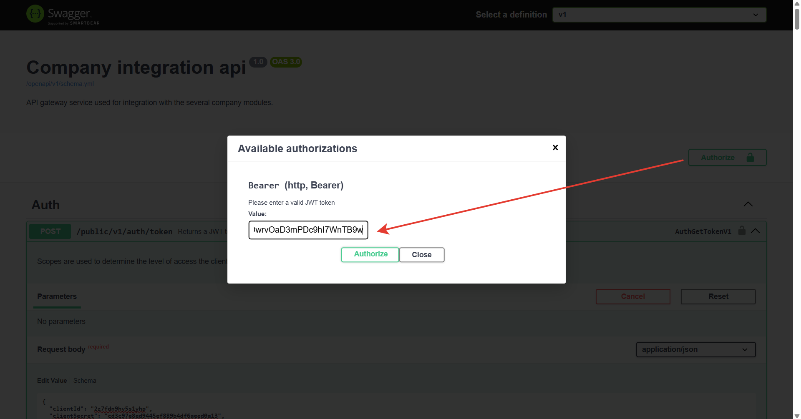

<sub>**[<   SIGNAL. Что нового](/ru/general/updates)     **|**     [HUB. Введение   >](/ru/hub/intro)**</sub>

<summary style="font-size: 16px; color: #0D47A1; background: #E3F2FD; border-radius: 7px; border: 1px solid #64B5F6; display: flex; gap: 10px; padding: 5px 16px; display: block; margin-top: 10px;">
<span style="flex-grow: 1;"> <a href="/general/api/updates" onclick="event.stopPropagation();" style="color: inherit; text-decoration: none;">🔄 Что нового (история изменений этого функционала)</a></span>
</summary>

> Публичный API SIGNAL позволяет подключать внешние системы к данным компании: работать с файлами, замечаниями, согласованиями и другими объектами, доступными интеграции.
{.is-info}

<div class="toc-grid">
  <div class="toc-card toc-green">
    <h4 class="toc-card-title"><a href="#doc">1. Начало работы</a></h4>
    <ul class="toc-list">
      <li><a href="#api-docs"><span class="toc-badge">1.1</span> Адрес и документация</a></li>
      <li><a href="#swagger"><span class="toc-badge">1.2</span> Подключение и авторизация в Swagger</a></li>
      <li><a href="#api-rules"><span class="toc-badge">1.3</span> Запросы, ответы и ограничения</a></li>
    </ul>
  </div>
  <div class="toc-card toc-green">
    <h4 class="toc-card-title"><a href="#examples">2. Примеры</a></h4>
    <ul class="toc-list">
      <li><a href="#example-setup"><span class="toc-badge">2.1</span> Подготовка</a></li>
      <li><a href="#example-auth"><span class="toc-badge">2.2</span> Авторизация</a></li>
      <li><a href="#example-upload"><span class="toc-badge">2.3</span> Загрузка файла</a></li>
      <li><a href="#example-download"><span class="toc-badge">2.4</span> Скачивание файла</a></li>
      <li><a href="#example-review"><span class="toc-badge">2.5</span> Данные согласования</a></li>
      <li><a href="#example-issues"><span class="toc-badge">2.6</span> Реестр замечаний</a></li>
      <li><a href="#example-videos"><span class="toc-badge">2.7</span> Видео и интеграции</a></li>
    </ul>
  </div>
  <div class="toc-card toc-green">
    <h4 class="toc-card-title"><a href="#reference">3. Справочник функций</a></h4>
    <ul class="toc-list">
      <li><a href="#reference-v1"><span class="toc-badge">3.1</span> Методы v1</a></li>
      <li><a href="#reference-v2"><span class="toc-badge">3.2</span> Методы v2</a></li>
      <li><a href="#reference-errors"><span class="toc-badge">3.3</span> Коды ответов</a></li>
    </ul>
  </div>
</div>

----

# Вкладки {.tabset}
## 1. Начало работы
###### 1. Начало работы {#doc}

###### 1.1. Адрес и документация {#api-docs}

Базовый адрес: **https://api.sgnl.pro**. Версия указывается в пути запроса: `/public/v1/...` или `/public/v2/...`.

- [Swagger — методы, модели и выполнение запросов](https://api.sgnl.pro/openapi/swagger/index.html).
- [ReDoc — документация v1](https://api.sgnl.pro/openapi/redoc-v1/index.html).
- [Машинная схема OpenAPI v1](https://api.sgnl.pro/openapi/v1/schema.yml).
- [Машинная схема OpenAPI v2](https://api.sgnl.pro/openapi/v2/schema.yml).

Сначала создайте интеграцию и выберите разрешения, затем получите токен. После этого используйте готовый [пример](#examples) или найдите нужный метод в [справочнике функций](#reference).

###### 1.2. Подключение и авторизация в Swagger {#swagger}

1. Добавьте интеграцию в [настройках компании в HUB](/hub/admin#settings). Выберите **scopes**, к которым хотите предоставить доступ через API в рамках этой интеграции. При необходимости ограничьте срок действия интеграции. Нажмите **Сохранить**:

  
2. Скопируйте **Secret key**. При утрате его можно сбросить:


3. Нажмите на значок :eye: у добавленной интеграции и скопируйте **clientId** и названия выбранных **scopes**:

  
4. Откройте [Swagger](https://api.sgnl.pro/openapi/swagger/index.html). Если вы уже авторизованы — отображается закрытый замок — выполните **Logout**:


5. Раскройте метод **`/public/v1/auth/token`**, нажмите **Try it out** и вставьте в поле **Edit Value** скопированные **clientId**, **clientSecret** и список **scopes**. Каждый scope в списке нужно заключить в кавычки. Нажмите **Execute**:


6. При успешном выполнении запроса — код `200` — скопируйте значение поля **token** из ответа. Срок действия токена возвращается в поле **expiresIn** (секунды). После истечения срока снова выполните запрос:


7. Нажмите **Authorize**, вставьте скопированный токен и ещё раз нажмите **Authorize**:

  
Авторизация выполнена. Используйте методы, соответствующие выбранным для интеграции scopes.

> Secret key и токен дают доступ к данным интеграции. Храните их на стороне сервера или в защищённых переменных окружения. Не добавляйте их в клиентский JavaScript, публичный репозиторий и тексты обращений.
{.is-warning}

###### 1.3. Запросы, ответы и ограничения {#api-rules}

Для получения токена передайте `clientId`, `clientSecret` и массив `scopes` в `POST /public/v1/auth/token`. В остальных запросах примеров используется заголовок:

```http
Authorization: Bearer <token>
```

Если запрос содержит JSON, добавьте `Content-Type: application/json`. Поля и обязательность параметров зависят от метода. Запрошенные scopes должны быть разрешены у интеграции; нужные значения указаны в справочнике.

- **Постраничная выдача.** В методах с параметрами `Take` и `Skip` запрашивайте очередную страницу, увеличивая `Skip` на число полученных записей. Для примеров ниже максимум `Take` — 200. Одна страница не является полным реестром.
- **Ответы.** Метод может вернуть массив, объект, значение в поле `data` или пустое тело. Не применяйте один формат разбора ко всем операциям.
- **Подписанные ссылки.** Билет загрузки или скачивания содержит `signedUrl` и `ttlSec`. Используйте ссылку до истечения указанного срока. JWT предназначен для API SIGNAL; в запрос к хранилищу по подписанной ссылке его передавать не нужно.
- **Частота запросов.** При `429` выдержите паузу из заголовка `Retry-After`. В текущей схеме для компании задан запас до 50 запросов с пополнением 4 запроса в секунду, для клиента — до 10 запросов в секунду. Для неавторизованных запросов — запас до 10 с пополнением 2 запроса каждые 2 секунды.
- **Повторы.** После сетевого обрыва при создании или изменении объекта сначала проверьте результат. Автоматический повтор всей последовательности может создать дубликат.

Назначение операции определяется её описанием: `POST` используется и для поиска, и для создания. В примерах «Данные согласования» и «Реестр замечаний» запросы только читают данные.

## 2. Примеры
###### 2. Примеры {#examples}

###### 2.1. Подготовка {#example-setup}

Выберите Python или JavaScript. Для Python используйте Python 3.10+ и установите пакет:

```bash
python -m pip install requests
```

Примеры JavaScript предназначены для Node.js 22+ и сохраняются с расширением `.mjs`; дополнительные пакеты не нужны. Это серверные скрипты, а не код для вставки в браузер.

Сохраните общий модуль из [примера авторизации](#example-auth) и выбранный сценарий в одну папку. Каждый сценарий сам получает токен через общий модуль. Задайте переменные окружения в настройках запуска своего терминала, IDE или сервера:

| Переменная | Значение |
| --- | --- |
| `SIGNAL_CLIENT_ID` | clientId интеграции. |
| `SIGNAL_CLIENT_SECRET` | Secret key интеграции. |
| `SIGNAL_SCOPES` | Нужные scopes одной строкой через пробел; см. таблицу ниже. |
| `SIGNAL_PROJECT_ID` | UUID проекта для загрузки, согласований и замечаний. |
| `SIGNAL_FOLDER_ID` | UUID папки назначения для загрузки. Папка должна принадлежать указанному проекту. |
| `SIGNAL_FILE` | Путь к локальному файлу для загрузки. |
| `SIGNAL_MIME_TYPE` | MIME-тип файла для JavaScript, например application/pdf. По умолчанию application/octet-stream. |
| `SIGNAL_ITEM_ID` и `SIGNAL_VERSION_ID` | UUID элемента и версии файла для скачивания. |
| `SIGNAL_REVIEW_ID` | UUID согласования. |
| `SIGNAL_OUTPUT` | Необязательное имя выходного файла для скачивания или JSON согласования. |
| `SIGNAL_OUTPUT_PREFIX` | Необязательное имя без расширения для CSV и JSON замечаний; по умолчанию issues. |

| Сценарий | Значение SIGNAL_SCOPES |
| --- | --- |
| Загрузка нового файла | `docs:object:create docs:version:create docs:item:create` |
| Скачивание файла | `docs:item:read` |
| Данные согласования | `docs:review:list` |
| Реестр замечаний | `docs:issue:list` |

Для отдельной проверки авторизации используйте scopes выбранного сценария. Дополнительные запросы для поиска идентификаторов требуют своих scopes из [справочника](#reference).

Идентификаторы можно получить через API: проекты — `GET /public/v1/projects`, папки — `GET /public/v1/projects/{projectId}/folders/tree`, файлы папки — `GET /public/v1/items`, версии — `GET /public/v1/versions`, согласования — `POST /public/v1/reviews`. Для скачивания нужен именно `versionId`; не подменяйте его идентификатором версии элемента `itemVersionId`.

Выходные файлы создаются в рабочей папке запуска. Если файл с выбранным именем уже существует, он будет заменён. Примеры рассчитаны на последовательный запуск; при долгой передаче увеличьте тайм-ауты под размер файла и скорость соединения.

###### 2.2. Авторизация {#example-auth}

**Задача:** получить JWT и использовать его в последующих запросах. **Результат:** токен хранится в памяти; на экран выводится только срок действия. Общий модуль получает новый токен перед истечением срока и ограниченно повторяет запросы при HTTP 429. Ошибки авторизации, остальные HTTP-ошибки и сетевые ошибки останавливают сценарий.

**Python — `signal_api.py`.** Сохраните модуль; для проверки выполните `python signal_api.py`.

```python
import os
import time
from pathlib import Path
import requests

BASE_URL = "https://api.sgnl.pro"

class SignalAPI:
    def __init__(self):
        scopes = os.environ["SIGNAL_SCOPES"].split()
        if not scopes:
            raise ValueError("Укажите хотя бы один scope")
        self.credentials = {
            "clientId": os.environ["SIGNAL_CLIENT_ID"],
            "clientSecret": os.environ["SIGNAL_CLIENT_SECRET"],
            "scopes": scopes,
        }
        self.token = None
        self.expires_at = 0

    def authorize(self):
        started = time.monotonic()
        response = requests.post(
            BASE_URL + "/public/v1/auth/token",
            json=self.credentials, timeout=60,
        )
        if not response.ok:
            raise RuntimeError(f"Авторизация: HTTP {response.status_code}")
        result = response.json()
        self.token = result["token"]
        self.expires_at = started + result["expiresIn"]
        return result["expiresIn"]

    def request(self, method, route, *, body=None, params=None):
        if self.token is None or time.monotonic() >= self.expires_at - 30:
            self.authorize()
        for attempt in range(4):
            response = requests.request(
                method, BASE_URL + route, json=body, params=params,
                headers={"Authorization": f"Bearer {self.token}"}, timeout=60,
            )
            if response.status_code == 429 and attempt < 3:
                delay = response.headers.get("Retry-After", "2")
                time.sleep(float(delay) if delay.isdigit() else 2)
                continue
            if not response.ok:
                raise RuntimeError(f"{method} {route}: HTTP {response.status_code}")
            return response.json() if response.content else None
        raise RuntimeError("Превышено число повторов")

def download_file(url, destination):
    target = Path(destination)
    temporary = target.with_name(target.name + ".part")
    try:
        # Подписанная ссылка уже разрешает скачивание. JWT сюда не передаём.
        with requests.get(url, stream=True, timeout=300) as response:
            if not response.ok:
                raise RuntimeError(f"Скачивание: HTTP {response.status_code}")
            with temporary.open("wb") as output:
                for chunk in response.iter_content(chunk_size=1024 * 1024):
                    output.write(chunk)
        temporary.replace(target)
    finally:
        temporary.unlink(missing_ok=True)

if __name__ == "__main__":
    api = SignalAPI()
    seconds = api.authorize()
    print(f"Авторизация выполнена. Срок действия токена: {seconds} с.")
```

**JavaScript — `signal_api.mjs`.** Сохраните модуль; для проверки выполните `node signal_api.mjs`.

```javascript
import { createWriteStream } from "node:fs";
import { rename, rm } from "node:fs/promises";
import { Readable } from "node:stream";
import { pipeline } from "node:stream/promises";
import { pathToFileURL } from "node:url";

const BASE_URL = "https://api.sgnl.pro";
export function env(name) {
  const value = process.env[name];
  if (!value) throw new Error("Не задана переменная " + name);
  return value;
}
export class SignalAPI {
  constructor() {
    this.credentials = {
      clientId: env("SIGNAL_CLIENT_ID"),
      clientSecret: env("SIGNAL_CLIENT_SECRET"),
      scopes: env("SIGNAL_SCOPES").trim().split(/\s+/),
    };
    this.token = null;
    this.expiresAt = 0;
  }
  async authorize() {
    const started = Date.now();
    const response = await fetch(BASE_URL + "/public/v1/auth/token", {
      method: "POST",
      headers: { "Content-Type": "application/json" },
      body: JSON.stringify(this.credentials),
      signal: AbortSignal.timeout(60000),
    });
    if (!response.ok) throw new Error("Авторизация: HTTP " + response.status);
    const result = await response.json();
    this.token = result.token;
    this.expiresAt = started + result.expiresIn * 1000;
    return result.expiresIn;
  }
  async request(method, route, { body, params } = {}) {
    if (!this.token || Date.now() >= this.expiresAt - 30000) {
      await this.authorize();
    }
    const url = new URL(BASE_URL + route);
    if (params) url.search = new URLSearchParams(params).toString();
    for (let attempt = 0; attempt < 4; attempt++) {
      const response = await fetch(url, {
        method,
        headers: {
          Authorization: "Bearer " + this.token,
          ...(body === undefined ? {} : { "Content-Type": "application/json" }),
        },
        body: body === undefined ? undefined : JSON.stringify(body),
        signal: AbortSignal.timeout(60000),
      });
      if (response.status === 429 && attempt < 3) {
        const value = response.headers.get("Retry-After") ?? "2";
        const seconds = /^\d+$/.test(value) ? Number(value) : 2;
        await response.arrayBuffer();
        await new Promise(resolve => setTimeout(resolve, seconds * 1000));
        continue;
      }
      if (!response.ok) throw new Error(method + " " + route + ": HTTP " + response.status);
      const text = await response.text();
      return text ? JSON.parse(text) : null;
    }
    throw new Error("Превышено число повторов");
  }
}
export async function downloadFile(url, destination) {
  const temporary = destination + ".part";
  try {
    // JWT не передаётся по подписанной ссылке.
    const response = await fetch(url, { signal: AbortSignal.timeout(300000) });
    if (!response.ok) throw new Error("Скачивание: HTTP " + response.status);
    await pipeline(Readable.fromWeb(response.body), createWriteStream(temporary));
    await rename(temporary, destination);
  } finally {
    await rm(temporary, { force: true });
  }
}
if (process.argv[1] && import.meta.url === pathToFileURL(process.argv[1]).href) {
  const seconds = await new SignalAPI().authorize();
  console.log("Авторизация выполнена. Срок действия токена: " + seconds + " с.");
}
```


###### 2.3. Загрузка файла {#example-upload}

**Задача:** создать новый файл в папке DOCS. Укажите `SIGNAL_PROJECT_ID`, `SIGNAL_FOLDER_ID` и `SIGNAL_FILE`. Размер в текущей схеме — от 10 байт до 5 ГиБ.

Последовательность:

1. Получить билет через `PUT /public/v1/objects`.
2. Передать содержимое файла методом PUT по `signedUrl`.
3. Подтвердить загрузку через `POST /public/v1/objects/{objectId}/uploading/commit`.
4. Создать версию через `POST /public/v1/versions`.
5. Создать файл в папке через `PUT /public/v1/items/file`.

**Результат:** новый файл в папке, его `itemId` и `versionId` в выводе скрипта. Пример не обновляет существующий файл. Для прикрепления версии к существующему элементу используйте `PUT /public/v1/items/versions` из справочника. Если папка требует правило именования, передайте допустимое имя и нужный `namingPatternId` в запросе создания файла согласно настройкам папки.

> Запуск этого примера создаёт данные в DOCS. Выберите папку для проверки интеграции. Если последовательность остановилась после загрузки объекта или создания версии, не запускайте её целиком повторно без проверки уже выполненных шагов.
{.is-warning}

**Python — `upload.py`; запуск: `python upload.py`.

```python
import mimetypes
import os
from pathlib import Path
import requests
from signal_api import SignalAPI

api = SignalAPI()
source = Path(os.environ["SIGNAL_FILE"])
project_id = os.environ["SIGNAL_PROJECT_ID"]
folder_id = os.environ["SIGNAL_FOLDER_ID"]
size = source.stat().st_size
if not 10 <= size <= 5368709120:
    raise ValueError("Размер файла должен быть от 10 байт до 5 ГиБ")
mime_type = mimetypes.guess_type(source.name)[0] or "application/octet-stream"

ticket = api.request("PUT", "/public/v1/objects", body={
    "projectId": project_id, "mimeType": mime_type, "size": size,
})
with source.open("rb") as content:
    response = requests.put(ticket["signedUrl"], data=content,
                            headers={"Content-Type": mime_type}, timeout=300)
if not response.ok:
    raise RuntimeError(f"Загрузка в хранилище: HTTP {response.status_code}")
api.request("POST", f"/public/v1/objects/{ticket['objectId']}/uploading/commit")
version = api.request("POST", "/public/v1/versions", body={
    "objectId": ticket["objectId"], "projectId": project_id, "name": source.name,
})
item = api.request("PUT", "/public/v1/items/file", body={
    "folderId": folder_id, "versionId": version["data"], "name": source.name,
})
print("itemId:", item["data"])
print("versionId:", version["data"])
```

**JavaScript — `upload.mjs`; запуск: `node upload.mjs`.

```javascript
import { createReadStream } from "node:fs";
import { stat } from "node:fs/promises";
import { basename } from "node:path";
import { SignalAPI, env } from "./signal_api.mjs";

const api = new SignalAPI();
const source = env("SIGNAL_FILE");
const projectId = env("SIGNAL_PROJECT_ID");
const folderId = env("SIGNAL_FOLDER_ID");
const name = basename(source);
const { size } = await stat(source);
if (size < 10 || size > 5368709120) throw new Error("Размер файла: от 10 байт до 5 ГиБ");
const mimeType = process.env.SIGNAL_MIME_TYPE || "application/octet-stream";
const ticket = await api.request("PUT", "/public/v1/objects", {
  body: { projectId, mimeType, size },
});
const stream = createReadStream(source);
try {
  const response = await fetch(ticket.signedUrl, {
    method: "PUT", body: stream, duplex: "half",
    headers: { "Content-Type": mimeType, "Content-Length": String(size) },
    signal: AbortSignal.timeout(300000),
  });
  if (!response.ok) throw new Error("Загрузка в хранилище: HTTP " + response.status);
} finally {
  stream.destroy();
}
await api.request("POST", "/public/v1/objects/" + ticket.objectId + "/uploading/commit");
const version = await api.request("POST", "/public/v1/versions", {
  body: { objectId: ticket.objectId, projectId, name },
});
const item = await api.request("PUT", "/public/v1/items/file", {
  body: { folderId, versionId: version.data, name },
});
console.log("itemId:", item.data);
console.log("versionId:", version.data);
```


###### 2.4. Скачивание файла {#example-download}

**Задача:** скачать выбранную версию файла DOCS. Укажите `SIGNAL_ITEM_ID` и `SIGNAL_VERSION_ID`. Для сохранения с нужным именем и расширением задайте `SIGNAL_OUTPUT`, например `document.pdf`.

Сначала запросите билет через `GET /public/v1/items/download`, затем скачайте содержимое по `signedUrl`. Ответ API с билетом не является содержимым файла.

**Результат:** локальный файл. Запись идёт во временный файл с окончанием .part; итоговое имя присваивается после успешного скачивания.

**Python — `download.py`; запуск: `python download.py`.

```python
import os
from signal_api import SignalAPI, download_file

api = SignalAPI()
ticket = api.request("GET", "/public/v1/items/download", params={
    "itemId": os.environ["SIGNAL_ITEM_ID"],
    "versionId": os.environ["SIGNAL_VERSION_ID"],
})
destination = os.environ.get("SIGNAL_OUTPUT", "download.bin")
download_file(ticket["signedUrl"], destination)
print("Файл сохранён:", destination)
```

**JavaScript — `download.mjs`; запуск: `node download.mjs`.

```javascript
import { SignalAPI, env, downloadFile } from "./signal_api.mjs";

const api = new SignalAPI();
const ticket = await api.request("GET", "/public/v1/items/download", {
  params: { itemId: env("SIGNAL_ITEM_ID"), versionId: env("SIGNAL_VERSION_ID") },
});
const destination = process.env.SIGNAL_OUTPUT || "download.bin";
await downloadFile(ticket.signedUrl, destination);
console.log("Файл сохранён:", destination);
```


###### 2.5. Данные согласования {#example-review}

**Задача:** получить данные для собственного листа согласования. Укажите `SIGNAL_PROJECT_ID` и `SIGNAL_REVIEW_ID`.

`POST /public/v1/reviews` возвращает согласование с последней версией `topVersion`, этапами, статусом и данными подписаний. Второй запрос, `POST /public/v1/reviews/versions/item-versions`, возвращает идентификаторы входящих версий элементов.

**Результат:** `review.json` с двумя полями: `review` и `itemVersionIdsByReviewVersion`. В `review.topVersion.stages` находятся этапы, в `review.topVersion.signings` — данные подписаний. Для деталей конкретной версии элемента используйте `GET /public/v1/items/item-version` из справочника.

Это исходные данные для собственной формы отчёта, а не штатный PDF/XLSX из интерфейса. В проверенных схемах OpenAPI v1/v2 отдельный метод скачивания штатного листа согласования не описан. Пример получает последнюю версию; для известного идентификатора другой версии предусмотрен `POST /public/v1/reviews/versions`.

**Python — `review.py`; запуск: `python review.py`.

```python
import json
import os
from pathlib import Path
from signal_api import SignalAPI

api = SignalAPI()
review_id = os.environ["SIGNAL_REVIEW_ID"]
reviews = api.request("POST", "/public/v1/reviews", body={
    "projectId": os.environ["SIGNAL_PROJECT_ID"], "ids": [review_id],
}, params={"Take": 1, "Skip": 0})
if len(reviews) != 1 or reviews[0]["id"].lower() != review_id.lower():
    raise RuntimeError("Указанное согласование не найдено")
review = reviews[0]
version_id = review["topVersion"]["id"]
item_versions = api.request("POST", "/public/v1/reviews/versions/item-versions", body={
    "reviewVersionIds": [version_id],
})
result = {"review": review, "itemVersionIdsByReviewVersion": item_versions}
destination = Path(os.environ.get("SIGNAL_OUTPUT", "review.json"))
destination.write_text(json.dumps(result, ensure_ascii=False, indent=2), encoding="utf-8")
print("Данные согласования сохранены:", destination)
```

**JavaScript — `review.mjs`; запуск: `node review.mjs`.

```javascript
import { writeFile } from "node:fs/promises";
import { SignalAPI, env } from "./signal_api.mjs";

const api = new SignalAPI();
const reviewId = env("SIGNAL_REVIEW_ID");
const reviews = await api.request("POST", "/public/v1/reviews", {
  body: { projectId: env("SIGNAL_PROJECT_ID"), ids: [reviewId] },
  params: { Take: 1, Skip: 0 },
});
if (reviews.length !== 1 || reviews[0].id.toLowerCase() !== reviewId.toLowerCase()) {
  throw new Error("Указанное согласование не найдено");
}
const review = reviews[0];
const itemVersions = await api.request("POST", "/public/v1/reviews/versions/item-versions", {
  body: { reviewVersionIds: [review.topVersion.id] },
});
const destination = process.env.SIGNAL_OUTPUT || "review.json";
await writeFile(destination, JSON.stringify({
  review, itemVersionIdsByReviewVersion: itemVersions,
}, null, 2), "utf8");
console.log("Данные согласования сохранены:", destination);
```


###### 2.6. Реестр замечаний {#example-issues}

**Задача:** собрать неудалённые замечания проекта. Укажите `SIGNAL_PROJECT_ID`. При необходимости дополните фильтр полями из модели `IssueFind`: например, типом замечания, статусами или ответственными.

Скрипт получает число записей через `POST /public/v1/issues/count`, читает страницы через `POST /public/v1/issues` с сортировкой по номеру, проверяет дубликаты и повторно сверяет количество.

**Результат:**

- `issues.csv` — таблица с идентификатором, номером, названием, статусом, описанием, местоположением, сроком устранения, датами создания и изменения и ответственным. Разделитель — точка с запятой; кодировка — UTF-8 с BOM. Составное поле ответственного сохраняется как JSON, статусы — в значениях API.
- `issues.json` — полные полученные записи для дальнейшей обработки, включая поля, не вошедшие в CSV. Дополнительные атрибуты, комментарии и вложения запрашиваются отдельными методами из справочника.

CSV формируется скриптом из данных API; это не выгрузка штатного шаблона реестра из интерфейса. При отсутствии замечаний CSV содержит заголовки, JSON — пустой массив.

Проверка количества и дубликатов обнаруживает часть изменений во время выгрузки, но не создаёт снимок данных на один момент. Чтобы получить согласованный реестр, запускайте сбор в период без изменений замечаний. При ошибке проверки новые файлы не записываются; ранее созданные файлы могут остаться в папке.

**Python — `issues.py`; запуск: `python issues.py`.

```python
import csv
import json
import os
from pathlib import Path
from signal_api import SignalAPI

api = SignalAPI()
filters = {
    "projectId": os.environ["SIGNAL_PROJECT_ID"], "deleted": False,
    "order": "Number", "isOrderAsc": True,
}
def count():
    return api.request("POST", "/public/v1/issues/count", body=filters)["data"]

expected = count()
issues = []
seen = set()
skip = 0
while True:
    page = api.request("POST", "/public/v1/issues", body=filters,
                       params={"Take": 200, "Skip": skip})
    if not page:
        break
    for issue in page:
        if issue["id"] in seen:
            raise RuntimeError("Повтор записи: повторите выгрузку после окончания изменений")
        seen.add(issue["id"])
        issues.append(issue)
    skip += len(page)
    if len(issues) > expected:
        raise RuntimeError("Состав замечаний изменился во время выгрузки; повторите её")
actual = count()
if len(issues) != expected or actual != expected:
    raise RuntimeError("Число замечаний изменилось или выгрузка неполная; повторите её")

fields = ["id", "number", "name", "status", "description", "placement",
          "eliminationDate", "added", "modified", "responsible"]
def cell(value):
    if isinstance(value, (dict, list)):
        value = json.dumps(value, ensure_ascii=False)
    text = "" if value is None else str(value)
    # Текст из API не должен становиться формулой при открытии CSV.
    return "'" + text if text.lstrip().startswith(("=", "+", "-", "@")) else text

stem = Path(os.environ.get("SIGNAL_OUTPUT_PREFIX", "issues"))
with Path(str(stem) + ".csv").open("w", encoding="utf-8-sig", newline="") as output:
    writer = csv.writer(output, delimiter=";")
    writer.writerow(fields)
    writer.writerows([cell(issue.get(key)) for key in fields] for issue in issues)
Path(str(stem) + ".json").write_text(
    json.dumps(issues, ensure_ascii=False, indent=2), encoding="utf-8",
)
print(f"Сохранено {len(issues)} замечаний: {stem}.csv и {stem}.json")
```

**JavaScript — `issues.mjs`; запуск: `node issues.mjs`.

```javascript
import { writeFile } from "node:fs/promises";
import { SignalAPI, env } from "./signal_api.mjs";

const api = new SignalAPI();
const filters = {
  projectId: env("SIGNAL_PROJECT_ID"), deleted: false,
  order: "Number", isOrderAsc: true,
};
async function count() {
  return (await api.request("POST", "/public/v1/issues/count", { body: filters })).data;
}
const expected = await count();
const issues = [];
const seen = new Set();
let skip = 0;
while (true) {
  const page = await api.request("POST", "/public/v1/issues", {
    body: filters, params: { Take: 200, Skip: skip },
  });
  if (!page.length) break;
  for (const issue of page) {
    if (seen.has(issue.id)) throw new Error("Повтор записи: повторите выгрузку после окончания изменений");
    seen.add(issue.id);
    issues.push(issue);
  }
  skip += page.length;
  if (issues.length > expected) throw new Error("Состав замечаний изменился; повторите выгрузку");
}
const actual = await count();
if (issues.length !== expected || actual !== expected) {
  throw new Error("Число замечаний изменилось или выгрузка неполная; повторите её");
}
const fields = ["id", "number", "name", "status", "description", "placement",
                "eliminationDate", "added", "modified", "responsible"];
function cell(value) {
  let text = value == null ? "" : typeof value === "object" ? JSON.stringify(value) : String(value);
  if (/^[=+\-@]/.test(text.trimStart())) text = "'" + text;
  return '"' + text.replaceAll('"', '""') + '"';
}
const rows = [fields.map(cell).join(";"),
  ...issues.map(issue => fields.map(key => cell(issue[key])).join(";"))];
const stem = process.env.SIGNAL_OUTPUT_PREFIX || "issues";
await writeFile(stem + ".csv", "\uFEFF" + rows.join("\r\n") + "\r\n", "utf8");
await writeFile(stem + ".json", JSON.stringify(issues, null, 2), "utf8");
console.log("Сохранено " + issues.length + " замечаний: " + stem + ".csv и " + stem + ".json");
```

###### 2.7. Видео и интеграции {#example-videos}

- Авторизация:
[GoogleScript](https://vkvideo.ru/video890470724_456239019)
[IronPython](https://vkvideo.ru/video890470724_456239020)
[1С](https://vkvideo.ru/video890470724_456239021)
  
- Загрузка и скачивание файлов из DOCS:
[PowerShell](https://vkvideo.ru/video-230401166_456239017)
[VBA Excel](https://vkvideo.ru/video-230401166_456239018)
[Python](https://vkvideo.ru/video-230401166_456239019)

- Кейсы с применением n8n:
[Интеграция SIGNAL DOCS с n8n](https://vkvideo.ru/video-230401166_456239022)
[Сбор аналитики в SIGNAL DOCS](https://vkvideo.ru/video-230401166_456239023)
[Ежедневный отчет в Telegram по событиям в SIGNAL DOCS](https://vkvideo.ru/video-230401166_456239026)

## 3. Справочник функций
###### 3. Справочник функций {#reference}

Здесь перечислены все **153 операции** опубликованных схем на **17 ноября 2026 года**: **150 операций v1** и **3 операции v2**. Примеры выше используют только часть этих методов.

Пути указаны относительно `https://api.sgnl.pro`. В колонке «Контракт» перечислены параметры пути и строки запроса, модель тела и тип успешного ответа. Звёздочкой отмечены обязательные параметры пути/строки запроса. Для тела запроса приведены обязательные поля верхнего уровня, если они заданы моделью. Необязательные поля, вложенные модели и ограничения значений смотрите по ссылке «Схема» в Swagger; для v2 выберите соответствующую версию схемы в интерфейсе. Обозначение «тело не описано» означает, что OpenAPI не задаёт содержимое успешного ответа.

###### 3.1. Методы v1 {#reference-v1}

- [3.1.1. Акты приёмки](#ref-v1-acceptancecertificate)
- [3.1.2. Доступ пользователей к приложениям](#ref-v1-applicationuser)
- [3.1.3. Атрибуты](#ref-v1-attribute)
- [3.1.4. Типы атрибутов](#ref-v1-attributetype)
- [3.1.5. Значения списочных типов](#ref-v1-attributetypelistitems)
- [3.1.6. Значения атрибутов](#ref-v1-attributevalue)
- [3.1.7. Авторизация](#ref-v1-auth)
- [3.1.8. Дашборды](#ref-v1-board)
- [3.1.9. Бронирования](#ref-v1-booking)
- [3.1.10. CAdES-подписи](#ref-v1-cadessignature)
- [3.1.11. Карточки дашбордов](#ref-v1-card)
- [3.1.12. Публичные ссылки карточек](#ref-v1-cardpubliclink)
- [3.1.13. Компания](#ref-v1-company)
- [3.1.14. Пользователи компании](#ref-v1-companyuser)
- [3.1.15. Дополнительные роли компании](#ref-v1-companyusercustomrole)
- [3.1.16. Проекты DOCS](#ref-v1-docsproject)
- [3.1.17. Передачи документов](#ref-v1-documentstransfer)
- [3.1.18. Отправка передач](#ref-v1-documentstransferacceptance)
- [3.1.19. Доступ к передачам](#ref-v1-documentstransferaccesses)
- [3.1.20. Состав передач](#ref-v1-documentstransferitem)
- [3.1.21. Типы передач](#ref-v1-documentstransfertype)
- [3.1.22. Встроенные подписи](#ref-v1-embeddedsignature)
- [3.1.23. Папки](#ref-v1-folder)
- [3.1.24. Правила именования](#ref-v1-folderitemsnamingpattern)
- [3.1.25. Просмотр моделей через Forge](#ref-v1-forge)
- [3.1.26. Типы полей форм](#ref-v1-formfieldtype)
- [3.1.27. Типы форм](#ref-v1-formtype)
- [3.1.28. Группы типов форм](#ref-v1-formtypegroup)
- [3.1.29. Группы карточек](#ref-v1-group)
- [3.1.30. Папки фотомониторинга](#ref-v1-inspectionfolder)
- [3.1.31. Замечания](#ref-v1-issue)
- [3.1.32. Доступ к замечаниям](#ref-v1-issueaccesses)
- [3.1.33. Вложения замечаний](#ref-v1-issueattachment)
- [3.1.34. Комментарии замечаний](#ref-v1-issuecomment)
- [3.1.35. События замечаний](#ref-v1-issueevents)
- [3.1.36. Настройки замечаний проекта](#ref-v1-issueprojectsettings)
- [3.1.37. Типы замечаний](#ref-v1-issuetype)
- [3.1.38. Файлы и элементы](#ref-v1-item)
- [3.1.39. Машиночитаемые доверенности](#ref-v1-mchd)
- [3.1.40. Объекты хранилища](#ref-v1-object)
- [3.1.41. Права на папки](#ref-v1-permissions)
- [3.1.42. Планы фотомониторинга](#ref-v1-plan)
- [3.1.43. Точки фотомониторинга](#ref-v1-point)
- [3.1.44. Проекты](#ref-v1-project)
- [3.1.45. Формы проекта](#ref-v1-projectform)
- [3.1.46. Типы полей форм проекта](#ref-v1-projectformfieldtype)
- [3.1.47. Типы форм проекта](#ref-v1-projectformtype)
- [3.1.48. Пользователи проектов](#ref-v1-projectuser)
- [3.1.49. Дополнительные роли проектов](#ref-v1-projectusercustomrole)
- [3.1.50. Согласования](#ref-v1-review)
- [3.1.51. Группы согласований](#ref-v1-reviewgroup)
- [3.1.52. Документы согласований](#ref-v1-reviewitem)
- [3.1.53. Запуск согласований](#ref-v1-reviewprocess)
- [3.1.54. Типы согласований](#ref-v1-reviewtype)
- [3.1.55. Публикации файлов](#ref-v1-share)
- [3.1.56. Слоты](#ref-v1-slot)
- [3.1.57. Хранилища](#ref-v1-storage)
- [3.1.58. Просмотр моделей через Tangl](#ref-v1-tangl)
- [3.1.59. Журнал действий](#ref-v1-userlog)
- [3.1.60. Версии файлов](#ref-v1-version)

##### 3.1.1. Акты приёмки {#ref-v1-acceptancecertificate}

| Метод и путь | Назначение и права | Контракт |
| --- | --- | --- |
| `GET /public/v1/acceptance-certificates/download`<br>[Схема](https://api.sgnl.pro/openapi/swagger/index.html#/AcceptanceCertificate/AcceptanceCertificateDownloadV1) | Выдаёт временный билет для скачивания файла акта приёмки.<br>**Scope:** `docs:docs_transfer:read` | `acceptanceCertificateId`* (query), `fileName` (query)<br>**Ответ:** `200` → `AcceptanceCertificateDownloadTicket` |
| `POST /public/v1/acceptance-certificates/attach`<br>[Схема](https://api.sgnl.pro/openapi/swagger/index.html#/AcceptanceCertificate/AcceptanceCertificateAttachV1) | Прикрепляет акт приёмки к передаче документов.<br>**Scope:** `docs:docs_transfer:update` | JSON обязателен: `AcceptanceCertificateAttach`; поля: `authorId`, `companyRecipient`, `companySender`, `documentsTransferId`, `projectName`<br>**Ответ:** `200` → `uuid` |

##### 3.1.2. Доступ пользователей к приложениям {#ref-v1-applicationuser}

| Метод и путь | Назначение и права | Контракт |
| --- | --- | --- |
| `PUT /public/v1/application-users`<br>[Схема](https://api.sgnl.pro/openapi/swagger/index.html#/ApplicationUser/ApplicationUserUpsertApplicationUsersV1) | Пакетно назначает пользователям роли в нескольких приложениях.<br>**Scope:** `hub:application:user:update` | JSON обязателен: `ApplicationUsersUpsert`; поля: `applicationIds`, `role`, `userIds`<br>**Ответ:** `200` → тело не описано |
| `DELETE /public/v1/application-users`<br>[Схема](https://api.sgnl.pro/openapi/swagger/index.html#/ApplicationUser/ApplicationUserDeleteApplicationUsersV1) | Пакетно отзывает доступ пользователей к приложениям.<br>**Scope:** `hub:application:user:delete` | JSON обязателен: `ApplicationUsersDelete`; поля: `applicationIds`, `userIds`<br>**Ответ:** `200` → тело не описано |

##### 3.1.3. Атрибуты {#ref-v1-attribute}

| Метод и путь | Назначение и права | Контракт |
| --- | --- | --- |
| `POST /public/v1/attributes`<br>[Схема](https://api.sgnl.pro/openapi/swagger/index.html#/Attribute/AttributeListV1) | Возвращает атрибуты по заданному фильтру.<br>**Scope:** `docs:attribute:list` | JSON обязателен: `AttributeFind`; поля: `projectId`, `type`<br>**Ответ:** `200` → `массив AttributeListItem` |

##### 3.1.4. Типы атрибутов {#ref-v1-attributetype}

| Метод и путь | Назначение и права | Контракт |
| --- | --- | --- |
| `POST /public/v1/attributes/types`<br>[Схема](https://api.sgnl.pro/openapi/swagger/index.html#/AttributeType/AttributeTypeListV1) | Ищет типы атрибутов по фильтру.<br>**Scope:** `docs:attribute:list` | JSON обязателен: `AttributeTypeFind`; поля: `projectId`<br>**Ответ:** `200` → `массив AttributeType` |
| `PATCH /public/v1/attributes/types`<br>[Схема](https://api.sgnl.pro/openapi/swagger/index.html#/AttributeType/AttributeTypeUpdateV1) | Обновляет существующие типы атрибутов.<br>**Scope:** `docs:attribute:update` | JSON обязателен: `AttributeTypesUpdate`; поля: `data`, `projectId`<br>**Ответ:** `200` → тело не описано |
| `POST /public/v1/attributes/types/create`<br>[Схема](https://api.sgnl.pro/openapi/swagger/index.html#/AttributeType/AttributeTypeCreateV1) | Создаёт новый тип атрибута.<br>**Scope:** `docs:attribute:create` | JSON обязателен: `AttributeTypeCreate`; поля: `isRequired`, `name`, `order`, `projectId`, `type`<br>**Ответ:** `200` → `uuid` |

##### 3.1.5. Значения списочных типов {#ref-v1-attributetypelistitems}

| Метод и путь | Назначение и права | Контракт |
| --- | --- | --- |
| `POST /public/v1/attributes/types/list/items/create`<br>[Схема](https://api.sgnl.pro/openapi/swagger/index.html#/AttributeTypeListItems/AttributeTypeListItemsCreateV1) | Добавляет варианты значений в атрибут типа «список».<br>**Scope:** `docs:attribute:create` | JSON обязателен: `AttributeTypeListItemsCreate`; поля: `attributeTypeId`, `items`<br>**Ответ:** `200` → тело не описано |
| `PATCH /public/v1/attributes/types/list/items`<br>[Схема](https://api.sgnl.pro/openapi/swagger/index.html#/AttributeTypeListItems/AttributeTypeListItemsUpdateV1) | Изменяет варианты значений атрибута типа «список».<br>**Scope:** `docs:attribute:update` | JSON обязателен: `AttributeTypeListItemsUpdate`; поля: `attributeTypeId`, `items`<br>**Ответ:** `200` → тело не описано |

##### 3.1.6. Значения атрибутов {#ref-v1-attributevalue}

| Метод и путь | Назначение и права | Контракт |
| --- | --- | --- |
| `POST /public/v1/attributes/values/issues`<br>[Схема](https://api.sgnl.pro/openapi/swagger/index.html#/AttributeValue/AttributeValueListIssuesV1) | Возвращает значения атрибутов замечаний по фильтру.<br>**Scope:** `docs:attribute:list` | JSON обязателен: `IssueAttributeValueFind`; поля: `issueIds`, `projectId`<br>**Ответ:** `200` → `массив IssueAttributeValueListItem` |
| `POST /public/v1/attributes/values/items`<br>[Схема](https://api.sgnl.pro/openapi/swagger/index.html#/AttributeValue/AttributeValueListItemsV1) | Возвращает значения атрибутов элементов по фильтру.<br>**Scope:** `docs:attribute:list` | JSON обязателен: `ItemAttributeValueFind`; поля: `itemIds`, `projectId`<br>**Ответ:** `200` → `массив ItemAttributeValueListItem` |
| `POST /public/v1/attributes/values/folders`<br>[Схема](https://api.sgnl.pro/openapi/swagger/index.html#/AttributeValue/AttributeValueListFoldersV1) | Возвращает значения атрибутов папок по фильтру.<br>**Scope:** `docs:attribute:list` | JSON обязателен: `FolderAttributeValueFind`; поля: `folderIds`, `projectId`<br>**Ответ:** `200` → `массив FolderAttributeValueListItem` |
| `POST /public/v1/attributes/values/set`<br>[Схема](https://api.sgnl.pro/openapi/swagger/index.html#/AttributeValue/AttributeValueSetV1) | Устанавливает значения атрибутов для указанной сущности.<br>**Scope:** `docs:attribute:update` | JSON обязателен: `AttributeValuesSet`; поля: `type`, `values`<br>**Ответ:** `200` → тело не описано; `204` → тело не описано |

##### 3.1.7. Авторизация {#ref-v1-auth}

| Метод и путь | Назначение и права | Контракт |
| --- | --- | --- |
| `POST /public/v1/auth/token`<br>[Схема](https://api.sgnl.pro/openapi/swagger/index.html#/Auth/AuthGetTokenV1) | Выдаёт JWT указанному клиенту; запрошенные scope определяют права токена.<br>**Scope:** clientId, clientSecret и запрошенные scopes | JSON обязателен: `AuthCredentials`; поля: `clientId`, `clientSecret`, `scopes`<br>**Ответ:** `200` → `AuthToken` |

##### 3.1.8. Дашборды {#ref-v1-board}

| Метод и путь | Назначение и права | Контракт |
| --- | --- | --- |
| `POST /public/v1/boards`<br>[Схема](https://api.sgnl.pro/openapi/swagger/index.html#/Board/BoardListV1) | Возвращает дашборды проекта по фильтру; удалённые дашборды исключены.<br>**Scope:** `dash:board:list` | `Take` (query), `Skip` (query)<br>JSON обязателен: `BoardFind`; поля: `projectId`<br>**Ответ:** `200` → `массив Board` |

##### 3.1.9. Бронирования {#ref-v1-booking}

| Метод и путь | Назначение и права | Контракт |
| --- | --- | --- |
| `POST /public/v1/bookings`<br>[Схема](https://api.sgnl.pro/openapi/swagger/index.html#/Booking/BookingListV1) | Возвращает бронирования компании интеграции, упорядоченные по времени изменения и идентификатору.<br>**Scope:** `settings:booking:list` | JSON обязателен: `BookingFind`; поля: `paging`<br>**Ответ:** `200` → `массив Booking` |
| `DELETE /public/v1/bookings`<br>[Схема](https://api.sgnl.pro/openapi/swagger/index.html#/Booking/BookingDeleteBatchV1) | Удаляет указанные бронирования компании интеграции.<br>**Scope:** `settings:booking:delete` | JSON обязателен: `BookingBatchDelete`; поля: `bookingIds`<br>**Ответ:** `200` → тело не описано |

##### 3.1.10. CAdES-подписи {#ref-v1-cadessignature}

| Метод и путь | Назначение и права | Контракт |
| --- | --- | --- |
| `GET /public/v1/cades/signatures`<br>[Схема](https://api.sgnl.pro/openapi/swagger/index.html#/CadesSignature/CadesSignatureListV1) | Возвращает CAdES-подписи версии файла.<br>**Scope:** `docs:signing:list` | `versionId`* (query), `searchMchdIds` (query)<br>**Ответ:** `200` → `массив CadesVersionSignatureListItem` |
| `PUT /public/v1/cades/signatures`<br>[Схема](https://api.sgnl.pro/openapi/swagger/index.html#/CadesSignature/CadesSignatureCreateV1) | Создаёт новую CAdES-подпись.<br>**Scope:** `docs:signing:create` | JSON обязателен: `CadesSignatureCreate`; поля: `certificateId`, `signature`, `versionId`<br>**Ответ:** `204` → тело не описано |

##### 3.1.11. Карточки дашбордов {#ref-v1-card}

| Метод и путь | Назначение и права | Контракт |
| --- | --- | --- |
| `POST /public/v1/boards/cards`<br>[Схема](https://api.sgnl.pro/openapi/swagger/index.html#/Card/CardListV1) | Возвращает карточки дашборда с возможностью отбора по группам; удалённые карточки и карточки удалённых групп или дашбордов исключены.<br>**Scope:** `dash:card:list` | `Take` (query), `Skip` (query)<br>JSON обязателен: `CardFind`; поля: `boardId`<br>**Ответ:** `200` → `массив Card` |
| `GET /public/v1/boards/cards/{cardId}`<br>[Схема](https://api.sgnl.pro/openapi/swagger/index.html#/Card/CardGetV1) | Возвращает карточку с содержимым по её идентификатору.<br>**Scope:** `dash:card:read` | `cardId`* (путь)<br>**Ответ:** `200` → `Card` |

##### 3.1.12. Публичные ссылки карточек {#ref-v1-cardpubliclink}

| Метод и путь | Назначение и права | Контракт |
| --- | --- | --- |
| `PATCH /public/v1/card-public-links/regenerate`<br>[Схема](https://api.sgnl.pro/openapi/swagger/index.html#/CardPublicLink/CardPublicLinkRegenerateCardPubLinkV1) | Перегенерирует публичную ссылку на карточку дашборда.<br>**Scope:** `dash:card_public_link:update` | `pubLink`* (query)<br>**Ответ:** `200` → `CardPubLink` |

##### 3.1.13. Компания {#ref-v1-company}

| Метод и путь | Назначение и права | Контракт |
| --- | --- | --- |
| `GET /public/v1/company/users`<br>[Схема](https://api.sgnl.pro/openapi/swagger/index.html#/Company/CompanyListUsersV1) | Возвращает пользователей компании.<br>**Scope:** `company:user:list` | `Take` (query), `Skip` (query)<br>**Ответ:** `200` → `массив CompanyUserInfo` |
| `GET /public/v1/company/roles`<br>[Схема](https://api.sgnl.pro/openapi/swagger/index.html#/Company/CompanyListRolesV1) | Возвращает роли компании.<br>**Scope:** `company:role:list` | `Take` (query), `Skip` (query)<br>**Ответ:** `200` → `массив RoleInfo` |

##### 3.1.14. Пользователи компании {#ref-v1-companyuser}

| Метод и путь | Назначение и права | Контракт |
| --- | --- | --- |
| `GET /public/v1/company-users/by-telegram-id`<br>[Схема](https://api.sgnl.pro/openapi/swagger/index.html#/CompanyUser/CompanyUserGetUserIdByTelegramIdV1) | Возвращает идентификатор пользователя компании по Telegram ID.<br>**Scope:** В схеме не указан | `telegramId`* (query)<br>**Ответ:** `200` → `uuid` |
| `PUT /public/v1/company-users`<br>[Схема](https://api.sgnl.pro/openapi/swagger/index.html#/CompanyUser/CompanyUserAddCompanyUsersV1) | Пакетно приглашает или добавляет пользователей в компанию.<br>**Scope:** `hub:company:user:create` | JSON обязателен: `CompanyUsersAdd`; поля: `users`<br>**Ответ:** `200` → `массив CompanyUserAddResult` |
| `DELETE /public/v1/company-users`<br>[Схема](https://api.sgnl.pro/openapi/swagger/index.html#/CompanyUser/CompanyUserDeleteCompanyUsersV1) | Пакетно удаляет пользователей из компании.<br>**Scope:** `hub:company:user:delete` | JSON обязателен: `CompanyUsersDelete`; поля: `userIds`<br>**Ответ:** `200` → тело не описано |

##### 3.1.15. Дополнительные роли компании {#ref-v1-companyusercustomrole}

| Метод и путь | Назначение и права | Контракт |
| --- | --- | --- |
| `PUT /public/v1/company-user-custom-roles`<br>[Схема](https://api.sgnl.pro/openapi/swagger/index.html#/CompanyUserCustomRole/CompanyUserCustomRoleSetCompanyUserCustomRolesV1) | Заменяет дополнительные роли пользователя на уровне компании переданным списком.<br>**Scope:** `company:role:update` | JSON обязателен: `CompanyUserCustomRolesSet`; поля: `customRoleIds`, `userId`<br>**Ответ:** `200` → тело не описано |

##### 3.1.16. Проекты DOCS {#ref-v1-docsproject}

| Метод и путь | Назначение и права | Контракт |
| --- | --- | --- |
| `GET /public/v1/docs/projects/{projectId}`<br>[Схема](https://api.sgnl.pro/openapi/swagger/index.html#/DocsProject/DocsProjectGetInfoV1) | Возвращает сведения о проекте в SIGNAL DOCS.<br>**Scope:** `project:read` | `projectId`* (путь)<br>**Ответ:** `200` → `DocsProjectInfo` |
| `GET /public/v1/docs/projects/storage-id`<br>[Схема](https://api.sgnl.pro/openapi/swagger/index.html#/DocsProject/DocsProjectGetStorageIdV1) | Возвращает идентификатор хранилища, назначенного проекту.<br>**Scope:** `project:read` | `projectId`* (query)<br>**Ответ:** `200` → `GuidNullableSimpleDto` |

##### 3.1.17. Передачи документов {#ref-v1-documentstransfer}

| Метод и путь | Назначение и права | Контракт |
| --- | --- | --- |
| `POST /public/v1/documents-transfers`<br>[Схема](https://api.sgnl.pro/openapi/swagger/index.html#/DocumentsTransfer/DocumentsTransferListV1) | Ищет передачи документов по фильтру с постраничным выводом.<br>**Scope:** `docs:docs_transfer:list` | `Take` (query), `Skip` (query)<br>JSON обязателен: `DocumentsTransfersFind`; поля: `projectId`<br>**Ответ:** `200` → `массив DocumentsTransferListItem` |
| `GET /public/v1/documents-transfers`<br>[Схема](https://api.sgnl.pro/openapi/swagger/index.html#/DocumentsTransfer/DocumentsTransferGetAllDataV1) | Возвращает подробные сведения об одной передаче документов по её идентификатору.<br>**Scope:** `docs:docs_transfer:read` | `id`* (query)<br>**Ответ:** `200` → `DocumentsTransferAllData` |
| `POST /public/v1/documents-transfers/count`<br>[Схема](https://api.sgnl.pro/openapi/swagger/index.html#/DocumentsTransfer/DocumentsTransferListCountV1) | Подсчитывает передачи документов по фильтру.<br>**Scope:** `docs:docs_transfer:list` | JSON обязателен: `DocumentsTransfersFind`; поля: `projectId`<br>**Ответ:** `200` → `Int32SimpleDto` |
| `POST /public/v1/documents-transfers/create`<br>[Схема](https://api.sgnl.pro/openapi/swagger/index.html#/DocumentsTransfer/DocumentsTransferCreateV1) | Создаёт передачу документов.<br>**Scope:** `docs:docs_transfer:create` | JSON обязателен: `DocumentsTransferCreate`; поля: `authorId`, `cipher`, `documentsTransferTypeId`, `name`<br>**Ответ:** `200` → `uuid` |

##### 3.1.18. Отправка передач {#ref-v1-documentstransferacceptance}

| Метод и путь | Назначение и права | Контракт |
| --- | --- | --- |
| `POST /public/v1/documents-transfer-acceptances/send`<br>[Схема](https://api.sgnl.pro/openapi/swagger/index.html#/DocumentsTransferAcceptance/DocumentsTransferAcceptanceSendV1) | Отправляет подготовленную передачу документов получателю.<br>**Scope:** `docs:docs_transfer:update` | JSON обязателен: `DocumentsTransferSend`; поля: `authorId`, `documentsTransferId`, `recipient`<br>**Ответ:** `200` → тело не описано |

##### 3.1.19. Доступ к передачам {#ref-v1-documentstransferaccesses}

| Метод и путь | Назначение и права | Контракт |
| --- | --- | --- |
| `POST /public/v1/documents-transfers/accesses`<br>[Схема](https://api.sgnl.pro/openapi/swagger/index.html#/DocumentsTransferAccesses/DocumentsTransferAccessesListV1) | Возвращает правила доступа для указанных типов передачи документов.<br>**Scope:** `docs:docs_transfer:list` | JSON: `DocumentsTransferAccessesFind`; поля: `documentsTransferTypeIds`<br>**Ответ:** `200` → `массив DocumentsTransferAccessListItem` |

##### 3.1.20. Состав передач {#ref-v1-documentstransferitem}

| Метод и путь | Назначение и права | Контракт |
| --- | --- | --- |
| `POST /public/v1/documents-transfer-items`<br>[Схема](https://api.sgnl.pro/openapi/swagger/index.html#/DocumentsTransferItem/DocumentsTransferItemListV1) | Возвращает элементы указанной передачи документов с постраничным выводом.<br>**Scope:** `docs:docs_transfer:list` | `Take` (query), `Skip` (query)<br>JSON обязателен: `DocumentsTransferItemFind`; поля: `documentsTransferId`<br>**Ответ:** `200` → `массив DocumentsTransferItemListItem` |
| `POST /public/v1/documents-transfer-items/count`<br>[Схема](https://api.sgnl.pro/openapi/swagger/index.html#/DocumentsTransferItem/DocumentsTransferItemListCountV1) | Подсчитывает элементы указанной передачи документов.<br>**Scope:** `docs:docs_transfer:list` | JSON обязателен: `DocumentsTransferItemFind`; поля: `documentsTransferId`<br>**Ответ:** `200` → `Int32SimpleDto` |
| `GET /public/v1/documents-transfer-items/download`<br>[Схема](https://api.sgnl.pro/openapi/swagger/index.html#/DocumentsTransferItem/DocumentsTransferItemDownloadV1) | Выдаёт временный билет для скачивания элемента передачи документов.<br>**Scope:** `docs:docs_transfer:read` | `documentsTransferItemId`* (query), `fileName` (query)<br>**Ответ:** `200` → `DocumentsTransferItemDownloadTicket` |
| `POST /public/v1/documents-transfer-items/add`<br>[Схема](https://api.sgnl.pro/openapi/swagger/index.html#/DocumentsTransferItem/DocumentsTransferItemAddItemsV1) | Добавляет версии элементов в передачу документов.<br>**Scope:** `docs:docs_transfer:update` | JSON обязателен: `DocumentsTransferItemsAdd`; поля: `documentsTransferId`, `itemVersionIds`<br>**Ответ:** `200` → тело не описано |

##### 3.1.21. Типы передач {#ref-v1-documentstransfertype}

| Метод и путь | Назначение и права | Контракт |
| --- | --- | --- |
| `POST /public/v1/documents-transfers/types`<br>[Схема](https://api.sgnl.pro/openapi/swagger/index.html#/DocumentsTransferType/DocumentsTransferTypeListV1) | Ищет типы передачи документов по фильтру.<br>**Scope:** `docs:docs_transfer:list` | JSON обязателен: `DocumentsTransferTypeFind`; поля: `projectId`<br>**Ответ:** `200` → `массив DocumentsTransferTypeListItem` |

##### 3.1.22. Встроенные подписи {#ref-v1-embeddedsignature}

| Метод и путь | Назначение и права | Контракт |
| --- | --- | --- |
| `GET /public/v1/embedded/signatures`<br>[Схема](https://api.sgnl.pro/openapi/swagger/index.html#/EmbeddedSignature/EmbeddedSignatureListV1) | Возвращает встроенные подписи элемента.<br>**Scope:** `docs:signing:list` | `itemId`* (query)<br>**Ответ:** `200` → `массив EmbeddedVersionSignatureListItem` |
| `PUT /public/v1/embedded/signatures`<br>[Схема](https://api.sgnl.pro/openapi/swagger/index.html#/EmbeddedSignature/EmbeddedSignatureCreateV1) | Создаёт встроенную подпись.<br>**Scope:** `docs:signing:create` | JSON обязателен: `EmbeddedSignatureCreate`; поля: `certificateId`, `itemId`, `signature`, `versionId`<br>**Ответ:** `204` → тело не описано |

##### 3.1.23. Папки {#ref-v1-folder}

| Метод и путь | Назначение и права | Контракт |
| --- | --- | --- |
| `GET /public/v1/folders/{folderId}/children`<br>[Схема](https://api.sgnl.pro/openapi/swagger/index.html#/Folder/FolderListChildrenV1) | Возвращает непосредственных потомков папки.<br>**Scope:** `docs:folder:list` | `folderId`* (путь), `deleted` (query)<br>**Ответ:** `200` → `массив FolderListItem` |
| `PUT /public/v1/folders`<br>[Схема](https://api.sgnl.pro/openapi/swagger/index.html#/Folder/FolderCreateV1) | Создаёт папку и возвращает её идентификатор.<br>**Scope:** `docs:folder:create` | JSON обязателен: `FolderCreate`; поля: `name`, `parentId`<br>**Ответ:** `200` → `GuidSimpleDto` |
| `PATCH /public/v1/folders`<br>[Схема](https://api.sgnl.pro/openapi/swagger/index.html#/Folder/FolderUpdateV1) | Обновляет папку.<br>**Scope:** `docs:folder:update` | JSON обязателен: `FolderUpdate`; поля: `id`<br>**Ответ:** `204` → тело не описано |
| `DELETE /public/v1/folders/{folderId}`<br>[Схема](https://api.sgnl.pro/openapi/swagger/index.html#/Folder/FolderDeleteV1) | Перемещает папку в корзину.<br>**Scope:** `docs:folder:delete` | `folderId`* (путь)<br>**Ответ:** `204` → тело не описано |
| `GET /public/v1/projects/{projectId}/folders/tree`<br>[Схема](https://api.sgnl.pro/openapi/swagger/index.html#/Folder/FolderGetProjectTreeV1) | Возвращает полное дерево папок проекта с правами пользователя.<br>**Scope:** `docs:folder:read` | `projectId`* (путь)<br>**Ответ:** `200` → `FolderNodeUserPermissions` |

##### 3.1.24. Правила именования {#ref-v1-folderitemsnamingpattern}

| Метод и путь | Назначение и права | Контракт |
| --- | --- | --- |
| `GET /public/v1/naming-patterns/folder-items/find`<br>[Схема](https://api.sgnl.pro/openapi/swagger/index.html#/FolderItemsNamingPattern/FolderItemsNamingPatternFindV1) | Возвращает правила именования файлов в папке.<br>**Scope:** `docs:item:create` | `folderId`* (query)<br>**Ответ:** `200` → `FolderItemsNamingPatternsValueDto` |

##### 3.1.25. Просмотр моделей через Forge {#ref-v1-forge}

| Метод и путь | Назначение и права | Контракт |
| --- | --- | --- |
| `POST /public/v1/forge/convert`<br>[Схема](https://api.sgnl.pro/openapi/swagger/index.html#/Forge/ForgeConvertV1) | Запускает преобразование модели через Forge для просмотра; поддерживаемые форматы перечислены в Swagger.<br>**Scope:** `docs:viewer:execute` | JSON обязателен: `ForgeConvert`; поля: `versionId`<br>**Ответ:** `204` → тело не описано |
| `POST /public/v1/forge/item-versions/viewer`<br>[Схема](https://api.sgnl.pro/openapi/swagger/index.html#/Forge/ForgeGetViewersDataV1) | Возвращает токен доступа и URN моделей для отображения версий файлов в Forge Viewer.<br>**Scope:** `docs:viewer:read` | JSON обязателен: `ForgeModelsToViewRequest`; поля: `itemVersionIds`, `projectId`<br>**Ответ:** `200` → `ForgeModelsToView` |

##### 3.1.26. Типы полей форм {#ref-v1-formfieldtype}

| Метод и путь | Назначение и права | Контракт |
| --- | --- | --- |
| `POST /public/v1/forms/fields/types`<br>[Схема](https://api.sgnl.pro/openapi/swagger/index.html#/FormFieldType/FormFieldTypeListV1) | Ищет типы полей форм по фильтру.<br>**Scope:** `forms:form_field_type:list` | JSON обязателен: `FormFieldTypeFind`<br>**Ответ:** `200` → `массив FormFieldType` |

##### 3.1.27. Типы форм {#ref-v1-formtype}

| Метод и путь | Назначение и права | Контракт |
| --- | --- | --- |
| `POST /public/v1/forms/types`<br>[Схема](https://api.sgnl.pro/openapi/swagger/index.html#/FormType/FormTypeListV1) | Ищет типы форм по фильтру.<br>**Scope:** `forms:form_type:list` | JSON обязателен: `FormTypeFind`<br>**Ответ:** `200` → `массив FormType` |

##### 3.1.28. Группы типов форм {#ref-v1-formtypegroup}

| Метод и путь | Назначение и права | Контракт |
| --- | --- | --- |
| `POST /public/v1/forms/types/groups`<br>[Схема](https://api.sgnl.pro/openapi/swagger/index.html#/FormTypeGroup/FormTypeGroupListV1) | Ищет группы типов форм по фильтру.<br>**Scope:** `forms:form_type_group:list` | JSON обязателен: `FormTypeGroupFind`<br>**Ответ:** `200` → `массив FormTypeGroup` |

##### 3.1.29. Группы карточек {#ref-v1-group}

| Метод и путь | Назначение и права | Контракт |
| --- | --- | --- |
| `POST /public/v1/boards/groups`<br>[Схема](https://api.sgnl.pro/openapi/swagger/index.html#/Group/GroupListV1) | Возвращает группы карточек дашборда; удалённые группы и группы удалённого дашборда исключены.<br>**Scope:** `dash:group:list` | `Take` (query), `Skip` (query)<br>JSON обязателен: `GroupFind`; поля: `boardId`<br>**Ответ:** `200` → `массив Group` |

##### 3.1.30. Папки фотомониторинга {#ref-v1-inspectionfolder}

| Метод и путь | Назначение и права | Контракт |
| --- | --- | --- |
| `POST /public/v1/inspection/folders`<br>[Схема](https://api.sgnl.pro/openapi/swagger/index.html#/InspectionFolder/InspectionFolderListV1) | Возвращает папки фотомониторинга проекта по фильтру с постраничным выводом.<br>**Scope:** `inspection:folder:list` | `Take` (query), `Skip` (query)<br>JSON обязателен: `FolderFind`; поля: `projectId`<br>**Ответ:** `200` → `массив Folder` |
| `POST /public/v1/inspection/folders/count`<br>[Схема](https://api.sgnl.pro/openapi/swagger/index.html#/InspectionFolder/InspectionFolderListCountV1) | Подсчитывает папки фотомониторинга по фильтру.<br>**Scope:** `inspection:folder:list` | JSON обязателен: `FolderFind`; поля: `projectId`<br>**Ответ:** `200` → `int32` |

##### 3.1.31. Замечания {#ref-v1-issue}

| Метод и путь | Назначение и права | Контракт |
| --- | --- | --- |
| `POST /public/v1/issues`<br>[Схема](https://api.sgnl.pro/openapi/swagger/index.html#/Issue/IssueListV1) | Ищет замечания по фильтру с постраничным выводом.<br>**Scope:** `docs:issue:list` | `Take` (query), `Skip` (query)<br>JSON обязателен: `IssueFind`; поля: `projectId`<br>**Ответ:** `200` → `массив IssueListItem` |
| `PATCH /public/v1/issues`<br>[Схема](https://api.sgnl.pro/openapi/swagger/index.html#/Issue/IssueUpdateV1) | Пакетно обновляет несколько замечаний.<br>**Scope:** `docs:issue:update` | JSON обязателен: `массив IssueUpdate`<br>**Ответ:** `200` → тело не описано |
| `POST /public/v1/issues/count`<br>[Схема](https://api.sgnl.pro/openapi/swagger/index.html#/Issue/IssueListCountV1) | Подсчитывает замечания по фильтру.<br>**Scope:** `docs:issue:list` | JSON обязателен: `IssueFind`; поля: `projectId`<br>**Ответ:** `200` → `Int32SimpleDto` |
| `POST /public/v1/issues/items/counts`<br>[Схема](https://api.sgnl.pro/openapi/swagger/index.html#/Issue/IssueListItemIssuesCountV1) | Возвращает число замечаний, связанных с каждым из указанных элементов.<br>**Scope:** `docs:issue:list` | JSON обязателен: `ItemsIssuesCountGet`; поля: `itemIds`, `projectId`<br>**Ответ:** `200` → `массив IssueCountListItem` |
| `POST /public/v1/issues/create`<br>[Схема](https://api.sgnl.pro/openapi/swagger/index.html#/Issue/IssueCreateV1) | Создаёт замечание.<br>**Scope:** `docs:issue:create` | JSON обязателен: `IssueCreate`; поля: `authorId`, `issueTypeId`, `name`, `projectId`, `responsible`, `status`<br>**Ответ:** `200` → `uuid` |

##### 3.1.32. Доступ к замечаниям {#ref-v1-issueaccesses}

| Метод и путь | Назначение и права | Контракт |
| --- | --- | --- |
| `POST /public/v1/issues/accesses`<br>[Схема](https://api.sgnl.pro/openapi/swagger/index.html#/IssueAccesses/IssueAccessesListV1) | Возвращает правила доступа к замечаниям.<br>**Scope:** `docs:issue:list` | JSON обязателен: `IssueAccessesFind`; поля: `issueTypeIds`<br>**Ответ:** `200` → `массив IssueAccessListItem` |

##### 3.1.33. Вложения замечаний {#ref-v1-issueattachment}

| Метод и путь | Назначение и права | Контракт |
| --- | --- | --- |
| `POST /public/v1/issues/attachments`<br>[Схема](https://api.sgnl.pro/openapi/swagger/index.html#/IssueAttachment/IssueAttachmentListV1) | Возвращает вложения указанного замечания.<br>**Scope:** `docs:issue:list` | JSON обязателен: `IssueAttachmentFind`; поля: `issueId`<br>**Ответ:** `200` → `массив IssueAttachmentListItem` |
| `POST /public/v1/issues/attachments/object/download`<br>[Схема](https://api.sgnl.pro/openapi/swagger/index.html#/IssueAttachment/IssueAttachmentDownloadObjectV1) | Создаёт билет для скачивания объекта вложения.<br>**Scope:** `docs:issue:read` | JSON обязателен: `IssueAttachmentDownloadObject`; поля: `issueAttachmentId`<br>**Ответ:** `200` → `IssueAttachmentDownloadTicket` |

##### 3.1.34. Комментарии замечаний {#ref-v1-issuecomment}

| Метод и путь | Назначение и права | Контракт |
| --- | --- | --- |
| `POST /public/v1/issues/comments`<br>[Схема](https://api.sgnl.pro/openapi/swagger/index.html#/IssueComment/IssueCommentListV1) | Возвращает комментарии к замечаниям указанного проекта.<br>**Scope:** `docs:issue:list` | `Take` (query), `Skip` (query)<br>JSON обязателен: `IssueCommentFind`; поля: `issueIds`, `projectId`<br>**Ответ:** `200` → `массив IssueCommentListItem` |
| `PUT /public/v1/issues/comments`<br>[Схема](https://api.sgnl.pro/openapi/swagger/index.html#/IssueComment/IssueCommentCreateV1) | Создаёт комментарий к указанному замечанию.<br>**Scope:** `docs:issue:create` | JSON обязателен: `IssueCommentCreate`; поля: `issueId`, `text`<br>**Ответ:** `200` → `GuidSimpleDto` |
| `POST /public/v1/issues/comments/count`<br>[Схема](https://api.sgnl.pro/openapi/swagger/index.html#/IssueComment/IssueCommentListCountV1) | Подсчитывает комментарии по фильтру.<br>**Scope:** `docs:issue:list` | JSON обязателен: `IssueCommentFind`; поля: `issueIds`, `projectId`<br>**Ответ:** `200` → `Int32SimpleDto` |

##### 3.1.35. События замечаний {#ref-v1-issueevents}

| Метод и путь | Назначение и права | Контракт |
| --- | --- | --- |
| `POST /public/v1/issues/events`<br>[Схема](https://api.sgnl.pro/openapi/swagger/index.html#/IssueEvents/IssueEventsListV1) | Возвращает события замечаний по фильтру с постраничным выводом.<br>**Scope:** `docs:issue:list` | `Take` (query), `Skip` (query)<br>JSON обязателен: `IssueEventFind`; поля: `issueId`<br>**Ответ:** `200` → `массив IssueEventListItem` |
| `POST /public/v1/issues/events/count`<br>[Схема](https://api.sgnl.pro/openapi/swagger/index.html#/IssueEvents/IssueEventsListCountV1) | Подсчитывает события замечаний по фильтру.<br>**Scope:** `docs:issue:list` | JSON обязателен: `IssueEventFind`; поля: `issueId`<br>**Ответ:** `200` → `Int32SimpleDto` |

##### 3.1.36. Настройки замечаний проекта {#ref-v1-issueprojectsettings}

| Метод и путь | Назначение и права | Контракт |
| --- | --- | --- |
| `GET /public/v1/issues/settings/project`<br>[Схема](https://api.sgnl.pro/openapi/swagger/index.html#/IssueProjectSettings/IssueProjectSettingsGetV1) | Возвращает настройки замечаний для указанного проекта.<br>**Scope:** `docs:issue:read` | `projectId`* (query)<br>**Ответ:** `200` → `IssueProjectSettings` |

##### 3.1.37. Типы замечаний {#ref-v1-issuetype}

| Метод и путь | Назначение и права | Контракт |
| --- | --- | --- |
| `POST /public/v1/issues/types`<br>[Схема](https://api.sgnl.pro/openapi/swagger/index.html#/IssueType/IssueTypeListV1) | Ищет типы замечаний по фильтру.<br>**Scope:** `docs:issue:list` | JSON обязателен: `IssueTypeFind`; поля: `projectId`<br>**Ответ:** `200` → `массив IssueTypeListItem` |

##### 3.1.38. Файлы и элементы {#ref-v1-item}

| Метод и путь | Назначение и права | Контракт |
| --- | --- | --- |
| `PUT /public/v1/items/file`<br>[Схема](https://api.sgnl.pro/openapi/swagger/index.html#/Item/ItemCreateV1) | Создаёт элемент типа «файл» вместе с версией и возвращает идентификатор элемента.<br>**Scope:** `docs:item:create` | JSON обязателен: `FileItemCreate`; поля: `folderId`, `name`, `versionId`<br>**Ответ:** `200` → `GuidSimpleDto` |
| `PUT /public/v1/items/link`<br>[Схема](https://api.sgnl.pro/openapi/swagger/index.html#/Item/ItemCreateV1) | Создаёт элемент типа «ссылка» и возвращает его идентификатор.<br>**Scope:** `docs:item:create` | JSON обязателен: `LinkItemCreate`; поля: `folderId`, `link`, `name`<br>**Ответ:** `200` → `GuidSimpleDto` |
| `GET /public/v1/items`<br>[Схема](https://api.sgnl.pro/openapi/swagger/index.html#/Item/ItemListV1) | Возвращает непосредственные элементы папки без вложенных элементов.<br>**Scope:** `docs:item:list` | `folderId`* (query), `deleted` (query), `Take` (query), `Skip` (query)<br>**Ответ:** `200` → `массив ItemsListItem` |
| `GET /public/v1/items/count`<br>[Схема](https://api.sgnl.pro/openapi/swagger/index.html#/Item/ItemListCountV1) | Подсчитывает непосредственные элементы папки без вложенных элементов.<br>**Scope:** `docs:item:list` | `folderId`* (query), `deleted` (query)<br>**Ответ:** `200` → `Int32SimpleDto` |
| `POST /public/v1/items/search`<br>[Схема](https://api.sgnl.pro/openapi/swagger/index.html#/Item/ItemSearchV1) | Ищет элементы внутри папки, включая вложенные.<br>**Scope:** `docs:item:list` | `Take` (query), `Skip` (query)<br>JSON обязателен: `ItemSearch`; поля: `folderId`<br>**Ответ:** `200` → `массив ItemsListItem` |
| `GET /public/v1/items/item-version`<br>[Схема](https://api.sgnl.pro/openapi/swagger/index.html#/Item/ItemGetItemVersionV1) | Возвращает версию элемента по её идентификатору.<br>**Scope:** `docs:item:read` | `id`* (query)<br>**Ответ:** `200` → `ItemVersion` |
| `GET /public/v1/items/download`<br>[Схема](https://api.sgnl.pro/openapi/swagger/index.html#/Item/ItemDownloadV1) | Выдаёт билет для скачивания файла из S3.<br>**Scope:** `docs:item:read` | `itemId`* (query), `versionId`* (query), `fileName` (query), `urlTtlSecOverride` (query)<br>**Ответ:** `200` → `ItemDownloadTicket` |
| `PUT /public/v1/items/versions`<br>[Схема](https://api.sgnl.pro/openapi/swagger/index.html#/Item/ItemAttachVersionV1) | Прикрепляет новую версию к существующему элементу.<br>**Scope:** `docs:version:create` | JSON обязателен: `ItemAttachVersion`; поля: `itemId`, `versionId`<br>**Ответ:** `204` → тело не описано |
| `PATCH /public/v1/items/update`<br>[Схема](https://api.sgnl.pro/openapi/swagger/index.html#/Item/ItemUpdateV1) | Обновляет существующий элемент.<br>**Scope:** `docs:item:update` | JSON обязателен: `ItemUpdate`; поля: `id`<br>**Ответ:** `204` → тело не описано |
| `PATCH /public/v1/items/move`<br>[Схема](https://api.sgnl.pro/openapi/swagger/index.html#/Item/ItemMoveV1) | Перемещает элемент в другую папку.<br>**Scope:** `docs:item:update` | JSON обязателен: `ItemMove`; поля: `id`, `newFolderId`<br>**Ответ:** `200` → тело не описано |
| `PATCH /public/v1/items/versions/update`<br>[Схема](https://api.sgnl.pro/openapi/swagger/index.html#/Item/ItemUpdateVersionV1) | Обновляет существующую версию элемента.<br>**Scope:** `docs:version:update` | JSON обязателен: `ItemVersionUpdate`; поля: `id`<br>**Ответ:** `204` → тело не описано |
| `DELETE /public/v1/items/{itemId}`<br>[Схема](https://api.sgnl.pro/openapi/swagger/index.html#/Item/ItemDeleteV1) | Перемещает элемент в корзину.<br>**Scope:** `docs:item:delete` | `itemId`* (путь)<br>**Ответ:** `204` → тело не описано |

##### 3.1.39. Машиночитаемые доверенности {#ref-v1-mchd}

| Метод и путь | Назначение и права | Контракт |
| --- | --- | --- |
| `GET /public/v1/mchd/company`<br>[Схема](https://api.sgnl.pro/openapi/swagger/index.html#/Mchd/MchdGetCompanyMchdDocumentsV1) | Возвращает UUID машиночитаемых доверенностей (МЧД) компании.<br>**Scope:** `docs:signing:list` | `Take` (query), `Skip` (query)<br>**Ответ:** `200` → `GuidIReadOnlyCollectionSimpleDto` |
| `GET /public/v1/mchd/cades/signatures/{cadesSignatureId}`<br>[Схема](https://api.sgnl.pro/openapi/swagger/index.html#/Mchd/MchdGetAttachedMchdDocumentsV1) | Возвращает идентификаторы МЧД, связанных с CAdES-подписью.<br>**Scope:** `docs:signing:list` | `cadesSignatureId`* (путь)<br>**Ответ:** `200` → `массив AttachedMchdDocumentListItem` |
| `GET /public/v1/mchd/{mchdId}/object/download`<br>[Схема](https://api.sgnl.pro/openapi/swagger/index.html#/Mchd/MchdDownloadV1) | Выдаёт билет для скачивания МЧД.<br>**Scope:** `docs:signing:read` | `mchdId`* (путь)<br>**Ответ:** `200` → `MchdObjectDownloadTicket` |

##### 3.1.40. Объекты хранилища {#ref-v1-object}

| Метод и путь | Назначение и права | Контракт |
| --- | --- | --- |
| `PUT /public/v1/objects`<br>[Схема](https://api.sgnl.pro/openapi/swagger/index.html#/Object/ObjectCreateV1) | Выдаёт билет для загрузки объекта; после загрузки объект требуется подтвердить отдельным запросом.<br>**Scope:** `docs:object:create` | JSON обязателен: `ObjectCreate`; поля: `mimeType`, `projectId`, `size`<br>**Ответ:** `200` → `ObjectUploadTicket` |
| `POST /public/v1/objects/{objectId}/uploading/commit`<br>[Схема](https://api.sgnl.pro/openapi/swagger/index.html#/Object/ObjectCommitUploadingV1) | Подтверждает завершение загрузки объекта в S3.<br>**Scope:** `docs:object:create` | `objectId`* (путь)<br>**Ответ:** `200` → тело не описано |

##### 3.1.41. Права на папки {#ref-v1-permissions}

| Метод и путь | Назначение и права | Контракт |
| --- | --- | --- |
| `POST /public/v1/permissions/folders/upsert`<br>[Схема](https://api.sgnl.pro/openapi/swagger/index.html#/Permissions/PermissionsUpsertBatchV1) | Создаёт или обновляет права пользователей и ролей на конкретную папку.<br>**Scope:** `docs:permissions:update` | JSON обязателен: `PermissionUpsertBatch`; поля: `folderId`, `items`<br>**Ответ:** `200` → тело не описано; `204` → тело не описано |
| `GET /public/v1/permissions/tree`<br>[Схема](https://api.sgnl.pro/openapi/swagger/index.html#/Permissions/PermissionsGetProjectPermissionsTreeV1) | Возвращает дерево папок проекта с назначенными правами.<br>**Scope:** `docs:permissions:read` | `projectId`* (query)<br>**Ответ:** `200` → `FolderNodePermissions` |
| `DELETE /public/v1/permissions/{permissionId}`<br>[Схема](https://api.sgnl.pro/openapi/swagger/index.html#/Permissions/PermissionsDeleteV1) | Удаляет конкретное разрешение.<br>**Scope:** `docs:permissions:delete` | `permissionId`* (путь)<br>**Ответ:** `200` → тело не описано |

##### 3.1.42. Планы фотомониторинга {#ref-v1-plan}

| Метод и путь | Назначение и права | Контракт |
| --- | --- | --- |
| `POST /public/v1/inspection/plans`<br>[Схема](https://api.sgnl.pro/openapi/swagger/index.html#/Plan/PlanListV1) | Возвращает планы фотомониторинга проекта по фильтру с постраничным выводом.<br>**Scope:** `inspection:plan:list` | `Take` (query), `Skip` (query)<br>JSON обязателен: `PlanFind`; поля: `projectId`<br>**Ответ:** `200` → `массив Plan` |
| `POST /public/v1/inspection/plans/count`<br>[Схема](https://api.sgnl.pro/openapi/swagger/index.html#/Plan/PlanListCountV1) | Подсчитывает планы фотомониторинга по фильтру.<br>**Scope:** `inspection:plan:list` | JSON обязателен: `PlanFind`; поля: `projectId`<br>**Ответ:** `200` → `int32` |

##### 3.1.43. Точки фотомониторинга {#ref-v1-point}

| Метод и путь | Назначение и права | Контракт |
| --- | --- | --- |
| `POST /public/v1/inspection/points`<br>[Схема](https://api.sgnl.pro/openapi/swagger/index.html#/Point/PointListV1) | Возвращает точки фотомониторинга проекта по фильтру с постраничным выводом.<br>**Scope:** `inspection:point:list` | `Take` (query), `Skip` (query)<br>JSON обязателен: `PointFind`; поля: `projectId`<br>**Ответ:** `200` → `массив Point` |
| `POST /public/v1/inspection/points/count`<br>[Схема](https://api.sgnl.pro/openapi/swagger/index.html#/Point/PointListCountV1) | Подсчитывает точки фотомониторинга по фильтру.<br>**Scope:** `inspection:point:list` | JSON обязателен: `PointFind`; поля: `projectId`<br>**Ответ:** `200` → `int32` |
| `GET /public/v1/inspection/points/{pointId}`<br>[Схема](https://api.sgnl.pro/openapi/swagger/index.html#/Point/PointGetV1) | Возвращает точку фотомониторинга по идентификатору.<br>**Scope:** `inspection:point:read` | `pointId`* (путь)<br>**Ответ:** `200` → `Point` |

##### 3.1.44. Проекты {#ref-v1-project}

| Метод и путь | Назначение и права | Контракт |
| --- | --- | --- |
| `GET /public/v1/projects/{projectId}`<br>[Схема](https://api.sgnl.pro/openapi/swagger/index.html#/Project/ProjectGetV1) | Возвращает сведения об указанном проекте.<br>**Scope:** `project:read` | `projectId`* (путь)<br>**Ответ:** `200` → `HubProjectInfo` |
| `GET /public/v1/projects`<br>[Схема](https://api.sgnl.pro/openapi/swagger/index.html#/Project/ProjectListV1) | Возвращает список проектов компании.<br>**Scope:** `project:list` | `Take` (query), `Skip` (query)<br>**Ответ:** `200` → `массив ProjectListItem` |
| `PATCH /public/v1/projects`<br>[Схема](https://api.sgnl.pro/openapi/swagger/index.html#/Project/ProjectUpdateV1) | Изменяет основные сведения существующего проекта.<br>**Scope:** `project:update` | JSON обязателен: `ProjectUpdate`; поля: `id`, `name`, `timeZoneOffset`<br>**Ответ:** `200` → тело не описано |
| `GET /public/v1/projects/{projectId}/users`<br>[Схема](https://api.sgnl.pro/openapi/swagger/index.html#/Project/ProjectListUsersV1) | Возвращает пользователей проекта.<br>**Scope:** `project:user:list` | `projectId`* (путь), `Take` (query), `Skip` (query)<br>**Ответ:** `200` → `массив ProjectUserInfo` |
| `GET /public/v1/projects/{projectId}/users/{userId}/permissions`<br>[Схема](https://api.sgnl.pro/openapi/swagger/index.html#/Project/ProjectGetUserPermissionsV1) | Возвращает права пользователя в проекте; при отсутствии прав схема предусматривает ответ 404.<br>**Scope:** `project:user:read` | `projectId`* (путь), `userId`* (путь)<br>**Ответ:** `200` → `ProjectUserPermissions` |
| `GET /public/v1/projects/{projectId}/roles`<br>[Схема](https://api.sgnl.pro/openapi/swagger/index.html#/Project/ProjectListRolesV1) | Возвращает роли проекта.<br>**Scope:** `project:role:list` | `projectId`* (путь), `Take` (query), `Skip` (query)<br>**Ответ:** `200` → `массив RoleInfo` |

##### 3.1.45. Формы проекта {#ref-v1-projectform}

| Метод и путь | Назначение и права | Контракт |
| --- | --- | --- |
| `POST /public/v1/projects/forms`<br>[Схема](https://api.sgnl.pro/openapi/swagger/index.html#/ProjectForm/ProjectFormListV1) | Ищет формы проекта по фильтру и сортировке с постраничным выводом.<br>**Scope:** `forms:project_form:list` | `Take` (query), `Skip` (query)<br>JSON обязателен: `ProjectFormFindOrdered`; поля: `find`<br>**Ответ:** `200` → `ProjectFormRegistryResult` |
| `POST /public/v1/projects/forms/count`<br>[Схема](https://api.sgnl.pro/openapi/swagger/index.html#/ProjectForm/ProjectFormListCountV1) | Подсчитывает формы проекта по фильтру.<br>**Scope:** `forms:project_form:list` | JSON обязателен: `ProjectFormFind`; поля: `formTypeId`, `projectId`<br>**Ответ:** `200` → `int32` |
| `POST /public/v1/projects/forms/get`<br>[Схема](https://api.sgnl.pro/openapi/swagger/index.html#/ProjectForm/ProjectFormGetV1) | Возвращает форму проекта по идентификатору.<br>**Scope:** `forms:project_form:read` | JSON обязателен: `ProjectFormGet`; поля: `projectFormId`<br>**Ответ:** `200` → `ProjectForm` |
| `POST /public/v1/projects/forms/get-summary`<br>[Схема](https://api.sgnl.pro/openapi/swagger/index.html#/ProjectForm/ProjectFormGetSummaryV1) | Возвращает сводные данные указанных форм проекта.<br>**Scope:** `forms:project_form:read` | JSON обязателен: `ProjectFormsSummaryGet`; поля: `projectFormIds`, `projectIds`<br>**Ответ:** `200` → `массив ProjectFormSummary` |
| `POST /public/v1/projects/forms/find-form-source`<br>[Схема](https://api.sgnl.pro/openapi/swagger/index.html#/ProjectForm/ProjectFormFindFormSourceV1) | Ищет формы проекта, которые могут быть источниками данных для указанного типа поля, по заданным критериям.<br>**Scope:** `forms:project_form:list` | JSON обязателен: `FormSourceProjectFormFind`; поля: `formFieldTypeId`, `projectId`<br>**Ответ:** `200` → `FormSourceProjectFormResult` |
| `POST /public/v1/projects/forms/get-values-for-template-item`<br>[Схема](https://api.sgnl.pro/openapi/swagger/index.html#/ProjectForm/ProjectFormGetValuesForTemplateItemV1) | Возвращает значения элемента шаблона формы проекта.<br>**Scope:** `forms:project_form:read` | JSON обязателен: `ProjectFormValuesForTemplateItemGet`; поля: `projectFormId`<br>**Ответ:** `200` → `ProjectFormValuesForTemplateItem` |
| `POST /public/v1/projects/forms/get-download-url-by-template-item`<br>[Схема](https://api.sgnl.pro/openapi/swagger/index.html#/ProjectForm/ProjectFormGetDownloadUrlByTemplateItemV1) | Выдаёт временную ссылку для скачивания элемента шаблона формы проекта.<br>**Scope:** `forms:project_form:read` | JSON обязателен: `ProjectFormTemplateItemDownloadUrlGet`; поля: `projectFormId`, `templateItemId`<br>**Ответ:** `200` → `ProjectFormItemDownloadTicket` |
| `POST /public/v1/projects/forms/create-batch`<br>[Схема](https://api.sgnl.pro/openapi/swagger/index.html#/ProjectForm/ProjectFormCreateBatchV1) | Создаёт несколько форм проекта одним запросом.<br>**Scope:** `forms:project_form:create` | JSON обязателен: `ProjectFormBatchCreate`; поля: `forms`, `projectFormTypeId`<br>**Ответ:** `200` → `массив uuid` |
| `PATCH /public/v1/projects/forms/update`<br>[Схема](https://api.sgnl.pro/openapi/swagger/index.html#/ProjectForm/ProjectFormUpdateV1) | Обновляет существующую форму проекта.<br>**Scope:** `forms:project_form:update` | JSON обязателен: `ProjectFormUpdate`; поля: `projectFormFields`, `projectFormId`<br>**Ответ:** `200` → тело не описано |
| `PATCH /public/v1/projects/forms/complete`<br>[Схема](https://api.sgnl.pro/openapi/swagger/index.html#/ProjectForm/ProjectFormCompleteV1) | Переводит существующую форму проекта в завершённое состояние.<br>**Scope:** `forms:project_form:update` | JSON обязателен: `ProjectFormComplete`; поля: `projectFormId`<br>**Ответ:** `200` → тело не описано |

##### 3.1.46. Типы полей форм проекта {#ref-v1-projectformfieldtype}

| Метод и путь | Назначение и права | Контракт |
| --- | --- | --- |
| `POST /public/v1/projects/forms/fields/types`<br>[Схема](https://api.sgnl.pro/openapi/swagger/index.html#/ProjectFormFieldType/ProjectFormFieldTypeListV1) | Ищет типы полей форм проекта и связанные источники отображения по фильтру.<br>**Scope:** `forms:project_form_field_type:list` | JSON обязателен: `ProjectFormFieldTypeFind`; поля: `projectFormTypeId`<br>**Ответ:** `200` → `ProjectFormFieldTypeFindResult` |

##### 3.1.47. Типы форм проекта {#ref-v1-projectformtype}

| Метод и путь | Назначение и права | Контракт |
| --- | --- | --- |
| `POST /public/v1/projects/forms/types`<br>[Схема](https://api.sgnl.pro/openapi/swagger/index.html#/ProjectFormType/ProjectFormTypeListV1) | Ищет типы форм проекта по фильтру.<br>**Scope:** `forms:project_form_type:list` | JSON обязателен: `ProjectFormTypeFind`; поля: `projectId`<br>**Ответ:** `200` → `массив ProjectFormType` |

##### 3.1.48. Пользователи проектов {#ref-v1-projectuser}

| Метод и путь | Назначение и права | Контракт |
| --- | --- | --- |
| `PUT /public/v1/project-users`<br>[Схема](https://api.sgnl.pro/openapi/swagger/index.html#/ProjectUser/ProjectUserAddProjectsUsersV1) | Пакетно добавляет пользователей в несколько проектов.<br>**Scope:** `hub:project:user:create` | JSON обязателен: `ProjectsUsersAdd`; поля: `projectIds`, `userIds`<br>**Ответ:** `200` → тело не описано |
| `DELETE /public/v1/project-users`<br>[Схема](https://api.sgnl.pro/openapi/swagger/index.html#/ProjectUser/ProjectUserDeleteProjectsUsersV1) | Пакетно удаляет пользователей из нескольких проектов.<br>**Scope:** `hub:project:user:delete` | JSON обязателен: `ProjectsUsersDelete`; поля: `projectIds`, `userIds`<br>**Ответ:** `200` → тело не описано |

##### 3.1.49. Дополнительные роли проектов {#ref-v1-projectusercustomrole}

| Метод и путь | Назначение и права | Контракт |
| --- | --- | --- |
| `PUT /public/v1/project-user-custom-roles`<br>[Схема](https://api.sgnl.pro/openapi/swagger/index.html#/ProjectUserCustomRole/ProjectUserCustomRoleSetProjectUserCustomRolesV1) | Заменяет дополнительные роли пользователя в проекте переданным списком.<br>**Scope:** `project:role:update` | JSON обязателен: `ProjectUserCustomRolesSet`; поля: `customRoleIds`, `projectId`, `userId`<br>**Ответ:** `200` → тело не описано |

##### 3.1.50. Согласования {#ref-v1-review}

| Метод и путь | Назначение и права | Контракт |
| --- | --- | --- |
| `POST /public/v1/reviews`<br>[Схема](https://api.sgnl.pro/openapi/swagger/index.html#/Review/ReviewListV1) | Возвращает согласования указанного проекта.<br>**Scope:** `docs:review:list` | `Take` (query), `Skip` (query)<br>JSON обязателен: `ReviewFindOrdered`; поля: `find`<br>**Ответ:** `200` → `массив ReviewListItem` |
| `PATCH /public/v1/reviews`<br>[Схема](https://api.sgnl.pro/openapi/swagger/index.html#/Review/ReviewUpdateV1) | Изменяет основные сведения согласования.<br>**Scope:** `docs:review:update` | JSON обязателен: `ReviewUpdate`; поля: `id`<br>**Ответ:** `200` → тело не описано |
| `POST /public/v1/reviews/count`<br>[Схема](https://api.sgnl.pro/openapi/swagger/index.html#/Review/ReviewListCountV1) | Подсчитывает согласования по фильтру.<br>**Scope:** `docs:review:list` | JSON обязателен: `ReviewFind`; поля: `projectId`<br>**Ответ:** `200` → `Int32SimpleDto` |
| `POST /public/v1/reviews/versions`<br>[Схема](https://api.sgnl.pro/openapi/swagger/index.html#/Review/ReviewGetVersionsV1) | Возвращает версии согласований по указанным идентификаторам.<br>**Scope:** `docs:review:list` | JSON обязателен: `ReviewVersionsGet`; поля: `reviewVersionIds`<br>**Ответ:** `200` → `массив ReviewVersion` |
| `POST /public/v1/reviews/versions/item-versions`<br>[Схема](https://api.sgnl.pro/openapi/swagger/index.html#/Review/ReviewFindItemVersionIdsByReviewVersionIdsV1) | Возвращает идентификаторы версий элементов, сгруппированные по версиям согласований.<br>**Scope:** `docs:review:list` | JSON обязателен: `ReviewVersionItemVersionIdsFind`; поля: `reviewVersionIds`<br>**Ответ:** `200` → `object` |
| `POST /public/v1/reviews/create`<br>[Схема](https://api.sgnl.pro/openapi/swagger/index.html#/Review/ReviewCreateV1) | Создаёт согласование.<br>**Scope:** `docs:review:create` | JSON обязателен: `ReviewCreate`; поля: `behalfUserId`, `cipher`, `name`, `projectId`, `reviewTypeId`<br>**Ответ:** `200` → `uuid` |
| `PATCH /public/v1/reviews/type`<br>[Схема](https://api.sgnl.pro/openapi/swagger/index.html#/Review/ReviewSetTypeV1) | Устанавливает или изменяет тип согласования.<br>**Scope:** `docs:review:update` | JSON обязателен: `ReviewSetType`; поля: `id`, `reviewTypeId`<br>**Ответ:** `200` → тело не описано |
| `PATCH /public/v1/reviews/comment`<br>[Схема](https://api.sgnl.pro/openapi/swagger/index.html#/Review/ReviewSetCommentV1) | Устанавливает или очищает комментарий последней версии согласования, кроме удалённого согласования.<br>**Scope:** `docs:review:update` | JSON обязателен: `ReviewSetComment`; поля: `authorId`, `comment`, `id`<br>**Ответ:** `200` → тело не описано |

##### 3.1.51. Группы согласований {#ref-v1-reviewgroup}

| Метод и путь | Назначение и права | Контракт |
| --- | --- | --- |
| `POST /public/v1/reviews/groups`<br>[Схема](https://api.sgnl.pro/openapi/swagger/index.html#/ReviewGroup/ReviewGroupListV1) | Возвращает группы согласований указанного проекта.<br>**Scope:** `docs:review:list` | `Take` (query), `Skip` (query)<br>JSON обязателен: `ReviewGroupFind`; поля: `projectId`<br>**Ответ:** `200` → `массив ReviewGroupListItem` |

##### 3.1.52. Документы согласований {#ref-v1-reviewitem}

| Метод и путь | Назначение и права | Контракт |
| --- | --- | --- |
| `POST /public/v1/reviews/items`<br>[Схема](https://api.sgnl.pro/openapi/swagger/index.html#/ReviewItem/ReviewItemGetReviewItemsStatusesV1) | Возвращает статусы согласования указанных версий элементов.<br>**Scope:** `docs:review:list` | JSON обязателен: `ReviewItemsStatusesGet`; поля: `itemVersionIds`, `projectId`<br>**Ответ:** `200` → `массив ReviewItemStatusListItem` |
| `POST /public/v1/reviews/items/add`<br>[Схема](https://api.sgnl.pro/openapi/swagger/index.html#/ReviewItem/ReviewItemAddItemV1) | Добавляет версию элемента в существующее согласование.<br>**Scope:** `docs:review:update` | JSON обязателен: `ReviewItemAdd`; поля: `itemVersionId`, `reviewId`<br>**Ответ:** `200` → тело не описано |
| `POST /public/v1/reviews/items/remove`<br>[Схема](https://api.sgnl.pro/openapi/swagger/index.html#/ReviewItem/ReviewItemRemoveItemV1) | Удаляет версию элемента из согласования.<br>**Scope:** `docs:review:update` | JSON обязателен: `ReviewItemRemove`; поля: `itemVersionId`, `reviewId`<br>**Ответ:** `200` → тело не описано |

##### 3.1.53. Запуск согласований {#ref-v1-reviewprocess}

| Метод и путь | Назначение и права | Контракт |
| --- | --- | --- |
| `POST /public/v1/reviews/process/start`<br>[Схема](https://api.sgnl.pro/openapi/swagger/index.html#/ReviewProcess/ReviewProcessStartV1) | Запускает процесс указанного согласования.<br>**Scope:** `docs:review:update` | JSON обязателен: `ReviewStart`; поля: `behalfUserId`, `reviewId`<br>**Ответ:** `200` → тело не описано |

##### 3.1.54. Типы согласований {#ref-v1-reviewtype}

| Метод и путь | Назначение и права | Контракт |
| --- | --- | --- |
| `GET /public/v1/reviews/types/names`<br>[Схема](https://api.sgnl.pro/openapi/swagger/index.html#/ReviewType/ReviewTypeFindNamesV1) | Возвращает названия типов согласований указанного проекта.<br>**Scope:** `docs:review:list` | `projectId`* (query)<br>**Ответ:** `200` → `массив ReviewTypeName` |
| `POST /public/v1/reviews/types/create`<br>[Схема](https://api.sgnl.pro/openapi/swagger/index.html#/ReviewType/ReviewTypeCreateV1) | Создаёт тип согласования проекта.<br>**Scope:** `docs:review:create` | JSON обязателен: `ReviewTypeCreate`; поля: `name`, `projectId`, `version`<br>**Ответ:** `200` → `uuid` |
| `PATCH /public/v1/reviews/types`<br>[Схема](https://api.sgnl.pro/openapi/swagger/index.html#/ReviewType/ReviewTypeUpdateV1) | Обновляет существующий тип согласования.<br>**Scope:** `docs:review:update` | JSON обязателен: `ReviewTypeUpdate`; поля: `id`, `projectId`<br>**Ответ:** `200` → тело не описано |

##### 3.1.55. Публикации файлов {#ref-v1-share}

| Метод и путь | Назначение и права | Контракт |
| --- | --- | --- |
| `POST /public/v1/shares`<br>[Схема](https://api.sgnl.pro/openapi/swagger/index.html#/Share/ShareListV1) | Ищет публикации файлов по фильтру.<br>**Scope:** `docs:share:list` | `Take` (query), `Skip` (query)<br>JSON обязателен: `ShareFind`; поля: `projectId`<br>**Ответ:** `200` → `массив ShareListItem` |
| `PUT /public/v1/shares`<br>[Схема](https://api.sgnl.pro/openapi/swagger/index.html#/Share/ShareCreateV1) | Создаёт публикацию указанного элемента.<br>**Scope:** `docs:share:create` | JSON обязателен: `ShareCreate`; поля: `sharedItemId`, `sharedItemType`, `shareType`<br>**Ответ:** `200` → `GuidSimpleDto` |
| `PATCH /public/v1/shares`<br>[Схема](https://api.sgnl.pro/openapi/swagger/index.html#/Share/ShareUpdateV1) | Обновляет существующую публикацию.<br>**Scope:** `docs:share:update` | JSON обязателен: `ShareUpdate`; поля: `id`<br>**Ответ:** `200` → тело не описано |
| `DELETE /public/v1/shares`<br>[Схема](https://api.sgnl.pro/openapi/swagger/index.html#/Share/ShareDeleteV1) | Изменяет состояние удаления существующей публикации.<br>**Scope:** `docs:share:delete` | JSON обязателен: `ShareDelete`; поля: `deleted`, `id`<br>**Ответ:** `200` → тело не описано |
| `POST /public/v1/shares/count`<br>[Схема](https://api.sgnl.pro/openapi/swagger/index.html#/Share/ShareListCountV1) | Подсчитывает публикации по фильтру.<br>**Scope:** `docs:share:list` | JSON обязателен: `ShareFind`; поля: `projectId`<br>**Ответ:** `200` → `Int32SimpleDto` |

##### 3.1.56. Слоты {#ref-v1-slot}

| Метод и путь | Назначение и права | Контракт |
| --- | --- | --- |
| `POST /public/v1/slots`<br>[Схема](https://api.sgnl.pro/openapi/swagger/index.html#/Slot/SlotListV1) | Возвращает слоты компании интеграции, упорядоченные по началу и идентификатору.<br>**Scope:** `settings:slot:list` | JSON обязателен: `SlotFind`; поля: `paging`<br>**Ответ:** `200` → `массив Slot` |
| `DELETE /public/v1/slots`<br>[Схема](https://api.sgnl.pro/openapi/swagger/index.html#/Slot/SlotDeleteBatchV1) | Удаляет указанные слоты компании интеграции.<br>**Scope:** `settings:slot:delete` | JSON обязателен: `SlotBatchDelete`; поля: `slotIds`<br>**Ответ:** `200` → тело не описано |
| `POST /public/v1/slots/create-batch`<br>[Схема](https://api.sgnl.pro/openapi/swagger/index.html#/Slot/SlotCreateBatchV1) | Создаёт несколько слотов компании интеграции.<br>**Scope:** `settings:slot:create` | JSON обязателен: `SlotBatchCreate`; поля: `slots`<br>**Ответ:** `200` → `массив SlotCreateResult` |

##### 3.1.57. Хранилища {#ref-v1-storage}

| Метод и путь | Назначение и права | Контракт |
| --- | --- | --- |
| `POST /public/v1/storages`<br>[Схема](https://api.sgnl.pro/openapi/swagger/index.html#/Storage/StorageListV1) | Ищет хранилища документов по фильтру.<br>**Scope:** `docs:storage:list` | JSON обязателен: `StorageFind`<br>**Ответ:** `200` → `массив StorageListItem` |

##### 3.1.58. Просмотр моделей через Tangl {#ref-v1-tangl}

| Метод и путь | Назначение и права | Контракт |
| --- | --- | --- |
| `POST /public/v1/tangl/convert`<br>[Схема](https://api.sgnl.pro/openapi/swagger/index.html#/Tangl/TanglConvertV1) | Запускает преобразование модели через Tangl для просмотра; схема указывает форматы .rvt и .ifc.<br>**Scope:** `docs:viewer:execute` | JSON обязателен: `TanglConvert`; поля: `versionId`<br>**Ответ:** `204` → тело не описано |

##### 3.1.59. Журнал действий {#ref-v1-userlog}

| Метод и путь | Назначение и права | Контракт |
| --- | --- | --- |
| `POST /public/v1/user-logs`<br>[Схема](https://api.sgnl.pro/openapi/swagger/index.html#/UserLog/UserLogListV1) | Возвращает записи журнала действий пользователей по фильтру.<br>**Scope:** `logs:user:list` | JSON обязателен: `UserLogFind`<br>**Ответ:** `200` → `массив UserLogListItem` |

##### 3.1.60. Версии файлов {#ref-v1-version}

| Метод и путь | Назначение и права | Контракт |
| --- | --- | --- |
| `POST /public/v1/versions`<br>[Схема](https://api.sgnl.pro/openapi/swagger/index.html#/Version/VersionCreateV1) | Создаёт новую версию объекта и возвращает её идентификатор.<br>**Scope:** `docs:version:create` | JSON обязателен: `VersionCreate`; поля: `name`, `objectId`, `projectId`<br>**Ответ:** `200` → `GuidSimpleDto` |
| `GET /public/v1/versions`<br>[Схема](https://api.sgnl.pro/openapi/swagger/index.html#/Version/VersionListV1) | Возвращает версии элемента.<br>**Scope:** `docs:version:list` | `itemId`* (query), `Take` (query), `Skip` (query)<br>**Ответ:** `200` → `массив VersionListItem` |
| `POST /public/v1/versions/find-batch`<br>[Схема](https://api.sgnl.pro/openapi/swagger/index.html#/Version/VersionListBatchV1) | Возвращает версии для набора элементов.<br>**Scope:** `docs:version:list` | JSON обязателен: `VersionsByItemsFind`; поля: `itemIds`, `projectId`<br>**Ответ:** `200` → `массив VersionListItemsBatch` |
| `GET /public/v1/versions/count`<br>[Схема](https://api.sgnl.pro/openapi/swagger/index.html#/Version/VersionCountV1) | Подсчитывает версии элемента.<br>**Scope:** `docs:version:list` | `itemId`* (query), `Take` (query), `Skip` (query)<br>**Ответ:** `200` → `Int32SimpleDto` |

###### 3.2. Методы v2 {#reference-v2}

В Swagger выберите схему v2. Методы событий v1 и v2 представлены отдельно: сравните их модели перед заменой версии в интеграции. Наличие v2 не означает, что все методы v1 имеют аналог v2.

| Метод и путь | Назначение и права | Контракт |
| --- | --- | --- |
| `GET /public/v2/dummy/{someId}`<br>[Схема](https://api.sgnl.pro/openapi/swagger/index.html#/Dummy/DummyGetV2) | Возвращает объект `DummyItem` по параметру `someId`. В схеме нет текстового описания назначения запроса.<br>**Scope:** В схеме не указан | `someId`* (путь)<br>**Ответ:** `200` → `DummyItem` |
| `POST /public/v2/issues/events`<br>[Схема](https://api.sgnl.pro/openapi/swagger/index.html#/IssueEvents/IssueEventsListV2) | Возвращает события замечаний по фильтру с постраничным выводом.<br>**Scope:** `docs:issue:list` | `Take` (query), `Skip` (query)<br>JSON обязателен: `IssueEventFind`; поля: `projectId`<br>**Ответ:** `200` → `массив IssueEventListItem` |
| `POST /public/v2/issues/events/count`<br>[Схема](https://api.sgnl.pro/openapi/swagger/index.html#/IssueEvents/IssueEventsListCountV2) | Подсчитывает события замечаний по фильтру.<br>**Scope:** `docs:issue:list` | JSON обязателен: `IssueEventFind`; поля: `projectId`<br>**Ответ:** `200` → `Int32SimpleDto` |


Операция с DummyItem включена для полноты опубликованной схемы. Её прикладное назначение и scope в OpenAPI не описаны; для пользовательских сценариев выше она не используется.

###### 3.3. Коды ответов {#reference-errors}

| Код | Значение и следующий шаг |
| --- | --- |
| 200 / 204 | Успешное выполнение. Наличие и формат тела зависят от метода. |
| 400 | Ошибка запроса. Проверьте обязательные поля, типы, UUID, ограничения массивов и ответ ValidationProblemDetails. |
| 401 | Ошибка авторизации. Проверьте заголовок Bearer и срок действия токена; получите новый токен при необходимости. |
| 403 | Доступ запрещён. Проверьте scopes токена и доступ интеграции к запрошенной операции/данным. |
| 404 | Запрошенный ресурс не найден. Проверьте идентификаторы и контекст запроса. |
| 429 | Превышена частота запросов. Дождитесь Retry-After и повторите запрос с ограничением числа попыток. |
| 450 | Достигнута квота ресурса. Для увеличения квоты обратитесь в поддержку. |
| 500 | Ошибка сервера. Сохраните время, метод, путь и код ответа для обращения в поддержку, не передавая секреты. |
| 550 | Сервис временно недоступен. Повторите чтение позднее; перед повтором записи проверьте результат предыдущей попытки. |

Точный набор кодов зависит от операции и приведён в её схеме. Для ошибок хранилища по signedUrl отдельно проверьте срок действия билета и успешность передачи файла.

Справочник и параметры примеров сверены с [OpenAPI v1](https://api.sgnl.pro/openapi/v1/schema.yml) и [OpenAPI v2](https://api.sgnl.pro/openapi/v2/schema.yml) 17 ноября 2026 года. Примеры показывают работу по опубликованному контракту; перед использованием в рабочей интеграции проверьте их со своими правами и данными.

#

<sub>**[<   SIGNAL. Что нового](/ru/general/updates)     **|**     [HUB. Введение   >](/ru/hub/intro)**</sub>
