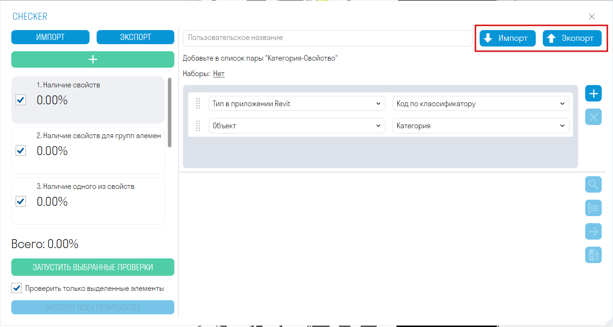
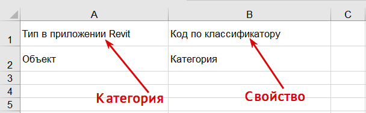
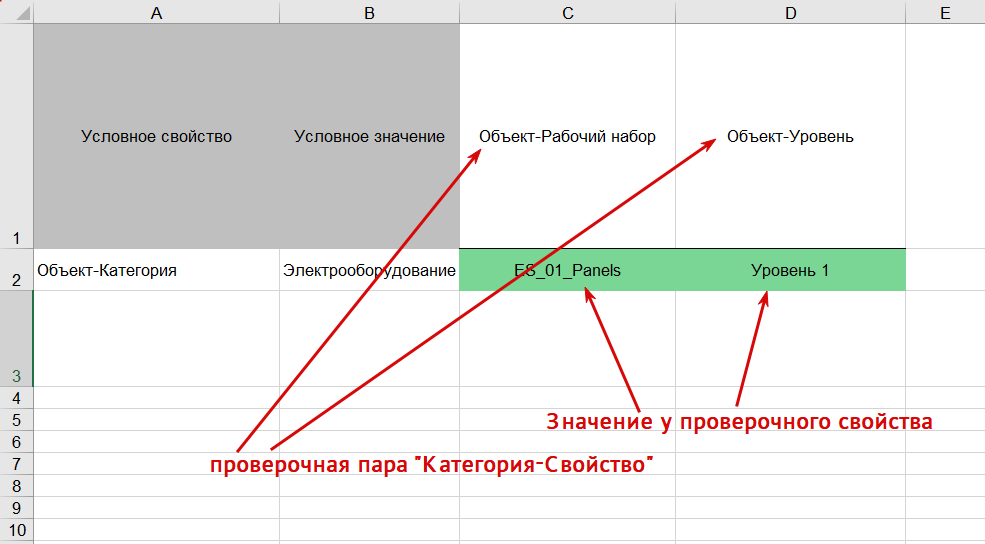

**[<   TOOLS FOR NAVIS. Панель](/ru/tools/navis/panel)     **|**     [TOOLS FOR NAVIS. Согласования   >](/ru/tools/navis/approval)**

---

> Комплексный инструмент, позволяющий проверять модель на наличие свойств, заполненность значений свойств, на пересечения (Clash Detective), наличие элементов и т.д.
{.is-info}

# Вкладки{.tabset}
## Окно Checker
Окно Checker разделено на 3 зоны: проверки, правила и результаты

1.  Добавьте одну из шести проверок, нажав  .
2.  Добавьте правила и запустите проверку, нажав “ЗАПУСТИТЬ ВЫБРАННЫЕ ПРОВЕРКИ”.
3.  Просматривайте в модели элементы с ошибками, чтобы составить замечания. Выгружайте результаты проверок в Excel или XML. XML можно подгрузить в Revit , чтобы быстро найти элементы с ошибками и исправить их. Сравнивайте результаты с результатами предыдущей проверки, чтобы увидеть, какие замечания были исправлены.

#### Зона проверок

> В этой зоне отображается процент выполненных проверок, количество элементов прошедших и не прошедших проверку.
{.is-info}

-   **Нажмите “Добавить проверку”** , чтобы добавить одну из шести проверок
-   **“ЭКСПОРТ”** позволяет выгрузить в XML все проверки с их правилами. Вы можете отправить данный файл с проверками своим коллегам.
-   **“ИМПОРТ”** позволяет загрузить XML файл с проверками.
-   **“ЗАПУСТИТЬ ВЫБРАННЫЕ ПРОВЕРКИ”** запускает проверку напротив которой стоит галочка.
-   **Переключатель “Проверить только выделенные элементы”** позволяет проверить только выделенные в модели элементы
-   **“ЭКСПОРТ ВСЕХ РЕЗУЛЬТАТОВ”** позволяет выгрузить результаты всех проверок в один Excel файл, который можно передать коллегам для исправления элементов, которые не прошли проверку

#### Зона правил

> В этой зоне создаются правила, по которым будет происходить проверка.
{.is-info}

-   **“ЭКСПОРТ”** позволяет выгрузить правила проверки в Excel файл. Данный файл можно дополнить правилами и загрузить обратно в Checker или отправить его коллегам.
-   **“ИМПОРТ”** позволяет загрузить Excel файл с правилами проверки.
  
  

#### Зона результатов

> В этой зоне отображаются результаты проверки в виде названия элементов и описания причины, почему элементы не прошли проверку.
{.is-info}

-   **Нажмите “Выбрать все”** , чтобы выделить в модели все элементы не прошедшие проверку.
-   **Нажмите**  рядом с результатом, чтобы выделить в модели один или группу элементов не прошедших проверку.
-   **Нажмите “Сгруппировать результаты”** , чтобы сгруппировать результаты проверок по повторяющимся названиям элементов и описаниям результатов. Таким образом, количество позиций в списке уменьшится и будет проще посмотреть в модели элементы не прошедшие проверку.
-   **Нажмите “Экспорт результатов”**  , чтобы выгрузить результаты проверки в формате Excel или XML. XML можно подгрузить в Revit с помощью команды “Результат проверки” и посмотреть в каких элементах требуется исправить замечания. Также после исправления замечаний данный XML можно сравнить с новыми результатами через команду “Сравнить”.
-   **Нажмите “Сравнить”** и загрузите XML файл с результатами предыдущей проверки, чтобы посмотреть какие замечания были устранены.

### Проверки Checker

# Вкладки{.tabset}
## 1.Наличие свойств

> Проверяет заполненность значения проверочного свойства. Подходит для проверки свойств, которые должны быть заполнены у всех элементов модели.
{.is-info}

Например, проверим, что свойство “Код по классификатору” заполнено у всех элементов

Добавьте свойство в виде пары “Категория-Свойство” и запустите проверку.

Правила к данной проверке можно создать в таблице Excel:

  

-   В столбце A укажите категорию свойства, в столбце B — название свойства, например “Тип в приложении Revit” и “Код по классификатору”.
-   Каждое проверочное свойство указывайте на отдельной строке.
-   Сохраните файл и в зоне правил нажмите **“ИМПОРТ”**.
  
  **Шаблоны можно скачать по следующей ссылке:**

[SGNL_Navis_Checker_Template_Check_1.xlsx](https://docs.sgnl.pro/s/f/01a1a1a3-eee7-7e29-846d-fecb4f0a0b4b)
  
# Вкладки{.tabset}
## 2.Наличие свойств для групп элементов

> Проверяет, что у всех элементов модели, содержащих условное свойство с определенным значением, заполнены проверочные свойства. (В данном контексте условное свойство - это свойство, которое задает начальное условие: Если свойство “Категория” имеет значение “Стены”. Проверочные свойства - это свойства, которые проверяются на наличие заполненного значения.)
{.is-info}

Например, проверим, что у элементов с кодом классификатора “Е2.4.2” и “Е2.3.1.1” заполнены проверочные свойства ”Этаж” и “Корпус”.

-   Добавьте условное свойство в виде пары “Категория-Свойство” и значение данного свойства.
-   Добавьте проверочные свойства в виде пары “Категория-Свойство”

Данную проверку можно запустить на определенный поисковый набор - выбрать его можно нажав на “Наборы” в верхней части зоны правил:

По умолчанию проверка запустится по всем элементам модели, либо по выделенным, если это указано перед запуском.

Правила к данной проверке удобнее создавать в таблице Excel:

-   В столбце A (Условное свойство) перечислите условные свойства в виде пары “Категория-Свойство” через дефис без пробелов, а в столбце B (Условное значение) укажите значения для данных условных свойств.

-   Далее в строке 1 начиная со столбца C перечислите проверочные свойства в виде пары “Категория-Свойство” через дефис без пробелов.
-   Затем заполните ячейки в матрице любыми значениями, например, “1”, чтобы привязать проверочное свойство к условному свойству.
-   Таким образом, получится: “Если свойство “Категория” имеет значение “Стены”, то проверить на заполненность свойства “Имя”, “MP\_Корпус” и т.д.”
-   Сохраните файл и в зоне правил нажмите **“ИМПОРТ”**.

Также можно проверять по другим условиям, например по Коду классификатора

**Шаблоны можно скачать по следующей ссылке:**

[SGNL_Navis_Checker_Template_Check_2.xlsx](https://docs.sgnl.pro/s/f/01a1a1a3-eee7-7e29-846d-fecb4f0a0b4b)

# Вкладки{.tabset}
## 4.Заполненность значений свойств для групп элементов

> Проверяет, что у всех элементов модели, содержащих условное свойство с определенным значением, проверочные свойства имеют конкретное значение.
> 
{.is-info}

Например, проверим, что у элементов с условным свойством “Категория”, имеющим значение “Стены”, проверочное свойство “Толщина” равно “0,200”

-   Добавьте условное свойство в виде пары “Категория-Свойство” и значение данного свойства.

-   Добавьте проверочное свойство в виде пары “Категория-Свойство” и значение, которое должно быть у данного свойства.

Правила к данной проверке можно создать в таблице Excel:
  
  

-   В столбце A (Условное свойство) перечислите условные свойства в виде пары “Категория-Свойство” через дефис без пробелов, а в столбце B (Условное значение) укажите значения для данных условных свойств.
-   Далее в строке 1 начиная со столбца C перечислите проверочные свойства в виде пары “Категория-Свойство” через дефис без пробелов.
-   На пересечении строки условного свойства и столбца проверочного свойства укажите значение, которое должно быть у проверочного свойства. Ячейки свойств, которые не нужно проверять, оставьте пустыми.
-   Таким образом, получится: “Если свойство “Категория” имеет значение “Электрооборудование”, то свойство “Рабочий набор” должно иметь значение “ES\_01\_Panels””.
-   Сохраните файл и в зоне правил нажмите **“ИМПОРТ”**.
  
  **Шаблоны можно скачать по следующей ссылке:**

[SGNL_Navis_Checker_Template_Check_4.xlsx](https://docs.sgnl.pro/s/f/01a1a1a3-eee7-7e29-846d-fecb4f0a0b4b)

#
**[<   TOOLS FOR NAVIS. Панель](/ru/tools/navis/panel)     **|**     [TOOLS FOR NAVIS. Согласования   >](/ru/tools/navis/approval)**